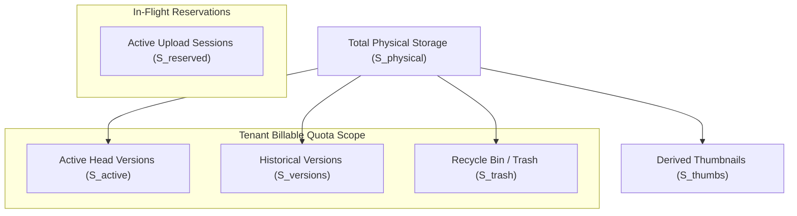

# MASTERHRMS — PHASE F4 IMPLEMENTATION PLAN
## File Manager: Storage Administration, Quota Dashboards & Analytics

**Phase:** F4  
**Status:** APPROVED & IN EXECUTION  
**Baseline:** Phases F1, F2, F3 verified with 100% PASS  
**Execution Order:** Audit → Plan → Implement → Test → Browser QA → Report → STOP  

---

## 1. Executive Summary & Pre-Implementation Audit Findings

This implementation plan establishes the architectural blueprint for the **MasterHRMS Storage Administration, Quota Dashboards & Analytics** module (Phase F4).

### Key Audit Findings & Baseline Verification
1. **Existing Quota & Usage Foundation:**
   - [`StorageQuota`](file:///c:/Users/TSV%20Global%20Solutions/Documents/hrms/server/prisma/schema.prisma#L5064) contains 246 records using `userId: "tenant_pool"` for tenant-level quotas.
   - [`StorageUsage`](file:///c:/Users/TSV%20Global%20Solutions/Documents/hrms/server/prisma/schema.prisma#L5077) contains 247 records tracking `usedBytes`, `reservedBytes`, `trashBytes`, and `fileCount` as `BigInt`.
   - Plan quotas are strictly configured: **Starter (10 GB)**, **Growth (25 GB)**, **Sovereign (100 GB)**, and **Custom (500 GB)**.
   - User quotas default to **5 GB** (`DEFAULT_USER_QUOTA_BYTES = 5368709120`).
2. **Canonical Tenant Pool Identifier:**
   - Both `userId: null` and `userId: "tenant_pool"` must be harmonized transparently so that existing migrated records and new queries resolve identically.
3. **Additive Models Required:**
   - `StorageSnapshot`: Captures daily/periodic snapshots for genuine forward-looking trend and growth analytics without fabricating historical data.
   - `StorageAlertState`: Tracks threshold transitions (70%, 85%, 95%, 100%) and prevents alert spam on dashboard refreshes.

---

## 2. Authoritative Accounting Rules & Mathematical Formulas

### 2.1 Multi-Dimensional Byte Taxonomies



### 2.2 Mathematical Formulas

1. **Active Storage ($S_{\text{active}}$):**
   $$S_{\text{active}}(T) = \sum \{ \text{fileSize} \mid \text{tenantId} = T \land \text{status} = \text{'ACTIVE'} \land \text{deletedAt IS NULL} \land \text{isFolder} = \text{false} \}$$
2. **Recycle Bin Storage ($S_{\text{trash}}$):**
   $$S_{\text{trash}}(T) = \sum \{ \text{fileSize} \mid \text{tenantId} = T \land (\text{status} = \text{'TRASHED'} \lor \text{deletedAt IS NOT NULL}) \land \text{isFolder} = \text{false} \}$$
3. **Historical Versions Storage ($S_{\text{versions}}$):**
   $$S_{\text{versions}}(T) = \sum \{ \text{sizeBytes} \mid \text{FileVersion.isCurrent} = \text{false} \land \text{FileVersion.file.tenantId} = T \}$$
4. **Reserved In-Flight Capacity ($S_{\text{reserved}}$):**
   $$S_{\text{reserved}}(T) = \sum \{ \text{sizeBytes} \mid \text{FileUploadSession.status} = \text{'INITIATED'} \land \text{expiresAt} > \text{now()} \land \text{tenantId} = T \}$$
5. **Effective Quota Limit ($Q_{\text{effective}}$):**
   $$Q_{\text{effective}}(T) = \begin{cases} 
   \text{StorageQuota.quotaBytes} & \text{if explicit override exists} \\
   \text{TenantSubscription.storageLimitGb} \times 1024^3 & \text{if set on subscription} \\
   \text{SubscriptionPlan.storageLimitGb} \times 1024^3 & \text{if set on plan} \\
   \text{PLAN\_CAPACITIES}[\text{planId}] \times 1024^3 & \text{fallback (Starter: 10 GB)}
   \end{cases}$$
6. **Available Runway ($S_{\text{available}}$):**
   $$S_{\text{available}}(T) = \max(0, Q_{\text{effective}}(T) - (S_{\text{active}}(T) + S_{\text{reserved}}(T)))$$
7. **Utilization Percentage ($U_{\text{pct}}$):**
   $$U_{\text{pct}}(T) = \min\left(100, \text{round}\left(\frac{S_{\text{active}}(T) + S_{\text{reserved}}(T)}{Q_{\text{effective}}(T)} \times 100, 1\right)\right)$$

### 2.3 Scope Governance Rules
- **Platform Media Isolation:** Files where `tenantId = NULL` belong to the platform (system branding, default avatars) and are 100% isolated from tenant quotas.
- **Team Folders:** Team folders (`ownerType = 'TEAM'`) consume the **Tenant Storage Pool**, but do NOT consume the uploading user's personal 5 GB quota.
- **Personal Files:** Only files where `ownerType = 'USER' AND ownerId = userId` consume the user's personal 5 GB quota.
- **Permanent Purge:** Decrements `trashBytes` (or `usedBytes`) and decrements `fileCount`.

---

## 3. Database Schema Extensions (Additive Only)

To satisfy historical trend analytics and deduplicated threshold alerting, the following two additive models are added to `server/prisma/schema.prisma`:

```prisma
model StorageSnapshot {
  id               String   @id @default(uuid()) @db.VarChar(36)
  tenantId         String?  @map("tenant_id") @db.VarChar(36) // null = platform aggregate
  usedBytes        BigInt   @map("used_bytes")
  trashBytes       BigInt   @map("trash_bytes")
  versionBytes     BigInt   @default(0) @map("version_bytes")
  reservedBytes    BigInt   @default(0) @map("reserved_bytes")
  fileCount        Int      @default(0) @map("file_count")
  folderCount      Int      @default(0) @map("folder_count")
  quotaBytes       BigInt   @map("quota_bytes")
  snapshotDate     DateTime @map("snapshot_date") @db.Date
  createdAt        DateTime @default(now()) @map("created_at")

  @@unique([tenantId, snapshotDate])
  @@index([snapshotDate])
  @@map("storage_snapshots")
}

model StorageAlertState {
  id               String    @id @default(uuid()) @db.VarChar(36)
  tenantId         String    @map("tenant_id") @db.VarChar(36)
  currentLevel     String    @default("NORMAL") @map("current_level") @db.VarChar(20) // NORMAL | WARNING_70 | HIGH_85 | CRITICAL_95 | LOCKED_100
  lastNotifiedLevel String   @default("NORMAL") @map("last_notified_level") @db.VarChar(20)
  lastNotifiedAt   DateTime? @map("last_notified_at")
  resolvedAt       DateTime? @map("resolved_at")
  updatedAt        DateTime  @updatedAt @map("updated_at")

  @@unique([tenantId])
  @@map("storage_alert_states")
}
```

---

## 4. Backend Architecture & API Surface

### 4.1 Storage Administration Service (`server/src/services/files/storage-admin.service.ts`)
- `getPlatformOverview(filters)`: Aggregates fleet-wide storage, allocated capacity, tenant rankings, top users, at-risk tenants, and plan distribution.
- `getTenantStorageSummary(tenantId)`: Computes tenant active, trash, versions, reserved, effective quota, breakdown by user and team, and category distribution.
- `getStorageGrowthAnalytics(tenantId | null, period)`: Returns real historical snapshots and daily upload/deletion volume.
- `calculateCapacityForecast(tenantId | null)`: Computes linear runway estimate, clearly marked as `isEstimate: true`.
- `checkAndDispatchAlerts(tenantId, currentPct)`: Evaluates 70%, 85%, 95%, 100% thresholds, deduplicates against `StorageAlertState`, and emits `OutboxEvent` and notifications.

### 4.2 Storage Reconciliation Service (`server/src/services/files/storage-reconciliation.service.ts`)
- `auditTenantStorage(tenantId)`: Compares `StorageUsage` against live `MediaFile` and `FileVersion` sums; checks for expired `FileUploadSession`s.
- `repairTenantStorage(tenantId, dryRun)`: Safe, transactional repair logging before/after state and emitting audit events.

### 4.3 REST API Routes
- Super Admin: Mounted under `/api/v1/super/storage/*` (protected by `requireAuth` + `requireSuperAdmin`).
  - `GET /api/v1/super/storage/overview`
  - `GET /api/v1/super/storage/tenants`
  - `GET /api/v1/super/storage/analytics`
  - `POST /api/v1/super/storage/reconcile`
- Tenant Admin: Mounted under `/api/v1/tenant/storage/*` (protected by `requireAuth` + `requireTenantAdmin`).
  - `GET /api/v1/tenant/storage/summary`
  - `GET /api/v1/tenant/storage/breakdown`
  - `GET /api/v1/tenant/storage/analytics`
  - `GET /api/v1/tenant/storage/users`
  - `GET /api/v1/tenant/storage/teams`
  - `POST /api/v1/tenant/storage/reconcile`

---

## 5. Frontend UI Architecture & Dashboard Layouts

### 5.1 Super Admin Dashboard (`CMS/src/app/super/files/storage/page.tsx`)
- Platform KPI Cards: Total Fleet Storage, Subscribed Allocation, Fleet Utilization, Total Files/Folders.
- Fleet Capacity Radial Gauge & stacked composition.
- Plan Distribution Chart (Starter, Growth, Sovereign, Custom).
- Tenants Table with search, plan filters, status filter, utilization progress bars, and "Inspect Storage" modal.
- At-Risk Tenants Radar highlighting accounts exceeding 70%, 85%, 95%.
- Global Storage Growth Chart (ApexCharts area).

### 5.2 Tenant Admin Dashboard (`CMS/src/app/(workspace)/tenant/files/storage/page.tsx`)
- Tenant KPI Cards: Used Active, Recycle Bin Reclaimable, Version History, Reserved In-Flight, Available Runway.
- Quota Utilization Dial with color state (Normal $<70\%$, Warning $70\%-84\%$, High $85\%-94\%$, Critical $\ge 95\%$).
- Quota Threshold Alerts Banner (dismissible, deduplicated).
- File Category & MIME Distribution Donut Chart.
- User Consumption Leaderboard with search and pagination.
- Team Shared Folders Storage Table.
- Reconciliation & Integrity Audit Card with "Verify Storage Integrity" trigger.

### 5.3 Navigation Shell Integration
- `CMS/src/components/layout/SuperShell.tsx`: Add `{ to: '/super/files/storage', label: 'Storage Administration', iconClass: 'ph-hard-drive', group: 'System Controls' }`.
- `CMS/src/components/layout/WorkspaceShell.tsx`: Add `{ title: 'Storage Administration', url: '/tenant/files/storage', group: 'Platform', icon: HardDrive }`.
- Complete dual-workspace sync between `CMS/` and `src/`.

---

## 6. Verification & Quality Assurance Strategy

1. **Automated Integration & Unit Suite (`scripts/verify_file_manager_f4_e2e.cjs`):**
   - 18 test checkpoints matching section 12 of the authorization.
2. **Browser QA with Playwright (`scripts/verify_file_manager_f4_browser_qa.cjs`):**
   - Authenticated Super Admin inspection of `/super/files/storage`.
   - Authenticated Tenant Admin inspection of `/tenant/files/storage`.
   - Verification of charts, tables, filters, quota dials, and responsive layouts.
   - Capture of 6 visual QA screenshots in `docs/Saas/screenshots/files_f4/`.
3. **Regression Safety Gates:**
   - Execute F1 regression (`scripts/verify_file_manager_f1_e2e.cjs`) $\rightarrow$ 100% PASS.
   - Execute F2 browser QA (`scripts/verify_file_manager_f2_browser_qa.cjs`) $\rightarrow$ 100% PASS.
   - Execute F3 collaboration suite (`scripts/verify_file_manager_f3_e2e.cjs`) $\rightarrow$ 100% PASS.
   - Server TypeScript: `npx tsc -p server/tsconfig.json --noEmit` $\rightarrow$ 0 errors.
   - CMS TypeScript: `npx tsc -p CMS/tsconfig.json --noEmit` $\rightarrow$ 0 errors.

---
*Implementation Plan finalized. Proceeding to Step 1: Database additive models and migrations.*

