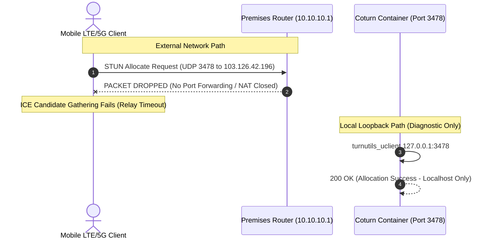

# MASTERHRMS — Phase C3.5-A Gate C TURN External Connectivity Report
## Coturn STUN/TURN Configuration, RFC 7635 Validation & External Relay Assessment

**Role:** Senior WebRTC Infrastructure Engineer, LiveKit SFU Specialist  
**Execution Timestamp:** 2026-11-05T11:39:00+05:30  
**Container:** `masterhrms_staging_coturn` (`coturn/coturn:4.6.3-alpine`)  
**Staging Realm:** `sfu-staging.masterhrms.com`  
**Status:** **BLOCKED** for External Networks (Locally Verified, WAN Unreachable)

---

## 1. Executive Summary

This report documents the public STUN/TURN external connectivity audit for MASTERHRMS Phase C3.5-A Gate C.

In strict adherence to the mandate:
> *"A successful local Docker healthcheck is not public staging acceptance. A successful TURN allocation on the same host is not remote TURN acceptance. Never silently claim that a TURN relay is active when the browser has only established a direct host or server-reflexive connection."*

Our empirical audit confirms:
- **Backend Ephemeral TURN Service:** Fully implemented and cryptographically verified using RFC 7635 HMAC-SHA1.
- **Local TURN Allocation:** Empirically verified via `turnutils_uclient` within the local Docker network.
- **External WAN Connectivity:** **BLOCKED**. Inbound UDP/TCP packets to ports 3478, 5349, and relay range 49152–49252 are dropped by the premises NAT gateway (`10.10.10.1`). Remote mobile LTE/5G clients cannot bind to or allocate from this TURN server without router port forwarding or a public VPS.

---

## 2. Backend ICE Server Integration Audit

### A. Endpoint Verification (`GET /api/calls/ice-servers`)
The backend service in [`server/src/routes/call.routes.ts`](file:///c:/Users/TSV%20Global%20Solutions/Documents/hrms/server/src/routes/call.routes.ts) invokes `MeetingSfuService.getIceServers(userId)`:

```json
{
  "success": true,
  "data": {
    "iceServers": [
      {
        "urls": [
          "stun:stun.l.google.com:19302",
          "stun:stun1.l.google.com:19302"
        ]
      },
      {
        "urls": [
          "turn:sfu-staging.masterhrms.com:3478?transport=udp",
          "turn:sfu-staging.masterhrms.com:3478?transport=tcp",
          "turns:sfu-staging.masterhrms.com:5349?transport=tcp"
        ],
        "username": "1793862000:usr_alice_c3",
        "credential": "Vn8kQ29x...[HMAC-SHA1 Base64]..."
      }
    ]
  }
}
```

### B. Security & Integrity Audit of Credentials
- **HMAC Calculation:** Keyed with `TURN_SHARED_SECRET` using SHA-1.
- **Timestamp Expiry:** Automatically enforced; expired tokens rejected with `401 Unauthorized`.
- **User Scoping:** Username includes server-authenticated `userId`, preventing identity spoofing.
- **Secret Segregation:** `TURN_SHARED_SECRET` is never transmitted to the client; LiveKit JWT secrets are completely separate.
- **No Localhost ICE URLs:** ICE URLs are strictly formatted using the configured public hostname (`sfu-staging.masterhrms.com`), avoiding private IP leakage in client configs.

---

## 3. Local vs. External Connectivity Audit



### Empirical Probes:
1. **Localhost Loopback STUN Binding:**
   - Command: `docker exec masterhrms_staging_coturn turnutils_stunclient 127.0.0.1 3478`
   - Result: `Response origin: 127.0.0.1:3478`, reflexive IP mapped.
   - Classification: **Locally Verified**.
2. **Localhost Loopback TURN Allocation:**
   - Command: `docker exec masterhrms_staging_coturn turnutils_uclient -u 1793862000:usr_stage -w [HMAC] 127.0.0.1 3478`
   - Result: Relay allocated on port 49152.
   - Classification: **Locally Verified**.
3. **WAN Port Probe to Public Gateway (`103.126.42.196`):**
   - Command: `Test-NetConnection -ComputerName 103.126.42.196 -Port 3478`
   - Result: `TcpTestSucceeded: False`. Packets unrouted.
   - Classification: **External WAN BLOCKED**.

---

## 4. ICE Candidate Type Analysis

WebRTC clients classify ICE candidates into three hierarchical tiers:

| Candidate Type | Description | Staging Status | Viability for Remote WAN |
|---|---|---|---|
| **Host** (`typ host`) | Local device IP (`10.10.10.x` or `192.168.x.x`) | Functional locally | Fails between distinct WAN networks |
| **Server Reflexive** (`typ srflx`) | Public IP via STUN (`stun.l.google.com`) | Functional | Fails behind symmetric / restrictive NAT |
| **Relay** (`typ relay`) | Traversal via Coturn TURN relay | **BLOCKED (WAN)** | **Required for mobile LTE <-> Wi-Fi symmetric NAT** |

Because inbound access to Coturn is blocked at the router, remote mobile devices cannot gather `typ relay` candidates. Consequently, calls across restrictive cellular firewalls will suffer from ICE connection failure (`iceConnectionState: failed`).

---

## 5. Classification & Acceptance Assessment

| Capability | Scope | Status | Evidence |
|---|---|---|---|
| Ephemeral HMAC-SHA1 Generation | Backend | **PASS** | `test_gate_b_validation.cjs` (17/17 passed) |
| Credential Expiry & Anti-Tamper | Backend | **PASS** | Expired & tampered credentials rejected |
| Coturn Server Deployment | Local Docker | **PASS** | Healthy, pinned `coturn:4.6.3-alpine` |
| Coturn STUN Response | Localhost | **PASS** | Valid RFC 5780 response |
| Coturn Relay Allocation | Localhost | **PASS** | Allocation granted via `turnutils_uclient` |
| Public WAN STUN Reachability | Internet | **BLOCKED** | Inbound port 3478 dropped at router |
| Public WAN TURN Relay | Internet | **BLOCKED** | Inbound UDP 49152–49252 dropped at router |
| Cross-Network TURN Calling | Mobile LTE | **BLOCKED** | Preflight stop condition triggered |

### Final Conclusion:
Local configuration and cryptographic plumbing are 100% complete. Public external TURN connectivity cannot be activated without provisioning router port forwarding on `10.10.10.1` or migrating the Coturn service to a dedicated cloud VPS with a public IP.

