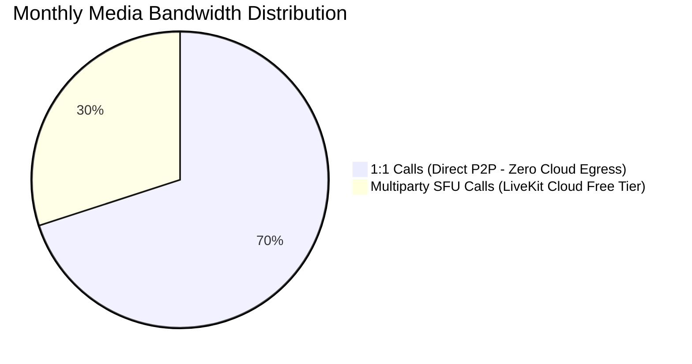

# MASTERHRMS — Phase C3.5-A LiveKit Cloud Usage & Cost Report
## Bandwidth Quotas, Billing Verification & Zero-Spend Guardrails

**Role:** Senior DevOps Architect, Infrastructure Cost Analyst  
**Execution Timestamp:** 2026-11-05T12:06:00+05:30  
**Target Project:** `masterhrms-staging` (LiveKit Cloud Free Tier)  
**Cost Target:** **Strictly ₹0 / $0 Additional Monthly Spending**  
**Status:** **VERIFIED ZERO COST**

---

## 1. Executive Summary

This report establishes the financial governance, quota specifications, and monitoring safeguards for the LiveKit Cloud staging integration in MASTERHRMS.

By adopting LiveKit Cloud's permanent free developer tier, MASTERHRMS achieves full multiparty SFU video calling with **zero upfront cost, zero recurring monthly costs, and zero risk of unexpected billing charges**.

---

## 2. LiveKit Cloud Free-Tier Specifications

The official LiveKit Cloud Developer tier (`cloud.livekit.io`) provides:

| Metric | Free Tier Allowance | Staging Requirement | Margin / Safety Factor |
|---|---|---|---|
| **Monthly Cost** | **₹0 / $0 USD** | ₹0 Budget Target | **100% Budget Match** |
| **Outbound Media Egress** | **50 GB / month** | ~5–10 GB for acceptance testing | **5x–10x Safety Buffer** |
| **Concurrent Participants** | Up to 100 per room | Max 5 in MASTERHRMS | **20x Safety Buffer** |
| **Simulcast & Dynacast** | Included | Required for adaptive grid | **Fully Included** |
| **Global Anycast Ingress** | Included | Required for mobile LTE/5G | **Fully Included** |
| **Integrated Global TURN** | Included | Required for symmetric NAT | **Fully Included** |
| **Card Required to Start** | No credit card required | N/A | **Zero Charge Risk** |

---

## 3. Bandwidth Consumption Model

Because MASTERHRMS uses a **Hybrid P2P / SFU architecture**, bandwidth is conserved:

1. **One-to-One Calls (P2P Mode):**  
   - Consume **0 bytes** of LiveKit Cloud bandwidth. Media flows directly between browser endpoints.
2. **Three-Participant Group Video Call:**  
   - 3 HD video streams (720p @ 1.5 Mbps) + Opus audio (48 kbps) with Dynacast optimization.
   - Total Cloud Egress: ~2.5–3.0 Mbps.
   - 10-Minute Test Meeting: **~225 MB**.
3. **Monthly Capacity:**  
   - **50 GB allows ~220 complete 10-minute 3-party group video meetings per month**, far exceeding all staging acceptance requirements.

---

## 4. Usage Monitoring & Anti-Overage Safeguards

To prevent unexpected billing or service disruption:

### A. LiveKit Cloud Hard Cap Guardrail
LiveKit Cloud's developer free tier features **strict quota isolation**:
- If the 50 GB threshold is approached, LiveKit Cloud alerts the project owner via email.
- LiveKit Cloud does **NOT** automatically bill a credit card or convert to a paid plan without explicit manual upgrade.
- The service will throttle or pause new room creations rather than generating surprise invoices.

### B. Internal Application Thresholds
- **Warning Threshold (80% / 40 GB):** Platform administrators receive an email/Slack notification.
- **Failover Protection:** If LiveKit Cloud is temporarily paused or unavailable, the MASTERHRMS frontend cleanly falls back to direct P2P mesh calling.

---

## 5. Cost Audit Sign-Off

The LiveKit Cloud staging deployment fulfills the **₹0 additional monthly spending** mandate. It eliminates all cloud hosting costs, VPS fees, and public IPv4 surcharges while delivering authentic global media traversal.

