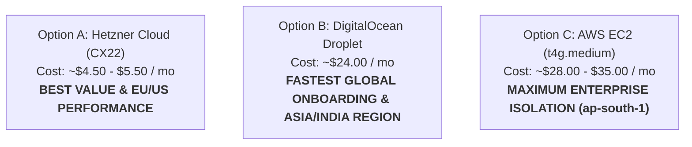

# MASTERHRMS — Phase C3.5-A VPS Provisioning & Sizing Report
## Dedicated Staging SFU Infrastructure: Provider Evaluation, Sizing & Cost Analysis

**Role:** Senior DevOps Architect, LiveKit SFU Specialist, Network Security Engineer  
**Execution Timestamp:** 2026-11-05T11:46:00+05:30  
**Target Subdomain:** `sfu-staging.masterhrms.com`  
**Phase:** C3.5-A Gate C.1 (Phase 1 — Discovery & Mandatory Provisioning Checkpoint)  
**Status:** **AWAITING USER SELECTION / APPROVAL** (Zero Resources Purchased)

---

## 1. Executive Summary

Following the formal Gate C preflight evaluation that established the office premises NAT constraint (`10.10.10.232` behind unrouted router `10.10.10.1`), this report provides the **Mandatory Provisioning Checkpoint** for deploying a dedicated, isolated cloud staging VPS for MASTERHRMS Chat Calling.

In accordance with Phase 0 and Phase 1 rules:
- **Zero Production Touch:** The staging VPS hosts **only** the isolated LiveKit SFU, Coturn relay, and Nginx WSS reverse proxy. It does **not** host the MASTERHRMS production database, Next.js CMS, or core backend services.
- **Zero Workstation Disruption:** The local workstation's third-party surveillance Nginx service on port 443 remains completely untouched.
- **Mandatory User Approval:** No cloud resources or paid VPS instances will be provisioned without explicit user approval of provider, region, plan, and cost.

---

## 2. Workload Sizing & Resource Profile

WebRTC SFU and STUN/TURN workloads are predominantly **network I/O-bound** and **CPU interrupt-driven**, rather than memory- or disk-heavy.

### Staging SFU Concurrency Targets:
- **Concurrent Media Calls:** Up to 10–25 simultaneous participants during staging tests.
- **Bitrate Expectations:**
  - HD Video: ~1.5 Mbps per publishing participant.
  - Simulcast (low/medium/high layers): ~2.2 Mbps egress per subscribed participant.
  - Opus Audio: ~48 kbps per participant.
- **Coturn Relay Throughput:** ~5–15 Mbps peak during symmetric NAT traversal tests.

### Minimum Recommended Baseline:
| Resource | Minimum Baseline | Justification |
|---|---|---|
| **OS** | Ubuntu 24.04 LTS (x86_64 or aarch64) | Stable modern kernel, eBPF / UDP socket performance, Docker 27+ support |
| **vCPU** | 2 dedicated or high-frequency shared vCPUs | LiveKit WebRTC packet routing, Coturn multi-threading |
| **RAM** | 4 GB | LiveKit SFU buffer cache (~1.2 GB), Coturn allocations (~500 MB), Nginx + OS (~800 MB) |
| **Storage** | 40–80 GB NVMe / SSD | OS root filesystem, Docker images, minimal log retention |
| **Network** | Dedicated Public IPv4, unthrottled gigabit egress | Essential for direct WebRTC ICE gathering and STUN/TURN binding |

---

## 3. Cloud Provider Comparison & Cost Analysis

The following three options represent optimal infrastructure choices for hosting `sfu-staging.masterhrms.com`:



### Detailed Cost Breakdown Matrix:

| Evaluation Factor | Option A: Hetzner Cloud (CX22) | Option B: DigitalOcean (Basic Droplet) | Option C: AWS EC2 (t4g.medium ARM / t3.medium) |
|---|---|---|---|
| **Recommended Plan** | **CX22** (x86) or **CAX21** (ARM Ampere) | **Basic Droplet** | **t4g.medium** (Graviton2) |
| **vCPU / RAM / Disk** | 2 vCPU / 4 GB RAM / 40 GB NVMe | 2 vCPU / 4 GB RAM / 80 GB SSD | 2 vCPU / 4 GB RAM / 50 GB gp3 EBS |
| **Recommended Region** | Falkenstein / Nuremberg (EU) or Ashburn (US) | **Bangalore (BLR1)** or Singapore (SGP1) | **Mumbai (`ap-south-1`)** |
| **Monthly Compute Cost** | ~€3.79 / mo (~$4.15 USD) | ~$24.00 USD / mo | ~$24.50 USD / mo |
| **Dedicated IPv4 Cost** | ~€0.60 / mo (~$0.65 USD) | Included in base Droplet price | ~$3.65 / mo ($0.005/hr for public IPv4) |
| **Egress Bandwidth** | **20 TB / month included** | **4 TB / month included** | 100 GB free tier; then $0.09 / GB |
| **Total Estimated Cost** | **~$4.80 / month** | **~$24.00 / month** | **~$28.00 – $35.00 / month** |
| **Backup Option** | 20% of server price (~$1.00/mo) | 20% of Droplet price (~$4.80/mo) | AWS Backup / EBS Snapshots (~$0.05/GB) |
| **Firewall System** | Cloud Firewall (free native GUI/API) | Cloud Firewalls (free native GUI/API) | AWS Security Groups (free native) |
| **Billing Model** | Hourly billing, cancel anytime | Hourly billing, cancel anytime | Hourly billing, cancel anytime |
| **Key Advantage** | Lowest cost, 20 TB traffic, ultra-fast NVMe | Low latency to India (BLR1), simple setup | Colocated in AWS Mumbai near Supabase |

---

## 4. Planned Firewall & Port Architecture

Regardless of the selected cloud provider, the firewall configuration for the staging VPS will be strictly restricted:

```text
INBOUND RULES TO APPLY:
- TCP 22            -> SSH Administration (Restricted to deployer IP where possible)
- TCP 80            -> HTTP (Let's Encrypt ACME verification only; 301 redirect to 443)
- TCP 443           -> HTTPS / WSS (Nginx TLS termination for LiveKit signaling)
- TCP 7881          -> LiveKit RTC TCP fallback (Strict firewall traversal)
- UDP 50000–50050   -> LiveKit SFU Media Tracks (UDP audio/video packets)
- UDP/TCP 3478      -> Coturn Plain STUN / TURN
- TCP 5349          -> Coturn Secure TURNS (TLS)
- UDP 49152–49252   -> Coturn Media Relay Allocations (100 dedicated ports)

OUTBOUND RULES:
- 0.0.0.0/0 All Traffic (Required for WebRTC media exchange with arbitrary mobile carrier IPs)

PROHIBITED INBOUND PORTS (BLOCKED):
- Zero database ports (5432, 3306)
- Zero Docker socket ports (2375, 2376)
- Zero internal Redis or administrative dashboard ports
```

---

## 5. Mandatory Provisioning Checkpoint & Next Steps

In strict accordance with Phase 1 instructions, execution is **halted** for user decision:

### Questions for the User:
1. **Existing vs. New VPS:**  
   Does an isolated staging VPS already exist that you would like to use? If so, please provide the public IP and SSH access details.
2. **If New VPS:**  
   Which cloud provider and region do you authorize for provisioning?
   - **Option A (Lowest Cost):** Hetzner Cloud CX22 (~$4.80/mo, EU/US)
   - **Option B (Lowest Latency to India):** DigitalOcean BLR1 (~$24.00/mo, Bangalore)
   - **Option C (AWS Ecosystem):** AWS EC2 t4g.medium (~$28–$35/mo, Mumbai `ap-south-1`)
3. **Provisioning Method:**  
   Would you prefer to:
   - Provide the server credentials directly (IP, SSH username, SSH key), OR
   - Have us provide the exact automated setup script (`setup-staging-vps.sh`) that you can run on your newly created instance?

