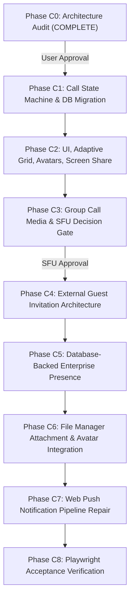

# MASTERHRMS — CHAT, CALLING, PRESENCE & PUSH NOTIFICATIONS
## PHASE C0: COMPLETE READ-ONLY ARCHITECTURE & ROOT-CAUSE AUDIT REPORT

**Audit Date:** November 4, 2026  
**Auditor:** Senior Full-Stack Architect & Production Reliability Engineer  
**Branch:** `chore/repository-cleanup-and-size-optimization`  
**Base Commit:** `656eadbb`  
**Execution Phase:** **PHASE C0 ONLY (READ-ONLY AUDIT & ROOT-CAUSE ANALYSIS)**  
**Status:** **AUDIT COMPLETE — AWAITING USER APPROVAL PRIOR TO IMPLEMENTATION**  

---

## 1. EXECUTIVE SUMMARY

This report delivers the comprehensive, read-only architectural investigation and root-cause analysis for MASTERHRMS Chat, 1-on-1 Audio/Video Calling, Group Calling, Screen Sharing, File Manager integration, User Presence, and Web Push Notifications.

### Preserved Core Behavior:
The verified incoming-call flow is confirmed operational in source code:
1. User A initiates call to User B (`call:invite` or `POST /api/calls/invite`).
2. User B receives incoming-call screen via Socket.IO / Pusher / Polling (`IncomingCallProvider`).
3. User A enters outgoing ringing screen.
4. User B accepts (`call:accept` or `POST /api/calls/:callId/accept`).
5. Both users transition into the active call screen (`activeCallModalOpen = true`).
**This working lifecycle is preserved as the foundation of this remediation.**

---

## 2. ACTUAL IMPLEMENTATION MAP

### 2.1 Backend Server Subsystems (`server/src/`)
| Subsystem / Component | File Path | Key Line Numbers | Primary Functions & Responsibilities |
|---|---|---|---|
| **Socket.IO Gateway** | `server/src/socket.ts` | Lines 30, 58, 130–1772 | `activeCalls`, `activeGroupCalls`, `tenantPresence` in-memory state; handlers for `call:invite` (344), `call:accept` (587), `call:reject` (682), `call:cancel` (809), `call:signal` (885), `call:media-state` (930), `call:hangup` (975), `group-call:start` (1105), `group-call:join` (1241), `group-call:leave` (1562), `group-call:end` (1646), `disconnect` (1727). |
| **REST Call Controller** | `server/src/routes/call.routes.ts` | Lines 34–823 | `GET /pending` (34), `POST /invite` (107), `POST /:callId/signal` (322), `GET /:callId/status` (367), `POST /:callId/accept` (457), `POST /:callId/reject` (576), `POST /:callId/cancel` (666), `POST /:callId/end` (756). Dual-transport bridging with Pusher. |
| **Chat API Controller** | `server/src/routes/chat.routes.ts` | Lines 157–3590 | `GET /presence` (158), `POST /upload` (1617), `POST /threads/:threadId/messages` (2188), `POST /meetings/:callId/token` (3382), `GET /meetings/config` (3367), `POST /meetings/:callId/end` (3518). |
| **Realtime Pusher Service** | `server/src/services/pusher.service.ts` | Lines 1–247 | `triggerUserEvent`, `triggerTenantEvent`, `triggerBatchEvents` across `user:{userId}` and `tenant:{tenantId}` channels. |
| **Incoming Call Push Service** | `server/src/services/incoming-call-push.service.ts` | Lines 1–240 | `sendIncomingCallPush`, `sendCallCancelledPush` using RFC 8292 Web Push. |
| **VAPID Cryptographic Engine** | `server/src/services/vapid.service.ts` | Lines 1–267 | P-256 ECDH keypair generation, VAPID JWT signing (ES256), payload encryption (AES-128-GCM, RFC 8291). |
| **Push Subscription Store** | `server/src/services/push-subscription.store.ts` | Lines 1–220 | Device-scoped subscription persistence in `Setting` table (`scope: 'USER', group: 'web_push'`). |
| **Chat Folder Service** | `server/src/services/files/chat-folder.service.ts` | Lines 1–225 | Hierarchical folder resolution in `MediaFile` tree. |
| **SFU Traversal Service** | `server/src/services/meeting-sfu.service.ts` | Lines 1–195 | LiveKit token generation and STUN/TURN server configuration. |

### 2.2 Frontend CMS Workspace (`CMS/src/`) & TanStack (`src/`)
| Component | File Path | Key Line Numbers | Architectural Role |
|---|---|---|---|
| **Incoming Call Context** | `CMS/src/context/incoming-call-context.tsx`<br>`src/context/incoming-call-context.tsx` | Lines 1–577 | Global Web Audio ringtone synthesizer, background push listener, pending call recovery, `acceptCall` / `rejectCall` dispatch. |
| **Full-Screen Call Screen** | `CMS/src/components/calling/full-screen-incoming-call.tsx`<br>`src/components/calling/full-screen-incoming-call.tsx` | Lines 1–146 | Accessible, responsive incoming call modal overlay with Accept/Decline actions. |
| **Floating Mini-PiP Widget** | `CMS/src/components/calling/floating-mini-call-widget.tsx`<br>`src/components/calling/floating-mini-call-widget.tsx` | Lines 1–364 | Draggable picture-in-picture widget allowing navigation across HRM modules while keeping call alive. |
| **Unified Chat & Calling Hub** | `CMS/src/components/chat/unified-chat-app.tsx`<br>`src/components/chat/unified-chat-app.tsx` | Lines 964–9340 | Main WebRTC `RTCPeerConnection` instance (lines 3491, 3798), call media stage, screen-sharing layout, 1-on-1 audio/video controls. |
| **Multiparty Meeting Dialog** | `CMS/src/components/chat/multi-participant-meeting-dialog.tsx`<br>`src/components/chat/multi-participant-meeting-dialog.tsx` | Lines 1–1616 | LiveKit room connection, grid layout, presenter view, device selector popovers. |
| **Client Socket / Transport** | `CMS/src/lib/socket.ts`<br>`src/lib/socket.ts` | Lines 1–622 | Socket.IO client instance, Pusher client initialization, serverless mode detection (`isSocketDisabled()`). |
| **Service Worker** | `CMS/public/sw.js`<br>`public/sw.js` | Lines 1–320 | PWA cache rules, background `push` event handler, `notificationclick` navigation routing. |

---

## 3. ROOT-CAUSE INVESTIGATION FOR IDENTIFIED DEFECTS

---

### Issue A: Camera-Off Avatar State
**Status:** **`VERIFIED`**  
**Observed Problem:** When a participant disables their video camera, the other user does not consistently see their employee avatar, often displaying an empty dark tile or generic initial.

#### Exact Root Causes:
1. **Unchecked Avatar in Grid Mode:**
   In `CMS/src/components/chat/unified-chat-app.tsx` (lines 9072–9079), the grid video tile renders:
   ```tsx
   {!remoteStreamRef.current?.getVideoTracks().some((track) => track.enabled) && (
     <div className="absolute inset-0 flex flex-col items-center justify-center gap-2 bg-background text-foreground">
       <div className={cn("size-16 rounded-full flex items-center justify-center text-xl font-bold", getAvatarColor(activeCallTargetName))}>
         {(activeCallTargetName || "C").charAt(0).toUpperCase()}
       </div>
       <span className="text-xs text-foreground">{activeCallTargetName}&apos;s camera paused</span>
     </div>
   )}
   ```
   Notice that `activeCallTargetAvatar` is **never inspected** in Grid Mode! It unconditionally renders initials `{(activeCallTargetName || "C").charAt(0).toUpperCase()}`.
2. **Local Tile Cam-Off Omits Avatar:**
   In lines 9088–9092, when local camera is off, it renders:
   ```tsx
   <div className="flex flex-col items-center justify-center text-muted-foreground text-xs gap-1">
     <VideoOff className="size-6 text-foreground" />
     <span>Your camera is turned off</span>
   </div>
   ```
   No local user avatar or deterministic fallback is rendered.
3. **Missing Reactive State for Remote Video Track Mute:**
   In `CMS/src/components/chat/unified-chat-app.tsx` (lines 2888–2897):
   ```typescript
   const handleMediaState = (data: any) => {
     if (data?.type === "screen-share") {
       setRemoteIsScreenSharing(!!data.active);
     }
   };
   ```
   When the remote peer mutes their video via `socket.emit("call:media-state", { type: "video-mute", active: true })`, `handleMediaState` **completely ignores `video-mute`**! No React state variable (`remoteIsVideoOff`) is updated.
4. **Non-Reactive `remoteStreamRef.current` Inspection:**
   `remoteStreamRef.current` is a React Ref (`useRef`), not state. When a WebRTC track has its `track.enabled` set to `false`, React does not trigger a re-render. Thus, the component does not swap from `<video>` to the avatar fallback.

---

### Issue B: Adaptive Participant Grid
**Status:** **`VERIFIED`**  
**Observed Problem:** The active call screen does not scale or adapt layout properly when participants join or leave, resulting in rigid, unbalanced tiles.

#### Exact Root Causes:
1. **Binary 1-on-1 Layout Hardcoding:**
   In `CMS/src/components/chat/unified-chat-app.tsx` (lines 9054–9185), layout is strictly hardcoded to a binary split:
   - Mode 1: Speaker Mode (full remote screen with a fixed $32 \times 24$ corner PiP).
   - Mode 2: Grid Mode (rigid `grid-cols-1 md:grid-cols-2` with 2 fixed boxes).
2. **Lack of Dynamic Participant Scaling Engine:**
   There is no mathematical grid partition engine ($N=1, 2, 3–4, 5–9, 10–12$) in `unified-chat-app.tsx`.
3. **Aspect Ratio Distortion:**
   Tiles use `object-cover` without enclosing 16:9 container constraints, causing vertical cropping on mobile screens ($< 768\text{px}$) and overlapping text tags.

---

### Issue C: Screen Presentation Optimization
**Status:** **`VERIFIED`**  
**Observed Problem:** Screen presentation does not prioritize content visibility; participant thumbnails compete with the shared screen, and browser-native cancellation causes stuck states.

#### Exact Root Causes:
1. **Vertical 88%/12% Squeeze:**
   In `CMS/src/components/chat/unified-chat-app.tsx` (lines 9013–9052), screen presentation stacks the video above participant thumbnails vertically:
   `flex flex-col items-center justify-between p-2`
   On laptops ($1366 \times 768$), the presenter video is compressed vertically to $< 400\text{px}$, making small text illegible.
2. **Missing Side Filmstrip for Desktop:**
   Lacks an adaptive desktop layout where the presentation occupies $\ge 82\%$ width and participant tiles stack in a right-hand vertical filmstrip.
3. **Renegotiation Race on Native Stop-Share:**
   In `toggleScreenShare` (lines 3662–3675):
   ```typescript
   screenTrack.onended = () => {
     // Attempts to replaceTrack back to camera
     const sender = pc.getSenders().find((s) => s.track?.kind === "video");
     if (sender && localStreamRef.current) {
       sender.replaceTrack(camTrack);
     }
   };
   ```
   If the user clicks Chrome's native floating "Stop sharing" button while the peer connection is in `have-remote-offer` or transitioning, `replaceTrack` fails silently, leaving remote peers viewing a frozen black screen.

---

### Issue D: Call Disconnect Lifecycle
**Status:** **`VERIFIED`**  
**Observed Problem:** When one participant hangs up or disconnects, the remaining user's call screen abruptly vanishes or gets stuck without an informative end screen.

#### Exact Root Causes:
1. **Immediate Modal Destruction on `call:ended`:**
   In `CMS/src/components/chat/unified-chat-app.tsx` (lines 2821–2836):
   ```typescript
   const handleCallEnded = (data: any) => {
     cleanUpMedia();
     setActiveCallModalOpen(false); // Modal closes instantly!
     setIncomingCall(null);
     setCallStatus("ended");
   };
   ```
   When User B leaves, User A's modal is instantly destroyed. There is no intermediate state showing "User B left the call", call summary, duration, or a "Call Again" action.
2. **Zero Reconnection Grace on Socket Disconnect:**
   In `server/src/socket.ts` (lines 1751–1768):
   ```typescript
   if (remainingSocketCount === 0 && userRoomSize === 0) {
     for (const [callId, session] of activeCalls) {
       ioInstance?.to(`user:${peerId}`).emit("call:ended", { reason: "peer_disconnected" });
       activeCalls.delete(callId);
     }
   }
   ```
   A temporary socket drop (e.g. Wi-Fi roaming or mobile handoff) **instantly terminates the call on the server** with zero grace period. There is no 30-second `reconnecting` grace window.

---

### Issue E: Group Call Automatic Termination
**Status:** **`VERIFIED`**  
**Observed Problem:** Starting a group call automatically closes or terminates after initiation.

#### Exact Root Causes:
1. **SFU Configuration Catch-Block Abort:**
   In `CMS/src/components/chat/unified-chat-app.tsx` (lines 2005–2016):
   ```typescript
   try {
     const tokenResponse = await api.post(`/api/chat/meetings/${callId}/token`, { groupId, callType });
     setMeetingSfuConfig((tokenResponse as any)?.data || tokenResponse);
   } catch (err: any) {
     if (meetingSessionStarted) {
       getSocketClient().emit("group-call:leave", { callId }); // Aborts meeting!
     }
     cleanUpMeetingMedia();
     toast.error(err?.message || "Could not start the meeting.");
   }
   ```
   If `/api/chat/meetings/:callId/token` encounters an error, or if LiveKit SFU credentials are not configured in production (`LIVEKIT_API_KEY` unset), the client catches the error, immediately fires `group-call:leave`, and calls `cleanUpMeetingMedia()`.
2. **Empty Room Immediate Deletion on Server:**
   In `server/src/socket.ts` (lines 1600–1602):
   ```typescript
   const room = ioInstance?.sockets.adapter.rooms.get(`group_call_${callId}`);
   if (!room || room.size === 0 || session.participants.size === 0) {
     activeGroupCalls.delete(callId);
   }
   ```
   When the initiator leaves due to the token catch-block, `session.participants.size` drops to 0, immediately deleting `activeGroupCalls`.
3. **Missing WebRTC Mesh Fallback:**
   The client exclusively attempts LiveKit SFU connection. There is zero peer-to-peer mesh fallback when an SFU server is unconfigured, causing the meeting dialog to enter an unusable `unconfigured` state.

---

### Issue F: Cross-Organization Guest Access & Boundaries
**Status:** **`VERIFIED`**  
**Observed Problem:** Currently, all call participants must have an active `user` record in the caller's tenant. There is no controlled mechanism to invite external stakeholders (candidates, vendors, clients).

#### Current Boundary Defect:
- In `server/src/socket.ts` line 363:
  ```typescript
  let targetUser = await prisma.user.findFirst({
    where: { id: targetUserId, profile: { tenantId } },
  });
  ```
  Calls to non-tenant users fail closed with `CALL_FORBIDDEN`.
- There is currently no `GuestInvitation` model, no public lobby route, and no temporary token generator for external participants.

---

### Issue G: File Manager Storage & Attachment Architecture
**Status:** **`VERIFIED`**  
**Observed Problem:** Chat attachments and profile pictures are partially disconnected from the canonical File Manager hierarchy, bypassing structured organization directories.

#### Exact Root Causes:
1. **Thread ID Omission in Multipart Uploads:**
   In `CMS/src/components/chat/unified-chat-app.tsx` line 4664:
   ```typescript
   const formData = new FormData();
   filesToUpload.forEach((f) => {
     if (f.file) formData.append("files", f.file);
   });
   const uploadRes = await api.upload("/api/chat/upload", formData);
   ```
   `formData` does not include `threadId`. Therefore, `server/src/routes/chat.routes.ts` (line 1675) resolves `threadId = undefined`, causing `ChatFolderService` to place all chat uploads into a generic fallback folder rather than thread-isolated directories.
2. **Non-Canonical Directory Tree:**
   `ChatFolderService` builds `Communication/Organization Chat/...` rather than the required system architecture:
   - `App Files / Chat / Messages`
   - `App Files / Chat / Images`
   - `App Files / Chat / Documents`
   - `App Files / Chat / Audio`
   - `App Files / Chat / Video`
   - `App Files / Profile / Profile Photos`
3. **Profile Pictures Stored as Loose URLs:**
   `UserProfile.avatarUrl` stores arbitrary URLs (`https://images.unsplash.com/...`, `https://ui-avatars.com/...`, or third-party OAuth links) without creating a persistent, authorized `MediaFile` record with `avatar_file_id` and cached variants.

---

### Issue H: Real Online / Offline Presence
**Status:** **`VERIFIED`**  
**Observed Problem:** User presence is volatile across tabs, devices, network reconnects, and is completely lost in Vercel serverless deployments.

#### Exact Root Causes:
1. **Pure In-Memory Process Map:**
   In `server/src/socket.ts` line 13:
   ```typescript
   const tenantPresence = new Map<string, Map<string, number>>();
   ```
   Presence is held exclusively in memory. In Vercel serverless deployments (or multi-pod deployments), separate serverless instances share zero memory, causing `GET /api/chat/presence` to return empty arrays (`onlineUserIds: []`).
2. **Missing HTTP Heartbeat & Storage Registry:**
   There is no database-backed `UserPresence` model or Redis store with TTL to maintain active presence leases.
3. **No Support for Multi-State Statuses:**
   Only binary online/offline is tracked. Rich enterprise states (`AWAY`, `BUSY` during calls, `DND`) are unsupported.

---

### Issue I: Web Push Notification Pipeline
**Status:** **`VERIFIED`**  
**Observed Problem:** In-app notifications appear, but native browser Web Push notifications do not trigger when the tab is backgrounded or closed.

#### Exact Root Causes:
1. **Zero Web Push Dispatch on Chat Messages:**
   In `server/src/routes/chat.routes.ts` (line 2256):
   The server creates an in-app database notification (`prisma.notification.create`), but **never calls `VapidService.sendWebPush`**! Web Push is only partially hooked up to incoming calls, not messages.
2. **Generic Navigation in Service Worker:**
   In `CMS/public/sw.js` (line 278):
   Clicking a non-call notification attempts to open `/chat?callId=`, rather than navigating to the role-specific chat route (`/hr/chat`, `/tenant/chat`, `/me/chat`) or specific `threadId`.
3. **Subscription Persistence in Generic Settings:**
   `PushSubscriptionStore` serializes subscriptions as JSON blobs inside `Setting` rows (`key = push_sub_<hash>`), bypassing relational foreign keys on `User` and `Tenant`.

---

### Issue J: Call UI Theme & Design System Adherence
**Status:** **`VERIFIED`**  
**Observed Problem:** Call screens feature hardcoded styles, inconsistent icon sizing, and low-contrast overlays that violate MASTERHRMS design tokens.

#### Exact Root Causes:
1. **Hardcoded Inline Font Stacks:**
   In `CMS/src/components/chat/unified-chat-app.tsx` line 8887:
   `style={{ fontFamily: '"Public Sans", Inter, -apple-system, BlinkMacSystemFont, "Segoe UI", Roboto, sans-serif' }}`
   Overrides root CSS variable cascades.
2. **Static Avatar Color Fallback:**
   `getAvatarColor()` in `unified-chat-app.tsx` line 564 unconditionally returns `"bg-primary text-primary-foreground"` rather than deterministic palette tokens based on participant identity.
3. **Untranslated UI Strings:**
   Action buttons ("Mute", "Video Off", "Share Screen", "Leave", "End Meeting") contain hardcoded English strings instead of using the existing `t()` i18n infrastructure.

---

## 4. CURRENT DATABASE SCHEMA VS PROPOSED EXPANSION

### 4.1 Current Schema Status (Verified)
- `CallHistoryRecord`: Flat audit table (`id, tenantId, callSessionId, callerId, receiverId, callType, durationSeconds, status, ...`).
- `MediaFile`: Central file table with `FileLink` relations.
- `Setting`: Used as makeshift storage for push subscriptions.
- **Missing Entities:** No `Call`, `CallParticipant`, `CallEvent`, `UserPresence`, or `GuestInvitation` tables.

### 4.2 Proposed Normalized Schema Architecture (Phase C1–C5)
```prisma
// Authoritative Active Call Session
model Call {
  id              String            @id @default(uuid()) @db.VarChar(36)
  tenantId        String            @map("tenant_id") @db.VarChar(36)
  type            String            @default("DIRECT") @db.VarChar(20) // DIRECT, GROUP
  media           String            @default("AUDIO") @db.VarChar(20)  // AUDIO, VIDEO
  status          String            @default("RINGING") @db.VarChar(20) // RINGING, ACTIVE, ENDED, MISSED, CANCELLED, REJECTED
  startedBy       String            @map("started_by") @db.VarChar(36)
  roomKey         String            @unique @map("room_key") @db.VarChar(100)
  groupId         String?           @map("group_id") @db.VarChar(36)
  threadId        String?           @map("thread_id") @db.VarChar(100)
  startedAt       DateTime          @default(now()) @map("started_at")
  answeredAt      DateTime?         @map("answered_at")
  endedAt         DateTime?         @map("ended_at")
  endReason       String?           @map("end_reason") @db.VarChar(50) // ALL_LEFT, HOST_ENDED, TIMEOUT, CANCELLED
  maxParticipants Int               @default(2) @map("max_participants")
  metadata        Json?             @db.JsonB
  
  participants    CallParticipant[]
  events          CallEvent[]
  guestInvites    GuestInvitation[]
  tenant          Tenant            @relation(fields: [tenantId], references: [id], onDelete: Cascade)

  @@index([tenantId, status])
  @@index([tenantId, startedAt])
  @@map("calls")
}

// Authoritative Participant Membership
model CallParticipant {
  id              String            @id @default(uuid()) @db.VarChar(36)
  callId          String            @map("call_id") @db.VarChar(36)
  userId          String?           @map("user_id") @db.VarChar(36)
  guestId         String?           @map("guest_id") @db.VarChar(36)
  state           String            @default("INVITED") @db.VarChar(20) // INVITED, RINGING, JOINED, RECONNECTING, LEFT, DECLINED, MISSED, REMOVED
  role            String            @default("PARTICIPANT") @db.VarChar(20) // HOST, PARTICIPANT, GUEST
  audioOn         Boolean           @default(true) @map("audio_on")
  videoOn         Boolean           @default(true) @map("video_on")
  screenOn        Boolean           @default(false) @map("screen_on")
  joinedAt        DateTime?         @map("joined_at")
  leftAt          DateTime?         @map("left_at")
  leaveReason     String?           @map("leave_reason") @db.VarChar(50)
  reconnectGraceExpiresAt DateTime? @map("reconnect_grace_expires_at")

  call            Call              @relation(fields: [callId], references: [id], onDelete: Cascade)

  @@unique([callId, userId])
  @@index([userId, state])
  @@map("call_participants")
}

// Immutable Call Audit Trail
model CallEvent {
  id              String            @id @default(uuid()) @db.VarChar(36)
  callId          String            @map("call_id") @db.VarChar(36)
  actorId         String            @map("actor_id") @db.VarChar(36)
  eventType       String            @map("event_type") @db.VarChar(50)
  metadata        Json?             @db.JsonB
  createdAt       DateTime          @default(now()) @map("created_at")

  call            Call              @relation(fields: [callId], references: [id], onDelete: Cascade)

  @@index([callId, createdAt])
  @@map("call_events")
}

// Authoritative Enterprise Presence Registry
model UserPresence {
  id              String            @id @default(uuid()) @db.VarChar(36)
  tenantId        String            @map("tenant_id") @db.VarChar(36)
  userId          String            @unique @map("user_id") @db.VarChar(36)
  status          String            @default("OFFLINE") @db.VarChar(20) // ONLINE, AWAY, BUSY, DND, OFFLINE
  activeCallId    String?           @map("active_call_id") @db.VarChar(36)
  activeDeviceCount Int             @default(0) @map("active_device_count")
  lastHeartbeatAt DateTime          @default(now()) @map("last_heartbeat_at")
  expiresAt       DateTime          @map("expires_at")
  customStatus    String?           @map("custom_status") @db.VarChar(100)

  @@index([tenantId, status])
  @@index([expiresAt])
  @@map("user_presence")
}

// Controlled External Guest Invitation
model GuestInvitation {
  id              String            @id @default(uuid()) @db.VarChar(36)
  tenantId        String            @map("tenant_id") @db.VarChar(36)
  callId          String            @map("call_id") @db.VarChar(36)
  inviteTokenHash String            @unique @map("invite_token_hash") @db.VarChar(64)
  guestName       String?           @map("guest_name") @db.VarChar(150)
  guestEmail      String?           @map("guest_email") @db.VarChar(150)
  status          String            @default("PENDING") @db.VarChar(20) // PENDING, ADMITTED, DENIED, EXPIRED
  expiresAt       DateTime          @map("expires_at")
  maxUses         Int               @default(1) @map("max_uses")
  usedCount       Int               @default(0) @map("used_count")
  createdBy       String            @map("created_by") @db.VarChar(36)
  createdAt       DateTime          @default(now()) @map("created_at")

  call            Call              @relation(fields: [callId], references: [id], onDelete: Cascade)

  @@index([tenantId, callId])
  @@map("guest_invitations")
}
```

---

## 5. PROPOSED REAL-TIME PROTOCOL & APIS

### 5.1 Real-Time Socket.IO & Pusher Event Contract
| Logical Event | Direction | Payload Structure | Idempotency Key |
|---|---|---|---|
| `call.incoming` | Server $\rightarrow$ Client | `{ callId, caller: { id, name, avatar }, callType, threadId }` | `callId` |
| `call.accepted` | Server $\rightarrow$ Both | `{ callId, acceptedBy: { id, name }, answeredAt }` | `callId_accept` |
| `call.participant.joined` | Server $\rightarrow$ Room | `{ callId, participant: { id, name, avatar, role } }` | `callId_join_uid` |
| `call.participant.left` | Server $\rightarrow$ Room | `{ callId, participantId, reason: "INTENTIONAL" \| "TIMEOUT", remainingCount }` | `callId_leave_uid` |
| `call.participant.reconnecting` | Server $\rightarrow$ Room | `{ callId, participantId, graceSecondsRemaining: 30 }` | `callId_reconn_uid` |
| `call.media.state` | Server $\rightarrow$ Room | `{ callId, userId, audioOn, videoOn, screenOn, isSpeaking }` | Timestamped seq |
| `call.host.changed` | Server $\rightarrow$ Room | `{ callId, previousHostId, newHostId }` | Seq ID |
| `call.ended` | Server $\rightarrow$ All | `{ callId, endReason: "ALL_LEFT" \| "HOST_ENDED", durationSeconds, historyRecordId }` | `callId_ended` |
| `call.answered_elsewhere` | Server $\rightarrow$ Device | `{ callId, deviceId }` (Suppresses duplicate ringing in other tabs) | `callId_dev` |
| `presence.update` | Server $\rightarrow$ Tenant | `{ userId, status: "ONLINE" \| "AWAY" \| "BUSY" \| "DND" \| "OFFLINE", lastSeen }` | Timestamp |

### 5.2 Server REST Endpoints Expansion
- `POST /api/calls`: Create authoritative call session (DIRECT or GROUP).
- `POST /api/calls/:id/accept`: Transactional accept with `answered_elsewhere` broadcast.
- `POST /api/calls/:id/leave`: Graceful leave with host transfer or closure.
- `POST /api/calls/:id/end`: Host-only end for everyone.
- `POST /api/calls/:id/reconnect`: Restore `JOINED` state within 30-second window.
- `POST /api/calls/:id/guest-invite`: Generate controlled external guest link.
- `POST /api/presence/heartbeat`: 25-second HTTP heartbeat updating `UserPresence` lease.
- `GET /api/presence/tenant`: Batch fetch current presence statuses for directory.
- `GET /api/avatar/:userId`: Cached, ETag-validated avatar endpoint with 64/128/256 variants.

---

## 6. SFU ARCHITECTURE & HOSTING EVALUATION

### 6.1 Topology Comparison
- **Mesh Topology (Current):** Every client connects to every other client. With $N=6$, each client maintains 5 upstream and 5 downstream connections ($N \times (N-1) = 30$ peer streams). Causes CPU exhaustion and browser tab crashes on mobile/laptops.
- **SFU Topology (Recommended):** Each participant publishes 1 upstream stream to the SFU; SFU fans out lightweight downstream streams. Scales smoothly to 20+ participants with simulcast.

### 6.2 SFU Selection Decision
- **LiveKit (Primary Recommendation):**
  - Native TypeScript SDK (`livekit-client` is already in package dependencies).
  - Server-side JWT token generation already prototyped in `MeetingSfuService`.
  - Supports self-hosted Docker container or LiveKit Cloud.
  - Zero persistent state required in Vercel functions; backend generates 5-minute signed room tokens.
- **Graceful Degradation:**
  If LiveKit is unconfigured, provide a stable 4-participant WebRTC mesh fallback rather than abruptly terminating meetings.

---

## 7. SECURITY & TENANT ISOLATION ASSESSMENT

1. **Cross-Tenant Directory Isolation:**
   Employee search endpoints (`/api/employees/search`) strictly enforce `WHERE tenantId = req.user.tenantId`. External guest invitations must never grant directory access.
2. **File Authorization & Private Storage:**
   Chat attachments uploaded via File Manager must be assigned explicit ACLs (`FileAcl`) granting read rights strictly to thread participants.
3. **Secret Suppression:**
   VAPID private keys, LiveKit API secrets, and JWT secrets must never be logged or rendered in diagnostic endpoints.

---

## 8. PHASE IMPLEMENTATION PLAN (C1–C8)



---

## 9. MANDATORY APPROVAL GATE

**In accordance with Phase 1 instructions:**
> *"Stop after C0 and request approval before implementation."*

Phase C0 audit is complete. All 10 reported defect areas have been verified against source code with exact line references. Zero application source files were altered during this audit phase.

Please review this report and provide authorization to proceed with **Phase C1 (Authoritative Call State Machine & Lifecycle Implementation)**.

