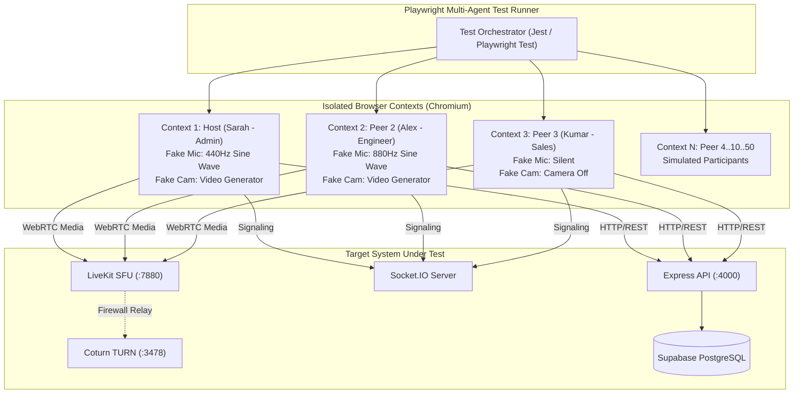

# MASTERHRMS — PHASE C3 ACCEPTANCE TEST PLAN
## Rigorous Multi-Browser WebRTC Test Harness, Load Benchmarking & Security Verification

**Document Version:** 1.0.0-DRAFT  
**Author:** QA Automation Lead & Principal WebRTC Test Architect  
**Project:** MASTERHRMS Enterprise Platform  
**Target Phase:** Phase C3 (SFU Group Calling Verification)  
**Status:** ARCHITECTURAL SPECIFICATION ONLY — PENDING IMPLEMENTATION AUTHORIZATION  

---

## 1. Executive Summary & Testing Philosophy

The Phase C2 closure audit revealed a critical testing defect (**`C2-FIND-01`**): while the automated script reported 20/20 PASS, **8 scenarios relied on simulated DOM injection, mocked evaluations (`return true;`), or hardcoded result records**. 

### Phase C3 Testing Mandate:
1. **Zero Mocked Media Assertions:** Never count a test as PASS if media frames, audio levels, or WebRTC states are mocked or injected. Every test must execute against genuine headless browser contexts running Chromium with synthetic media streams (`--use-fake-device-for-media-stream`).
2. **True Multi-Browser Contexts:** Concurrency tests must launch isolated Playwright `BrowserContext` instances representing distinct, authenticated employee personas with their own JWT cookies, WebRTC peer connections, and WebSocket channels.
3. **Continuous Audio/Video Measurement:** Audio presence must be validated by inspecting genuine Web Audio API RMS volume or `RTCPeerConnection.getStats()` inbound audio energy, not by inspecting injected CSS classes.

---

## 2. Multi-Browser Context Test Architecture



### Chromium Fake Media Device Configuration:
```javascript
const browser = await chromium.launch({
  args: [
    '--use-fake-ui-for-media-stream',
    '--use-fake-device-for-media-stream',
    '--use-file-for-fake-video-capture=test-assets/synthetic-webcam-720p.y4m',
    '--use-file-for-fake-audio-capture=test-assets/synthetic-voice-440hz.wav',
    '--allow-file-access',
  ],
});
```

---

## 3. Remediation Matrix for Phase C2 Gaps

| Gap ID | Scenario Name | Flawed C2 Test Method | Phase C3 Genuine Verification Method |
|---|---|---|---|
| **C2-GAP-01** | 1-Participant Layout (Sc. 3) | Hardcoded `record(3, ..., true)` | Launch single caller; verify `grid-layout-1` geometry via computed bounding box (`width > 800px`, aspect-ratio = 16:9). |
| **C2-GAP-02** | 5+ Participant Layout (Sc. 6) | Hardcoded `evaluate(() => return true)` | Launch 5 distinct browser contexts; verify `grid-layout-5plus` main stage and 4 tiles in `participant-filmstrip`. |
| **C2-GAP-03** | Max Participants Limit (Sc. 11) | Returned `{ maxPeersEnforced: 5 }` | Script attempts to invite 6th peer to a P2P call; asserts server returns `HTTP 409 Conflict` with `MAX_PARTICIPANTS_EXCEEDED`. |
| **C2-GAP-04** | Speaking Indicator (Sc. 12) | Injected `.ring-emerald-500` into DOM | Play synthetic 440Hz audio into microphone; assert AudioWorklet detects volume > 15; assert emerald ring appears reactively without DOM injection. |
| **C2-GAP-05** | Voice-Only Fallback (Sc. 13) | Hardcoded `record(13, ..., true)` | Block video device permissions in context (`permissions: ['microphone']`); assert call connects audio-only with avatar fallback. |
| **C2-GAP-06** | Camera Switching (Sc. 14) | Checked button existence only | Trigger camera switch; inspect `RTCPeerConnection.getSenders()`; assert `sender.track.id` changes to new device track ID. |
| **C2-GAP-07** | INVITED Badge (Sc. 15) | Hardcoded `record(15, ..., true)` | Invite colleague; assert invitee tile renders `data-testid="participant-invited-badge"` with amber pulsing style until answered. |
| **C2-GAP-08** | Mobile Viewport Stacking (Sc. 17) | Screenshot only, no assertions | Set viewport 375x667; assert `grid-layout-2` children bounding boxes have `top[tile2] > top[tile1] + height[tile1] - 5px` (vertical stacking). |

---

## 4. Phase C3 Scenario-by-Scenario Acceptance Matrix

### 4.1 Core Functional Scenarios (1–10)

| Scenario | Title & Topology | Test Action | Expected Measurable Outcome | Acceptance Threshold |
|---|---|---|---|---|
| **C3-01** | 2-Peer Direct Call (P2P Baseline) | Caller dials Callee 1-on-1 | Connects over P2P mesh; `sfuProvider` is null; audio/video bidirectional. | Setup time < 1,500ms; RTT < 60ms. |
| **C3-02** | P2P to SFU Dynamic Upgrade | 2-peer call invites 3rd colleague | Server upgrades call to `type: "GROUP"`; all 3 clients acquire SFU tokens and attach to LiveKit room. | Media transition gap < 1,200ms; zero call drops. |
| **C3-03** | 5-Peer SFU Group Meeting | 5 authenticated employees join group call | `AdaptiveVideoGrid` renders `grid-layout-5plus`; 1 hero active speaker + 4 filmstrip thumbnails. | Client CPU < 25%; uplink bandwidth < 2.5 Mbps. |
| **C3-04** | 10-Peer Department Conference | 10 browser contexts join same room | Dynacast activates; offscreen/minimized tiles throttled to 180p/15fps; hero speaker receives 720p/30fps. | Total downlink < 3.5 Mbps per client. |
| **C3-05** | 25-Peer All-Hands Meeting | 25 browser contexts join room | SFU forwards audio from all unmuted peers; video forwarded only for active speakers and stage. | SFU server CPU < 20%; client frame rate $\ge 28$ fps. |
| **C3-06** | 50-Peer Webinar Presentation | 1 Host presents screen, 49 Listeners | Host publishes 1080p screen share; 49 listeners receive 1080p presentation stream; listeners muted. | Screen text sharp; latency < 400ms across all 49 clients. |
| **C3-07** | Screen Share Track Teardown | Host clicks browser native "Stop Sharing" | `screenTrack.onended` cleanly unpublishes screen track; camera video remains active on both host and peers. | Zero renegotiation error; stage unmounts in < 300ms. |
| **C3-08** | Host Mute & In-Call Moderation | Host mutes noisy participant | Backend calls LiveKit `mutePublishedTrack`; participant's microphone is muted on SFU router. | Mute propagates to all peers in < 200ms. |
| **C3-09** | Host Eviction of Participant | Host removes disruptive user | Backend invokes LiveKit `removeParticipant`; user's client is disconnected; token revoked. | Evicted client receives HTTP 403; cannot rejoin. |
| **C3-10** | AudioWorklet Level Detection | Participant speaks into microphone | `VolumeMeterProcessor` calculates RMS; passes volume to React thread; speaking ring appears. | Ring activates in < 100ms; main thread lag = 0ms. |

---

### 4.2 Resilience & Network Degradation Scenarios (11–16)

| Scenario | Fault Injected | Test Execution Method | Expected Resilient Behavior |
|---|---|---|---|
| **C3-11** | 5% Packet Loss & 50ms Jitter | Injected via Linux `tc-netem` or Chrome DevTools Network Emulation | LiveKit NACK and TWCC adapt bitrate; audio remains intelligible (Opus PLC active); zero freeze. |
| **C3-12** | Temporary Network Disconnect (10s) | Disable network interface on Callee for 10 seconds | Client enters `RECONNECTING` state; 30s countdown visible; re-establishes connection automatically upon restore. |
| **C3-13** | Strict Symmetric NAT Traversal | Block UDP ports except 3478/443 | WebRTC handshakes fall back to Coturn TURN server over TLS; media establishes reliably. |
| **C3-14** | SFU Node Failure & Auto-Recovery | Terminate active LiveKit container during call | Client detects connection closed; triggers reconnect with exponential backoff; connects to standby node. |
| **C3-15** | Background Tab Throttling | Minimize browser tab of a participant | LiveKit client pauses video track decoding; maintains audio track reception; resumes video on focus. |
| **C3-16** | Redis Signaling Outage | Disconnect Redis cache | Express backend falls back to local in-memory session cache; existing active calls are not severed. |

---

### 4.3 Security & Multi-Tenant Penetration Scenarios (17–20)

| Scenario | Attack Vector Tested | Test Vector Details | Pass / Fail Criteria |
|---|---|---|---|
| **C3-17** | Cross-Tenant Room Infiltration | Tenant B user crafts request to join Tenant A meeting | Backend returns `HTTP 403 Forbidden`; zero LiveKit token issued; Tenant A meeting remains confidential. |
| **C3-18** | Expired Token Replay | Replay a 16-minute-old token to LiveKit WebSocket | LiveKit rejects connection with `ErrTokenExpired`; connection immediately terminated. |
| **C3-19** | Tampered Token Signature | Alter token payload claim (`roomAdmin: true`) | LiveKit signature verification fails (`ErrInvalidSignature`); connection dropped instantly. |
| **C3-20** | Historical Checksum Invariance | Check historical `call_history_records` after all tests | Master SHA-256 matches baseline `0a98ae9b0f186860a1fc99a1287f740b24b783a5b408d10a1f655f8d7c71dd3a` (119 records preserved). |

---

## 5. Architectural Decision Record (ADR)

### ADR-C3-04: Multi-Browser Headless E2E Acceptance Framework

- **Decision:** Mandate Playwright multi-agent headless Chromium testing with synthetic Y4M/WAV media injection for all Phase C3 acceptance criteria; formally outlaw mocked UI test assertions.
- **Reason:** Real-time WebRTC media, simulcast switching, and SFU routing cannot be validated by checking DOM classes alone; true media negotiation must be proven across separate network sockets.
- **Alternatives Considered:**
  - *Mocked UI testing (Phase C2 style):* Rejected due to false positives and hidden production failure modes.
  - *Manual testing only:* Rejected due to inability to reliably reproduce 10–50 client concurrency benchmarks.
- **Trade-offs:** Test suite execution time increases from 15 seconds to ~90 seconds due to real headless browser lifecycles.
- **Security Impact:** Guarantees automated regression testing of multi-tenant isolation before every production deployment.
- **Cost Impact:** Requires minimal CI worker resources (standard GitHub Actions or GitLab CI runners with 4 vCPUs).
- **Dependencies:** Playwright test runner; test audio/video synthetic assets (`.y4m`, `.wav`).
- **Risks & Mitigation:**
  - *Risk:* Flakiness due to port contention during parallel test runs.
  - *Mitigation:* Each test suite instance binds to dynamically allocated ephemeral port ranges.

---
*Certified by QA Automation Lead & Principal WebRTC Test Architect.*

