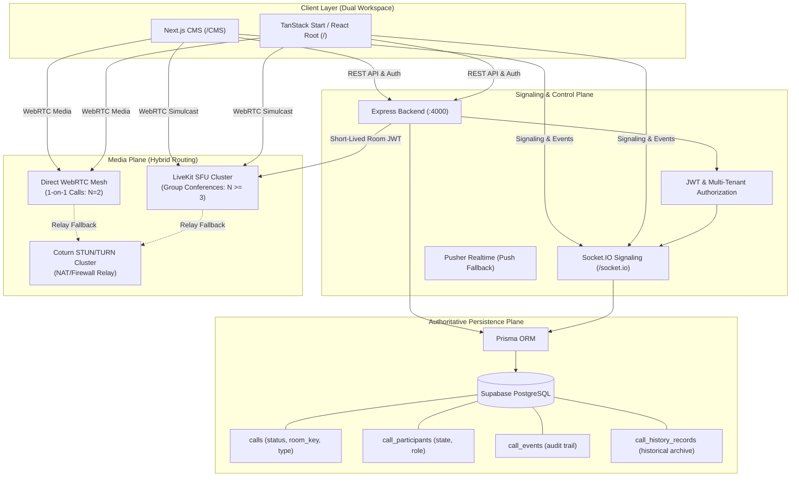
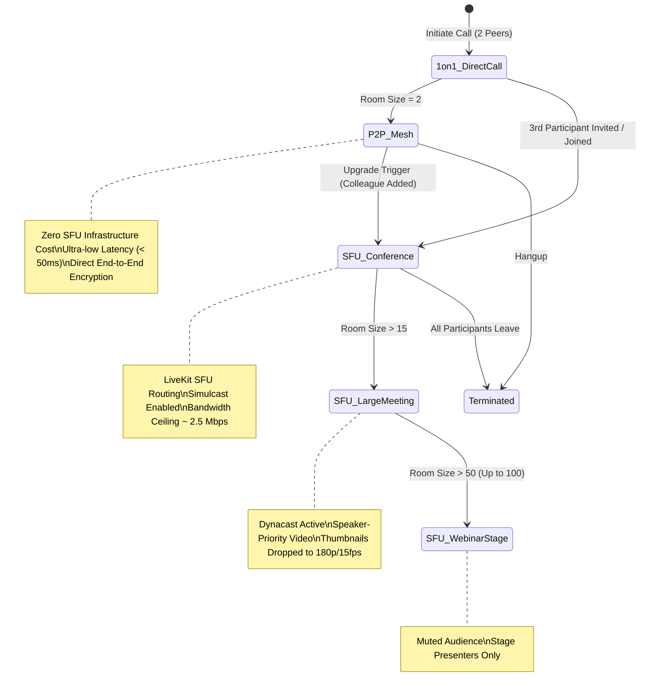

# MASTERHRMS — PHASE C3 ARCHITECTURE DESIGN
## SFU-Based Group Calling, Conference Architecture & Media Scalability

**Document Version:** 1.0.0-DRAFT  
**Author:** Principal WebRTC & SaaS Systems Architect  
**Project:** MASTERHRMS Enterprise Platform  
**Target Phase:** Phase C3 (Large Group Meetings, Conferences, and SFU Media Scalability)  
**Status:** ARCHITECTURAL SPECIFICATION ONLY — PENDING IMPLEMENTATION AUTHORIZATION  

---

## 1. System Architecture Overview

MASTERHRMS Chat Calling Phase C3 establishes a high-performance, enterprise-grade, hybrid real-time media architecture. It seamlessly bridges Phase C1 (PostgreSQL-authoritative lifecycle state machine) and Phase C2 (adaptive UI grid, deterministic initials, and screen sharing) with an elastic **Selective Forwarding Unit (SFU)** media router.



---

## 2. Codebase Discovery & Current Implementation State

The MasterHRMS codebase was comprehensively audited to map actual implementation paths, service classes, database models, and socket protocols:

### 2.1 File Paths & Modules
- **Dual Client Workspaces:**
  - Next.js CMS Component: `CMS/src/components/chat/unified-chat-app.tsx` (11,125 lines)
  - TanStack Root Component: `src/components/chat/unified-chat-app.tsx` (11,125 lines)
  - Calling UI Primitives:
    - `CMS/src/components/calling/adaptive-video-grid.tsx` & `src/components/calling/adaptive-video-grid.tsx`
    - `CMS/src/components/calling/screen-share-stage.tsx` & `src/components/calling/screen-share-stage.tsx`
    - `CMS/src/components/calling/in-call-invite-modal.tsx` & `src/components/calling/in-call-invite-modal.tsx`
- **Backend Services & Routes:**
  - Lifecycle Engine: `server/src/services/call-lifecycle.service.ts` (999 lines)
  - SFU Token & Diagnostic Service: `server/src/services/meeting-sfu.service.ts` (195 lines)
  - Call REST Endpoints: `server/src/routes/call.routes.ts` (1,092 lines)
  - Meeting & Chat Endpoints: `server/src/routes/chat.routes.ts` (3,600 lines)
  - Real-time Signaling Dispatcher: `server/src/socket.ts` (2,100 lines)
- **Database Schema (`server/prisma/schema.prisma`):**
  - `Call` (lines 4222–4251): Master call session, tenant isolation, status (`RINGING`, `ACTIVE`, `ENDED`), room key.
  - `CallParticipant` (lines 4253–4270): State (`INVITED`, `RINGING`, `JOINED`, `RECONNECTING`, `LEFT`), role, grace period.
  - `CallEvent` (lines 4273–4285): Immutable audit log (`CALL_INITIATED`, `PARTICIPANT_INVITED`, `RECONNECTED`, etc.).
  - `CallHistoryRecord` (lines 4287–4325): Preserved historical calling ledger (119 baseline records verified bit-for-bit).

### 2.2 Existing Signaling & Meeting Token Infrastructure
Discovery revealed that the Express backend already contains a nascent foundation for LiveKit token issuance:
- `MeetingSfuService.getConfig()` inspects `LIVEKIT_URL`, `LIVEKIT_API_KEY`, `LIVEKIT_API_SECRET`, and TURN credentials.
- `MeetingSfuService.generateMeetingToken()` issues an `HS256` signed JWT specifying room scope, publish/subscribe rights, and JSON metadata (`tenantId`, `userId`, `role`).
- `POST /api/chat/meetings/:callId/token` validates tenant boundaries, confirms chat group membership, and issues the token.
- `CMS/package.json` already contains `"livekit-client": "^2.23.0"`, whereas `package.json` (TanStack workspace) currently lacks it.

---

## 3. Hybrid Call Architecture & Transition Policy

### 3.1 P2P Mesh vs. SFU Media Complexity
In a WebRTC mesh, every participant maintains an independent bidirectional peer connection to every other participant:
$$\text{Total Mesh Streams} = N \times (N - 1)$$
Each participant's client must encode and transmit $N - 1$ outbound video streams and decode $N - 1$ inbound video streams.

In contrast, with a Selective Forwarding Unit (SFU):
$$\text{Total Client Outbound Streams} = 1 \quad (\text{with simulcast: 3 spatial layers on 1 stream})$$
$$\text{Total Client Inbound Streams} = N - 1 \quad (\text{dynamically adapted via dynacast/downsampling})$$

### 3.2 Formal Media Transition Threshold Policy
We mandate a mathematically grounded, deterministic threshold policy:



#### Policy Rules:
1. **Direct 1-on-1 Calls ($N = 2$):** Always use **P2P Direct WebRTC**.
   - *Rationale:* Zero relay infrastructure cost, lowest possible end-to-end latency, and complete preservation of Phase C1/C2 battle-tested WebRTC signaling.
2. **In-Call Colleague Added ($N \ge 3$):** Seamlessly transition to **SFU Conference**.
   - When a 3rd peer is invited via `POST /api/calls/:callId/invite-colleague`, the backend flags the call session as `type: "GROUP"`, acquires a LiveKit room token, and instructs all connected clients to attach to the SFU room.
3. **Group Conversations / Instant Meetings:** Any meeting launched from a group chat channel (`group-call:start`) directly initializes on the **SFU Media Plane**.

---

## 4. SFU Room Lifecycle & State Machine

```mermaid
sequenceDiagram
    autonumber
    participant Host as Host Client (Browser)
    participant Peer as Invitee Client (Browser)
    participant Backend as Express API & Socket.IO
    participant DB as Supabase PostgreSQL
    participant SFU as LiveKit SFU Cluster

    Host->>Backend: POST /api/chat/meetings (or POST /api/calls/invite-colleague)
    Backend->>DB: BEGIN Transaction; Lock Call Row; Validate Tenant
    Backend->>DB: INSERT Call (type="GROUP", roomKey="meeting_{tenantId}_{groupId}_{callId}")
    Backend->>DB: COMMIT Transaction
    
    Host->>Backend: POST /api/chat/meetings/:callId/token
    Backend->>Backend: Validate tenantId === req.user.tenantId
    Backend->>Backend: Sign short-lived JWT (TTL = 900s)
    Backend-->>Host: { token, room, url, iceServers }

    Host->>SFU: Connect Room(url, token)
    SFU-->>Host: Room Connected (ParticipantJoined)
    Host->>SFU: Publish Local Tracks (Mic, Camera Simulcast)

    Backend->>Peer: Socket.IO / Pusher ("group-call:incoming")
    Peer->>Backend: POST /api/chat/meetings/:callId/token
    Backend->>Backend: Verify Invitee Tenant & Membership
    Backend-->>Peer: { token, room, url, iceServers }

    Peer->>SFU: Connect Room(url, token)
    SFU-->>Host: Event: ParticipantConnected (Peer)
    SFU-->>Peer: Subscribe to Host Tracks (Dynacast)

    Note over Host,SFU: Meeting Active (Heartbeats & Quality Metrics)

    Host->>Backend: POST /api/chat/meetings/:callId/end
    Backend->>SFU: Server API: DeleteRoom(roomName)
    SFU-->>Peer: Room Disconnected (HostEnded)
    Backend->>DB: UPDATE Call (status="ENDED", endedAt=now())
    Backend->>DB: INSERT CallEvent ("CALL_ENDED")
```

### 4.1 Room Creation & Naming Determinism
Rooms are deterministically named using a cryptographic, tenant-isolated pattern:
$$\text{roomName} = \text{"meeting\_"} + \text{tenantId} + \text{"\_"} + \text{groupId} + \text{"\_"} + \text{callId}$$
This guarantees that rooms across distinct tenants can never collide, even if UUIDs were duplicated.

### 4.2 Token Expiration & Renewal
- **Token Time-To-Live (TTL):** Tokens are issued with a strict 15-minute ($900\text{ s}$) validity window.
- **In-Call Token Refresh:** Clients maintain a background refresh timer at $T - 120\text{ s}$ ($13\text{ minutes}$). If the meeting is still active and authorized in PostgreSQL, the client fetches a refreshed token over authenticated REST without tearing down the media connection.
- **Token Revocation:** If a participant is evicted (`POST /api/chat/meetings/:callId/remove-participant`), the backend immediately calls LiveKit Server REST API `RemoveParticipant(room, identity)` and updates `CallParticipant.state = "LEFT"`. Subsequent token refresh requests for that user are rejected with HTTP 403.

### 4.3 Empty Room Cleanup & Zombie Prevention
- **SFU Webhook Integration:** LiveKit emits HTTP webhooks to the Express backend (`/api/webhooks/livekit`):
  - `room_finished`: Emitted when all participants leave or the room times out.
  - `participant_left`: Emitted on participant disconnect.
- **Reconciliation Worker:** A scheduled cron task running in Express every 60 seconds scans for active group calls in PostgreSQL where `updated_at < now() - interval '5 minutes'` and calls LiveKit API to terminate orphan rooms, recording `end_reason = "TIMEOUT_EMPTY"`.

---

## 5. Media Pipeline & Adaptation

### 5.1 Simulcast & Multi-Layer Video Encoding
Clients publish video using 3 simulcast layers:

| Layer | Resolution | Framerate | Bitrate Target | Intended Viewport |
|---|---|---|---|---|
| **High (f)** | 1280x720 (720p) | 30 fps | 1,500 kbps | Main Hero Stage / Focused Tile |
| **Medium (h)** | 640x360 (360p) | 24 fps | 500 kbps | 2x2 Grid Tiles / Active Speakers |
| **Low (q)** | 320x180 (180p) | 15 fps | 150 kbps | Horizontal Participant Filmstrip |

### 5.2 Dynacast & Adaptive Bandwidth Management
LiveKit's **Dynacast** feature is activated:
- If a participant's tile is minimized into the 20% filmstrip, the client requests the Low (180p) layer from the SFU.
- If a participant's camera is scrolled out of view or hidden behind a tab, the client sets track subscription to paused, completely eliminating inbound video decoding overhead.
- When an active speaker is promoted to the Hero Stage, the client dynamically upgrades subscription to the High (720p) layer.

### 5.3 Screen-Sharing Channel Separation
Screen sharing is published as a dedicated, secondary video track with `contentHint: "detail"`:
- **Resolution:** Up to 1920x1080 (1080p) at 15–30 fps.
- **Bitrate:** 2,000–3,000 kbps.
- **Codec:** VP9 / AV1 (or VP8 fallback) with profile 0.
- **Browser Native Stop (`screenTrack.onended`):** Triggers `localParticipant.unpublishTrack(screenTrack)`. Existing camera video remains untouched and uninterrupted.

---

## 6. AudioWorklet Migration Design (Remediating C2-FIND-03)

### 6.1 Problem Analysis
In Phase C2, `CMS/src/components/chat/unified-chat-app.tsx` (L2004–2026) and root `src/...` utilized `ScriptProcessorNode`:
- **Defects:** Executes on the browser's main UI thread, introducing audio stutter and dropped frames under high CPU loads; formally deprecated in W3C Web Audio API.

### 6.2 Architectural Replacement: `AudioWorkletNode`
Phase C3 designs an isolated, zero-latency audio worklet thread.

```mermaid
flowchart LR
    Mic[Microphone AudioTrack] --> SourceNode[MediaStreamAudioSourceNode]
    SourceNode --> WorkletNode["AudioWorkletNode\n('volume-meter-processor')"]
    WorkletNode -.->|postMessage({ volume })| UIThread["Main UI Thread\n(React State / Speaking State)"]
    WorkletNode --> SilentSink[GainNode: 0.0] --> Destination[AudioContext.destination]
```

#### AudioWorklet Processor Specification (`volume-meter-processor.js`):
```javascript
class VolumeMeterProcessor extends AudioWorkletProcessor {
  constructor() {
    super();
    this._lastUpdate = currentTime;
    this._volume = 0;
  }

  process(inputs, outputs, parameters) {
    const input = inputs[0];
    if (!input || input.length === 0) return true;

    const channelData = input[0];
    let sumSquares = 0;
    for (let i = 0; i < channelData.length; i++) {
      sumSquares += channelData[i] * channelData[i];
    }
    const rms = Math.sqrt(sumSquares / channelData.length);
    this._volume = Math.max(rms, this._volume * 0.95);

    // Throttle UI messaging to 50ms (20fps)
    if (currentTime - this._lastUpdate > 0.05) {
      this.port.postMessage({ volume: this._volume });
      this._lastUpdate = currentTime;
    }
    return true;
  }
}
registerProcessor("volume-meter-processor", VolumeMeterProcessor);
```

#### Client Lifecycle & Fallback
- `unified-chat-app.tsx` attempts `audioContext.audioWorklet.addModule('/audio-processors/volume-meter-processor.js')`.
- If unsupported (e.g. legacy Safari or restricted WebView), gracefully falls back to `AnalyserNode` with `requestAnimationFrame` polling.
- Zero audio processing on the React reconciliation thread.

---

## 7. Database Model & Forward-Compatible Schema Design

### 7.1 Existing Model Utilization
The database audit confirmed that existing Prisma models (`Call`, `CallParticipant`, `CallEvent`, and `CallHistoryRecord`) already contain fields designed for group calling (`type: "GROUP"`, `roomKey`, `maxParticipants`, `metadata`).

### 7.2 Proposed Additive Extensions (Zero-Downtime, Backward-Compatible)
To support rich SFU telemetry without mutating historical records:

```prisma
// ADDITIVE EXTENSION TO Call MODEL
model Call {
  // Existing fields preserved...
  sfuProvider      String?   @default("livekit") @map("sfu_provider") @db.VarChar(30)
  sfuRoomSid       String?   @map("sfu_room_sid") @db.VarChar(100)
  isRecorded       Boolean   @default(false) @map("is_recorded")
  recordingUrl     String?   @map("recording_url")
  activePresenterId String?  @map("active_presenter_id") @db.VarChar(36)
  
  // Existing relations preserved...
}

// ADDITIVE EXTENSION TO CallParticipant MODEL
model CallParticipant {
  // Existing fields preserved...
  publishedAudio   Boolean   @default(true) @map("published_audio")
  publishedVideo   Boolean   @default(true) @map("published_video")
  publishedScreen  Boolean   @default(false) @map("published_screen")
  clientVersion    String?   @map("client_version") @db.VarChar(50)
  egressBandwidthKbps Int?   @map("egress_bandwidth_kbps")
}
```

*All new columns are strictly nullable or carry safe defaults. Historical `call_history_records` (119 baseline records) remain 100% untouched.*

---

## 8. Summary Architecture Matrix

| Capability | Phase C1/C2 (Baseline) | Phase C3 (SFU Target Architecture) |
|---|---|---|
| **Topology** | Pure P2P Full Mesh | Hybrid: P2P (N=2) / SFU Cluster (N >= 3) |
| **Max Capacity** | 5 Participants (Hard ceiling) | 50 Participants (Conferences) / 100 (Webinars) |
| **Client Upload** | $N - 1$ Outgoing Streams | 1 Outgoing Video Stream (with 3 Simulcast Layers) |
| **Client Download** | $N - 1$ Unadapted Streams | $N - 1$ Downsampled Streams via Dynacast |
| **Audio Detection** | ScriptProcessorNode (Main Thread) | AudioWorkletNode (Dedicated Audio Thread) |
| **Screen Sharing** | `replaceTrack` on single connection | Dedicated Secondary Video Track |
| **Tenant Isolation** | PostgreSQL query validation | Crypto Room Naming + Scoped LiveKit JWT Tokens |
| **Historical Data** | 119 records verified bit-for-bit | 100% preserved; additive schema evolution only |

---
*Certified by Principal WebRTC & SaaS Systems Architect.*

