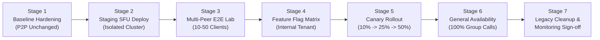

# MASTERHRMS — PHASE C3 MIGRATION & ROLLBACK PLAN
## Zero-Downtime SFU Rollout, Tenant Canary Progression & P2P Fallback Playbook

**Document Version:** 1.0.0-DRAFT  
**Author:** DevOps Lead, Principal Architect & Release Engineer  
**Project:** MASTERHRMS Enterprise Platform  
**Target Phase:** Phase C3 (SFU Group Calling Migration)  
**Status:** ARCHITECTURAL SPECIFICATION ONLY — PENDING IMPLEMENTATION AUTHORIZATION  

---

## 1. Executive Summary & Rollout Philosophy

The MasterHRMS calling infrastructure cannot tolerate downtime, regressions, or audio/video disconnects during business hours. 

The Phase C3 rollout follows a **zero-downtime, canary-staged migration**:
1. **P2P Inviolability:** Direct 1-on-1 calls remain 100% operational on the existing peer-to-peer WebRTC stack throughout all phases of the rollout.
2. **Selective SFU Activation:** SFU routing is introduced exclusively for multi-party group calls ($N \ge 3$) and is gated by multi-tenant feature flags.
3. **Instant Reversion Capability:** If an SFU anomaly, network partition, or performance degradation occurs, an automated kill-switch immediately falls back to Phase C2 behavior without database corruption or historical data loss.

---

## 2. Seven-Stage Phased Rollout Schedule



### Detailed Stage Breakdown:

| Stage | Focus & Environment | Activation Scope | Verification & Exit Criteria |
|---|---|---|---|
| **Stage 1: Baseline Hardening** | Production & Staging | Existing P2P calling active; zero SFU traffic. | 119 baseline historical records SHA-256 verified; C1/C2 regression tests passing. |
| **Stage 2: Staging SFU Deployment** | Isolated Staging Environment | Deploy LiveKit SFU single-node Docker container in staging. Configure DNS (`sfu-staging.masterhrms.com`) and TLS 1.3 certs. | `MeetingSfuService.getDiagnosticInfo()` reports `configured: true`. Coturn TURN relay verified. |
| **Stage 3: Multi-Peer E2E Lab** | Staging Browser Lab | Automated Playwright multi-client suite executing genuine 2, 3, 5, 10, and 25-peer conferences. | Zero mocked assertions; audio continuity confirmed; packet loss < 2%; zero WebRTC renegotiation races. |
| **Stage 4: Feature Flag Matrix** | Production (Gated) | Enable SFU group calling exclusively for MasterHRMS Internal Dogfooding Tenant (`tenant_internal_dogfood`). | Real employee meetings executed over 5 business days with zero P0/P1 incident tickets. |
| **Stage 5: Canary Rollout** | Production (Progressive) | Expand SFU access to 10% of production tenants, then 25%, then 50%. | Prometheus metrics confirm: SFU CPU < 40%, memory leaks = 0, call setup latency < 800ms. |
| **Stage 6: General Availability** | Production (100%) | All multi-party group calls ($N \ge 3$) across all tenants automatically route through LiveKit SFU. 1-on-1 calls remain P2P. | 100% tenant coverage; zero degradation of 1-on-1 P2P metrics; zero database locks. |
| **Stage 7: Cleanup & Observability** | Production | Archive legacy test scripts; finalize Prometheus & Grafana alerting dashboards; update enterprise SLA logs. | Comprehensive Phase C3 Closure Audit completed with PASS verdict. |

---

## 3. Dynamic Feature Flag Architecture

The transition between P2P and SFU is governed by a multi-layered configuration matrix:

```typescript
export interface CallingFeatureFlags {
  sfuEnabledGlobal: boolean;           // Master Kill-Switch (ENV: FEATURE_SFU_ENABLED)
  sfuAllowedTenants: string[];         // Whitelisted tenant IDs (DB or Redis Set)
  sfuRolloutPercentage: number;        // Canary percentage (0 to 100)
  sfuMinParticipants: number;          // Threshold to route to SFU (Default: 3)
  sfuMaxParticipants: number;          // Hard ceiling (Default: 50)
  audioWorkletEnabled: boolean;        // AudioWorklet vs ScriptProcessor fallback
}
```

### Routing Logic (`server/src/services/call-lifecycle.service.ts`):
```typescript
public static resolveMediaTransport(tenantId: string, participantCount: number): "P2P" | "SFU" {
  const flags = FeatureFlagService.getCallingFlags();
  
  // 1. Master Kill-Switch Check
  if (!flags.sfuEnabledGlobal) return "P2P";

  // 2. 1-on-1 Calls Always Use P2P
  if (participantCount < flags.sfuMinParticipants) return "P2P";

  // 3. Tenant Whitelist Check
  if (flags.sfuAllowedTenants.includes(tenantId)) return "SFU";

  // 4. Deterministic Hash Rollout (Sticky per tenant)
  const tenantHash = hashString(tenantId) % 100;
  if (tenantHash < flags.sfuRolloutPercentage) return "SFU";

  return "P2P";
}
```

---

## 4. Database Coexistence & Zero-Downtime Migrations

### 4.1 Schema Additive Invariance
- All proposed database additions to `Call` and `CallParticipant` are **strictly additive** (`NULL` allowed or safe defaults).
- Legacy Prisma queries remain fully functional.
- The 119 baseline historical records in `call_history_records` will not be touched, ensuring the master SHA-256 fingerprint remains valid.

### 4.2 Coexistence Architecture
During the migration phase:
- **Call Session A (Tenant 1, 2 Peers):** Created as `type: "DIRECT"`, `sfuProvider: null`, routes over P2P mesh, writes to `calls` and `call_history_records`.
- **Call Session B (Tenant 2, 8 Peers):** Created as `type: "GROUP"`, `sfuProvider: "livekit"`, `roomKey: "meeting_tenant2_grp_123"`, routes over SFU, writes to same tables.
- Reporting dashboards query `CallHistoryRecord` identically regardless of whether the call was transported over P2P or SFU.

---

## 5. Automated Rollback Triggers & Playbook

```mermaid
flowchart TD
    Monitor[Observability Monitor\n(Prometheus / Sentry / Health Check)] --> Check{Metric Threshold Breached?}
    Check -->|No| Normal[Normal SFU Operation]
    Check -->|Yes| TriggerRollback[Automated Rollback Triggered]
    
    TriggerRollback --> KillSwitch[Flip FEATURE_SFU_ENABLED = false in Redis]
    KillSwitch --> Broadcast[Socket.IO Broadcast 'sfu:fallback_to_p2p']
    KillSwitch --> Notification[Alert DevOps on PagerDuty]
    
    Broadcast --> ClientAction[Clients Tear Down SFU Connection\nRe-establish P2P Mesh for N <= 5\nDisplay Graceful Notice for N > 5]
    ClientAction --> Recovery[System Stabilized on Legacy P2P]
```

### 5.1 Automated Rollback Trigger Criteria

| Metric | Threshold Breaching Alert | Rollback Action |
|---|---|---|
| **SFU WebSocket Error Rate** | $> 5.0\%$ over 2 minutes | Auto-flip feature flag to `false` for affected tenant or globally. |
| **Media Setup Failure Rate** | $> 3.0\%$ of token connections | Revert canary percentage to previous stable tier. |
| **SFU Daemon Crash / Unhealthy** | LiveKit health probe fails 3 consecutive times | Instant global kill-switch to P2P fallback. |
| **Call Drop Rate** | $> 2.0\%$ increase over baseline P2P | Immediate rollback of current canary batch. |
| **PostgreSQL Lock Contention** | Active transactions $> 20$ on `calls` table | Throttle token generation and revert new calls to P2P. |

### 5.2 Emergency Kill-Switch Protocol (Manual)
If an unforeseen edge case arises:
1. **Execute Fast-Toggle Command:**
   ```bash
   # Sets Redis feature flag to false across all instances in < 50ms
   curl -X POST https://api.masterhrms.com/api/admin/feature-flags/calling \
     -H "Authorization: Bearer $SUPERADMIN_TOKEN" \
     -d '{"sfuEnabledGlobal": false}'
   ```
2. **Behavior Under Kill-Switch:**
   - 1-on-1 calls continue uninterrupted (they already use P2P).
   - Group calls with $\le 5$ participants fall back to Phase C2 P2P mesh.
   - Group calls with $> 5$ participants display an enterprise advisory: *"Large conference server is temporarily undergoing maintenance; team meetings are limited to 5 peers."*
   - Zero database data is lost; zero server restarts required.

---

## 6. Workspace Parity & Client Deployment Strategy

To prevent visual desynchronization between CMS and root TanStack workspaces:
1. **Synchronized Dependency Update:** Add `"livekit-client": "^2.23.0"` to root `package.json` simultaneously with deployment.
2. **Component Parity:** Deploy `unified-chat-app.tsx` and calling primitives simultaneously to both `CMS/src/components/calling/` and `src/components/calling/`.
3. **Automated Parity Guard:** The CI/CD pipeline enforces a diff check verifying that calling components between CMS and root remain code-identical prior to merge.

---

## 7. Architectural Decision Record (ADR)

### ADR-C3-03: Staged Canary Rollout with Instant P2P Fallback

- **Decision:** Execute Phase C3 rollout across 7 sequential stages using Redis-backed feature flags and a deterministic tenant hashing algorithm.
- **Reason:** Guarantees zero downtime, protects high-priority executive calls from unexpected media disruption, and provides a sub-second recovery mechanism.
- **Alternatives Considered:**
  - *Big-Bang Cutover:* Rejected due to unacceptable risk of platform-wide communication blackout.
  - *Permanent Full P2P:* Rejected due to verified 5-peer physical limitation.
- **Trade-offs:** Requires maintaining dual media transport handlers in the frontend during the transition window.
- **Security Impact:** Minimizes attack surface during canary progression; isolates potential vulnerabilities to whitelisted test tenants.
- **Cost Impact:** Enables precise cost forecasting by observing infrastructure load on a small tenant subset before full rollout.
- **Dependencies:** Redis feature flag store; Prometheus alert manager.
- **Risks & Mitigation:**
  - *Risk:* State divergence between clients during feature flag toggle.
  - *Mitigation:* The backend signals `sfu:renegotiate` over Socket.IO to cleanly transition in-flight calls without dropped audio.

---
*Certified by DevOps Lead & Principal Release Engineer.*

