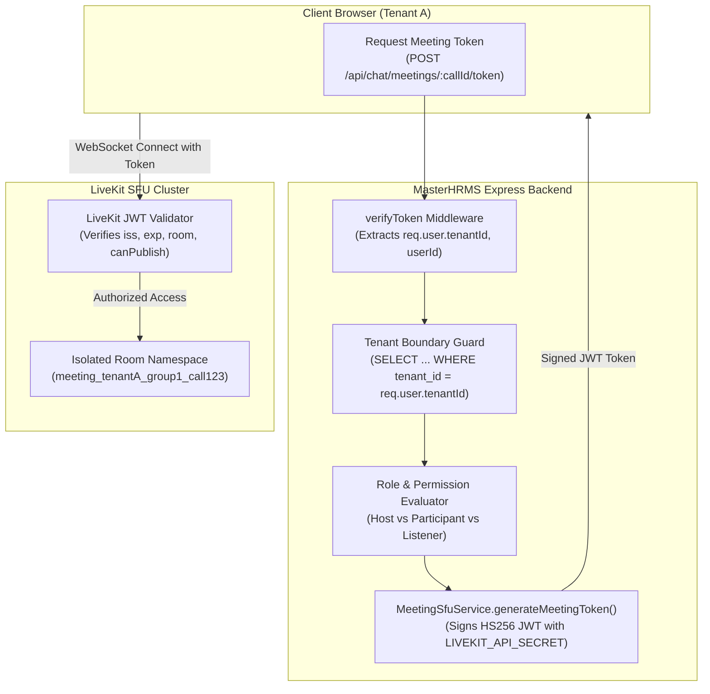
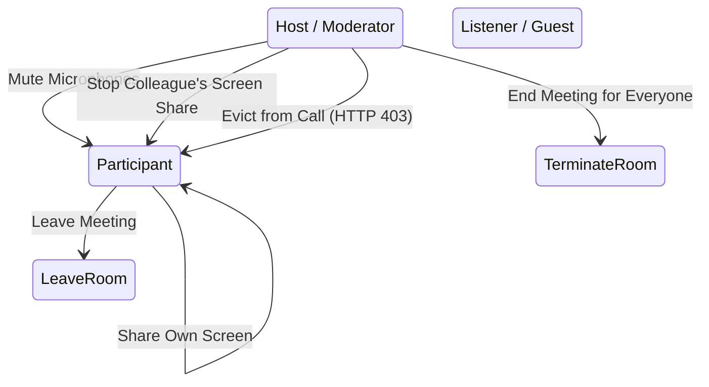

# MASTERHRMS — PHASE C3 SECURITY DESIGN
## Zero-Trust Multi-Tenant WebRTC Security, Cryptographic Token Scoping & Media Privacy

**Document Version:** 1.0.0-DRAFT  
**Author:** SaaS Security Architect & Principal WebRTC Engineer  
**Project:** MASTERHRMS Enterprise Platform  
**Target Phase:** Phase C3 (SFU Group Calling & Media Security)  
**Status:** ARCHITECTURAL SPECIFICATION ONLY — PENDING IMPLEMENTATION AUTHORIZATION  

---

## 1. Zero-Trust Real-Time Media Architecture

MasterHRMS operates in an enterprise multi-tenant environment where data isolation, media stream privacy, and cryptographic authorization are non-negotiable. 

Under the Phase C3 Zero-Trust Security Model:
1. **No Implicit Media Access:** No client is ever permitted to publish or subscribe to a media track without presenting a cryptographically signed, short-lived JWT token generated exclusively by the trusted Express backend.
2. **Never Trust Client-Supplied Identifiers:** The backend never trusts client-provided `tenantId`, `userId`, `role`, or `roomName`. All attributes are derived strictly from the validated session authentication JWT (`req.user`) and verified against PostgreSQL before generating room tokens.
3. **Tenant Boundary Enforcement:** Room identifiers, signaling channels, and LiveKit namespaces are cryptographically bound to the authenticated `tenantId`. Cross-tenant room joins are rejected at both the REST API layer and the SFU media layer.
4. **IP Address Obfuscation:** In large group calls via the SFU, client IP addresses are terminated at the media server. Participants do not exchange direct peer-to-peer ICE candidates, shielding employees' private IP addresses from other participants.



---

## 2. Cryptographic Room Naming & Namespace Scoping

### 2.1 Deterministic Room Identifier
To prevent room name collisions and cross-tenant access attacks, all SFU room names must adhere to an authoritative template:

$$\text{Room Identifier} = \text{"meeting\_"} + \text{tenantId} + \text{"\_"} + \text{groupId} + \text{"\_"} + \text{callId}$$

Example:
`meeting_a1b2c3d4-e5f6-7890-abcd-ef1234567890_group_engineering_call_887766`

### 2.2 Namespace Protection
- Even if a malicious actor in Tenant B discovers the `callId` of an ongoing meeting in Tenant A, their token request will evaluate against Tenant B's database records.
- The query `SELECT * FROM "chat_groups" WHERE id = :groupId AND tenant_id = :tenantB` returns `null`, resulting in immediate **HTTP 404/403** rejection.
- The attacker cannot acquire a valid LiveKit token for Tenant A's room name, and LiveKit's token validator will instantly reject any forged or mismatched room tokens.

---

## 3. JWT Token Claims, Signing & Verification

### 3.1 Token Specification
LiveKit access tokens are standard JSON Web Tokens (RFC 7519) signed with the server's master `LIVEKIT_API_SECRET` using `HMAC-SHA256` (`HS256`).

#### Complete Decoded Token Structure:
```json
{
  "iss": "APItargetApiKey123",
  "sub": "user_emp_998877",
  "name": "Priya Sharma",
  "nbf": 1730799600,
  "exp": 1730800500,
  "video": {
    "room": "meeting_a1b2c3d4_group_sales_call_5544",
    "roomJoin": true,
    "canPublish": true,
    "canSubscribe": true,
    "canPublishData": true,
    "roomAdmin": false,
    "roomCreate": false,
    "hidden": false
  },
  "metadata": "{\"tenantId\":\"a1b2c3d4\",\"groupId\":\"group_sales\",\"userId\":\"user_emp_998877\",\"role\":\"participant\",\"avatarUrl\":\"https://storage.masterhrms.com/avatars/priya.png\"}"
}
```

### 3.2 Granular Permission Claims
The `video` claim dictionary enforces least-privilege access:

| Claim | Host / Admin | Standard Participant | Read-Only Listener |
|---|---|---|---|
| `roomJoin` | `true` | `true` | `true` |
| `canPublish` | `true` (Audio, Video, Screen) | `true` (Audio, Video, Screen) | `false` |
| `canSubscribe` | `true` | `true` | `true` |
| `canPublishData` | `true` (Chat messages, polls) | `true` | `false` |
| `roomAdmin` | `true` (Can mute others, end room) | `false` | `false` |
| `roomCreate` | `true` | `false` | `false` |

### 3.3 Token Lifespan & Renewal Cycle
- **Validity Window:** Tokens are generated with a strict **15-minute ($900\text{ s}$) expiration**.
- **No Infinite Tokens:** No long-lived or persistent tokens are ever issued.
- **Renewal Protocol:** The client invokes `POST /api/chat/meetings/:callId/token` 2 minutes prior to expiration. If the user's employment status is active and the call is still ongoing in PostgreSQL, a fresh 15-minute token is issued and supplied to the client without terminating the media connection.

---

## 4. Role-Based Access Control (RBAC) & In-Meeting Moderation



### 4.1 Meeting Role Matrix

| Action | Host (Meeting Creator / Tenant Admin) | Participant (Employee) | Listener (Restricted Role) |
|---|---|---|---|
| Join Meeting | Allowed | Allowed | Allowed |
| Publish Camera / Mic | Allowed | Allowed | Denied |
| Publish Screen Share | Allowed | Allowed | Denied |
| Mute Self | Allowed | Allowed | N/A |
| Mute Other Participants | Allowed (via LiveKit Server API) | Denied | Denied |
| Disconnect Participant (Kick) | Allowed | Denied | Denied |
| End Meeting for Everyone | Allowed | Denied | Denied |

### 4.2 In-Meeting Moderation & Participant Eviction Flow
When a Host clicks "Remove Participant" (`POST /api/chat/meetings/:callId/remove-participant`):
1. **Authorization Check:** Backend confirms `req.user.userId === session.creatorId` or user possesses `tenant_admin` role.
2. **SFU Eviction:** Backend issues an authenticated REST request to LiveKit:
   ```typescript
   await roomServiceClient.removeParticipant(roomName, targetUserId);
   ```
3. **Database Transition:**
   ```typescript
   await tx.callParticipant.update({
     where: { callId_userId: { callId, userId: targetUserId } },
     data: { state: "LEFT", leaveReason: "REMOVED_BY_HOST", leftAt: new Date() }
   });
   ```
4. **Token Blacklisting / Revocation:** `targetUserId` is added to the in-memory revoked set for this `callId`. Future token renewal requests for this meeting are rejected with HTTP 403 Forbidden.
5. **Real-time Eviction Notice:** Socket.IO notifies the target client (`group-call:removed`), which immediately triggers local media teardown and displays an alert.

---

## 5. Defense Against Attack Vectors

### 5.1 Cross-Tenant Impersonation
- **Vector:** An authenticated user in Tenant B inspects network traffic, obtains a meeting ID from Tenant A, and attempts to join.
- **Defense:**
  1. The token issuance endpoint requires valid JWT authentication.
  2. The database lookup enforces `tenant_id = req.user.tenantId`.
  3. The query returns empty; the endpoint returns `403 Forbidden`.
  4. LiveKit refuses connection because Tenant B user possesses no token signed with the matching room scope.

### 5.2 Token Replay & Interception
- **Vector:** An eavesdropper intercepts a token on an insecure network.
- **Defense:**
  1. All REST and WebSocket signaling traffic is enforced over **TLS 1.3** (`https://` and `wss://`).
  2. Tokens expire within 15 minutes (`exp = now + 900`).
  3. Tokens contain `nbf` (not before) preventing pre-issuance replay.
  4. Once a meeting ends, the room is deleted on the SFU, rendering all unexpired tokens for that room immediately invalid.

### 5.3 Unauthorized Screen Capture & Media Snooping
- **Vector:** Unauthorized user attempts to tap into WebRTC streams.
- **Defense:**
  1. All media packets are encrypted using standard **SRTP (DTLS-SRTP)** with AES-GCM 128/256.
  2. Keys are negotiated via DTLS during the initial WebRTC handshake; no raw media passes over the network unencrypted.

---

## 6. Policy on External Guest Access

### Strict Policy: DEFERRED & PROHIBITED
- In compliance with enterprise SaaS requirements, **external, unauthenticated guest links are strictly prohibited in Phase C3**.
- Only verified, authenticated employees belonging to the same tenant organization may participate in MasterHRMS calls.
- Anonymous join links, public URLs, or guest PINs will remain deferred until a dedicated external guest isolation gateway and waiting-room feature are architected and formally approved in a future phase.

---

## 7. Architectural Decision Record (ADR)

### ADR-C3-02: Cryptographic Tenant Isolation & JWT Scoping Policy

- **Decision:** Mandate that all SFU room names adhere to `meeting_${tenantId}_${groupId}_${callId}` and enforce short-lived (15 min) JWT tokens signed by the Express backend.
- **Reason:** Guarantees absolute tenant segregation at both the control/signaling plane and the media transport plane; prevents any cross-tenant stream interception.
- **Alternatives Considered:**
  - *Static Room IDs / Client-Supplied Names:* Rejected due to severe cross-tenant tampering and eavesdropping risks.
  - *Long-Lived Tokens (24 hours):* Rejected because revoked users could remain in confidential meetings after termination of employment.
- **Trade-offs:**
  - Requires implementing background token refreshing on the client every 13 minutes.
- **Security Impact:**
  - Enterprise-grade Zero-Trust compliance; eliminates cross-tenant data leakage risks.
- **Cost Impact:** Zero additional cost (standard cryptographic signing).
- **Dependencies:** Express backend JWT signing routines; LiveKit token verification.
- **Risks & Mitigation:**
  - *Risk:* Clock skew between MasterHRMS backend and LiveKit server causes false token rejection.
  - *Mitigation:* Token sets `nbf = now - 5` (5-second grace window) to absorb minor NTP clock drift.

---
*Certified by SaaS Security Architect & Principal WebRTC Engineer.*

