# MASTERHRMS — CHAT, CALLING, PRESENCE & PUSH NOTIFICATION SUBSYSTEM
## COMPREHENSIVE EGM (EXPERT GOLDFISH METHOD) SWARM REVIEW REPORT

**Document Audited:** [`design_draft.md`](file:///Users/apple/Documents/hrms/design_draft.md) (and `MASTERHRMS_CHAT_CALLING_C0_ROOT_CAUSE_AUDIT.md`)  
**Evaluation Swarm:**
1. **Pragmatic Technical Lead (`egm-implementation-readiness`)**
2. **Hostile Design Critic (`egm-design`)**
3. **Skeptical Architect (`egm-zoom-out`)**
4. **Pedantic Technical Quality Auditor (`egm-codebase-details`)**  
**Compiler / Synthesizer:** Swarm Lead Architect (`egm-synthesizer`)  
**Date:** November 4, 2026  
**Consolidated Verdict:** **CONDITIONALLY REJECTED — REQUIRES ARCHITECTURAL PREREQUISITES REVISION PRIOR TO IMPLEMENTATION**

---

## 1. CONSOLIDATED SCORECARD ACROSS REVIEW PERSONAS

| Review Persona | Lens / Focus Area | Verdict | Primary Finding / Challenge |
|---|---|---|---|
| **Pragmatic Tech Lead** | Execution readiness, unambiguous tasks, testing gates, migration safety | **BLOCKED** | Prisma opposite relations missing; REST/Socket event contracts incomplete; Phase 8 task breakdown is a bare flowchart without files/tests. |
| **Hostile Design Critic** | Architecture resilience, distributed race conditions, serverless split-brain, security | **REJECTED** | 30s in-memory timers fail in serverless; dual-transport accept/cancel race conditions; high-frequency Postgres heartbeat write storms ($80\text{ QPS}$); guest impersonation vulnerabilities. |
| **Skeptical Architect** | Minimalism, YAGNI, complexity reduction, existing code reuse | **OVER-ENGINEERED** | Reinvents 5 new database models when `CallHistoryRecord`, `ChatMessage` system events, and `Meeting` already exist; guest links (Phase C4) is speculative scope creep; Pusher presence channels provide zero-DB tracking. |
| **Technical Quality Auditor** | Code-level accuracy, line numbers, imports, schema compatibility, library reuse | **DISCREPANCIES FOUND** | **Critical bug found in codebase:** `chat.routes.ts` calls `prisma.userProfile` (fails closed with 500); missing `tenant-models.config.ts` registration; Radix `Avatar` is already imported in `unified-chat-app.tsx`; hallucinated `t()` i18n claims. |

---

## 2. BLOCKER FINDINGS (MUST BE RESOLVED BEFORE PROCEEDING)

### [BLOCKER 1] Fatal Code Crash: Non-Existent `prisma.userProfile` in Group Meeting Route
- **Identified by:** `egm-codebase-details`
- **Location:** [`server/src/routes/chat.routes.ts` line 3427](file:///Users/apple/Documents/hrms/server/src/routes/chat.routes.ts#L3427), [`server/src/facade/prisma-proxy.facade.ts` lines 129–131](file:///Users/apple/Documents/hrms/server/src/facade/prisma-proxy.facade.ts#L129-L131)
- **Defect:** In `chat.routes.ts` line 3427, the endpoint `/api/chat/meetings/:callId/token` executes:
  ```typescript
  const userProfile = await prisma.userProfile.findUnique({
    where: { userId },
    select: { fullName: true, avatarUrl: true },
  });
  ```
  In `schema.prisma`, the model is named `Profile` (mapped to table `profiles`), and `tenant-models.config.ts` registers `"Profile"`. There is no `userProfile` property on Prisma Client. `prisma-proxy.facade.ts` catches access to unclassified models and throws `TENANT_CONTEXT_REQUIRED` (500 error). Group meeting token generation crashes unconditionally regardless of LiveKit setup.
- **Resolution:** Change line 3427 to `prisma.profile.findUnique({ where: { userId } })`.

### [BLOCKER 2] Broken Prisma Schema Compilation & Tenant Isolation Gate Failure
- **Identified by:** `egm-implementation-readiness`, `egm-design`, `egm-codebase-details`
- **Location:** [`design_draft.md` lines 310–415](file:///Users/apple/Documents/hrms/design_draft.md#L310-L415), [`server/prisma/schema.prisma` lines 40–252](file:///Users/apple/Documents/hrms/server/prisma/schema.prisma#L40-L252), [`server/src/config/tenant-models.config.ts`](file:///Users/apple/Documents/hrms/server/src/config/tenant-models.config.ts)
- **Defect:**
  1. `Call` defines `tenant Tenant @relation(...)`, but `Tenant` does not define `calls Call[]`. `prisma validate` fails compilation immediately.
  2. The multi-tenant proxy (`prisma-proxy.facade.ts`) blocks any model not explicitly registered in `tenant-models.config.ts`. The design draft omitted this, which would cause all queries against `Call`, `CallParticipant`, `CallEvent`, and `UserPresence` to throw runtime `TenantContextRequiredError` (403).
  3. `CallParticipant` and `CallEvent` omitted `tenantId`, breaking automatic tenant filtering.
  4. `UserPresence` lacked foreign keys to `Tenant` and `User`.
- **Resolution:**
  - If new models are added, update `model Tenant` with `calls Call[]`, add `tenantId` to all models with cascade foreign keys, and register models in `server/src/config/tenant-models.config.ts`.
  - Alternatively (recommended by `egm-zoom-out`), reuse `CallHistoryRecord` and avoid unnecessary schema proliferation.

### [BLOCKER 3] Serverless Timer Impossibility for 30-Second Reconnection Grace Window
- **Identified by:** `egm-design`, `egm-implementation-readiness`
- **Location:** [`design_draft.md` lines 160–170](file:///Users/apple/Documents/hrms/design_draft.md#L160-L170), [`server/src/socket.ts` lines 1751–1768](file:///Users/apple/Documents/hrms/server/src/socket.ts#L1751-L1768)
- **Defect:** On Vercel or multi-instance environments, process memory `setTimeout` timers are wiped when serverless lambdas freeze or terminate. If user disconnects, an in-memory 30s timer is lost. If managed via DB cron, `system_cron_jobs` runs at $\ge 60\text{s}$ intervals.
- **Resolution:** Implement a lease timestamp (`reconnectGraceExpiresAt = NOW() + 30s`). Reconnection validates `NOW() < reconnectGraceExpiresAt` within an atomic transaction. Finalization is evaluated lazily when a peer requests state or sends a keep-alive.

### [BLOCKER 4] Presence Database Write Storm & WAL Saturation
- **Identified by:** `egm-design`, `egm-zoom-out`
- **Location:** [`design_draft.md` lines 379–393](file:///Users/apple/Documents/hrms/design_draft.md#L379-L393)
- **Defect:** A 25-second HTTP heartbeat updating PostgreSQL `user_presence` creates $80\text{ Write QPS}$ for 1,000 active users (across desktop + mobile). This creates massive PostgreSQL MVCC table bloat, WAL write pressure, and connection pool starvation on pooled databases (Supabase port 6543).
- **Resolution:** Drop continuous database heartbeat writes. Rely on Pusher Presence Channels (`presence-tenant-{tenantId}`) or in-memory Socket.IO rooms for real-time presence. If persistence is desired, throttle database updates to **status changes only** (`OFFLINE` $\rightarrow$ `ONLINE`, `ONLINE` $\rightarrow$ `BUSY`).

---

## 3. MAJOR ARCHITECTURAL & STRATEGIC CONCERNS

### [MAJOR 1] Over-Engineering vs. Existing Codebase Reuse
- **Identified by:** `egm-zoom-out`
- **Analysis:**
  - [`CallHistoryRecord`](file:///Users/apple/Documents/hrms/server/prisma/schema.prisma#L4220-L4258) already has `callSessionId`, `callerId`, `receiverId`, `callType`, `status`, `startedAt`, `endedAt`, `durationSeconds`, and `participantIds: String[]`.
  - [`server/src/routes/call.routes.ts`](file:///Users/apple/Documents/hrms/server/src/routes/call.routes.ts#L148-L166) already uses `CallHistoryRecord` for pending call recovery and busy-line checking.
  - Ephemeral track mute/unmute states (`audioOn`, `videoOn`, `screenOn`) fluctuate dozens of times per call and should remain in Socket.IO / Pusher channel state rather than incurring database transaction latency.
  - In-thread call event markers ("Call ended: 12m 30s") should be stored directly in [`ChatMessage`](file:///Users/apple/Documents/hrms/server/prisma/schema.prisma#L3326-L3329) using the existing fields `isSystemEvent: true`, `eventType: "CALL_SUMMARY"`, and `eventMetadata: Json`.
- **Action:** Retain `CallHistoryRecord` as the historical record, avoid creating redundant operational tables, and use `ChatMessage` for in-thread audit logs.

### [MAJOR 2] 4-Participant WebRTC Mesh Fallback Operational Anti-Pattern
- **Identified by:** `egm-design`
- **Analysis:**
  - Mesh fallback for 4 participants requires $4 \times 3 = 12$ peer video streams. On mobile uplinks, this causes severe packet loss ($>2.5\text{ Mbps}$ upstream required) and crashes client browser tabs.
  - Full WebRTC Perfect Negotiation (polite/impolite peers, rollback on glare) is completely absent in `unified-chat-app.tsx`.
  - Forcing the client to ship both the LiveKit SDK and a custom multi-peer mesh engine bloats the bundle and creates maintenance divergence.
- **Action:** For multi-participant meetings (>2 participants), enforce LiveKit SFU. If LiveKit credentials are not configured, degrade gracefully to **Audio-Only Mesh** or fail fast with a descriptive administrative error (`MEETING_SFU_UNCONFIGURED`), rather than attempting an unviable 4-way video mesh.

### [MAJOR 3] Real-Time Event Protocol Naming Drift (Dots vs. Colons)
- **Identified by:** `egm-implementation-readiness`, `egm-codebase-details`
- **Analysis:**
  - The codebase exclusively uses colon notation: `call:invite`, `call:accept`, `call:media-state`, `call:ended`.
  - The design draft unilaterally proposed dot notation: `call.incoming`, `call.accepted`, `call.ended`.
  - Changing event names without an adapter breaks existing client event listeners in `unified-chat-app.tsx` and `incoming-call-context.tsx`.
- **Action:** Retain the production colon standard (`call:*`, `presence:*`) across Socket.IO and Pusher.

### [MAJOR 4] Premature Feature Expansion: External Guest Invitations (Phase C4)
- **Identified by:** `egm-zoom-out`, `egm-design`
- **Analysis:**
  - MASTERHRMS is an internal enterprise human resource system.
  - External guest links introduce public token hashing, lobby waiting rooms, host admission controls, and open relay security risks.
  - Adding this in the middle of fixing core 1-on-1 audio/video calling expands the failure surface and delays delivery of critical internal communication repairs.
- **Action:** Defer Phase C4 (External Guest Access) until core internal 1-on-1 and group calling are verified stable.

### [MAJOR 5] Missing Radix UI Library Reuse
- **Identified by:** `egm-codebase-details`
- **Analysis:**
  - `CMS/src/components/chat/unified-chat-app.tsx` lines 81–84 already imports `Avatar, AvatarImage, AvatarFallback` from `@/components/ui/avatar`.
  - Rather than creating bespoke avatar endpoints or custom fallback algorithms, the video tile simply needs to render `<Avatar className="h-28 w-28"><AvatarImage src={activeCallTargetAvatar} /><AvatarFallback>{initials}</AvatarFallback></Avatar>`.
- **Action:** Reuse the existing Radix UI `Avatar` component inside the video stage.

---

## 4. SYNTHESIZED REMEDIATION ROADMAP (REFINED C1–C7)

Based on the unified findings of all four reviewers, the implementation roadmap is restructured to eliminate unnecessary migrations, prevent database flooding, and focus on verifiable code repairs:

```mermaid
flowchart TD
    subgraph PreReq ["Prerequisite Fix"]
        R0["Fix prisma.userProfile -> prisma.profile\nin server/src/routes/chat.routes.ts"]
    end

    subgraph PhaseC1 ["Phase C1: Resilient Call Lifecycle & State Machine"]
        C1A["Update CallHistoryRecord status enum & lease expiry"]
        C1B["Socket.IO 30s reconnect grace period"]
        C1C["call.answered_elsewhere multi-tab suppression"]
        C1D["Frontend Call Ended summary dialog"]
    end

    subgraph PhaseC2 ["Phase C2: UI, Adaptive Grid, Radix Avatar & Screen Share"]
        C2A["Radix Avatar fallback in video stage on camera-off"]
        C2B["Reactive remoteIsVideoOff state in unified-chat-app.tsx"]
        C2C["Adaptive responsive participant grid (N=1,2,3,4)"]
        C2D["Presenter side-filmstrip layout for screen sharing"]
    end

    subgraph PhaseC3 ["Phase C3: Group Call Media & LiveKit Configuration Gate"]
        C3A["LiveKit token generation & room validation"]
        C3B["Graceful audio-only fallback or admin warning on missing keys"]
        C3C["Prevent auto-leave crash in unified-chat-app.tsx"]
    end

    subgraph PhaseC4 ["Phase C4: Pusher Edge Presence (Zero-DB Writes)"]
        C4A["Pusher presence-tenant-{tenantId} channel integration"]
        C4B["Socket.IO tenantPresence sync (status-change only DB write)"]
    end

    subgraph PhaseC5 ["Phase C5: File Manager Attachment Integration"]
        C5A["Append threadId to chat upload FormData"]
        C5B["ChatFolderService App Files / Chat / Messages folder mapping"]
        C5C["Inherited group chat file access (no N+1 ACL explosion)"]
    end

    subgraph PhaseC6 ["Phase C6: Web Push Notifications for Chat Messages"]
        C6A["Trigger VapidService.sendWebPush in POST /messages"]
        C6B["Foreground tab suppression & push tag coalescing"]
        C6C["Fix service worker notification click navigation"]
    end

    subgraph PhaseC7 ["Phase C7: Multi-Browser Playwright Acceptance Verification"]
        C7A["User A -> User B 1-on-1 Audio/Video Call Test"]
        C7B["Camera toggle & Radix avatar fallback verification"]
        C7C["Screen share filmstrip test"]
        C7D["30s disconnect & reconnect recovery test"]
        C7E["Chat file upload & push delivery test"]
    end

    PreReq --> PhaseC1
    PhaseC1 --> PhaseC2
    PhaseC2 --> PhaseC3
    PhaseC3 --> PhaseC4
    PhaseC4 --> PhaseC5
    PhaseC5 --> PhaseC6
    PhaseC6 --> PhaseC7
```



---

## 5. REVISED PHASE C1 SPECIFICATION (IMPLEMENTATION-READY)

With the consensus of the EGM swarm, Phase C1 is now fully specified without ambiguity:

### 1. Prerequisite Code Fix
- **File:** [`server/src/routes/chat.routes.ts`](file:///Users/apple/Documents/hrms/server/src/routes/chat.routes.ts#L3427)
- **Change:** Line 3427: replace `prisma.userProfile.findUnique` with `prisma.profile.findUnique`.

### 2. Database Model Harmonization (Additive)
- **File:** [`server/prisma/schema.prisma`](file:///Users/apple/Documents/hrms/server/prisma/schema.prisma#L4220-L4258)
- **Scope:** Retain `CallHistoryRecord`. Add optional columns:
  - `reconnectGraceExpiresAt DateTime? @map("reconnect_grace_expires_at")`
  - `answeredElsewhereBy String? @map("answered_elsewhere_by") @db.VarChar(100)`
- **Run:** `npx prisma generate` in `server/`.

### 3. Server-Side 30-Second Reconnection Grace Period
- **File:** [`server/src/socket.ts`](file:///Users/apple/Documents/hrms/server/src/socket.ts#L1727-L1769)
- **Logic:**
  - On socket `disconnect`: If user is in an active call, do NOT delete the call immediately.
  - Set `participant.reconnecting = true` and `participant.reconnectExpiresAt = Date.now() + 30000`.
  - Emit `call:participant-reconnecting` to peer with `{ userId, graceSeconds: 30 }`.
  - Start a 30s timer on the server session. If user reconnects via new socket, clear timer, set `reconnecting = false`, and emit `call:participant-reconnected`.
  - If 30s expires without reconnection, finalize call with status `completed` / `disconnected` and emit `call:ended`.

### 4. Multi-Device Call Suppression
- **Files:** [`server/src/routes/call.routes.ts`](file:///Users/apple/Documents/hrms/server/src/routes/call.routes.ts#L457), [`server/src/socket.ts`](file:///Users/apple/Documents/hrms/server/src/socket.ts#L587), [`CMS/src/context/incoming-call-context.tsx`](file:///Users/apple/Documents/hrms/CMS/src/context/incoming-call-context.tsx)
- **Logic:**
  - When User accepts call on Tab/Device 1, emit `call:answered-elsewhere` with `{ callId, deviceId }` to room `user:${userId}`.
  - In `incoming-call-context.tsx`: When `call:answered-elsewhere` is received, stop the Web Audio ringtone and dismiss the incoming call modal.

### 5. Frontend Call End & Summary Card
- **File:** [`CMS/src/components/chat/unified-chat-app.tsx`](file:///Users/apple/Documents/hrms/CMS/src/components/chat/unified-chat-app.tsx#L2821-L2836)
- **Logic:**
  - When `call:ended` or hangup occurs, set local state `callEndedSummary = { duration, targetUser, endReason }` instead of calling `setActiveCallModalOpen(false)` immediately.
  - Render an accessible "Call Ended" card with duration, "Call Again" action, and "Close" button.

---

## 6. RECOMMENDATION FOR PROCEEDING

The EGM review has successfully identified and neutralized critical risks before a single line of application code was broken:
1. The crashing bug in `chat.routes.ts` (`prisma.userProfile`) will be resolved first.
2. We avoid adding unmaintainable schema bloat and database heartbeat write storms.
3. We preserve the verified incoming call flow with zero regressions.
4. We maintain the colon-delimited event protocol (`call:*`, `presence:*`).

**The implementation plan is now hardened, streamlined, and ready for execution.**
