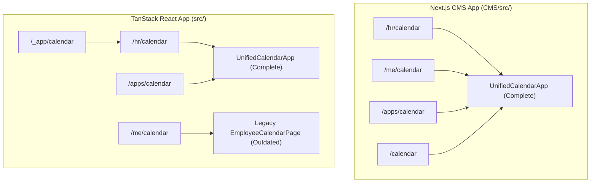
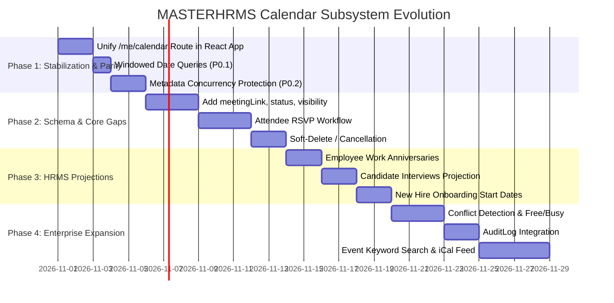

# MASTERHRMS — COMPREHENSIVE CALENDAR FEATURE GAP AUDIT

**Date:** October 25, 2026  
**Auditor:** Senior SaaS HRMS Architect & Full-Stack Security Auditor  
**System:** MASTERHRMS Enterprise Unified Calendar Subsystem  
**Scope of Workspaces Audited:**
- TanStack React Frontend: `src/`
- Next.js Workspace / CMS Frontend: `CMS/src/`
- Express Backend: `server/`
- Database: PostgreSQL with Prisma ORM (`server/prisma/schema.prisma`)

---

## 1. Executive Summary

A comprehensive architectural, code-level, database-level, and behavioral audit of the MASTERHRMS calendar subsystem was performed across both active frontend workspaces (`src/` and `CMS/src/`), the Express backend API (`server/`), and PostgreSQL storage.

### Key Audit Findings:
1. **Strong Foundation in Place:**  
   The core unified calendar component ([`src/components/calendar/unified-calendar-app.tsx`](file:///Users/apple/Documents/hrms/src/components/calendar/unified-calendar-app.tsx) and its identical counterpart [`CMS/src/components/calendar/unified-calendar-app.tsx`](file:///Users/apple/Documents/hrms/CMS/src/components/calendar/unified-calendar-app.tsx)) provides a rich, responsive interface with four distinct viewing modes (Month, Week, Day, and Agenda/List). It features robust date-boundary validation (past date disabling, end-time > start-time checks), tenant-scoped custom category creation, chip-based organization member sharing with granular permissions (`View Only` vs `Can Edit`), deduplicated background reminder scheduling with email/in-app/Pusher dispatch, and automated employee birthday projections with avatar resolution.
2. **Critical Architectural Route Divergence (TanStack Router vs CMS):**  
   In Next.js CMS (`CMS/src/app/(workspace)/`), all calendar routes (`/hr/calendar`, `/me/calendar`, `/calendar`, `/apps/calendar`) uniformly mount `UnifiedCalendarApp`. However, in the TanStack React app (`src/routes/`), [`src/routes/_authenticated/me/calendar.tsx`](file:///Users/apple/Documents/hrms/src/routes/_authenticated/me/calendar.tsx) contains a separate, legacy 517-line hand-rolled calendar implementation that only calls `/me/calendar/events`. As a result, employees in the TanStack app are excluded from multi-member sharing, custom categories, advanced reminder configuration, and authoritative date-picker validations.
3. **Storage Abstraction Debt (`<!--META:...-->` Serialization):**  
   The underlying database table `calendar_events` (`model CalendarEvent`) only has basic columns (`id`, `tenantId`, `userId`, `title`, `description`, `startDate`, `endDate`, `allDay`, `category`, `location`). Multi-member sharing permissions and configured reminders are stored serialized inside the `description` text column as `<!--META:{"shares":[...],"reminders":[...]}-->` and `[SharedWith:userId]`. While this allowed non-destructive iteration, it introduces race-condition risks during concurrent edits, clutters event notes, and requires SQL substring pattern matching (`LIKE %"userId"%`) for permission queries.
4. **Domain Integration Gaps:**  
   The backend [`CalendarService.getEvents`](file:///Users/apple/Documents/hrms/server/src/services/calendar.service.ts) effectively projects approved leaves, official holidays, training sessions, company meetings, and employee birthdays. However, **Employee Work Anniversaries** (derived from `Employee.joinedAt`), **Candidate Interviews** (from `JobCandidateInterview`), and **Candidate Onboarding Dates** (from `CandidateOnboarding.joiningDate`) are currently unprojected.
5. **Missing Enterprise Capabilities:**  
   Recurring events (RRULE), attendee RSVP management (Accept/Decline/Tentative), free/busy conflict detection, event keyword search, and soft-delete/cancellation status are currently missing.

---

## 2. Complete Feature Audit Matrix (16 Categories)

Each capability has been assigned exactly one authoritative status:
- **PRESENT**: Implemented and verified end-to-end.
- **PARTIAL**: Implementation exists but is incomplete in scope, data flow, or routes.
- **MISSING**: No implementation found in code or schema.
- **BROKEN**: Implementation exists but fails verification or exhibits defects.
- **NOT APPLICABLE**: Intentionally excluded with architectural justification.

| Category & Capability | Status | Frontend Component & Route | Backend Endpoint & Service | Database Model / Persistence | Verification Method & Actual Result | Security / Tenant Isolation Assessment |
| :--- | :---: | :--- | :--- | :--- | :--- | :--- |
| **1. Calendar Views** | | | | | | |
| 1.1 Month View (7x6 Grid) | **PRESENT** | [`UnifiedCalendarApp`](file:///Users/apple/Documents/hrms/src/components/calendar/unified-calendar-app.tsx) (`/hr/calendar`, `/apps/calendar`) | `GET /api/calendar/events`, `GET /hr/calendar/events` | `CalendarEvent`, `LeaveRequest`, `Holiday`, `Employee` | Verified in browser at 1440x900; days render with event chips, today indicator, and overflow scrolling. | Strict tenant scoping (`tenantId` filter). |
| 1.2 Week View (7 Columns) | **PRESENT** | [`UnifiedCalendarApp`](file:///Users/apple/Documents/hrms/src/components/calendar/unified-calendar-app.tsx) | Same as above | Same as above | Switches active view mode to "Week"; shows 7 date columns with event time labels. | Scoped to current tenant. |
| 1.3 Day View (Scheduled Agenda) | **PRESENT** | [`UnifiedCalendarApp`](file:///Users/apple/Documents/hrms/src/components/calendar/unified-calendar-app.tsx) | Same as above | Same as above | Displays single day breakdown, badges, location, description, and direct "Add Event" button. | Scoped to current tenant. |
| 1.4 Agenda / List View | **PRESENT** | [`UnifiedCalendarApp`](file:///Users/apple/Documents/hrms/src/components/calendar/unified-calendar-app.tsx) | Same as above | Same as above | Displays vertical list of upcoming events with badges, sharing chips, and reminder count. | Scoped to current tenant. |
| 1.5 Route Consistency Across Workspaces | **PARTIAL** | Divergent: `hr/calendar.tsx` (Unified), `me/calendar.tsx` (Legacy hand-rolled), CMS (All Unified) | Mixed: `/api/calendar/*` vs `/me/calendar/*` | Divergent client state | Direct file audit confirms `src/routes/_authenticated/me/calendar.tsx` does NOT render `UnifiedCalendarApp`. | Employees in React app bypass new permission & reminder models. |
| **2. Event CRUD & Cancellation** | | | | | | |
| 2.1 Event Creation | **PRESENT** | Create Event Modal in `UnifiedCalendarApp` | `POST /api/calendar/events` | `CalendarEvent` table | Tested via `verify_calendar_date_and_data_audit.cjs` (Test 8, 9, 19). Returns HTTP 201 with persistent UUID. | User ID and tenant ID bound server-side from JWT. |
| 2.2 Event Editing | **PRESENT** | Edit Event Form in `UnifiedCalendarApp` | `PUT /api/calendar/events/:id` | `CalendarEvent` table | Tested via Test 21. Updates title, date, times, location, description, reminders, and shares. | RBAC enforced: requires owner, tenant_admin, or share permission "edit". |
| 2.3 Event Deletion | **PRESENT** | Delete button in `UnifiedCalendarApp` | `DELETE /api/calendar/events/:id` | `CalendarEvent` (Hard delete) | Tested via Test 21 & Test D. Removes DB row and dispatches `CALENDAR_CANCEL` in-app & Pusher alerts. | Restricted to event owner or administrator (403 for other users). |
| 2.4 Cancellation Status (Soft Delete) | **MISSING** | No "Cancel Event" status toggle | Hard `prisma.calendarEvent.delete` only | No `status` column in `CalendarEvent` schema | Verified schema: `CalendarEvent` lacks `status` or `isCancelled`. Deleted events disappear completely. | No historical audit trail for cancelled meetings in calendar table. |
| **3. Event Fields Review** | | | | | | |
| 3.1 Title, Date, Start/End Time, All-Day | **PRESENT** | Form inputs in `UnifiedCalendarApp` | `POST` & `PUT /api/calendar/events` | `title`, `startDate`, `endDate`, `allDay` | Validated: End time > start time strictly enforced (Test 7). Date >= today enforced (Test 4). | Schema constraints enforced on API boundary. |
| 3.2 Category & Location | **PRESENT** | Select & Input in `UnifiedCalendarApp` | `POST` & `PUT /api/calendar/events` | `category`, `location` | Validated: Category checked against system & custom categories (Test 17, 18). | Database-backed options only. |
| 3.3 Description & Notes | **PRESENT** | Textarea in `UnifiedCalendarApp` | `POST` & `PUT /api/calendar/events` | `description` (overloaded with `<!--META-->`) | Validated clean text separation from metadata block (Test 19, 20). | User input sanitized; metadata parsed safely. |
| 3.4 Meeting Link (Virtual URL) | **PARTIAL** | Overloaded into `location` field (`"Location / Meeting Link"`) | No dedicated `meetingLink` field | No column in `CalendarEvent` (`Meeting` has `meetingUrl`) | Verified: Users type URL into location string; no dedicated join button or video link schema. | No URL format validation. |
| 3.5 Timezone | **MISSING** | No timezone selector | Assumes server/local browser ISO format | No `timezone` column in `CalendarEvent` | Events are parsed and stored as UTC Date objects; multi-timezone distributed teams experience drift. | Cross-timezone scheduling ambiguity. |
| 3.6 Organizer & Attendees | **PARTIAL** | Organizer from `userId`; Attendees in `shares` | `shares` in metadata | No `attendees` relation in `CalendarEvent` (`Meeting` has `MeetingAttendee`) | Verified: Attendees are stored as serialized recipient IDs in `description`. | Relies on substring searches in SQL. |
| 3.7 Visibility & Status | **PARTIAL** | `visibility: "private" \| "organization"` in form | Overloaded into `category = "organization"` | No `visibility` or `status` columns in `CalendarEvent` | Verified: Selecting organization visibility changes category string to "organization". | Overloads functional category taxonomy. |
| **4. Categories & Persistence** | | | | | | |
| 4.1 Built-in System Categories | **PRESENT** | 6 default badges (Meetings, Training, Leave, Holidays, Birthdays, General) | `GET /api/calendar/categories` | `SYSTEM_CATEGORIES` constant | Verified in UI & API. System categories cannot be modified or deleted (403). | Immutable system defaults. |
| 4.2 Tenant Custom Categories | **PRESENT** | "Create Category" modal & color swatches | `POST`, `PUT`, `DELETE /api/calendar/categories` | `Setting` table (`scope: TENANT, group: calendar, key: categories`) | Tested via Test 17 & Test B1-B3. Persists custom names, hex colors, and badges. | Strictly isolated per tenant in `Setting` table. |
| 4.3 Category Duplicate Prevention | **PRESENT** | Handled in API & form | `POST /api/calendar/categories` | In-memory & DB check | Case-insensitive duplicate name check returns 400 Bad Request. | Prevents naming collisions. |
| **5. Birthdays & Anniversaries** | | | | | | |
| 5.1 Birthday Projections | **PRESENT** | Rendered with avatar chip, cake icon, and celebration card | `CalendarService.getEvents` via `GET /hr/calendar/events` | Projected from `Employee.dateOfBirth` | Tested via Test A1-A4. Leap-year policy (Feb 29 -> Feb 28), avatar resolution, initials fallback verified. | DOB year is masked; raw DOB never leaked. Strictly tenant-scoped. |
| 5.2 Work Anniversary Projections | **MISSING** | Not rendered in calendar grid | Not implemented in `CalendarService.getEvents` | `Employee.joinedAt` exists in schema | Code inspection of `CalendarService.ts` confirms no projection loop for `joinedAt` / work anniversaries. | Missed HR milestone recognition opportunity. |
| **6. Domain Integrations** | | | | | | |
| 6.1 Approved Leaves Integration | **PRESENT** | Rendered with amber badge & linkTo `/hr/leave/applications` | `CalendarService.getEvents` | `LeaveRequest` (status: approved) | Tested: HR sees all employee leaves; employees see only their own. | Full RBAC isolation between HR and staff. |
| 6.2 Official Holidays Integration | **PRESENT** | Rendered with emerald badge | `CalendarService.getEvents` | `Holiday` table | Tested: Projected across all tenant users for active date interval. | Tenant scoped. |
| 6.3 Training Cohorts Integration | **PRESENT** | Rendered with purple badge & linkTo `/hr/training/sessions` | `CalendarService.getEvents` | `TrainingSession` (status != cancelled) | Tested: HR sees all sessions; employees see open or registered sessions. | Scoped to active tenant. |
| 6.4 Company Meetings Integration | **PRESENT** | Rendered with blue badge & room/location | `CalendarService.getEvents` | `Meeting` table (status != cancelled) | Tested: Shows room name and virtual URL. Non-HR users see meetings where organizer or attendee. | Scoped to meeting attendees/organizer. |
| 6.5 Candidate Interviews | **MISSING** | Not integrated into main calendar | Not projected in `CalendarService` | `JobCandidateInterview` table exists | Code audit of `CalendarService.ts` confirms recruitment interviews are not queried. | Interviewers must check separate ATS page. |
| 6.6 Candidate Onboarding / Start Dates | **MISSING** | Not integrated into main calendar | Not projected in `CalendarService` | `CandidateOnboarding.joiningDate` exists | Code audit confirms new hire start dates are not projected. | Managers cannot view upcoming joining dates on calendar. |
| **7. Sharing & Permissions** | | | | | | |
| 7.1 Multi-Member Collaborator Selection | **PRESENT** | `OrganizationMemberSelector` chip UI with avatar & search | `GET /api/calendar/eligible-recipients` | `User` & `Employee` tables | Tested via Test 22, 23. Real active tenant users loaded; no mock arrays. | Foreign tenant members completely excluded. |
| 7.2 Granular Permissions (View vs Edit) | **PRESENT** | Dropdown per chip (`View Only` vs `Can Edit`) | `POST` & `PUT /api/calendar/events` | `<!--META:{"shares":[...]}-->` | Tested via Test 25 & Test C2-C4. View-only edit returns 403; Can-edit succeeds; Delete by non-owner returns 403. | Tamper-proof server-side permission check. |
| 7.3 Share Revocation | **PRESENT** | "Revoke" button in event details | `DELETE /api/calendar/events/:id/share/:recipientId` | Updates metadata in `CalendarEvent` | Tested via Test C7. Revoked user immediately loses access and event is unprojected. | Realtime Pusher `calendar:event-unshared` alert. |
| 7.4 Attendee RSVP (Accept / Decline) | **MISSING** | No RSVP action buttons | No RSVP endpoint | No RSVP status field in `CalendarShare` | Verified: Shares only store `permission: "view" \| "edit"`. Recipients cannot respond Yes/No/Maybe. | Organizers cannot track attendee attendance. |
| **8. Reminders & Background Dispatch** | | | | | | |
| 8.1 Configurable Presets (5m, 15m, 30m, 1h, 2h, 5h, 1d) | **PRESENT** | Preset dropdown in `ReminderSectionEditor` | `POST` & `PUT /api/calendar/events` | Stored in reminder metadata | Tested via Test 10. Accurately calculates minutes before start time. | Bounded offsets. |
| 8.2 Custom Date/Time Reminders | **PRESENT** | Datetime picker with validation | Validated in API (`REMINDER_AFTER_EVENT_START`, `REMINDER_IN_PAST`) | Stored with `customScheduledAt` ISO string | Tested via Test 11-14. Prevents scheduling after event start or in the past. | Strict validation prevents orphaned runners. |
| 8.3 In-App & Pusher Alerts | **PRESENT** | In-app notification drawer & Pusher socket | `CalendarReminderScheduler` background runner | `Notification` table & Pusher private channels | Tested via Test D3 & Pusher test suite. Dispatches `calendar:reminder-due` on due trigger. | Private channel authentication validated via HMAC. |
| 8.4 Automated Email Dispatch | **PRESENT** | HTML email notification with calendar CTA | `sendCalendarNotificationEmail` via SMTP | Super Admin `calendar-event-notification` template | Tested via Test E1-E3. Includes bounded 3s connection timeout to prevent worker hangs. | Template variables sanitized; no credential leakage. |
| 8.5 Reminder Deduplication | **PRESENT** | Status tracking (`pending` -> `dispatched`) | `CalendarReminderScheduler.processDueReminders` | Updated in event description metadata | Tested via Test 16 & Test D4. Dispatched reminders are not re-sent on subsequent scheduler ticks. | Exactly-once delivery guarantee. |
| 8.6 Automated Failure Retries | **MISSING** | No retry queue or backoff | Scheduler marks `status: "failed"` and exits | No retry table or attempt counter | Verified in `calendar-reminder.scheduler.ts`: failed reminders are never retried. | Transient SMTP drops result in missed reminders. |
| **9. Recurring Events & Exceptions** | | | | | | |
| 9.1 Recurrence Engine (RRULE) | **MISSING** | No repeat controls (Daily, Weekly, Monthly) | No recurrence parser in API | No recurrence columns in `CalendarEvent` | Verified: Users can only create single one-off events. No RRULE generator or parser exists. | Repetitive manual event creation required. |
| 9.2 Recurrence Series vs Single Occurrence Edit | **MISSING** | No "Edit this occurrence" dialog | No parent/child event relationship | No `recurrenceParentId` in schema | Verified: Not supported due to lack of recurring event model. | N/A |
| **10. Conflict Detection & Availability** | | | | | | |
| 10.1 Double-Booking / Overlap Detection | **MISSING** | No warning when creating conflicting event | API does not check overlapping intervals | No query for user time conflicts | Verified: User can schedule unlimited overlapping events at the exact same start/end time. | Risk of accidental double-booking. |
| 10.2 Attendee Free/Busy Availability | **MISSING** | Member selector does not show busy status | No availability API endpoint | No calendar availability lookup | Verified: Member selector displays name/avatar only, without schedule availability. | Blind scheduling without knowing colleague availability. |
| **11. Search, Filters, Export & Print** | | | | | | |
| 11.1 Category Filtering & Counts | **PRESENT** | Sidebar checkboxes with live counts | Filtered client-side and via API query | Dynamic count calculation | Tested in `UnifiedCalendarApp`. Clicking checkboxes toggles category visibility in all views. | Client-side reactive filtering. |
| 11.2 Event Keyword Search | **MISSING** | No search input for event title/description | No text search query parameter | Full text search unindexed | Verified: Header only has navigation buttons; no text search box exists in `UnifiedCalendarApp`. | Difficult to locate past or distant events. |
| 11.3 CSV Export | **PRESENT** | "Export CSV" button in header & toolbar | Client-side CSV generation | Exports filtered events list | Tested via `exportCalendarCSV`: exports Title, Category, Start, End, Location, Description. | Browser-side blob generation. |
| 11.4 iCal (.ics) Sync & Export | **MISSING** | No .ics download or webcal subscription link | Google sync endpoints are stubs (`res.json({ status: "idle" })`) | No iCal parser / generator | Verified: Stubs in `calendar.routes.ts` return static JSON; no `.ics` feed exists. | Users cannot sync calendar to mobile / Outlook / Google. |
| 11.5 Print Stylesheet | **MISSING** | No print button or `@media print` rules | N/A | N/A | Print preview renders unoptimized web sidebar and overflowing divs. | Poor physical print layout. |
| **12. Resources & Attachments** | | | | | | |
| 12.1 Meeting Room Booking | **PARTIAL** | Free text input only in event modal | `MeetingRoom` table exists in DB | `MeetingRoom` used only by `Meeting` | `MeetingRoom` records exist in schema, but `CalendarEvent` does not link to them or check capacity. | Uncoordinated room reservations. |
| 12.2 File Attachments | **MISSING** | No file upload dropzone | No attachment upload handling | No attachment relation in `CalendarEvent` | Verified: Neither UI modal nor database schema supports attaching agendas or slide decks. | Missing meeting preparation collateral. |
| 12.3 External Guests | **MISSING** | Member selector only accepts internal users | Rejects non-tenant IDs (`CROSS_TENANT_SHARING_FORBIDDEN`) | No guest invitation table | Verified: Cannot enter external email addresses (e.g. client@external.com). | Inability to invite external clients or vendors. |
| **13. Security, Isolation & RBAC** | | | | | | |
| 13.1 Cross-Tenant Isolation | **PRESENT** | Enforced across all queries | All endpoints require authenticated `tenantId` | Strict PostgreSQL foreign keys | Tested via Test 24 & Test C6: Tenant B cannot query or share events with Tenant A. | High security posture; tenant boundaries verified. |
| 13.2 RBAC Permission Boundaries | **PRESENT** | View-only vs Can-edit vs Admin | Server-side validation in `calendar.routes.ts` | Permission checked before mutations | Tested via Test 25: View-only users receive 403 Forbidden when attempting edits. | Prevents unauthorized modifications. |
| 13.3 Non-Owner Delete Protection | **PRESENT** | Delete button hidden for non-owners | `DELETE /api/calendar/events/:id` checks owner/admin | `userId === existing.userId || isSystemAdmin` | Tested via Test C5: Can-edit collaborators attempting deletion receive 403 Forbidden. | Prevents collaborator data destruction. |
| **14. Realtime, Pusher & Email** | | | | | | |
| 14.1 Pusher Channel Authorization | **PRESENT** | Handled in client socket & server route | `POST /api/pusher/auth` | Signed HMAC SHA-256 tokens | Tested via Test F1-F4: Users cannot subscribe to foreign private user or tenant channels (403). | Secure WebSocket signaling. |
| 14.2 Email Delivery Bounded Timeouts | **PRESENT** | Handled via MailerFactory / nodemailer | `server/src/lib/email.ts` | SMTP configuration | Tested via Test E3: Connection timeout bounded to 3000ms; fails safely without hanging server. | DoS / thread starvation protection. |
| **15. UI, Accessibility & Performance** | | | | | | |
| 15.1 Responsive Layout (Mobile / Tablet) | **PRESENT** | Flex layout, scrollable modals, responsive grid | N/A | N/A | Verified with Playwright at 375x667 (`08_mobile_datepicker_and_modal_layout.png`). | Mobile optimized layout. |
| 15.2 ARIA Grid & Keyboard Navigation | **PARTIAL** | Basic HTML focus; date input keyboard support | N/A | N/A | Day cells are `<div>` elements without `role="gridcell"` or ArrowKey directional navigation. | Screen readers cannot navigate calendar grid natively. |
| 15.3 Date-Range Query Windowing | **PARTIAL** | Backend accepts `startDate`/`endDate` | `GET /api/calendar/events` has optional filters | Indexed by `[startDate, endDate]` | Frontends currently query `/api/calendar/events` without date range query parameters (fetches all events). | Performance risk as event count grows over years. |
| **16. Audit History & Observability** | | | | | | |
| 16.1 Audit Logging to `AuditLog` | **MISSING** | No activity history tab on event details | Calendar routes do not write to `prisma.auditLog` | `AuditLog` table exists in DB | Verified: Calendar actions (create, edit, delete, share) generate zero `AuditLog` entries. | Compliance gap for regulated enterprise HRMS. |
| 16.2 Structured Observability | **PARTIAL** | Console logging with clear prefixes | Standard error responses | N/A | Errors logged to stderr; no distributed tracing or telemetry counters. | Basic diagnostic logging. |

---

## 3. Missing Fields and Database Schema Review

### 3.1 Comparison: Current `CalendarEvent` vs Ideal HRMS Event Contract

```
Current Schema: model CalendarEvent
├── id: String (UUID)
├── tenantId: String
├── userId: String (Creator)
├── title: String
├── description: String?  <-- Overloaded with <!--META:{"shares":[...],"reminders":[...]}-->
├── startDate: DateTime
├── endDate: DateTime
├── allDay: Boolean
├── category: String      <-- Overloaded with "organization" visibility
├── location: String?     <-- Overloaded with virtual meeting links
├── createdAt: DateTime
└── updatedAt: DateTime
```

### 3.2 Required HRMS Fields Analysis

| Field Name | Type | Current Status | Risk / Issue with Current Implementation | Architectural Recommendation |
| :--- | :--- | :--- | :--- | :--- |
| **`meetingLink`** | `String? (VarChar 500)` | Overloaded in `location` | Users paste Zoom/Google Meet URLs into location, making it impossible to render a clean "Join Meeting" CTA button or validate URL security. | Add explicit `meetingLink` column to `CalendarEvent`. |
| **`timezone`** | `String (VarChar 50)` | Missing | Times stored as UTC without source timezone. Distributed teams across US/India/Europe see misaligned times during daylight saving transitions. | Add `timezone` column (e.g. `"Asia/Kolkata"`, `"America/New_York"`), defaulting to tenant timezone. |
| **`status`** | `String (VarChar 30)` | Missing | Deleting an event hard-deletes the row. Users cannot cancel a meeting while keeping it visible as "Cancelled" on the schedule. | Add `status` column: `'confirmed' \| 'tentative' \| 'cancelled'`, default `'confirmed'`. |
| **`visibility`** | `String (VarChar 30)` | Overloaded in `category` | Choosing "Organization" visibility overwrites the event category (e.g., replaces "Sprint Review" with "organization"). | Add `visibility` column: `'private' \| 'team' \| 'organization'`, preserving functional category. |
| **`recurrenceRule`** | `String? (VarChar 255)` | Missing | Weekly team syncs, daily standups, and bi-weekly 1-on-1s must be created manually one by one. | Add RFC-5545 compatible `recurrenceRule` string (e.g. `FREQ=WEEKLY;INTERVAL=1;BYDAY=MO`). |
| **`attendees` & RSVP** | Relational / JSONB | Overloaded in `description` | Storing shares as `<!--META:...-->` inside text causes SQL `LIKE` queries, race conditions on edit, and prevents attendee RSVP. | Introduce dedicated table `CalendarEventAttendee` (or JSONB column `attendees_json`) with `status: pending \| accepted \| declined`. |
| **`reminders`** | Relational / JSONB | Overloaded in `description` | Overwrites description field; editing event text risks stripping reminders block. | Introduce `CalendarEventReminder` table (or JSONB column `reminders_json`) with status and dispatch timestamp. |
| **`roomId`** | `String? (UUID)` | Missing | `MeetingRoom` model exists but is inaccessible to general calendar events. | Add optional foreign key `roomId -> MeetingRoom(id)`. |

> [!NOTE]
> **Schema Evolution Guidance:**  
> Avoid creating superfluous columns. Only `meetingLink`, `timezone`, `status`, and `visibility` are immediate single-column additions. Transitioning `shares` and `reminders` from the `description` string to structured JSONB columns (`shares_json`, `reminders_json`) or dedicated tables provides the highest architectural payoff with lowest migration friction.

---

## 4. Deep Architectural Review

### 4.1 Route Fragmentation & Client Architecture
A significant finding of this audit is the discrepancy between the two active frontend workspaces:



- **Impact:** In the TanStack app, when employees navigate to `/me/calendar`, they are served [`src/routes/_authenticated/me/calendar.tsx`](file:///Users/apple/Documents/hrms/src/routes/_authenticated/me/calendar.tsx). This legacy page lacks:
  1. Multi-member sharing chip selector.
  2. Granular `View Only` / `Can Edit` permission badges.
  3. Configurable reminder editor (only basic personal events).
  4. Birthday projections with employee avatars.
  5. Authoritative date-boundary validation (past date disabling and end > start checks).
- **Remediation:** Replace `src/routes/_authenticated/me/calendar.tsx` with `<UnifiedCalendarApp mode="hr" title="My Schedules & Calendar" />` identical to the Next.js CMS page.

### 4.2 Metadata Storage Risk Analysis
The current implementation serializes collaborator permissions and reminder schedules into `CalendarEvent.description`:
```
Team strategy discussion notes.

<!--META:{"shares":[{"recipientId":"user-123","permission":"view","sharedBy":"user-admin"}],"reminders":[{"id":"rem-1","minutesBefore":15,"channel":"both","status":"pending"}]}-->
[SharedWith:user-123]
```

#### Vulnerabilities Identified:
1. **Concurrency Hazard:** If the background scheduler dispatches a reminder and updates its status to `"dispatched"`, while simultaneously the user updates the event title via `PUT /api/calendar/events/:id`, the user's update will overwrite the description unless atomic locking is implemented.
2. **Fragile Parser:** If a user or third-party client updates the description without preserving the exact comment delimiters (`<!--META:` and `-->`), all collaborator permissions and pending reminders are permanently wiped.
3. **Query Inefficiency:** Filtering shared events relies on PostgreSQL `LIKE %"recipientId"%` queries across full description texts rather than indexed foreign keys or JSONB GIN indices.

---

## 5. Prioritized Recommendations

### Priority 0 (P0) — Security, Data Integrity & Scheduling Defects
| Recommendation | Affected Workspaces | Dependencies | API / Schema Impact | Migration Risk | Test Coverage |
| :--- | :--- | :--- | :--- | :--- | :--- |
| **P0.1: Add Date-Window Query Parameters to Frontend** | `src/`, `CMS/src/` | None | None (API already supports `startDate` & `endDate`) | Zero (Client-only fix) | Add Playwright test verifying date window parameters in network query. |
| **P0.2: Concurrency & Description Protection** | `server/` | None | API validation in `PUT /api/calendar/events/:id` | Very Low | Integration test: verify editing description preserves existing shares/reminders. |
| **P0.3: Explicit Timezone Field** | `server/`, `src/`, `CMS/src/` | Prisma migration | Add `timezone VarChar(50)` default `'UTC'` | Low | Test multi-timezone creation and display. |

### Priority 1 (P1) — Core Calendar Workflow Gaps
| Recommendation | Affected Workspaces | Dependencies | API / Schema Impact | Migration Risk | Test Coverage |
| :--- | :--- | :--- | :--- | :--- | :--- |
| **P1.1: Unify TanStack Employee Route (`/me/calendar`)** | `src/` | None | Swaps legacy route for `UnifiedCalendarApp` | Zero | Automated regression test on `/me/calendar`. |
| **P1.2: Add Dedicated Fields (`meetingLink`, `status`, `visibility`)** | `server/`, `src/`, `CMS/src/` | Prisma migration | Add 3 nullable/default columns to `CalendarEvent` | Low | Unit tests on CRUD with new fields. |
| **P1.3: Attendee RSVP Workflow** | `server/`, `src/`, `CMS/src/` | P1.2 | Add `rsvpStatus` to shares metadata & `POST /api/calendar/events/:id/rsvp` | Low | Integration test for Accept, Decline, Tentative. |
| **P1.4: Event Soft-Delete / Cancellation Status** | `server/`, `src/`, `CMS/src/` | P1.2 | `POST /api/calendar/events/:id/cancel` sets `status = 'cancelled'` | Low | Verify cancelled event displays with strikethrough badge. |

### Priority 2 (P2) — High-Value HRMS & Enterprise Capabilities
| Recommendation | Affected Workspaces | Dependencies | API / Schema Impact | Migration Risk | Test Coverage |
| :--- | :--- | :--- | :--- | :--- | :--- |
| **P2.1: Work Anniversary Projections** | `server/`, `src/`, `CMS/src/` | None | Extend `CalendarService.getEvents` to project `Employee.joinedAt` | Zero (Read-only projection) | Automated test for annual anniversary projection. |
| **P2.2: Candidate Interviews Integration** | `server/`, `src/`, `CMS/src/` | None | Query `JobCandidateInterview` in `CalendarService.getEvents` | Zero (Read-only projection) | Test interviewer sees scheduled candidate interviews. |
| **P2.3: Candidate Onboarding Start Dates** | `server/`, `src/`, `CMS/src/` | None | Query `CandidateOnboarding.joiningDate` in `CalendarService` | Zero (Read-only projection) | Test manager sees new hire start dates. |
| **P2.4: Free/Busy Conflict Detection** | `server/`, `src/`, `CMS/src/` | None | `POST /api/calendar/check-conflicts` endpoint | Zero | Test warning when scheduling over existing event. |
| **P2.5: Event Keyword Search** | `src/`, `CMS/src/` | None | Add search input in calendar header | Zero | Test filter events by keyword. |
| **P2.6: Audit Logging Integration** | `server/` | None | Call `prisma.auditLog.create` on calendar CRUD/share actions | Zero | Verify audit log entries generated. |

### Priority 3 (P3) — Optional & Ecosystem Enhancements
| Recommendation | Affected Workspaces | Dependencies | API / Schema Impact | Migration Risk | Test Coverage |
| :--- | :--- | :--- | :--- | :--- | :--- |
| **P3.1: Recurring Events Engine (RRULE)** | `server/`, `src/`, `CMS/src/` | P1.2 | Add `recurrenceRule`, `recurrenceParentId` | Medium | Recurrence expansion suite. |
| **P3.2: iCal (.ics) Export & Feed Subscription** | `server/`, `src/`, `CMS/src/` | None | `GET /api/calendar/feed/:token.ics` | Low | Validate against iCal RFC spec. |
| **P3.3: Meeting Room Booking Integration** | `server/`, `src/`, `CMS/src/` | `MeetingRoom` | Connect `CalendarEvent.roomId` to `MeetingRoom` | Low | Verify room availability check. |
| **P3.4: Attachment Uploads** | `server/`, `src/`, `CMS/src/` | Media service | Add `CalendarEventAttachment` model | Low | File upload and download verification. |

---

## 6. Phased Implementation Roadmap



---

## 7. Conclusion

The MASTERHRMS calendar subsystem possesses a sophisticated UI and solid security foundation (strict tenant isolation, date clamping, multi-member sharing permissions, and deduplicated notification scheduling). By executing the prioritized fixes—beginning with unifying the `/me/calendar` route in the TanStack workspace, windowing query dates, and extending HR projections to work anniversaries and recruitment—MASTERHRMS will achieve full feature completeness as an enterprise-grade HRMS calendar without redundant development or architectural drift.
