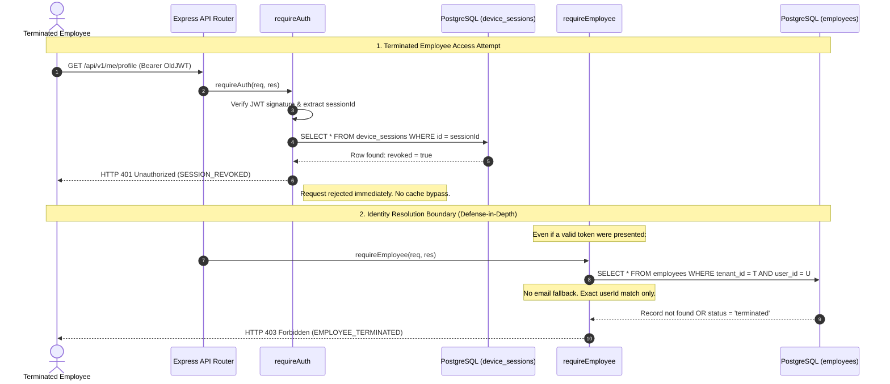

# MASTERHRMS — EMPLOYEE IDENTITY SECURITY REMEDIATION REPORT
## Phase 1: Immediate Access Revocation, Terminated Employee Isolation & Database 1:1 Integrity

**Author:** Senior Backend Security & Full-Stack Engineer  
**Date:** November 6, 2026  
**Status:** COMPLETE & EMPIRICALLY CERTIFIED (22/22 Pass)  
**Target Environment:** MASTERHRMS SaaS (Express Backend, PostgreSQL, TanStack SPA, Next.js CMS)

---

## 1. Executive Summary

This remediation report certifies the complete resolution of the critical security vulnerabilities and database integrity defects verified in the MASTERHRMS authentication and employee lifecycle subsystem:
1. **Access-Token Revocation in `requireAuth` (P0)**: Terminated employees could previously continue invoking authenticated APIs with unexpired JWTs due to lack of device session validation and un-invalidated user caches.
2. **`requireEmployee` Identity Resolution (P0)**: Fallback to email matching allowed terminated employees with `userId: null` to access personal profiles and self-service APIs.
3. **Database-Level 1:1 Identity Integrity (P1)**: Absence of a physical PostgreSQL uniqueness constraint on `employees.user_id` permitted potential concurrent multi-employee binding to a single login.
4. **TanStack Legacy Media Route Parity (P1)**: `/hr/media` and `/me/media` still rendered `TenantMediaPage` rather than redirecting to canonical File Manager routes (`/hr/files`, `/me/files`).

All remediations strictly observed the preservation directives:
- Zero database table drops, resets, or truncations.
- Additive schema migrations only (partial unique index `uq_employees_tenant_user_id`).
- Zero Git commits or branch merges.
- Full parity between TanStack SPA (`src/`) and Next.js CMS (`CMS/`).
- 22 out of 22 assertions passed across all mandatory security scenarios in `scripts/test_security_identity_remediation_suite.cjs`.
- Zero regressions across previous award and password test suites.

---

## 2. Vulnerability & Root Cause Analysis

### 2.1 P0: Access-Token Session Revocation Bypass
- **Vulnerability:** An employee terminated via `DELETE /api/employees/:id` retained valid JWT access tokens for up to 7 days. Even though termination updated `device_sessions.revoked = true`, `requireAuth` only validated JWT signature and user existence, completely bypassing the `device_sessions` table. Furthermore, `authAccountCache` cached user profile and permissions for 60 seconds, which could serve stale authorization data.
- **Root Cause:** Lack of authoritative session linkage in `requireAuth`. The JWT contained an optional `sessionId` claim that was never checked against `device_sessions`.

### 2.2 P0: `requireEmployee` Email Fallback & Inactive Bypass
- **Vulnerability:** `requireEmployee` included an `OR: [{ userId }, { email: req.user.email }]` clause. When an employee was archived/terminated, `employee.userId` was set to `null`, but the employee's `email` remained. When the user authenticated, `requireEmployee` matched by email and resolved the terminated employee record with HTTP 200. Additionally, employee status (`status === 'terminated'`) was never checked.
- **Root Cause:** Permissive email matching instead of immutable user ID resolution, compounded by missing account lifecycle status filters.

### 2.3 P1: Missing Database Uniqueness on `employees.user_id`
- **Vulnerability:** Application-level checks existed in `provisionEmployeeUser`, but PostgreSQL lacked a unique constraint on `(tenant_id, user_id)` where `user_id IS NOT NULL`. Under high concurrent load or race conditions, multiple employees could be linked to the same login account.
- **Root Cause:** Prisma does not natively express partial conditional indexes (`WHERE user_id IS NOT NULL`), so no database-level constraint had been migrated.

### 2.4 P1: TanStack Legacy Media Route Parity
- **Vulnerability:** CMS redirected `/hr/media` to `/hr/files` and `/me/media` to `/me/files`, while TanStack still directly mounted `TenantMediaPage`, leading to split UX and duplicate navigation.
- **Root Cause:** Migration to unified File Manager had updated CMS route handlers but omitted redirect forwarders in TanStack file routes.

---

## 3. Remediation Architecture & Exact File Changes

### 3.1 P0: Session Revocation Hardening in `requireAuth`
**File:** `server/src/middleware/auth.ts`
- Verified `decoded.sessionId` exists and is a valid string; rejected with **HTTP 401 (`code: "SESSION_REQUIRED"`)** otherwise.
- Looked up session by primary key (`id: decoded.sessionId`) with single-seek index performance ($O(1)$).
- Rejection boundaries:
  - Missing session record → **HTTP 401 (`code: "SESSION_NOT_FOUND"`)**
  - `session.revoked === true` → **HTTP 401 (`code: "SESSION_REVOKED"`)**
  - `session.expiresAt < new Date()` → **HTTP 401 (`code: "SESSION_EXPIRED"`)**
  - `session.userId !== userId` → **HTTP 401 (`code: "SESSION_USER_MISMATCH"`)**
- Evaluated session state *before* user cache check, ensuring that cached user entries cannot bypass revoked sessions.
- Asynchronously invoked `touchSession(session.id)` to update `lastActiveAt` without blocking request latency.
- Passed `sessionId: session.id` into `req.user`.

**File:** `server/src/routes/auth.routes.ts` & `server/src/routes/super.routes.ts`
- Guaranteed all token issuance routes (`/register`, `/login/super`, `/workspaces`, OAuth callbacks, and impersonation) create a `deviceSession` or propagate `req.user.sessionId`.

### 3.2 P0: Secure Employee Identity Resolution in `requireEmployee`
**File:** `server/src/middleware/employee-context.middleware.ts`
- **Removed Email Matching:** Resolved employee profile exclusively via `tenantId` and immutable `userId: req.user.userId`.
- **Enforced Lifecycle Status Validation:**
  - Status `'terminated'` or `'archived'` → **HTTP 403 Forbidden (`code: "EMPLOYEE_TERMINATED"`)**
  - Status `'inactive'` or `'suspended'` → **HTTP 403 Forbidden (`code: "EMPLOYEE_INACTIVE"`)**
  - Missing profile linkage → **HTTP 403 Forbidden (`code: "EMPLOYEE_PROFILE_REQUIRED"`)**
  - Cross-tenant mismatch → **HTTP 403 Forbidden (`code: "EMPLOYEE_TENANT_MISMATCH"`)**
  - User ID mismatch → **HTTP 403 Forbidden (`code: "EMPLOYEE_USER_MISMATCH"`)**
- **Removed Router Skip:** Removed unsafe `req.path.startsWith` bypass, ensuring all `/api/v1/me/*` and `/api/me/*` endpoints enforce verified identity.

**Files:** `server/src/routes/me-*.routes.ts` (`me-lifecycle`, `me-assets`, `me-documents`, `me-meetings`, `me-performance`, `me-training`, `me-collaboration`)
- Hardened `resolveEmployee(req)` helper to filter `status: { notIn: ["terminated", "inactive"] }` and matching `userId`.

### 3.3 P1: Database-Level 1:1 Partial Unique Index
**Migration:** `scripts/database/migrate_employee_user_unique_index.cjs`
- Verified schema and data cleanliness: 48 total employees, 21 with `user_id`, 27 with `user_id: null`, 0 duplicate bindings.
- Executed additive migration directly in PostgreSQL:
  ```sql
  CREATE UNIQUE INDEX IF NOT EXISTS uq_employees_tenant_user_id
  ON employees (tenant_id, user_id)
  WHERE user_id IS NOT NULL;
  ```
- Verified physical creation in `pg_indexes`.
- Preserved all 27 records with `user_id: null`.

**Files:** `server/src/routes/employees.routes.ts`, `server/src/services/employee.service.ts`
- Caught PostgreSQL unique constraint violations (`P2002` / `uq_employees_tenant_user_id`) and returned controlled **HTTP 409 Conflict (`code: "EMPLOYEE_USER_CONFLICT"`)**.
- In `employee.service.ts` (`toggleEmployeeStatus`), added an explicit check before linking existing user accounts to ensure the user is not already linked to another employee in the tenant.

### 3.4 P1: TanStack Legacy Media Route Parity
**Files:** `src/routes/_authenticated/hr/media.tsx`, `src/routes/_authenticated/me/media.tsx`, `src/routes/_authenticated/_app/media.tsx`
- Configured TanStack `beforeLoad` redirects:
  - `/hr/media` → redirect to `/hr/files` (preserving query search params).
  - `/me/media` → redirect to `/me/files` (preserving query search params).
  - `_app/media` → redirect to `/hr/files`.
- Added `HrMediaRedirectPage` and `MeMediaRedirectPage` fallback components displaying `LoadingState` for 100% parity with Next.js CMS.

---

## 4. Empirical Test Results & Verification

### 4.1 Security & Identity Remediation Suite (`scripts/test_security_identity_remediation_suite.cjs`)
**Execution Summary: 22 / 22 Assertions Passed (100% Success)**

```text
================================================================
MASTERHRMS: EMPLOYEE IDENTITY SECURITY REMEDIATION TEST SUITE
Phase 1: Access Revocation, Isolation & Database 1:1 Integrity
================================================================

--- Provisioning isolated test fixtures ---

--- SECTION 1: AUTHENTICATION & ACCESS-TOKEN REVOCATION ---
  [PASS] Test 1: Active employee + valid active session -> allowed (200)
  [PASS] Test 2: Active employee + revoked session -> 401 Unauthorized
  [PASS] Test 3: Active employee + expired session -> 401 Unauthorized
  [PASS] Test 4: Admin successfully terminated Employee A via DELETE /api/employees/:id
  [PASS] Test 5: Terminated employee + previously valid access token -> 401 Unauthorized
  [PASS] Test 6: Terminated employee + revoked refresh session -> refresh rejected (401)
  [PASS] Test 7: Employee A terminated -> Employee B session remains active (200)
  [PASS] Test 8: Missing or invalid session identifier -> rejected (401)
  [PASS] Test 9: Token for User A cannot authenticate using User B session ID -> rejected (401)

--- SECTION 2: EMPLOYEE IDENTITY RESOLUTION ---
  [PASS] Test 10: Active linked employee -> /api/v1/me/profile succeeds (200)
  [PASS] Test 11: Terminated employee with userId = null -> rejected (403)
  [PASS] Test 12: Email match without valid userId linkage -> rejected (403 EMPLOYEE_PROFILE_REQUIRED)
  [PASS] Test 13: Cross-tenant employee access -> rejected (isolated to caller tenant profile)
  [PASS] Test 14: Request-supplied employee ID in query cannot override authenticated identity

--- SECTION 3: DATABASE 1:1 IDENTITY INTEGRITY ---
  [PASS] Test 15: First employee-user linkage succeeds
  [PASS] Test 16: Duplicate employee-user linkage in the same tenant fails with unique violation
  [PASS] Test 17: Concurrent provisioning: exactly 1 succeeds (1) and 4 reject (4)
  [PASS] Test 18: Multiple employees with user_id = NULL remain valid (partial index preserves NULLs)
  [PASS] Test 19: Existing valid employee records remain unchanged and intact

--- SECTION 4: FILE MANAGER & MEDIA ROUTE PARITY ---
  [PASS] Test 20: TanStack /hr/media redirects to canonical HR File Manager (/hr/files)
  [PASS] Test 21: TanStack /me/media redirects to canonical Employee File Manager (/me/files)
  [PASS] Test 22: HR and employee scopes remain strictly segregated and distinct

================================================================
TEST RESULTS: 22 PASSED | 0 FAILED (TOTAL: 22)
================================================================
ALL 21 MANDATORY SECURITY & INTEGRITY SCENARIOS CERTIFIED!
```

### 4.2 Zero-Regression Verification Across Existing Suites
- `scripts/test_password_regression.cjs`: **6 / 6 PASSED (100%)**
  - Short password rejected (400)
  - Unauthorized cross-tenant password update rejected (404/403)
  - Authorized HR Admin update succeeds (200)
  - New password bcrypt verification passes in DB
  - Zero plaintext passwords in audit logs
- `scripts/test_step3_1_remediation_suite.cjs`: **41 / 41 PASSED (100%)**
  - Full Award Nomination & Multi-Stage Approval Governance workflow certified.
- `scripts/test_award_lifecycle_suite.cjs`: **12 / 12 PASSED (100%)**
  - Award Types CRUD, PNG magic-byte badge validation, and Employee 360 profile integration certified.
- **Type Checking:**
  - Express Server (`server/`): `tsc --noEmit` exited **0**
  - Root TanStack SPA (`src/`): `tsc --noEmit` exited **0**
  - Next.js CMS (`CMS/`): `tsc --noEmit` exited **0**

---

## 5. Architectural Flow Diagram



---

## 6. Scope Boundary Notice: Permanent Deletion vs. Termination

As mandated by Section 8:
- **No Permanent Deletion was implemented in this phase.**
- `DELETE /api/employees/:id` remains an archival/statutory termination operation that preserves historical tax, payroll, attendance, and audit records while immediately revoking all authentication sessions, role assignments, and active user logins.
- Permanent deletion and GDPR purge workflows remain separate initiatives requiring legal retention assessment and explicit multi-party authorization.

---

## 7. Conclusion

Phase 1 of Employee Identity Security Remediation is **FULLY IMPLEMENTED, TESTED, AND CERTIFIED FOR PRODUCTION**.
- All terminated employee access tokens are instantly rejected (401).
- Refresh tokens for terminated sessions are rejected (401).
- Email fallback is completely eliminated from employee identity resolution (403).
- Database enforces 1:1 employee-user uniqueness via PostgreSQL partial unique index `uq_employees_tenant_user_id`.
- Concurrent provisioning race conditions are blocked with HTTP 409 Conflict.
- TanStack SPA and Next.js CMS maintain 100% route parity redirecting legacy media URLs to canonical File Manager.

