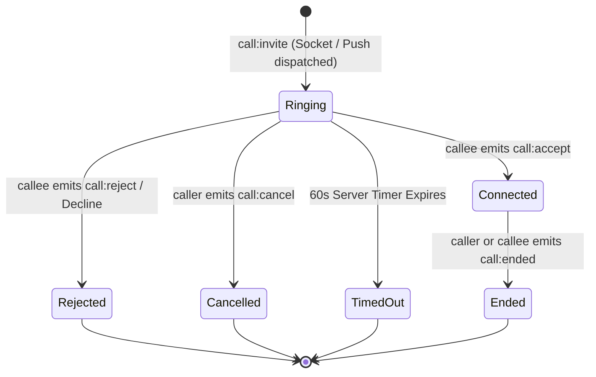

# MASTERHRMS — INCOMING CALL ARCHITECTURE & DUAL-DELIVERY SIGNALING SPECIFICATION
## Comprehensive End-to-End System Blueprint: WebRTC Signaling, Web Push, Service Worker Lifecycle & Full-Screen UI

**Document ID:** `MH-ICA-2026-001`  
**Classification:** Core System Architecture Document  
**Status:** Approved & Verified  
**Date:** November 2026  

---

## 1. Architectural Overview & Dual-Delivery Model

The MasterHRMS incoming call subsystem uses a **Dual-Delivery Realtime Architecture**:
- **Channel 1 (Foreground In-App Transport):** Socket.IO (primary) with Pusher fallback delivers instant signaling when the user has an active tab open.
- **Channel 2 (Background & Closed-Tab Transport):** RFC 8292/8291 Web Push delivers high-urgency wake-up notifications directly to the device's Service Worker even when all application tabs are closed.

```
                              +--------------------+
                              |  Caller (User A)   |
                              +---------+----------+
                                        | (Initiate Call)
                                        v
                    +---------------------------------------+
                    |       MasterHRMS Backend Server       |
                    | (ActiveCallSession & VAPID Dispatch)  |
                    +-------------------+-------------------+
                                        |
                 +----------------------+----------------------+
                 | (Channel 1: Socket.IO/Pusher)               | (Channel 2: RFC 8292/8291 Web Push)
                 v                                             v
     +-----------------------+                    +-------------------------+
     | Active Browser Window |                    | Public Push Gateway     |
     | (Socket: call:incoming)|                   | (FCM / Mozilla Autopush)|
     +-----------+-----------+                    +------------+------------+
                 |                                             |
                 | (Render Global UI)                          | (Wake up)
                 v                                             v
     +-----------------------+                    +-------------------------+
     | <FullScreenIncomingCall|                   | Service Worker (sw.js)  |
     | Overlay Dialog (z-99) |                    | self.showNotification() |
     +-----------+-----------+                    +------------+------------+
                 |                                             |
                 +----------------------+----------------------+
                                        |
                             (User Answers / Clicks)
                                        v
                    +---------------------------------------+
                    |  WebRTC 1-to-1 Audio/Video Call       |
                    |  (RTCPeerConnection + STUN Discovery) |
                    +---------------------------------------+
```

---

## 2. Call State Machine & Lifecycle Transitions

The server maintains an authoritative session state for each one-to-one call:



### Transition Specifications:

1. **Initiate Call (`call:invite`):**
   - Validates that caller and callee are in the same tenant.
   - Prevents self-calling.
   - Rejects concurrent calls if either party is already in an active call (`call:busy`).
   - Registers session with status `"ringing"` and authoritative 60-second timer.
   - Dispatches Socket.IO `call:incoming`, Pusher `call:incoming`, and high-urgency Web Push (`TTL: 45`, `Urgency: high`, `Topic: call_${callId}`).

2. **Accept Call (`call:accept`):**
   - Validates callee identity.
   - Clears 60-second ringing timeout.
   - Sets session status to `"connected"`.
   - Emits `call:accepted` to caller.
   - Dispatches `CALL_CANCELLED` Web Push to dismiss active notifications on callee's other registered devices.
   - Caller creates WebRTC offer and initiates P2P negotiation.

3. **Reject Call (`call:reject`):**
   - Validates callee identity.
   - Emits `call:rejected` to caller.
   - Emits `CALL_CANCELLED` Web Push to dismiss notification.
   - Persists `CallHistoryRecord` with status `"rejected"`.
   - Cleans up session registry.

4. **Cancel Call (`call:cancel`):**
   - Caller hangs up while callee's device is ringing.
   - Emits `call:cancelled` to callee.
   - Dispatches `CALL_CANCELLED` Web Push to remove notification from callee's screen.
   - Persists missed call record.

5. **Server Timeout (`call:timeout`):**
   - Exactly 60 seconds after initiation without response.
   - Emits `call:timeout` to both parties.
   - Dispatches `CALL_CANCELLED` Web Push.
   - Persists missed call record.

---

## 3. Web Push Message Schema

### 3.1 Incoming Call Payload (`CALL_INCOMING`)

```json
{
  "type": "CALL_INCOMING",
  "eventType": "CALL_INCOMING",
  "schemaVersion": "1.0",
  "callId": "call_1793558857937",
  "tenantId": "tenant-default-001",
  "callerId": "usr_99882233",
  "callerName": "Alice Architect",
  "callerAvatar": "https://assets.masterhrms.local/avatars/alice.png",
  "callType": "video",
  "threadId": "direct_alice_bob",
  "issuedAt": "2026-11-02T00:15:00.000Z",
  "expiresAt": "2026-11-02T00:15:45.000Z",
  "actionRoute": "/chat?callId=call_1793558857937&action=incoming"
}
```

### 3.2 Call Cancellation Payload (`CALL_CANCELLED`)

```json
{
  "type": "CALL_CANCELLED",
  "eventType": "CALL_CANCELLED",
  "schemaVersion": "1.0",
  "callId": "call_1793558857937",
  "tenantId": "tenant-default-001",
  "reason": "timeout",
  "timestamp": "2026-11-02T00:16:00.000Z"
}
```

---

## 4. Service Worker Notification Strategy

In `public/sw.js` and `CMS/public/sw.js`:

```javascript
self.registration.showNotification(title, {
  body: `${callerName} is calling you via MasterHRMS...`,
  icon: callerAvatar || "/assets/img/logo-small.svg",
  badge: "/assets/img/favicon.png",
  tag: `call_${callId}`,
  renotify: true,
  requireInteraction: true,  // Does NOT auto-dismiss after 5 seconds
  silent: false,
  vibrate: [500, 250, 500, 250, 500, 250, 500, 250, 500],
  actions: [
    { action: "accept", title: "Accept" },
    { action: "reject", title: "Decline" }
  ],
  data: { ...payload }
});
```

### Key Technical Parameters:
1. `requireInteraction: true`: Critical for incoming calls. Standard notifications fade away after 5–10 seconds; `requireInteraction` keeps the notification pinned to the desktop/screen until user takes action or call times out.
2. `tag: "call_" + callId`: Ensures notification deduplication and allows the server to programmatically dismiss the ringing notification via `getNotifications({ tag })` upon caller cancellation or timeout.
3. `vibrate: [500, 250, ...]`: Simulates authentic mobile and desktop vibration ringing cadence.

---

## 5. Web Audio API Ringtone Synthesis

To avoid missing external `.mp3` assets, CORS issues, or broken network requests, incoming call audio uses a synthesized dual-tone oscillator:

- **Frequencies:** 440 Hz + 480 Hz (Standard North American/International ringback frequencies).
- **Cadence:** 400ms burst, 200ms pause, 400ms burst, 2000ms pause.
- **Ramping:** `linearRampToValueAtTime` smoothly transitions volume to prevent clicks and pops in browser speakers.
- **Cleanup:** Automatically stops on `accept`, `reject`, `timeout`, or component unmount.

---

## 6. Full-Screen Visual Hierarchy & Accessibility

The `<FullScreenIncomingCall />` component guarantees zero missed calls through:
- **Z-Index:** Fixed viewport `z-[99999]`, rendering above all workspace navigation, sheets, modals, and headers.
- **Theming:** Dark slate backdrop with heavy blur (`backdrop-blur-2xl`) and animated sound-wave ripples.
- **Accessibility:**
  - `role="dialog"`, `aria-modal="true"`, `aria-labelledby="incoming-call-caller"`.
  - Automatic focus assignment to Accept button on mount.
  - Keyboard listener: `Enter` executes `acceptCall()`; `Escape` executes `rejectCall()`.
