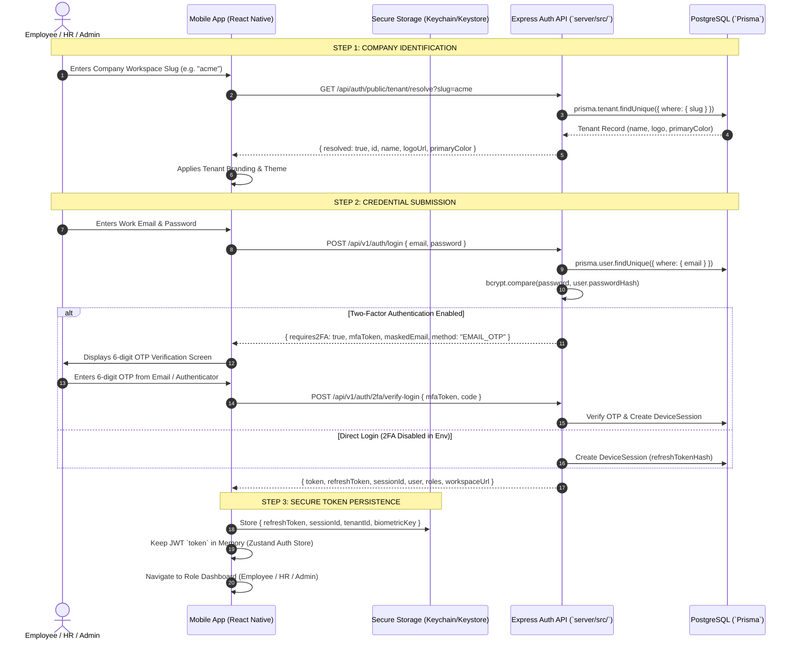

# MASTERHRMS MOBILE — AUTHORITATIVE AUTHENTICATION ARCHITECTURE
**Comprehensive Mobile Authentication, Token Management & Session Security**  
**Repository:** `Webfamily-06/masterhrms`  
**Platforms:** Android & iOS (React Native CLI + TypeScript)  
**Date:** November 16, 2026  

---

## 1. End-to-End Mobile Authentication Lifecycle

---

## 2. Token Storage & Platform Security Boundaries

### 2.1 The Two-Tier Storage Model
To prevent token theft and ensure enterprise compliance:
1. **Access Token (JWT)**:
   - **Lifetime**: 15 minutes to 24 hours.
   - **Storage**: In-memory only (Zustand state store).
   - **Never persisted** to AsyncStorage or plain SQLite. If the process is killed, the token disappears from memory.
2. **Refresh Token & Session ID**:
   - **Lifetime**: 30 days rolling.
   - **Storage**: Platform Hardware-Backed Secure Storage:
     - **iOS**: Apple Keychain Services (`kSecAttrAccessibleAfterFirstUnlockThisDeviceOnly`).
     - **Android**: Android Keystore Provider with AES-256-GCM encryption.
   - **Library**: `react-native-keychain`.

### 2.2 Local Biometric App Unlock vs Backend Authentication
- **Fundamental Rule**: Biometric authentication (FaceID / TouchID / BiometricPrompt) is strictly a **local convenience gate**, never a replacement for backend authentication.
- **Workflow**:
  - When the user enables "Biometric Unlock" in Mobile Settings, the refresh credentials in Keychain/Keystore are locked behind biometric biometric access control (`ACCESS_CONTROL.BIOMETRY_CURRENT_SET_OR_DEVICE_PASSCODE`).
  - When the app returns from background or launches after device reboot, the user provides FaceID/Fingerprint to unlock the keystore.
  - The app then retrieves the stored `refreshToken` and `sessionId`, calls `POST /api/v1/auth/refresh`, and receives a fresh access token from the backend.

---

## 3. Atomic Refresh Token Rotation & Concurrency Control

### 3.1 Concurrency Race Prevention
In mobile applications, multiple asynchronous components or widgets (e.g. Dashboard stats, attendance banner, notifications count) frequently make concurrent API calls when the access token expires.

If all requests trigger simultaneous refresh calls:
- Standard naive refresh handlers fail due to reuse detection.
- **MasterHRMS Implementation**:
  1. Centralized **Axios Response Interceptor** detects HTTP 401.
  2. A single atomic promise `refreshTokenPromise` is instantiated.
  3. All other concurrent 401 requests subscribe to this single in-flight promise and wait.
  4. Once `POST /api/v1/auth/refresh` resolves, the new access token is broadcast to all waiting requests, which replay seamlessly with the new Bearer header.

### 3.2 Reuse Attack Detection (`device-session.service.ts`)
- Every refresh token is single-use.
- The database stores `refreshTokenHash` (SHA-256).
- If an attacker intercepts and replays an already rotated refresh token:
  - Hash mismatch occurs on the server.
  - The server immediately flags a security incident and **revokes the entire session** (`revoked: true`).
  - All subsequent requests from both legitimate user and attacker fail with HTTP 401 `SESSION_REVOKED`, forcing re-authentication.

---

## 4. Session Expiration, Inactivity & Lockout

### 4.1 Inactivity Timeout
- Mobile app monitors user touch interactions via root pan responder.
- After a configurable duration (default: 15 minutes of inactivity):
  - In-memory access token is cleared.
  - App displays the "Session Locked" modal overlay.
  - User can instantly unlock using local biometric verification or password re-entry (`POST /api/auth/unlock`).

### 4.2 Account Deactivation & Employment Termination
- On every authenticated API call, `requireAuth` calls `touchSession(session.id)`.
- If an employee has been terminated (`employee.status === "terminated"`) or user account deactivated by HR:
  - Backend returns HTTP 403 `ACCOUNT_DEACTIVATED` or `EMPLOYMENT_TERMINATED`.
  - Mobile app interceptor immediately purges all secure storage, clears query cache, and routes user to the Logout / Account Locked screen.

---

## 5. Logout & Cache Cleanup Lifecycle

When the user taps "Log Out" or selects "Log out of all devices":
1. App calls `POST /api/v1/auth/logout` passing `{ sessionId, deviceId }`.
2. Backend invalidates `authAccountCache` and marks `deviceSession` revoked.
3. Push notification tokens for that device are explicitly deregistered from `PushSubscriptionStore`.
4. Mobile App performs complete local sanitize:
   - Clears in-memory Zustand auth store.
   - Clears Keychain/Keystore refresh tokens.
   - Purges TanStack Query client cache (`queryClient.clear()`).
   - Clears temporary cached document files from app sandbox (`react-native-fs`).
   - Resets React Navigation stack to Company Discovery / Login Screen.
