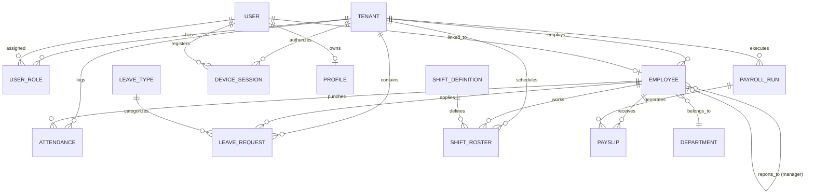

# MASTERHRMS MOBILE — AUTHORITATIVE DATABASE MAPPING SPECIFICATION
**Data Model Topology, Entity Relationships & Role Data Access Patterns**  
**Repository:** `Webfamily-06/masterhrms`  
**ORM:** Prisma Client v5.22.0 | **Provider:** PostgreSQL (Supabase Connection Pooler)  
**Schema File:** `server/prisma/schema.prisma` (298 models)  
**Date:** November 16, 2026  

---

## 1. Database Model Classification

The MasterHRMS database architecture enforces multi-tenancy at the data layer through a hybrid model hierarchy codified in `server/src/config/tenant-models.config.ts`.

```
                             +-------------------------------+
                             |    GLOBAL PLATFORM MODELS     |
                             |  User, SubscriptionPlan,     |
                             |  Permission, SystemCronJob    |
                             +-------------------------------+
                                             |
                                             v
                             +-------------------------------+
                             |       ROOT TENANT MODEL       |
                             |      Tenant (`id` = UUID)     |
                             +-------------------------------+
                                             |
                      +----------------------+----------------------+
                      |                                             |
                      v                                             v
     +----------------------------------+          +----------------------------------+
     |      DIRECT TENANT MODELS        |          |      SCOPED TENANT MODELS        |
     |  (Contain direct `tenantId` col) |          |  (Contain scope='TENANT' and     |
     |  Employee, Attendance,           |          |   scopeId=tenantId)              |
     |  LeaveRequest, PayrollRun,       |          |  Setting, SettingAudit           |
     |  ShiftRoster, DeviceSession      |          +----------------------------------+
     +----------------------------------+
                      |
                      v
     +----------------------------------+
     |     CHILD DEPENDENT MODELS       |
     |  (Isolated via foreign keys)     |
     |  SalaryStructureItem,            |
     |  EmployeeSalaryItem,             |
     |  TaxDeclarationProof             |
     +----------------------------------+
```

---

## 2. Core Entities for Mobile Experience

### 2.1 User, Profile & Tenant Binding
- **`Tenant`**: The corporate workspace container (`id`, `name`, `slug`, `logoUrl`, `timezone`, `status`).
- **`User`**: The global authentication principal (`id`, `email`, `passwordHash`, `twoFactorEnabled`, `twoFactorSecret`).
- **`Profile`**: The workspace-bound identity link (`id`, `userId`, `tenantId`, `fullName`, `avatarUrl`, `phone`).
- **`DeviceSession`**: Authoritative device session registry (`id`, `userId`, `tenantId`, `deviceType`, `refreshTokenHash`, `revoked`, `expiresAt`, `lastActiveAt`).

### 2.2 Employee & Organizational Hierarchy
- **`Employee`**: Master workforce record (`id`, `tenantId`, `userId`, `employeeCode`, `firstName`, `lastName`, `email`, `phone`, `departmentId`, `designationId`, `managerId`, `status`, `joinedAt`, `bankName`, `bankAccount`, `pan`, `aadhaar`).
- **`Department`**: Organizational department unit (`id`, `tenantId`, `name`, `code`).
- **`Designation`**: Job designation title (`id`, `tenantId`, `name`).

### 2.3 Attendance, Biometrics & Geo-Fencing
- **`Attendance`**: Time and attendance log (`id`, `tenantId`, `employeeId`, `date`, `checkIn`, `checkOut`, `hours`, `status`, `notes`).
- **`ShiftDefinition`**: Shift master (`id`, `tenantId`, `name`, `code`, `startTime`, `endTime`, `halfDayHours`, `fullDayHours`).
- **`ShiftRoster`**: Daily shift schedule per employee (`id`, `tenantId`, `employeeId`, `rosterDate`, `shiftId`).
- **`Warehouse`**: Corporate premises & geofence coordinates (`id`, `tenantId`, `name`, latitude/longitude fallback).

### 2.4 Leave Management
- **`LeaveType`**: Policy types (`id`, `tenantId`, `name`, `code`, `daysAllowed`, `isPaid`, `color`, `status`).
- **`LeaveRequest`**: Employee leave applications (`id`, `tenantId`, `employeeId`, `leaveTypeId`, `startDate`, `endDate`, `days`, `status`, `reason`, `approverComment`).
- **`LeaveAllocation`**: Annual quotas and accruals (`id`, `tenantId`, `employeeId`, `leaveTypeId`, `year`, `allocatedDays`, `usedDays`).

### 2.5 Payroll & Compensation
- **`PayrollRun`**: Monthly payroll batch (`id`, `tenantId`, `periodYear`, `periodMonth`, `status`, `totalGross`, `totalNet`, `processedAt`).
- **`Payslip`**: Individual itemized earnings statement (`id`, `tenantId`, `payrollRunId`, `employeeId`, `grossSalary`, `netSalary`, `totalDeductions`, `currency`).
- **`EmployeeTaxDeclaration`**: Annual tax declaration & regime (`id`, `tenantId`, `employeeId`, `financialYear`, `regime`).

---

## 3. Entity-Relationship Diagram (ERD)



---

## 4. Role-Based Data Access Patterns

### 4.1 Employee Persona Data Access
- **Scope**: Strictly limited to rows matching `tenantId = ctx.tenantId AND employeeId = self.employeeId`.
- **Allowed Queries**:
  - `Attendance`: Read own punches; create/update own daily check-in / check-out.
  - `LeaveRequest`: Read own leave history; submit new leave request; cancel own pending leave.
  - `LeaveBalance`: Read own available vs consumed leave quotas.
  - `Payslip`: Read own itemized payslips; cannot access any peer employee payslips.
  - `ShiftRoster`: Read own scheduled shift calendar.
  - `Announcement`: Read all published company or department-targeted announcements.
  - `Employee`: Read own profile; read sanitized public colleagues directory (names, designations, departments; salary and bank details masked).

### 4.2 HR Persona Data Access
- **Scope**: Operational authority across the entire workspace (`tenantId = ctx.tenantId`).
- **Allowed Queries**:
  - `Employee`: Read all employees across all departments; view employment history and contact info.
  - `Attendance`: Read company-wide attendance dashboard; view late-ins, early check-outs, and absent employees.
  - `LeaveRequest`: Read all pending leave requests; approve or reject with comments (`LeaveService.decideApplication()`).
  - `ShiftRoster`: View department shift matrices; assign employees to shifts.
  - `PayrollRun`: View payroll processing runs and aggregate salary disbursement summaries.

### 4.3 Admin Persona Data Access
- **Scope**: Full administrative control of workspace settings and subscription.
- **Allowed Queries**:
  - `Tenant`: Read and update workspace details, custom domains, and corporate branding.
  - `TenantSubscription`: Read plan limits, employee capacity, and billing invoice history.
  - `Setting`: Read and write workspace security parameters (2FA requirements, IP firewall rules).
  - `SettingAudit` & `ActivityLog`: Review full chronological audit trail of configuration changes and logins.

---

## 5. Security & Masking Rules for Mobile Queries

To protect employee privacy and comply with financial/statutory data regulations (such as GDPR and Indian IT Act):
1. **Bank Account Number**: Only the last 4 digits are transmitted (`••••••••1234`).
2. **PAN & Aadhaar**: Full numbers are masked server-side (`••••••••5678`).
3. **Password Hashes & Salt**: Never exposed in any mobile response under any circumstance.
4. **Tenant Isolation Extension**: Guarantees zero cross-tenant contamination even if a malicious client injects a foreign `tenantId` into request query parameters.
