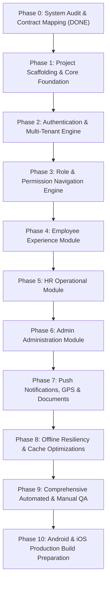

# MASTERHRMS MOBILE — IMPLEMENTATION ROADMAP & PHASED EXECUTION PLAN
**Authoritative Engineering Roadmap for Unified MasterHRMS Mobile Application**  
**Repository:** `Webfamily-06/masterhrms`  
**Target:** Android & iOS (React Native CLI + TypeScript)  
**Date:** November 16, 2026  

---

## 1. Roadmap Overview & Timeline

The MasterHRMS Mobile Application implementation is partitioned into **11 sequential, strictly verified phases**. Every phase must satisfy functional verification, automated tests, and tenant isolation checks before proceeding to the subsequent phase.

---

## 2. Phase-by-Phase Execution Plan

### Phase 0: Existing System Audit (COMPLETED)
- [x] Comprehensive read-only audit of server routes, Prisma schema, and web frontends.
- [x] Production of `MASTERHRMS_MOBILE_SYSTEM_AUDIT.md`.
- [x] Production of `MASTERHRMS_MOBILE_API_MAPPING.md`.
- [x] Production of `MASTERHRMS_MOBILE_DATABASE_MAPPING.md`.
- [x] Production of `MASTERHRMS_MOBILE_AUTH_ARCHITECTURE.md`.
- [x] Production of `MASTERHRMS_MOBILE_TENANT_ARCHITECTURE.md`.
- [x] Production of `MASTERHRMS_MOBILE_IMPLEMENTATION_ROADMAP.md`.

---

### Phase 1: Project Scaffolding & Foundation (`mobile-app/`)
- **Objective**: Establish a clean React Native CLI project with TypeScript, design tokens, navigation, and API infrastructure.
- **Tasks**:
  1. Initialize React Native project with TypeScript template in `mobile-app/`.
  2. Configure `tsconfig.json` with strict type checking and path aliases (`@core/*`, `@modules/*`, `@components/*`, `@theme/*`).
  3. Implement **Design Tokens System**:
     - Brand color palette (Primary Orange `#FF6B00`, Deep Navy `#1E293B`, Slate `#64748B`, Dark mode neutrals).
     - Typography scale (Headings, Body, Captions, tabular figures for currency/hours).
     - Spacing, border radius, and elevation tokens.
  4. Configure **Axios API Client** (`@core/api/apiClient.ts`):
     - Base URL configuration (Dev localhost/LAN vs Prod).
     - Request interceptor attaching `Authorization: Bearer <token>`, `x-tenant-id`, and `User-Agent`.
     - Response interceptor with atomic token refresh on HTTP 401.
     - Centralized error normalization (`ApiError`).
  5. Configure **Secure Storage** (`@core/storage/secureStorage.ts`) using Keychain (iOS) and Keystore (Android).
  6. Configure **Zustand Stores** (`@store/authStore.ts`, `@store/tenantStore.ts`, `@store/themeStore.ts`).
  7. Set up **TanStack Query** (`@tanstack/react-query`) with tenant-aware query key defaults.

---

### Phase 2: Authentication & Company Identification
- **Objective**: Implement secure multi-tenant company discovery, credential login, 2FA, and session persistence.
- **Tasks**:
  1. Build **Company Discovery Screen**:
     - User inputs company slug or domain.
     - Calls `GET /api/auth/public/tenant/resolve?slug={slug}`.
     - Renders company branding (logo, company name, primary brand color).
  2. Build **Login Screen**:
     - Work email and password inputs with React Hook Form + Zod validation.
     - Calls `POST /api/v1/auth/login`.
  3. Build **Two-Factor Authentication (2FA) Screen**:
     - 6-digit OTP code input with auto-focus and resend countdown timer.
     - Calls `POST /api/v1/auth/2fa/verify-login`.
     - Handles OTP resend via `POST /api/v1/auth/2fa/resend`.
  4. Build **Session Restoration & Auto-Login**:
     - On app cold start, checks Keychain/Keystore for active session.
     - Rotates refresh token via `POST /api/v1/auth/refresh`.
     - Fetches active user state via `GET /api/v1/auth/me`.
  5. Build **Biometric Local Unlock**:
     - Enables FaceID / Fingerprint lock screen on app resume.
  6. Build **Password Reset Flow**:
     - Forgot password request (`POST /api/v1/auth/forgot-password`).
     - Reset password confirmation (`POST /api/v1/auth/reset-password`).

---

### Phase 3: Role & Permission Navigation Engine
- **Objective**: Centralized dynamic navigation system switching between Employee, HR, and Admin personas.
- **Tasks**:
  1. Build **Dynamic Navigation Root**:
     - Auth Stack (Company Discovery, Login, 2FA, Forgot Password).
     - App Shell (Role-based Bottom Tab Navigator + Drawer).
  2. Implement **Permission & Role Resolver**:
     - Evaluates `user.roles` (`employee`, `hr_admin`, `admin`, `tenant_admin`, `manager`).
     - Evaluates `user.permissions` (`attendance.view`, `leave.approve`, `payroll.view`, etc.).
  3. Configure **Role-Based Tab Configurations**:
     - **Employee Tab Bar**: Home / Dashboard, Attendance (Punch), Leaves, Payslips, Profile.
     - **HR Tab Bar**: HR Overview, Employees Directory, Attendance Matrix, Approvals Queue, Shifts.
     - **Admin Tab Bar**: Admin Overview, Workforce Stats, Settings, Subscription, Audit Logs.
  4. Build **Role Switcher Header**:
     - For dual-role users (e.g. an HR Director who is also an employee with personal attendance/leave), allow toggling between "My Workspace (Self-Service)" and "HR Operations".

---

### Phase 4: Employee Module Implementation
- **Objective**: Full personal self-service experience for regular employees.
- **Tasks**:
  1. **Employee Dashboard**:
     - Quick punch banner with live shift timer.
     - Today's attendance status (`NOT_CHECKED_IN`, `PRESENT`, `HALF_DAY`, `LATE`).
     - Leave balance chips (Casual, Sick, Privilege).
     - Upcoming holidays and active announcements carousel.
  2. **Attendance & Punch Experience**:
     - Geo-Fenced Punch button with real-time GPS coordinate acquisition.
     - Haversine distance verification feedback (e.g. "Within 50m of BKC Office").
     - Monthly attendance calendar with visual indicators (Green: Present, Orange: Late, Red: Absent, Blue: Leave).
     - Attendance regularization form (`POST /api/v1/me/regularizations`).
  3. **Leave Management Experience**:
     - Leave balance breakdown with annual accruals.
     - Apply for leave form (Leave type picker, Date range, Half-day toggle, Reason, Proof attachment).
     - Preflight validation via `POST /api/v1/me/leaves/validate`.
     - Leave history with status badge (Pending, Approved, Rejected) and cancel action.
  4. **Payroll & Payslips**:
     - Monthly payslips archive (`GET /api/v1/me/payslips`).
     - Itemized earnings (Basic, HRA, Special Allowance) and deductions (PF, PT, TDS).
     - Secure PDF viewer and native system share sheet.
  5. **Employee Profile & Change Requests**:
     - Personal details with masked statutory fields (PAN, Aadhaar, Bank).
     - Non-sensitive update form (Phone, Gender, Emergency Contact).
     - Formal Maker-Checker Change Request submission for banking/statutory details.

---

### Phase 5: HR Operational Module Implementation
- **Objective**: Real-time workforce management tools for HR Managers and Officers.
- **Tasks**:
  1. **HR Operational Dashboard**:
     - Real-time headcount counters (Total, Present, Absent, On Leave).
     - Department attendance breakdown chart.
     - Pending approvals widget.
  2. **Employee Directory**:
     - Searchable workforce list with department and status filters.
     - Detailed employee view with reporting manager hierarchy and contact shortcuts (Call, Email).
  3. **Attendance Exception Management**:
     - Company-wide daily attendance exceptions (Late arrivals, Missing check-outs).
     - Regularization request review queue with Approve / Reject action.
  4. **Leave Approvals Engine**:
     - Real-time queue of pending leave requests (`/api/leave/requests?status=pending`).
     - Leave request detail with employee leave history and team overlap check.
     - One-tap Approve / Reject with mandatory rejection comments (`LeaveService.decideApplication()`).
  5. **Shift Schedule Management**:
     - Monthly team shift calendar.
     - Shift assignment review and swap request approvals.

---

### Phase 6: Admin Administration Module Implementation
- **Objective**: Executive overview and organization configuration for Tenant Administrators.
- **Tasks**:
  1. **Admin Executive Dashboard**:
     - Organization metrics (License utilization, active user count, storage quota).
     - Department headcount distribution.
     - Recent administrator activity feed.
  2. **Subscription & Plan Limits**:
     - Current plan badge (Starter, Growth, Sovereign).
     - License usage progress bars (e.g. 42 / 50 seats used).
     - Invoice history view.
  3. **Security & Audit Logs**:
     - Chronological activity log (`/api/v1/activity-logs`) with actor, action, timestamp, and IP.
     - Review of 2FA enforcement and IP firewall settings.

---

### Phase 7: Push Notifications, GPS & Documents
- **Objective**: Hardware integration for location, push notifications, and documents.
- **Tasks**:
  1. **Push Notifications**:
     - Integrate `@react-native-firebase/app` and `@react-native-firebase/messaging`.
     - Request notification permissions with explanatory context modal.
     - Register device token with backend (`/api/notifications/push/subscribe`).
     - Deep linking configuration for incoming push notifications (Navigate directly to Leave Approval, Announcement, or Payslip).
  2. **High-Accuracy Geolocation**:
     - Integrate `react-native-geolocation-service` with Android fine location and iOS `NSLocationWhenInUseUsageDescription`.
     - Fallback handling for GPS timeout or permission denial.
  3. **Document Downloads & Temporary Cache Cleanup**:
     - Secure document download to sandbox (`react-native-fs`).
     - Automatic temporary cache purge upon viewing.

---

### Phase 8: Offline Resiliency & Cache Optimizations
- **Objective**: Seamless network interruption handling without violating business rules.
- **Tasks**:
  1. **Offline State Awareness**:
     - Network status listener via `@react-native-community/netinfo`.
     - Persistent offline banner when network drops.
  2. **Cached Read-Only Views**:
     - Persist last-known dashboard, leave balances, and attendance history in TanStack Query local storage.
  3. **Duplicate Submission Protection**:
     - Idempotency locks on Punch, Apply Leave, and Approval actions.
     - Disable submission buttons while network request is in-flight.
     - Never allow offline-queued attendance punches to bypass server-side timestamp and geofence verification.

---

### Phase 9: Quality Assurance & Automated Testing
- **Objective**: Rigorous unit, integration, and security testing.
- **Tasks**:
  1. **Unit & State Tests**:
     - Test token rotation interceptors with mocked 401 responses.
     - Test permission resolver functions against all role combinations.
     - Test form validations (Zod schemas).
  2. **Component & Navigation Tests**:
     - Test Auth flow (Login, 2FA, Session restore) using React Native Testing Library.
     - Test Employee vs HR vs Admin tab rendering based on authenticated roles.
  3. **Tenant Isolation Verification**:
     - Execute automated tests verifying cross-tenant token rejection (`HOST_TENANT_MISMATCH`).
     - Verify complete cache clearance on account switch and logout.

---

### Phase 10: Production Release Preparation
- **Objective**: Android APK/AAB and iOS IPA build configurations.
- **Tasks**:
  1. **Android Build Pipeline**:
     - Configure `android/app/build.gradle` (minSdkVersion 24, targetSdkVersion 34).
     - ProGuard / R8 bytecode optimization rules.
     - Release keystore configuration with environment variables.
     - App icons and adaptive launcher mipmaps.
     - Android splash screen (`react-native-bootsplash`).
  2. **iOS Build Pipeline**:
     - Configure Xcode project bundle identifier (`com.masterhrms.app`).
     - Set up CocoaPods dependencies and architectures.
     - APNs push notification capabilities and background modes.
     - Launch screen storyboard and App Store asset catalog.
  3. **Production Deployment Documentation**:
     - Comprehensive deployment guide covering environment variables, signing keys, and store submission checklists.

---

## 3. Acceptance Criteria & Final Deliverables Checklist

| Deliverable | Phase Target | Verification Method |
| :--- | :--- | :--- |
| `MASTERHRMS_MOBILE_SYSTEM_AUDIT.md` | Phase 0 | Forensic read-only audit completed |
| `MASTERHRMS_MOBILE_API_MAPPING.md` | Phase 0 | Full API catalog documented |
| `MASTERHRMS_MOBILE_DATABASE_MAPPING.md` | Phase 0 | Prisma models & ERD mapped |
| `MASTERHRMS_MOBILE_AUTH_ARCHITECTURE.md` | Phase 0 | Auth & token lifecycle documented |
| `MASTERHRMS_MOBILE_TENANT_ARCHITECTURE.md`| Phase 0 | Tenant isolation guarantees mapped |
| `MASTERHRMS_MOBILE_IMPLEMENTATION_ROADMAP.md`| Phase 0 | Phased engineering roadmap approved |
| Unified Mobile Application (`mobile-app/`) | Phases 1–8 | Single binary supporting Employee, HR, Admin |
| Automated Test Suite | Phase 9 | Jest + Testing Library tests passing |
| Android & iOS Release Builds | Phase 10 | Release AAB and iOS archive verified |
