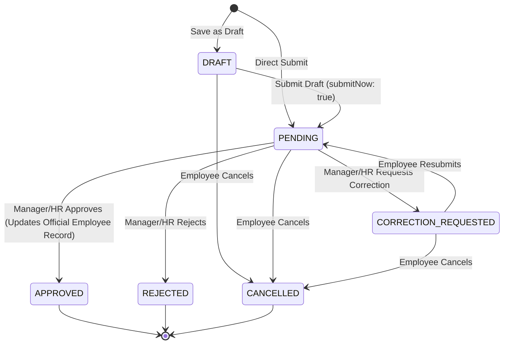

# MASTERHRMS — PHASE 3.1 API & WORKFLOW REFERENCE
## Employee Self-Service Request Centre Contract & Integration Guide

**Date:** November 12, 2026  
**Audience:** Full-Stack Engineers, API Integrators, QA Automation Leads

---

## 1. Request Categories & Field Allowlists

Each change request must specify a valid `category`. Submitted `changes` are validated server-side against strict allowlists. Any attempt to modify protected administrative fields is rejected with a `400 Bad Request`.

| Category | Normalized Key | Allowed Fields | Target `Employee` Columns | Notes & Validation Rules |
| :--- | :--- | :--- | :--- | :--- |
| **Personal Information** | `personal` | `firstName`, `lastName`, `dateOfBirth`, `gender`, `phone`, `maritalStatus`, `bloodGroup`, `fatherOrSpouseName` | `first_name`, `last_name`, `date_of_birth`, `gender`, `phone`, `marital_status`, `blood_group`, `father_or_spouse_name` | Age must be >= 16 years. Gender must be in `male`, `female`, `other`, `prefer_not_to_say`. |
| **Address Details** | `address` | `presentAddress`, `permanentAddress`, `addressLine1`, `addressLine2`, `city`, `district`, `state`, `postalCode` | `present_address`, `permanent_address`, `address_line1`, `address_line2`, `city`, `district`, `state`, `postal_code` | Allows individual address components or full text block. |
| **Emergency Contact** | `emergency_contact` | `emergencyContactName`, `emergencyContactRelationship`, `emergencyContactPhone` | `emergency_contact_name`, `emergency_contact_relationship`, `emergency_contact_phone` | Validates international phone formatting regex (`^\+?[0-9\s\-()]{7,20}$`). |
| **Banking Information** | `banking` | `bankName`, `bankAccount`, `bankIfsc`, `bankBranch` | `bank_name`, `bank_account`, `bank_ifsc`, `bank_branch` | Highly sensitive. Account masked in standard views. IFSC validated against 11-char pattern (`^[A-Z]{4}0[A-Z0-9]{6}$`). |
| **Tax & Statutory Identity** | `tax_identity` | `pan`, `aadhaar`, `uan`, `esiNumber`, `pfNumber` | `pan`, `aadhaar`, `uan`, `esi_number`, `pf_number` | PAN validated against 10-char pattern (`^[A-Z]{5}[0-9]{4}[A-Z]{1}$`). Aadhaar, PAN, and UAN masked. |

### Protected System Fields (Strictly Rejected)
```json
[
  "id", "employeeCode", "tenantId", "userId", "status",
  "departmentId", "designationId", "branchId", "clientId",
  "establishmentId", "managerId", "salary", "employmentType",
  "joinedAt", "createdAt", "updatedAt", "role", "permissions"
]
```

---

## 2. Request Lifecycle State Machine



### State Transition Matrix

| Current State | Permitted Next States | Trigger Action | Authorized Actor |
| :--- | :--- | :--- | :--- |
| `DRAFT` | `PENDING`, `CANCELLED` | `PUT /me/profile/change-requests/:id`, `DELETE /me/profile/change-requests/:id` | Owner Employee |
| `PENDING` | `APPROVED`, `REJECTED`, `CORRECTION_REQUESTED`, `CANCELLED` | `POST /me/team/profile-changes/:id/action`, `POST /hr/requests/profile-changes/:id/action`, `DELETE` | Assigned Approver / HR Admin / Owner Employee |
| `CORRECTION_REQUESTED` | `PENDING`, `CANCELLED` | `PUT /me/profile/change-requests/:id` (with `submitNow: true`), `DELETE` | Owner Employee |
| `APPROVED` | *(Terminal)* | None | Immutable |
| `REJECTED` | *(Terminal)* | None | Immutable |
| `CANCELLED` | *(Terminal)* | None | Immutable |

---

## 3. API Endpoint Specifications

### 3.1. Employee Portal APIs (`/api/v1/me/profile/change-requests`)

#### A. Submit Change Request (or Save Draft)
- **Method:** `POST /api/v1/me/profile/change-requests`
- **Headers:** `Authorization: Bearer <token>`, `X-Tenant-Id: <tenantId>`
- **Request Body:**
  ```json
  {
    "category": "banking",
    "changes": {
      "bankName": "HDFC Bank",
      "bankAccount": "50100987654321",
      "bankIfsc": "HDFC0001234",
      "bankBranch": "Indiranagar, Bangalore"
    },
    "proofMediaId": "med_123456",
    "reason": "Updated to new salary account branch",
    "isDraft": false
  }
  ```
- **Response (`201 Created`):**
  ```json
  {
    "success": true,
    "message": "Change request submitted successfully and is pending review.",
    "data": {
      "id": "cr_abc789",
      "tenantId": "tenant_1",
      "employeeId": "emp_1",
      "fieldCategory": "banking",
      "fieldKey": "compound_banking",
      "status": "PENDING",
      "reason": "Updated to new salary account branch",
      "oldValues": {
        "bankName": "State Bank of India",
        "bankAccount": "••••••••5566",
        "bankIfsc": "SBIN0001234",
        "bankBranch": "MG Road"
      },
      "newValues": {
        "bankName": "HDFC Bank",
        "bankAccount": "••••••••4321",
        "bankIfsc": "HDFC0001234",
        "bankBranch": "Indiranagar, Bangalore"
      },
      "proofMediaId": "med_123456",
      "createdAt": "2026-11-12T18:00:00.000Z"
    }
  }
  ```

#### B. List Employee Change Requests
- **Method:** `GET /api/v1/me/profile/change-requests`
- **Query Params:** `status` (`ALL`, `PENDING`, `APPROVED`, etc.), `category`, `page`, `limit`
- **Response (`200 OK`):**
  ```json
  {
    "success": true,
    "data": [ ... ],
    "pagination": { "total": 4, "page": 1, "pageSize": 20, "totalPages": 1 }
  }
  ```

#### C. Get Single Request Details
- **Method:** `GET /api/v1/me/profile/change-requests/:id`
- **Response (`200 OK`):** Returns full before/after diffs, proof document metadata, and approval actions timeline.

#### D. Edit Draft or Respond to Correction Request
- **Method:** `PUT /api/v1/me/profile/change-requests/:id`
- **Request Body:**
  ```json
  {
    "changes": { ... },
    "proofMediaId": "med_revised_file",
    "reason": "Uploaded revised document proof",
    "submitNow": true
  }
  ```
- **Response (`200 OK`):**
  ```json
  {
    "success": true,
    "message": "Change request resubmitted for approval.",
    "data": { ... }
  }
  ```

#### E. Cancel Request
- **Method:** `DELETE /api/v1/me/profile/change-requests/:id`
- **Request Body (Optional):** `{ "reason": "No longer needed" }`
- **Response (`200 OK`):** `{ "success": true, "message": "Change request cancelled successfully." }`

---

### 3.2. HR Review Queue APIs (`/api/v1/hr/requests/profile-changes`)

#### A. Queue Summary Metrics
- **Method:** `GET /api/v1/hr/requests/profile-changes/summary`
- **Response (`200 OK`):**
  ```json
  {
    "success": true,
    "data": {
      "total": 18,
      "pending": 6,
      "correctionRequested": 2,
      "approved": 8,
      "rejected": 2,
      "draft": 0,
      "cancelled": 0
    }
  }
  ```

#### B. List Queue Requests
- **Method:** `GET /api/v1/hr/requests/profile-changes`
- **Query Params:** `status`, `category`, `departmentId`, `search`, `page`, `limit`
- **Response (`200 OK`):** Paginated requests enriched with `employee` details (`firstName`, `lastName`, `employeeCode`, `department`, `branch`).

#### C. Process Review Decision (Approve / Reject / Request Correction)
- **Method:** `POST /api/v1/hr/requests/profile-changes/:id/action`
- **Request Body:**
  ```json
  {
    "action": "approve", // "approve" | "reject" | "request_correction"
    "reviewComments": "Verified official passbook proof. Approved."
  }
  ```
- **Response (`200 OK`):**
  ```json
  {
    "success": true,
    "message": "Change request approved and official profile record updated successfully.",
    "data": { ... }
  }
  ```

---

## 4. Workflow Engine Integration

When an active change request is submitted (`status: "PENDING"`):
1. `EmployeeChangeRequestService` invokes:
   ```ts
   await WorkflowService.submit({
     tenantId,
     module: "EMPLOYEE_SELF_SERVICE",
     entityType: "EmployeeChangeRequest",
     entityId: changeRequest.id,
     requesterId: userId,
     payloadSnapshot: { category, changes, reason },
   });
   ```
2. `WorkflowService` links an `ApprovalRequest` record with `entityType: "EmployeeChangeRequest"`.
3. When approved via `/hr/requests/profile-changes/:id/action`:
   - `WorkflowService.approveStep` advances or completes the step.
   - Upon final approval, the service updates the official `Employee` record inside `prisma.$transaction`.
4. When rejected:
   - `WorkflowService.rejectStep` marks the workflow as `REJECTED`.
5. When cancelled by the employee:
   - `WorkflowService.withdrawRequest` transitions the workflow to `WITHDRAWN`.

---

## 5. Error Responses & Status Codes

| HTTP Status | Error Code / Message | Scenario |
| :--- | :--- | :--- |
| `400 Bad Request` | `Changes payload cannot be empty.` | Submitted empty changes object |
| `400 Bad Request` | `Modification of protected administrative field 'salary' is strictly forbidden.` | Attempting to update unauthorized fields |
| `400 Bad Request` | `Invalid PAN format. Must be 10 characters (e.g., ABCDE1234F).` | Malformed statutory formatting |
| `400 Bad Request` | `A clear reason or comment is required when rejecting or requesting correction...` | Missing mandatory review notes |
| `400 Bad Request` | `Segregation of duties violation: You cannot approve or review your own change request.` | Employee attempting self-approval |
| `403 Forbidden` | `Access denied. HR employee view permissions required.` | Non-HR user attempting to access HR queue |
| `404 Not Found` | `Change request not found.` | Invalid ID or cross-tenant query |
| `404 Not Found` | `Change request not found or not authorized to cancel.` | Attempting to cancel another employee's request |

