# MASTERHRMS — PHASE 3.3
# CONTRACT RENEWAL & LIFECYCLE REFERENCE

**Document Version:** 1.0.0  
**Phase:** 3.3  
**Status:** COMPLETE  

---

## 1. Overview

Employment agreements in MASTERHRMS govern legal contracts, fixed-term retainers, compensation schedules, and renewal cycles. Phase 3.3 introduces automated expiry timeline tracking, auto-transition of expired contracts, and an atomic renewal workflow that preserves complete audit history without data loss.

---

## 2. Contract Status & Timeline Lifecycle

```mermaid
stateDiagram-v2
    [*] --> ACTIVE: Contract Issued (Fixed-Term or Permanent)
    ACTIVE --> EXPIRING_30_DAYS: 30 Days Remaining
    EXPIRING_30_DAYS --> EXPIRING_15_DAYS: 15 Days Remaining
    EXPIRING_15_DAYS --> EXPIRING_7_DAYS: 7 Days Remaining
    EXPIRING_7_DAYS --> EXPIRING_TODAY: 0 Days Remaining
    EXPIRING_TODAY --> EXPIRED: Daily Cron (End Date Surpassed)
    
    ACTIVE --> RENEWED: Atomic Renewal Workflow
    EXPIRING_30_DAYS --> RENEWED: Atomic Renewal Workflow
    EXPIRING_15_DAYS --> RENEWED: Atomic Renewal Workflow
    EXPIRING_7_DAYS --> RENEWED: Atomic Renewal Workflow
    EXPIRING_TODAY --> RENEWED: Atomic Renewal Workflow
    EXPIRED --> RENEWED: Atomic Renewal Workflow

    RENEWED --> [*]: Predecessor Archived; Successor Born
    ACTIVE --> TERMINATED: Contract Concluded Early
```



---

## 3. Contract Classification Rules

The contract classifier `ContractLifecycleService.classifyContract` evaluates `EmployeeContract` records:

| Condition | Classification | Stage | Description |
| :--- | :--- | :--- | :--- |
| `status == "renewed"` | `RENEWED` | `none` | Predecessor archived; successor active |
| `status == "terminated"` | `TERMINATED` | `none` | Inactive; early termination |
| `endDate == null` | `ACTIVE` | `none` | Indefinite / permanent agreement |
| `status == "expired"` | `EXPIRED` | `expired` | Past-due contract; requires renewal or termination |
| `diffDays < 0` | `EXPIRED` | `expired` | End date passed; flagged for auto-transition |
| `diffDays == 0` | `EXPIRING_TODAY` | `today` | Concludes today |
| `diffDays <= 7` | `EXPIRING_7_DAYS` | `7_days` | Urgent final renewal window |
| `diffDays <= 15` | `EXPIRING_15_DAYS` | `15_days` | High priority reminder |
| `diffDays <= 30` | `EXPIRING_30_DAYS` | `30_days` | 30-day renewal review window opened |
| `diffDays > 30` | `ACTIVE` | `none` | Active contract in good standing |

---

## 4. Contract Renewal Workflow

### 4.1 Endpoint
`POST /api/hr/documents/contracts/:id/renew`

### 4.2 Payload
```json
{
  "startDate": "2026-11-14",
  "endDate": "2027-11-13",
  "title": "Senior Software Engineer Employment Agreement (Renewed)",
  "contractTypeId": "ct-fixed-term-01",
  "salary": 120000,
  "notes": "Annual renewal with merit increase approved by VP of Engineering."
}
```

### 4.3 Atomic Execution Steps
1. **Predecessor Validation:**
   - Contract must belong to the caller's tenant context.
   - Predecessor cannot already be in `renewed` or `superseded` status.
2. **Date Inversion Check:**
   - If `endDate` is specified, `endDate` must be strictly after `startDate`.
3. **Date Overlap Validation:**
   - The system queries other active contracts for the same employee:
     ```ts
     AND: [
       { startDate: { lte: newEndDate || '2099-12-31' } },
       { OR: [{ endDate: null }, { endDate: { gte: newStartDate } }] }
     ]
     ```
   - If an overlapping active contract is found, the renewal is rejected with HTTP `400 Bad Request`.
4. **Atomic Transaction:**
   - **Update Predecessor:** Sets `status = 'renewed'` and appends `[Renewed on {date} by user {actorId}]` to `notes`.
   - **Create Successor:** Inserts new `EmployeeContract` with `status: 'active'`, revised salary, new start/end dates, and contract type.
5. **Audit & Notifications:**
   - Emits `CONTRACT_RENEWED` audit mutation event.
   - Emits transactional outbox event.
   - Dispatches in-app notification to the employee.

---

## 5. Overview & Query Endpoints

### 5.1 HR Contract Overview
- **Endpoint:** `GET /api/hr/documents/contracts/overview`
- **Response:**
```json
{
  "counts": {
    "total": 42,
    "active": 35,
    "expiring30Days": 5,
    "expiring15Days": 3,
    "expiring7Days": 1,
    "expired": 2,
    "renewed": 5
  },
  "evaluatedAt": "2026-11-13T07:45:00.000Z"
}
```

### 5.2 Employee Self-Service Contracts
- **Endpoint:** `GET /api/me/documents/contracts`
- **Response:** Enriched list of contracts for the authenticated user, complete with `classification`, `daysRemaining`, `isExpiringSoon`, and `isExpired` tags.

