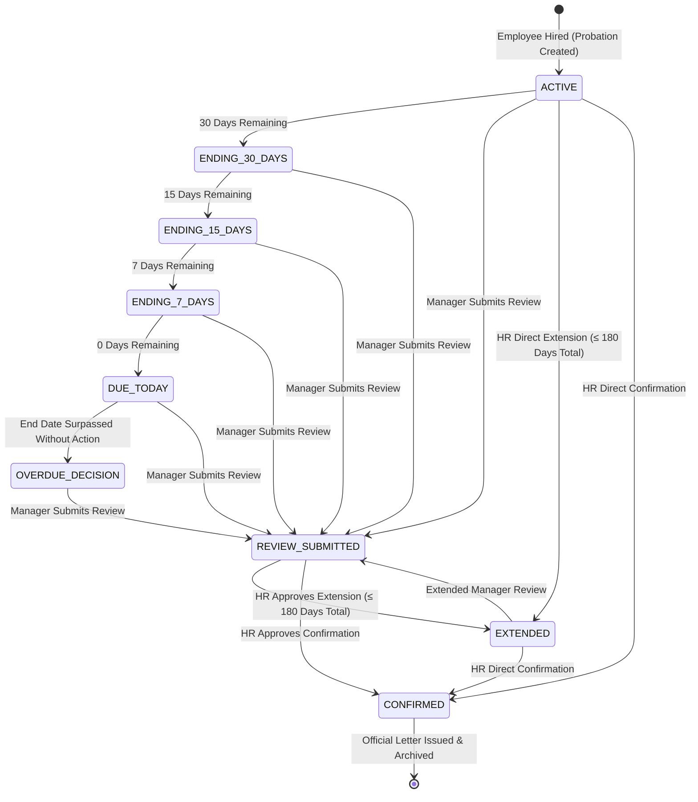

# MASTERHRMS — PHASE 3.3
# PROBATION WORKFLOW & CONFIRMATION REFERENCE

**Document Version:** 1.0.0  
**Phase:** 3.3  
**Status:** COMPLETE  

---

## 1. Overview

The Probation Workflow in MASTERHRMS automates the evaluation, review, extension, and confirmation lifecycle of newly appointed employees. The process enforces strict role-based access control, segregation of duties, automated reminder notifications, and automatic generation of official confirmation letters.

---

## 2. Probation Status Lifecycle



---

## 3. Probation Classification Engine

The pure classification function `ProbationService.classifyProbation` evaluates any `ProbationRecord` against a reference date (defaulting to the current UTC timestamp):

| Condition | Classification | Stage | Description |
| :--- | :--- | :--- | :--- |
| `status == "confirmed"` | `CONFIRMED` | `none` | Employee confirmed; no further alerts required |
| `diffDays < 0` | `OVERDUE_DECISION` | `overdue` | Evaluation window closed; urgent HR decision required |
| `diffDays == 0` | `DUE_TODAY` | `due_today` | Final probation day concludes today |
| `diffDays <= 7` | `ENDING_7_DAYS` | `7_days` | Urgent final review window |
| `diffDays <= 15` | `ENDING_15_DAYS` | `15_days` | Intermediate reminder |
| `diffDays <= 30` | `ENDING_30_DAYS` | `30_days` | Evaluation review window opened |
| `diffDays > 30` | `ACTIVE` / `EXTENDED` | `none` | Standard trial period underway |

*Note: If `extendedUntil` is populated on the probation record, `extendedUntil` overrides the original `endDate` for all countdown arithmetic.*

---

## 4. Manager Probation Review API

### 4.1 Endpoints
- **Self-Service / Team:** `POST /api/me/lifecycle/team/probation/:id/review`
- **HR Administrative:** `POST /api/hr/lifecycle/probation/:id/manager-review`

### 4.2 Payload
```json
{
  "performanceRating": 5,
  "recommendation": "recommend_confirmation",
  "qualityOfWork": "Exceeds role standards",
  "attendancePunctuality": "Consistent and reliable",
  "roleCompetency": "High technical proficiency",
  "teamCollaboration": "Proactive communicator",
  "strengths": "Strong architectural instincts, mentors junior team members",
  "areasForImprovement": "Expand domain expertise in billing modules",
  "managerRemarks": "I enthusiastically recommend Alice for full permanent confirmation."
}
```

### 4.3 Validation & Access Controls
1. **Reporting Line Check:** The submitting user must be the employee's direct `manager` or possess the `hr_admin`/`super_admin` role.
2. **Anti-Self-Review:** Employees cannot submit reviews for their own probation records (`probation.employee.userId !== actorUserId`).
3. **Rating Boundaries:** Numeric ratings must be between `1` and `5`.
4. **Valid Recommendations:** Must be one of `recommend_confirmation`, `recommend_extension`, or `do_not_confirm`.
5. **State Transition:** Upon submission, the record status updates to `review_submitted` and triggers notification alerts to the HR administrative group.

---

## 5. HR Confirmation & Automated Letter Generation

### 5.1 Confirmation Endpoints
- `PUT /api/hr/lifecycle/probation/:id/confirm`
- `POST /api/hr/lifecycle/probation/:id/confirm`

### 5.2 Payload
```json
{
  "performanceRating": "Exceeds Expectations",
  "remarks": "Evaluation complete. Permanent confirmation approved."
}
```

### 5.3 Automated Letter Workflow
1. **Status Transition:** Atomically updates `ProbationRecord.status = 'confirmed'`, sets `confirmedAt = now()`, and logs employee status transition to `permanent`.
2. **Idempotent Letter Check:** Looks up existing `GeneratedLetter` for this employee with `letterType = 'CONFIRMATION_LETTER'`.
3. **Template Resolution:** Locates active `DocumentTemplate` matching code/title containing `"confirmation"`.
4. **Letter Creation:** Generates a new `GeneratedLetter` record with:
   - Unique serial: `LTR-CONF-{timestamp}`
   - `letterType = "CONFIRMATION_LETTER"`
   - `status = "issued"`
   - Title: `"Employment Confirmation Letter"`
5. **Resilience Safeguard:** If document rendering or PDF compilation fails temporarily, the transaction does **not** roll back the valid HR confirmation approval. A warning is logged and the record remains confirmed.
6. **Notification & Outbox:** Emits `PROBATION_CONFIRMED` outbox event and alerts the employee via in-app notification.

---

## 6. Probation Extension Workflow

### 6.1 Endpoints
- `PUT /api/hr/lifecycle/probation/:id/extend`
- `POST /api/hr/lifecycle/probation/:id/extend`

### 6.2 Payload
```json
{
  "extensionDays": 30,
  "remarks": "Need additional 30 days to evaluate newly assigned feature scope."
}
```

### 6.3 180-Day Rule Enforcement
- The system checks: `current_probationPeriodDays + extensionDays <= 180`.
- Extensions exceeding 180 cumulative days throw HTTP `400 Bad Request`:
  `Total cumulative probation cannot exceed 180 days (currently {total} days).`
- Extension updates `status = 'extended'`, shifts `endDate` forward, and sets `extendedUntil`.

