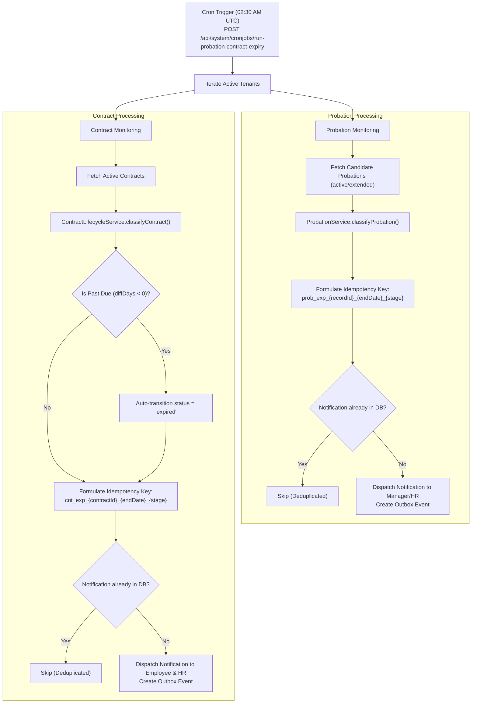

# MASTERHRMS — PHASE 3.3
# SCHEDULER & NOTIFICATION REFERENCE

**Document Version:** 1.0.0  
**Phase:** 3.3  
**Status:** COMPLETE  

---

## 1. Background Scheduler Architecture

Phase 3.3 provides a scheduled monitoring engine for probations and contracts. The engine executes daily at 02:30 AM UTC (`30 2 * * *`), iterating across all active, non-suspended tenants.

---

## 2. Cron Job Registration & Manual Triggering

### 2.1 System Cron Registration
The job is registered in `server/src/routes/hrm-extensions.routes.ts`:
- **Job ID:** `probation_contract_monitor`
- **Name:** `"Probation Review & Contract Expiry Monitor"`
- **Schedule:** `30 2 * * *` (Daily at 02:30 AM UTC)
- **Description:** `"Evaluates employee probations and contract expiration milestones, auto-transitions concluded contracts, and dispatches reminder notifications."`

### 2.2 API Endpoints
- **Execute via Registry:** `POST /api/system/cronjobs/probation_contract_monitor/run`
- **Dedicated Endpoint:** `POST /api/system/cronjobs/run-probation-contract-expiry`
  - Optional Query / Body: `?tenantId=...` (runs scoped to one tenant or platform-wide).

---

## 3. Idempotency Key Design

Duplicate notifications are prevented using deterministic idempotency keys stored in `Notification.metadataJson.idempotencyKey` and `OutboxEvent.metadata.idempotencyKey`.

### 3.1 Probation Idempotency Keys
- **Pattern:** `prob_exp_{recordId}_{endDate}_{stage}`
- **Stages:** `30_days`, `15_days`, `7_days`, `due_today`, `overdue`
- **Example:** `prob_exp_rec-123_2026-11-20_7_days`

### 3.2 Contract Idempotency Keys
- **Pattern:** `cnt_exp_{contractId}_{endDate}_{stage}`
- **Stages:** `30_days`, `15_days`, `7_days`, `today`, `expired`
- **Example:** `cnt_exp_cnt-456_2026-12-13_30_days`

---

## 4. Notification Routing & Escalation

### 4.1 Probation Notifications
| Stage | Recipient(s) | Notification Title | Action URL |
| :--- | :--- | :--- | :--- |
| `30_days` | Direct Manager | Probation Milestone: 30 Days Remaining | `/me/lifecycle/team/probation` |
| `15_days` | Direct Manager | Probation Review Required: 15 Days Remaining | `/me/lifecycle/team/probation` |
| `7_days` | Direct Manager + HR Admins | URGENT: Probation Concluding in 7 Days | `/hr/lifecycle/probation` |
| `due_today` | Direct Manager + HR Admins | ACTION REQUIRED: Probation Concludes Today | `/hr/lifecycle/probation` |
| `overdue` | HR Admins | OVERDUE DECISION: Probation Period Ended | `/hr/lifecycle/probation` |
| `confirmed` | Employee | Probation Completed & Appointment Confirmed | `/me/profile` |
| `letter_issued`| Employee | Confirmation Letter Available in Vault | `/me/documents` |

### 4.2 Contract Notifications
| Stage | Recipient(s) | Notification Title | Action URL |
| :--- | :--- | :--- | :--- |
| `30_days` | Employee + HR Admins | Contract Expiring in 30 Days: {title} | `/me/documents/contracts` |
| `15_days` | Employee + HR Admins | Contract Expiring in 15 Days: {title} | `/me/documents/contracts` |
| `7_days` | Employee + HR Admins | URGENT: Contract Expiring in 7 Days | `/hr/documents/contracts` |
| `today` | Employee + HR Admins | Contract Concludes Today: {title} | `/hr/documents/contracts` |
| `expired` | HR Admins | EXPIRED CONTRACT: Action Required for {title} | `/hr/documents/contracts` |
| `renewed` | Employee | Contract Renewed: {title} | `/me/documents/contracts` |

