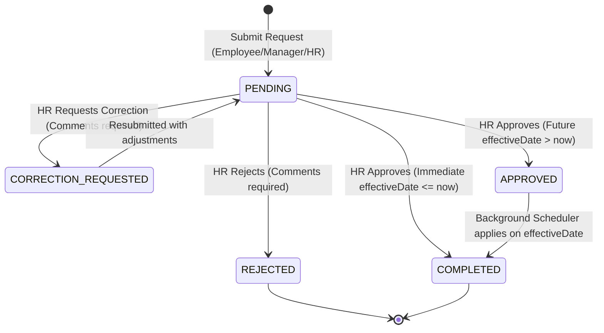

# MASTERHRMS — Phase 3.4: Manager Change Workflow Reference

## Overview
This document specifies the complete request, approval, review, and application workflow for employee reporting manager changes within MASTERHRMS.

---

## 1. Lifecycle States & State Transitions



### State Definitions
- **`PENDING`**: Request submitted and awaiting review by HR or Authorized Manager. Active hierarchy remains unchanged.
- **`CORRECTION_REQUESTED`**: Reviewer determined adjustments or clarifications are required. Author may update and resubmit.
- **`REJECTED`**: Request denied. Reason captured in remarks/history. Active hierarchy remains unchanged.
- **`APPROVED`**: Request approved by HR, but `effectiveDate` is in the future. Change is pending activation by the daily scheduler.
- **`COMPLETED`**: Manager change has been applied to authoritative `Employee.managerId`. Multi-party notifications and audit log recorded.

---

## 2. API Endpoints

### 2.1 Creation Endpoints
- **HR Endpoint:** `POST /api/v1/organization/manager-change-request` (or alias `POST /api/hr/organization/manager-change-request`)
  - **Permission:** `organization:manage` or `hr:write`
  - **Payload:**
    ```json
    {
      "employeeId": "emp-uuid-1",
      "newManagerId": "emp-uuid-2",
      "effectiveDate": "2026-12-01T00:00:00.000Z",
      "reason": "Team restructuring under newly appointed engineering lead.",
      "idempotencyKey": "req-idem-12345"
    }
    ```
- **Self-Service Endpoint:** `POST /api/v1/me/organization/manager-change-request`
  - Allows an employee or manager to submit a request for their team member or reporting line.

### 2.2 Review & Approval Endpoints
- **HR Review Action:** `POST /api/v1/organization/manager-changes/:id/action` (or alias `POST /api/hr/organization/manager-changes/:id/action`)
  - **Permission:** `organization:manage` or `hr:write`
  - **Payload:**
    ```json
    {
      "action": "APPROVE" | "REJECT" | "REQUEST_CORRECTION",
      "comments": "Approved following organizational alignment."
    }
    ```
- **Self-Service Team Action:** `POST /api/v1/me/team/manager-changes/:id/action`
  - Allows authorized managers to review pending changes for subordinates in their line.

### 2.3 Retrieval & Query Endpoints
- **List Requests:** `GET /api/v1/organization/manager-changes?status=PENDING&page=1&limit=20&search=Developer`
- **Dashboard Overview Metrics:** `GET /api/v1/organization/manager-changes/overview`
  - Returns counts: `totalRequests`, `pendingRequests`, `approvedAwaitingExecution`, `completedLast30Days`, `rejectedRequests`.
- **Single Request Detail:** `GET /api/v1/organization/manager-changes/:id`
- **Employee Manager History:** `GET /api/v1/organization/tree/employee/:id/manager-history`

---

## 3. Idempotency Key & Concurrency Protection
To prevent duplicate submissions caused by network retries or rapid double-clicks:
- An optional `idempotencyKey` may be passed in the creation request.
- The system automatically generates a deterministic key if omitted:
  `MGR-CHG-${tenantId}-${employeeId}-${newManagerId || 'ROOT'}-${effectiveDate}`
- Conflicting requests: If an active `PENDING` request already exists for `employeeId`, subsequent submissions are blocked with HTTP 409 Conflict.

---

## 4. Multi-Party Notification Matrix

When a manager change transitions through the workflow, notifications and outbox events are dispatched:

| Event | Recipient | Subject / Purpose |
| :--- | :--- | :--- |
| **Request Submitted** | HR Admins & Proposed Manager | Alert: New reporting manager change pending review |
| **Correction Requested** | Submitter / Employee | Action Required: Clarification needed on manager change |
| **Request Rejected** | Submitter & Employee | Notice: Reporting manager change request was rejected with comments |
| **Request Approved (Future)** | Employee & Managers | Confirmation: Manager change approved for future effective date |
| **Change Applied (Completed)** | Target Employee | Confirmation: Your reporting manager is now updated |
| **Change Applied (Completed)** | Previous Manager | Notice: Employee has been transitioned off your team |
| **Change Applied (Completed)** | New Manager | Notice: Employee has joined your reporting team |
| **Change Applied (Completed)** | HR Admin Team | Audit notification: Hierarchy change executed |

