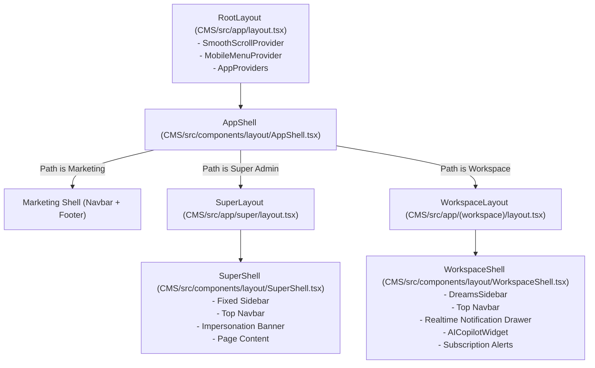

# MASTERHRMS — PHASE 1: REPOSITORY ROUTE & COMPONENT INVENTORY

**Project:** MasterHRMS Multi-Tenant SaaS  
**Phase:** 1 — Full Responsive Architecture Audit & Baseline (Read-Only)  
**Date:** October 31, 2026  
**Status:** AUDIT COMPLETE — BASELINE ESTABLISHED

---

## 1. Executive Summary & Repository Metrics

A comprehensive, forensic read-only audit of the entire `Webfamily-06/masterhrms` repository was executed to map all application routes, component dependencies, shared shells, and responsive behavior across viewports.

### Architectural Inventory Totals
| Metric | Value | Reference / Evidence |
|---|---:|---|
| **Total Registered CMS Pages** | **561** | Discovered under `CMS/src/app/**/page.tsx` |
| **Total Shared Layout Shells** | **3** | `CMS/src/app/layout.tsx`, `CMS/src/app/(workspace)/layout.tsx`, `CMS/src/app/super/layout.tsx` |
| **Total CMS React Components** | **296** | Located in `CMS/src/components/**/*.tsx` |
| **Total Shared UI Primitives** | **58** | Located in `CMS/src/components/ui/*.tsx` |
| **Legacy / Root Router Routes** | **530** | Historical TanStack Start routes in `src/routes/` |
| **Target Production Runtime** | **Next.js 16.1.6** | App Router under `CMS/` deployed via `vercel.json` |
| **Backend API Runtime** | **Express 4.19.2** | Node 24 Serverless Function (`server/index.js`) |

---

## 2. Portal & Route Classification Matrix

All 561 active pages in `CMS/src/app` were traced to their authoritative execution boundaries and user roles:

```
                  ┌─────────────────────────────────────────────────────────┐
                  │                 MasterHRMS Monorepo                     │
                  │             561 Total Next.js Pages                     │
                  └──────────────────────────┬──────────────────────────────┘
                                             │
      ┌──────────────────┬───────────────────┼──────────────────┬─────────────────┐
      │                  │                   │                  │                 │
┌─────▼───────┐    ┌─────▼──────┐      ┌─────▼──────┐     ┌─────▼──────┐    ┌─────▼────────┐
│ Super Admin │    │ Tenant Adm │      │  HR Admin  │     │  Employee  │    │  Workspace   │
│  44 Pages   │    │  28 Pages  │      │ 141 Pages  │     │  78 Pages  │    │ 203 Shared   │
│  (/super/*) │    │(/tenant/*) │      │  (/hr/*)   │     │  (/me/*)   │    │(/attendance, │
└─────────────┘    └────────────┘      └────────────┘     └────────────┘    │ /invoices..) │
                                                                            └──────┬───────┘
                                                                                   │
                                         ┌─────────────────┬───────────────────────┤
                                         │                 │                       │
                                   ┌─────▼──────┐    ┌─────▼──────┐         ┌──────▼───────┐
                                   │   Addons   │    │ Auth/Sec   │         │ Marketing/CMS│
                                   │  38 Pages  │    │  10 Pages  │         │   19 Pages   │
                                   │ (/addons/*)│    │(/login...) │         │  (/, /blog..)│
                                   └────────────┘    └────────────┘         └──────────────┘
```

### Route Breakdown by Domain
| Portal Domain | Path Prefix | Page Count | Primary Layout Shell | Primary RBAC Role Required |
|---|---|---:|---|---|
| **Super Admin Console** | `/super/*` | 44 | [`SuperShell`](file:///Users/apple/Documents/hrms/CMS/src/components/layout/SuperShell.tsx) | `super_admin` |
| **Tenant Admin Suite** | `/tenant/*` | 28 | [`WorkspaceShell`](file:///Users/apple/Documents/hrms/CMS/src/components/layout/WorkspaceShell.tsx) | `admin`, `tenant_admin`, `owner` |
| **HR Administration** | `/hr/*` | 141 | [`WorkspaceShell`](file:///Users/apple/Documents/hrms/CMS/src/components/layout/WorkspaceShell.tsx) | `hr_admin`, `hrmanager`, `admin` |
| **Employee Self-Service** | `/me/*` | 78 | [`WorkspaceShell`](file:///Users/apple/Documents/hrms/CMS/src/components/layout/WorkspaceShell.tsx) | `employee`, `user` |
| **Shared Workspace Modules** | `/(workspace)/*` | 203 | [`WorkspaceShell`](file:///Users/apple/Documents/hrms/CMS/src/components/layout/WorkspaceShell.tsx) | Multi-role / Contextual |
| **Modular Addons Marketplace** | `/(workspace)/addons/*` | 38 | [`WorkspaceShell`](file:///Users/apple/Documents/hrms/CMS/src/components/layout/WorkspaceShell.tsx) | Entitlement Guarded |
| **Authentication & Gateways** | `/login`, `/register`, etc. | 10 | [`RootLayout`](file:///Users/apple/Documents/hrms/CMS/src/app/layout.tsx) | Public / Unauthenticated |
| **Marketing & CMS Storefront** | `/`, `/pricing`, `/blog/*` | 19 | [`AppShell`](file:///Users/apple/Documents/hrms/CMS/src/components/layout/AppShell.tsx) (Marketing Scope) | Public / Anonymous |
| **Total** | | **561** | | |

---

## 3. High-Priority Route & Component Import Trace

The audit inspected whether identically named routes across portals duplicate code or share unified implementations.

### 1. Calendar Modules
| Route URL | Entry File | Rendered Component | Shared Architecture Notes |
|---|---|---|---|
| `/calendar` | [`CMS/src/app/(workspace)/calendar/page.tsx`](file:///Users/apple/Documents/hrms/CMS/src/app/(workspace)/calendar/page.tsx) | [`UnifiedCalendarApp`](file:///Users/apple/Documents/hrms/CMS/src/components/calendar/unified-calendar-app.tsx) | Renders mode `canonical` |
| `/tenant/calendar` | [`CMS/src/app/(workspace)/tenant/calendar/page.tsx`](file:///Users/apple/Documents/hrms/CMS/src/app/(workspace)/tenant/calendar/page.tsx) | [`UnifiedCalendarApp`](file:///Users/apple/Documents/hrms/CMS/src/components/calendar/unified-calendar-app.tsx) | Renders mode `canonical` |
| `/apps/calendar` | [`CMS/src/app/(workspace)/apps/calendar/page.tsx`](file:///Users/apple/Documents/hrms/CMS/src/app/(workspace)/apps/calendar/page.tsx) | Role-based redirector | Redirects to `/me/calendar`, `/hr/calendar`, or `/tenant/calendar` |
| `/hr/calendar` | [`CMS/src/app/(workspace)/hr/calendar/page.tsx`](file:///Users/apple/Documents/hrms/CMS/src/app/(workspace)/hr/calendar/page.tsx) | [`UnifiedCalendarApp`](file:///Users/apple/Documents/hrms/CMS/src/components/calendar/unified-calendar-app.tsx) | Renders mode `hr` |
| `/me/calendar` | [`CMS/src/app/(workspace)/me/calendar/page.tsx`](file:///Users/apple/Documents/hrms/CMS/src/app/(workspace)/me/calendar/page.tsx) | [`UnifiedCalendarApp`](file:///Users/apple/Documents/hrms/CMS/src/components/calendar/unified-calendar-app.tsx) | Renders mode `hr` (Self/Employee) |

### 2. Chat & Communications Modules
| Route URL | Entry File | Rendered Component | Shared Architecture Notes |
|---|---|---|---|
| `/tenant/chat` | [`CMS/src/app/(workspace)/tenant/chat/page.tsx`](file:///Users/apple/Documents/hrms/CMS/src/app/(workspace)/tenant/chat/page.tsx) | [`UnifiedChatApp`](file:///Users/apple/Documents/hrms/CMS/src/components/chat/unified-chat-app.tsx) | `initialMode="chats"`, `workspacePrefix="/tenant"` |
| `/tenant/chat/groups` | [`CMS/src/app/(workspace)/tenant/chat/groups/page.tsx`](file:///Users/apple/Documents/hrms/CMS/src/app/(workspace)/tenant/chat/groups/page.tsx) | [`UnifiedChatApp`](file:///Users/apple/Documents/hrms/CMS/src/components/chat/unified-chat-app.tsx) | `initialMode="groups"`, `workspacePrefix="/tenant"` |
| `/tenant/chat/calls` | [`CMS/src/app/(workspace)/tenant/chat/calls/page.tsx`](file:///Users/apple/Documents/hrms/CMS/src/app/(workspace)/tenant/chat/calls/page.tsx) | [`UnifiedChatApp`](file:///Users/apple/Documents/hrms/CMS/src/components/chat/unified-chat-app.tsx) | `initialMode="calls"`, `workspacePrefix="/tenant"` |
| `/tenant/chat/contacts` | [`CMS/src/app/(workspace)/tenant/chat/contacts/page.tsx`](file:///Users/apple/Documents/hrms/CMS/src/app/(workspace)/tenant/chat/contacts/page.tsx) | [`UnifiedChatApp`](file:///Users/apple/Documents/hrms/CMS/src/components/chat/unified-chat-app.tsx) | `initialMode="contacts"`, `workspacePrefix="/tenant"` |
| `/hr/chat/*` | `CMS/src/app/(workspace)/hr/chat/**/page.tsx` | [`UnifiedChatApp`](file:///Users/apple/Documents/hrms/CMS/src/components/chat/unified-chat-app.tsx) | `workspacePrefix="/hr"` |
| `/me/chat/*` | `CMS/src/app/(workspace)/me/chat/**/page.tsx` | [`UnifiedChatApp`](file:///Users/apple/Documents/hrms/CMS/src/components/chat/unified-chat-app.tsx) | `workspacePrefix="/me"` |
| `/call-history` | [`CMS/src/app/(workspace)/call-history/page.tsx`](file:///Users/apple/Documents/hrms/CMS/src/app/(workspace)/call-history/page.tsx) | Inline `CallHistoryPage` component | Uses `api.get('/crm/calls')`, renders full table |

### 3. File Manager Modules
| Route URL | Entry File | Rendered Component | Shared Architecture Notes |
|---|---|---|---|
| `/tenant/files` | [`CMS/src/app/(workspace)/tenant/files/page.tsx`](file:///Users/apple/Documents/hrms/CMS/src/app/(workspace)/tenant/files/page.tsx) | [`UnifiedFileManager`](file:///Users/apple/Documents/hrms/CMS/src/components/apps/file-manager/unified-file-manager.tsx) | `role="tenant"` |
| `/hr/files` | [`CMS/src/app/(workspace)/hr/files/page.tsx`](file:///Users/apple/Documents/hrms/CMS/src/app/(workspace)/hr/files/page.tsx) | [`UnifiedFileManager`](file:///Users/apple/Documents/hrms/CMS/src/components/apps/file-manager/unified-file-manager.tsx) | `role="hr"` |
| `/me/files` | [`CMS/src/app/(workspace)/me/files/page.tsx`](file:///Users/apple/Documents/hrms/CMS/src/app/(workspace)/me/files/page.tsx) | [`UnifiedFileManager`](file:///Users/apple/Documents/hrms/CMS/src/components/apps/file-manager/unified-file-manager.tsx) | `role="me"` |
| `/super/files` | [`CMS/src/app/super/files/page.tsx`](file:///Users/apple/Documents/hrms/CMS/src/app/super/files/page.tsx) | [`UnifiedFileManager`](file:///Users/apple/Documents/hrms/CMS/src/components/apps/file-manager/unified-file-manager.tsx) | `role="super"` (Global platform scope) |
| `/apps/file-manager/grid-view` | `CMS/src/app/(workspace)/apps/file-manager/grid-view/page.tsx` | [`ClassicFileManagerApp`](file:///Users/apple/Documents/hrms/CMS/src/components/apps/file-manager/classic-file-manager-app.tsx) | Legacy view mode adapter |

### 4. ToDo & Gantt Modules
| Route URL | Entry File | Rendered Component | Shared Architecture Notes |
|---|---|---|---|
| `/tenant/todo` | [`CMS/src/app/(workspace)/tenant/todo/page.tsx`](file:///Users/apple/Documents/hrms/CMS/src/app/(workspace)/tenant/todo/page.tsx) | [`UnifiedTodoApp`](file:///Users/apple/Documents/hrms/CMS/src/components/todo/unified-todo-app.tsx) | `initialView="list"` |
| `/tenant/todo/gantt` | [`CMS/src/app/(workspace)/tenant/todo/gantt/page.tsx`](file:///Users/apple/Documents/hrms/CMS/src/app/(workspace)/tenant/todo/gantt/page.tsx) | [`GanttTimelineView`](file:///Users/apple/Documents/hrms/CMS/src/components/todo/gantt-timeline-view.tsx) | Delegates to `UnifiedTodoApp initialView="gantt"` |
| `/hr/todo` & `/hr/todo/gantt` | `CMS/src/app/(workspace)/hr/todo/**/page.tsx` | [`UnifiedTodoApp`](file:///Users/apple/Documents/hrms/CMS/src/components/todo/unified-todo-app.tsx) | Multi-role todo app |
| `/me/todo` & `/me/todo/gantt` | `CMS/src/app/(workspace)/me/todo/**/page.tsx` | [`UnifiedTodoApp`](file:///Users/apple/Documents/hrms/CMS/src/components/todo/unified-todo-app.tsx) | Scoped to current authenticated employee |

---

## 4. Shared Layout Shell Mapping



### Critical Architectural Finding on Duplication
1. **Root `src/` vs `CMS/src/`**:
   The repository contains two parallel source directories:
   - `src/` (530 routes using TanStack router configuration `src/routeTree.gen.ts`).
   - `CMS/src/` (561 routes using Next.js 16 App Router).
   Per `vercel.json`, Vercel deploys `CMS/` as the primary Next.js web application. Any modifications in `src/` have zero effect on the production Vercel deployment unless mirrored in `CMS/src/`.
2. **Component Synchronization**:
   Many components exist in both `src/components/` and `CMS/src/components/`. All responsive fixes in Phase 2 must target `CMS/src/` to take effect in the active deployment.

---
**Document Status:** Verified Complete — Proceed to Audit Report.

