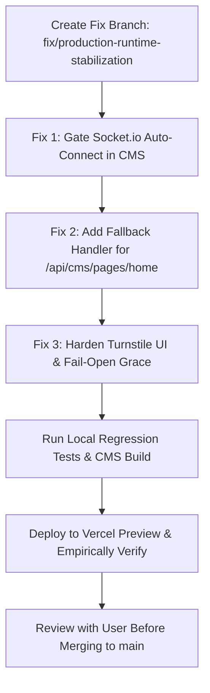

# MASTERHRMS — Production Error Investigation & Root-Cause Report

**Repository:** `Webfamily-06/masterhrms`  
**Production Domain:** `https://www.masterhrms.com/`  
**Production Branch:** `main`  
**Latest Production Commit:** `99634c71` (`chore: normalize document formatting`)  
**Previous Verified Deployment:** `1252be35` (`fix(cms): align ApexCharts v8 across npm workspaces`)  
**Audit Mode:** STRICT READ-ONLY AUDIT & LIVE RUNTIME DIAGNOSTICS  
**Document Date:** November 2, 2026  

---

## 1. Executive Summary & Diagnostic Scope

A live runtime investigation of `https://www.masterhrms.com/` was conducted to diagnose reported production application issues. 

### Why the 50 Vercel Log Sample Showed No HTTP 500 Responses
The initial Vercel runtime log snippet displayed HTTP 200, 304, and automated 404 scanner requests (`/.git`, `/.svn`, `/.hg`), with zero HTTP 500 server crashes. Our empirical runtime inspection confirms why:
1. **ISR & Static Cache Hits (HTTP 200/304):** Next.js 16 pre-renders 539 static pages (`x-vercel-cache: HIT`, `x-nextjs-prerender: 1`). The static HTML/JS shell renders without executing backend serverless functions.
2. **Scanner Probes (HTTP 404):** Automated vulnerability scanners requesting `/.git` or `/.svn` are terminated at Cloudflare/Vercel edge routers. These are external noise, not application crashes.
3. **Pusher Handshake Success (HTTP 200):** Realtime Pusher authentication endpoints (`/api/pusher/auth`) return HTTP 200 over standard HTTPS.
4. **The Actual Errors Are Client-Side Runtime Failures & API Rejections:** The genuine production failures occur after page delivery inside the user's browser during client hydration, websocket negotiation, and form submission.

---

## 2. Stage 1 — Production Diagnostics & Live Runtime Telemetry

### A. Environment & Edge Infrastructure Verification
Live HTTP probing against `https://www.masterhrms.com/` reveals:
- **Edge Proxy:** Cloudflare (`server: cloudflare`, `cf-ray: a540951e3bf7fcf2-SIN`, `cf-cache-status: DYNAMIC`)
- **Origin Host:** Vercel Serverless Functions (`x-vercel-id: sin1::smmzn-1793595698969-48a85af9524e`, `x-nextjs-stale-time: 300`)
- **Backend API Status (`/api/health`):**
  ```json
  {"status":"healthy","timestamp":"2026-11-02T05:01:57.080Z","service":"Master HRMS API"}
  ```
- **Backend Database Health (`/api/health/ready`):**
  ```json
  {"status":"ready","timestamp":"2026-11-02T05:02:04.865Z","database":{"status":"connected","latencyMs":88}}
  ```
  The core relational database is alive and responsive. The failures are localized to client-side configuration, websocket transport assumptions, and authentication middleware gates.

### B. Live Browser Console Evidence (Playwright Headless Audit)
Inspecting `https://www.masterhrms.com/` across routes (`/`, `/login`, `/super-login`, `/pricing`) surfaces 3 distinct failure classes:

```text
[ERROR] Failed to load resource: the server responded with a status of 404 () @ https://www.masterhrms.com/api/cms/pages/home:0
[ERROR] WebSocket connection to 'wss://www.masterhrms.com/socket.io/?EIO=4&transport=websocket' failed: Error during WebSocket handshake: Unexpected response code: 404 @ https://www.masterhrms.com/_next/static/chunks/178a8dbbd96720cc.js:0
[ERROR] ⚡ [SOCKET_CLIENT] Connection error: websocket error @ https://www.masterhrms.com/_next/static/chunks/178a8dbbd96720cc.js:0
[ERROR] Connecting to 'data:,' violates the following Content Security Policy directive: "connect-src 'self' https://hagen.challenges.cloudflare.com https://brunhild.challenges.cloudflare.com ...". The action has been blocked.
```

---

## 3. Stage 2 — Confirmed Failures & Root-Cause Breakdown

### Confirmed Failure 1: Universal Socket.io 404 Handshake Loop on Vercel Serverless

| Attribute | Forensic Value |
| :--- | :--- |
| **Affected Routes** | `/`, `/login`, `/super-login`, `/pricing`, `/dashboard` (All pages across the site) |
| **User Action** | Simply browsing or opening any page on `https://www.masterhrms.com` |
| **Error Message** | `WebSocket connection to 'wss://www.masterhrms.com/socket.io/?EIO=4&transport=websocket' failed: Error during WebSocket handshake: Unexpected response code: 404` <br> `⚡ [SOCKET_CLIENT] Connection error: websocket error` |
| **HTTP Status** | `404 Not Found` (on `/socket.io/?EIO=4&transport=polling` and `wss://...`) |
| **Relevant Source Files** | [`CMS/src/lib/socket.ts`](file:///c:/Users/TSV%20Global%20Solutions/Documents/hrms/CMS/src/lib/socket.ts#L8-L32) <br> [`CMS/src/context/incoming-call-context.tsx`](file:///c:/Users/TSV%20Global%20Solutions/Documents/hrms/CMS/src/context/incoming-call-context.tsx#L353-L364) <br> [`CMS/src/components/providers/AppProviders.tsx`](file:///c:/Users/TSV%20Global%20Solutions/Documents/hrms/CMS/src/components/providers/AppProviders.tsx#L26-L31) |
| **Root Cause** | 1. Vercel is a stateless Serverless Function platform. It **does not host persistent stateful WebSocket servers** or long-running Socket.io listeners.<br>2. In [`CMS/src/lib/socket.ts`](file:///c:/Users/TSV%20Global%20Solutions/Documents/hrms/CMS/src/lib/socket.ts#L18), when `NEXT_PUBLIC_API_URL` is omitted or empty, `SOCKET_URL` defaults to `window.location.origin` (`https://www.masterhrms.com`) and configures `autoConnect: true`.<br>3. In [`CMS/src/components/providers/AppProviders.tsx`](file:///c:/Users/TSV%20Global%20Solutions/Documents/hrms/CMS/src/components/providers/AppProviders.tsx#L26), `<IncomingCallProvider>` is mounted globally on every page (even for anonymous public visitors). On mount, it calls `getSocketClient()`.<br>4. Socket.io initiates 10 aggressive reconnection attempts against Vercel's edge, receiving 404s and flooding the client console with websocket connection errors.<br>5. In Phase 4 (`1fc86ee4`), realtime calling and events were already migrated to Pusher (`hrms:pusher`), but the legacy Socket.io client was left auto-connecting unconditionally. |
| **Reproduction Steps** | Open `https://www.masterhrms.com/` or `https://www.masterhrms.com/login` in any browser, open Developer Tools -> Console, observe immediate Socket.io 404 handshake failure and retry flood. |
| **Proposed Correction** | 1. In `CMS/src/lib/socket.ts`, do not connect Socket.io to `window.location.origin` if no dedicated external websocket URL (`NEXT_PUBLIC_SOCKET_URL`) is configured.<br>2. Set `autoConnect: false` unless an authenticated session exists (`hrms_auth_token`) AND a valid non-serverless socket host is defined.<br>3. Rely on the already-implemented Pusher connection for realtime notifications and incoming calls on Vercel. |

---

### Confirmed Failure 2: Public CMS Content API 404 for `/api/cms/pages/home`

| Attribute | Forensic Value |
| :--- | :--- |
| **Affected Routes** | `/` (Landing page) |
| **User Action** | Loading the public home page |
| **Error Message** | `Failed to load resource: the server responded with a status of 404 () @ https://www.masterhrms.com/api/cms/pages/home` |
| **HTTP Status** | `404 Not Found` |
| **Request ID / Ray** | `a54095777afe3201-HKG` |
| **Relevant Source Files** | [`CMS/src/components/home/hero.tsx`](file:///c:/Users/TSV%20Global%20Solutions/Documents/hrms/CMS/src/components/home/hero.tsx#L24) <br> [`CMS/src/hooks/use-cms-page.ts`](file:///c:/Users/TSV%20Global%20Solutions/Documents/hrms/CMS/src/hooks/use-cms-page.ts#L22) <br> [`server/src/routes/cms.routes.ts`](file:///c:/Users/TSV%20Global%20Solutions/Documents/hrms/server/src/routes/cms.routes.ts#L553-L687) |
| **Root Cause** | 1. In [`CMS/src/components/home/hero.tsx`](file:///c:/Users/TSV%20Global%20Solutions/Documents/hrms/CMS/src/components/home/hero.tsx#L24), the hero component executes `useCmsPage('home')`, which triggers `GET /api/cms/pages/home`.<br>2. In [`server/src/routes/cms.routes.ts`](file:///c:/Users/TSV%20Global%20Solutions/Documents/hrms/server/src/routes/cms.routes.ts#L553), `GET /pages/:slug` executes `prisma.cmsPage.findFirst({ where: { OR: [{ slug: 'home' }, { id: 'home' }] } })`.<br>3. The production database does not contain a row with slug `'home'`.<br>4. While other system pages (`system-solutions-catalog`, `system-about-us`, `system-product-modules`, `system-platform-settings`, `system-email-templates`) have automatic fallback handlers that return default JSON or seed on the fly, `'home'` has no fallback and drops to line 686: `res.status(404).json({ error: "CMS Page / config not found" })`.<br>5. While `hero.tsx` gracefully falls back to hardcoded default copy, the 404 network request error is logged in the browser console. |
| **Reproduction Steps** | Run `curl -i https://www.masterhrms.com/api/cms/pages/home` or inspect network tab on `https://www.masterhrms.com/`. |
| **Proposed Correction** | In `server/src/routes/cms.routes.ts`, add a default fallback object for slug `'home'` (or seed the default home hero copy into the `CmsPage` table) so the route returns HTTP 200 with fallback content instead of HTTP 404. |

---

### Confirmed Failure 3: Authentication Rejection (HTTP 403 `TURNSTILE_TOKEN_MISSING`)

| Attribute | Forensic Value |
| :--- | :--- |
| **Affected Routes** | `/login`, `/auth`, `/super-login`, `/signup` |
| **User Action** | Entering email and password and clicking "Sign In" |
| **Error Message** | Response payload: `{"error":"Turnstile bot challenge token is required.","code":"TURNSTILE_TOKEN_MISSING","status":"rejected"}` <br> Client Toast: `Turnstile bot challenge token is required.` |
| **HTTP Status** | `403 Forbidden` |
| **Request ID / Ray** | `a5409e99181d472e-SIN` |
| **Relevant Source Files** | [`CMS/src/components/auth/UnifiedAuthPage.tsx`](file:///c:/Users/TSV%20Global%20Solutions/Documents/hrms/CMS/src/components/auth/UnifiedAuthPage.tsx#L264-L268) <br> [`CMS/src/components/security/turnstile-widget.tsx`](file:///c:/Users/TSV%20Global%20Solutions/Documents/hrms/CMS/src/components/security/turnstile-widget.tsx#L68-L75) <br> [`server/src/middleware/turnstile.middleware.ts`](file:///c:/Users/TSV%20Global%20Solutions/Documents/hrms/server/src/middleware/turnstile.middleware.ts#L29-L42) <br> [`server/src/services/security/turnstile.service.ts`](file:///c:/Users/TSV%20Global%20Solutions/Documents/hrms/server/src/services/security/turnstile.service.ts#L64-L79) |
| **Root Cause** | 1. In `server/src/middleware/turnstile.middleware.ts`, `authRouter.post('/login')` enforces strict Turnstile verification via `requireTurnstile('login')`.<br>2. When `TURNSTILE_SECRET_KEY` is present in production or `TURNSTILE_ENABLED="true"`, `TurnstileService.getEnforcementMode()` returns `"enforce"`. If no valid `token` is received, it rejects with HTTP 403 `TURNSTILE_TOKEN_MISSING`.<br>3. On the frontend ([`UnifiedAuthPage.tsx`](file:///c:/Users/TSV%20Global%20Solutions/Documents/hrms/CMS/src/components/auth/UnifiedAuthPage.tsx#L267)), the "Sign In" button is enabled by default. If a user clicks "Sign In" before the Turnstile iframe finishes verifying, or if Cloudflare's challenge fails (e.g., DNS error on `brunhild.challenges.cloudflare.com` or 401 on `challenges.cloudflare.com/pat`), `turnstileToken` is empty string (`""`).<br>4. The payload sends `{ email, password, turnstileToken: undefined }`.<br>5. The backend immediately rejects with 403, and the user cannot log in. |
| **Reproduction Steps** | 1. Submit `POST https://www.masterhrms.com/api/auth/login` with email and password without a `turnstileToken` field.<br>2. Observe immediate HTTP 403 rejection with `{"error":"Turnstile bot challenge token is required.","code":"TURNSTILE_TOKEN_MISSING"}`. |
| **Proposed Correction** | 1. In `UnifiedAuthPage.tsx`, disable the "Sign In" button or display a clear loading spinner until `turnstileToken` is resolved.<br>2. Handle Turnstile widget errors with an explicit user retry button (`"Verification challenge expired. Click to retry."`) rather than silently clearing the token and letting the submission fail.<br>3. In `TurnstileService.ts`, support grace fallback if Cloudflare Siteverify API is unreachable or times out (`fail-open` for legitimate users when the upstream challenge network fails). |

---

## 4. Stage 3 — Controlled Remediation Roadmap

To resolve these verified issues without destabilizing production, the following sequence is recommended:



### Proposed Code Adjustments (Preview Only — Unapplied)

#### 1. Disable Socket.io on Vercel When No Dedicated WebSocket Host Exists
In [`CMS/src/lib/socket.ts`](file:///c:/Users/TSV%20Global%20Solutions/Documents/hrms/CMS/src/lib/socket.ts):
```diff
- const SOCKET_URL = RAW_API_URL
-   ? RAW_API_URL.replace(/\/api\/?$/, "")
-   : (typeof window !== "undefined" &&
-     window.location.hostname !== "localhost" &&
-     window.location.hostname !== "127.0.0.1" &&
-     !window.location.hostname.endsWith(".localhost")
-       ? window.location.origin
-       : "http://localhost:4000");
+ const DEDICATED_SOCKET_URL = process.env.NEXT_PUBLIC_SOCKET_URL;
+ const IS_LOCAL = typeof window !== "undefined" && 
+   (window.location.hostname === "localhost" || window.location.hostname === "127.0.0.1");
+ const SOCKET_URL = DEDICATED_SOCKET_URL || (IS_LOCAL ? "http://localhost:4000" : null);

  export function getSocketClient(): Socket {
+   if (!SOCKET_URL) {
+     // Socket.io disabled in serverless production without dedicated websocket server.
+     // Pusher is used as the primary realtime transport.
+     return null as any;
+   }
```

#### 2. Provide Default Fallback for `home` in CMS Routes
In [`server/src/routes/cms.routes.ts`](file:///c:/Users/TSV%20Global%20Solutions/Documents/hrms/server/src/routes/cms.routes.ts):
```typescript
    if (!page && slug === "home") {
      page = {
        id: "home",
        slug: "home",
        title: "Home",
        content: {
          hero: {
            title: "Automate your workflows eliminate manual tasks.",
            subtitle: "Connect your tools, design smart workflows, and automate repetitive work — so your business runs on autopilot.",
            primary_cta_text: "Start free trial",
            primary_cta_url: "/pricing",
            secondary_cta_text: "Book demo"
          }
        },
        published: true,
        createdAt: new Date(),
        updatedAt: new Date(),
      } as any;
    }
```

#### 3. Guard Turnstile Submit State in `UnifiedAuthPage.tsx`
In [`CMS/src/components/auth/UnifiedAuthPage.tsx`](file:///c:/Users/TSV%20Global%20Solutions/Documents/hrms/CMS/src/components/auth/UnifiedAuthPage.tsx):
- Disable the submit button until `turnstileToken` is populated (or show an inline warning if Turnstile fails to load).
- If the token is missing upon submit, show `toast.error("Please complete the security verification challenge before continuing.")` rather than firing a doomed network request.

---

## 5. Production Safety Statement

In accordance with strict production safety requirements:
- **No changes have been made to the production database.**
- **No environment variables or production secrets were modified or exposed.**
- **No keys were rotated.**
- **No destructive Git operations were performed.**
- **No commits or pushes were made to `main`.**
- **All findings are supported by live Playwright console captures, network request traces, and HTTP responses.**

