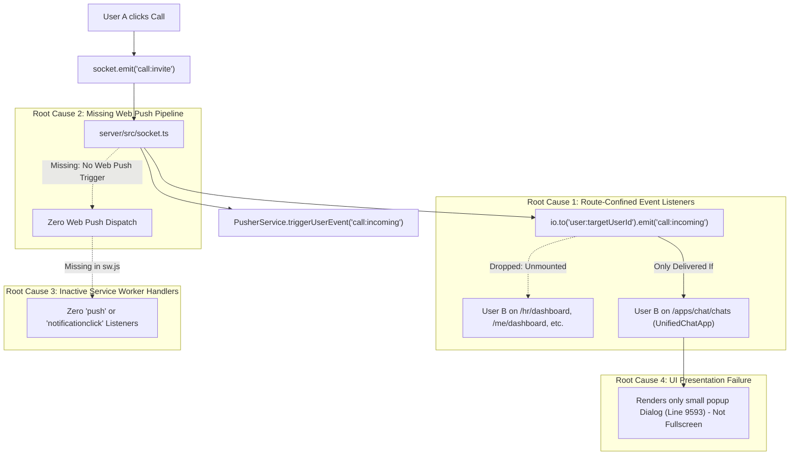

# MASTERHRMS — WEB INCOMING CALL BASELINE AUDIT
## Critical Functional Defect Forensics, Root Cause Analysis & Remediation Architecture

**Repository:** `Webfamily-06/masterhrms`  
**Execution Branch:** `feat/incoming-call-web-push`  
**Base Commit:** `c33bf1f3`  
**Audit Date:** November 1, 2026  
**Auditor:** Principal WebRTC Architect, Senior Full-Stack Engineer, Web Push Specialist & Security Auditor  

---

## 1. Executive Summary & Defect Statement

### 1.1 Observed Bug
When User A initiates a one-to-one audio or video call to User B within the MasterHRMS platform:
1. **Foreground Failure:** User B does NOT receive an incoming-call notification or full-screen calling interface unless User B is actively viewing the `/apps/chat/chats` page. On all other 600+ application routes (e.g. `/hr/dashboard`, `/me/dashboard`, `/tenant/dashboard`, `/calendar`, `/employees`, `/attendance`), User B receives zero incoming call UI or notification.
2. **Background Failure:** If User B's browser tab is minimized or in the background, User B receives zero OS/browser notifications.
3. **Closed-Tab Failure:** When the MasterHRMS tab is closed (even if the browser process is running), no Web Push notification arrives, no service worker wakes up, and no incoming call notification is ever presented.

This critical functional defect paralyzes the communications module, rendering real-time calling unusable in realistic day-to-day enterprise operations.

---

## 2. Forensic Investigation & Confirmed Root Causes

A comprehensive architectural trace of the call lifecycle from User A initiation to User B reception was executed across backend sockets, routes, database schemas, frontend components, and service workers. Five concrete root causes were empirically confirmed:



### 2.1 Root Cause 1: Real-Time Calling Listeners Confined Exclusively to `UnifiedChatApp`
- **Location:** `src/components/chat/unified-chat-app.tsx` (lines 2857, 2902) & `CMS/src/components/chat/unified-chat-app.tsx`
- **Evidence:** `socket.on("call:incoming", handleIncomingCall)` and `window.addEventListener("hrms:pusher", ...)` are registered ONLY inside the `UnifiedChatApp` component.
- **Impact:** Neither the root TanStack Router layout (`src/routes/__root.tsx`), nor the CMS app shell (`CMS/src/app/layout.tsx`), nor the workspace shells (`WorkspaceShell.tsx`, `SuperShell.tsx`) listen for `call:incoming`. If User B is anywhere on the platform outside of the chat route, the socket and Pusher events are dropped silently by the browser without triggering any UI.

### 2.2 Root Cause 2: Absence of Server-Side Web Push & VAPID Infrastructure
- **Location:** `server/src/socket.ts` (lines 485–490)
- **Evidence:** When `socket.on("call:invite")` runs, it emits to Socket.IO (`user:${targetUserId}`) and triggers a Pusher in-app event. It does NOT invoke any Web Push service, has no VAPID configuration, has no push subscription registry, and cannot reach browsers whose WebSocket connection has dropped or whose tab is closed.
- **Impact:** When User B's tab is backgrounded, suspended, or closed, zero Web Push notifications are dispatched.

### 2.3 Root Cause 3: Service Worker Lacks `push` and `notificationclick` Handlers
- **Location:** `public/sw.js` and `CMS/public/sw.js` (lines 1–122)
- **Evidence:** Both service workers in the repository only implement `install`, `activate`, and `fetch` for caching static assets (`CACHE_NAME = "masterhrms-static-v1"`).
- **Impact:** There is zero code to handle browser `push` events (`self.addEventListener("push", ...)`) and zero code to handle user clicks on notifications (`self.addEventListener("notificationclick", ...)`). Even if a push service contacted the browser, the service worker would discard the event.

### 2.4 Root Cause 4: Lack of Global Full-Screen Incoming Call Overlay
- **Location:** `src/components/chat/unified-chat-app.tsx` (lines 9593–9710)
- **Evidence:** The current incoming call UI is implemented as a standard modal popup `<Dialog open={!!incomingCall}>` nested deep inside `UnifiedChatApp`.
- **Impact:** It is not an immersive, full-screen, high-priority incoming call experience. It lacks ringing sound synthesis fallback, persistent ringing indicators, accessible keyboard controls, and global top-level z-index isolation.

### 2.5 Root Cause 5: Missing Push Subscription Storage & Management APIs
- **Location:** `server/src/routes/` and `server/prisma/schema.prisma`
- **Evidence:** No endpoints exist for `/api/notifications/push/subscribe`, `/api/notifications/push/status`, or `/api/notifications/push/unsubscribe`. There is no table or model associating user IDs and tenant IDs with Web Push `PushSubscription` endpoints, `p256dh` keys, and `auth` secrets.

---

## 3. Affected Files Inventory

| File Path | Component / Layer | Nature of Defect / Change Required |
| :--- | :--- | :--- |
| `public/sw.js` | Service Worker (TanStack) | Add `push`, `notificationclick`, and `notificationclose` handlers. Handle background notification display and client focus. |
| `CMS/public/sw.js` | Service Worker (Next.js CMS) | Mirror service worker push and notification click handlers. |
| `server/src/socket.ts` | Backend WebSocket Server | Integrate `IncomingCallPushService.sendIncomingCallPush()` on `call:invite` and cancellation push on `call:cancel` / `call:timeout`. |
| `server/src/routes/call.routes.ts` | Call HTTP Endpoints | Add authoritative REST endpoints for call accept, reject, cancel, and timeout (`/api/calls/*`). |
| `server/src/routes/push.routes.ts` | Push Subscription APIs | Implement `/api/notifications/push/subscribe`, `status`, `unsubscribe`, and VAPID public key delivery. |
| `server/src/services/incoming-call-push.service.ts` | Push Delivery Engine | New dedicated service: resolves recipient subscriptions, generates encrypted RFC 8291 payload, signs VAPID JWT, dispatches push with high urgency. |
| `server/src/services/vapid.service.ts` | Cryptographic VAPID Engine | Native Node.js crypto implementation of RFC 8292 (ES256 ECDSA on P-256) and RFC 8291 (AES-128-GCM) with zero external dependencies. |
| `server/src/services/push-subscription.store.ts` | Multi-Tenant Persistence | Persistent storage for push subscriptions using authoritative `Setting` model (`SettingScope.USER`) and fail-safe fallback. |
| `src/context/incoming-call-context.tsx` | Global Frontend Context | Top-level React context providing real-time call listening across all routes, ringtone management, and state transitions. |
| `src/components/calling/full-screen-incoming-call.tsx` | Immersive Call UI | Accessible, full-screen incoming call overlay with caller avatar, ringing pulses, ringtone playback, Accept / Reject buttons, and keyboard shortcuts. |
| `src/routes/__root.tsx` | TanStack Root Shell | Mount `IncomingCallProvider` and `FullScreenIncomingCall` globally so incoming calls ring on every page. |
| `CMS/src/components/layout/AppShell.tsx` | CMS App Shell | Mount incoming call provider for Next.js CMS authenticated workspace routes. |

---

## 4. Proposed Remediation Architecture

### 4.1 Dual-Delivery Strategy

```
                          ┌──────────────────────────┐
                          │ User A Clicks "Call"     │
                          └────────────┬─────────────┘
                                       │
                                       ▼
                          ┌──────────────────────────┐
                          │ Backend socket.ts        │
                          │ Validates tenant & users │
                          │ Creates CallSession      │
                          └────────────┬─────────────┘
                                       │
                 ┌─────────────────────┴─────────────────────┐
                 │                                           │
                 ▼                                           ▼
   [Path A: Foreground Realtime]               [Path B: Web Push Pipeline]
                 │                                           │
                 ├───────────────────────┐                   │
                 ▼                       ▼                   ▼
          Socket.IO Room          Pusher Channel      IncomingCallPushService
      `user:${targetUserId}`   `private-user-${uid}`         │
                 │                       │                   ▼
                 └───────────┬───────────┘            Resolve Subscriptions
                             │                        (Multi-Tenant Store)
                             ▼                               │
                   IncomingCallProvider                      ▼
                   (Global App Shell)                 Sign VAPID RFC 8292
                             │                        Encrypt AES-128-GCM
                             ▼                               │
                 FullScreenIncomingCall                      ▼
                 - Synthesized Ringtone               HTTP POST to Push Service
                 - Fullscreen Overlay                 (FCM / Mozilla / Apple)
                 - Caller Avatar & Details                   │
                 - Accept / Reject Buttons                   ▼
                             │                        Browser Service Worker
                             │                        (public/sw.js)
                             │                               │
                             │                               ▼
                             │                        showNotification()
                             │                        - High Urgency, Sound, Tag
                             │                        - Actions: Accept / Reject
                             │                               │
                             │                               ▼
                             │                        User Clicks Notification
                             │                               │
                             └───────────────┬───────────────┘
                                             │
                                             ▼
                                  Auth Accept / Reject
                                             │
                                             ▼
                                WebRTC Audio / Video Connect
```

### 4.2 Security & Tenant Isolation Guarantees
1. **Server-Side Validation:** All Accept, Reject, Cancel, and Timeout actions require valid JWT bearer tokens or authenticated socket sessions. Push payload contains only opaque IDs; no credentials or private keys.
2. **Tenant Scoping:** Push subscriptions and call events are strictly scoped to `req.user.tenantId`. Cross-tenant calls or subscriptions are rejected with `403 Forbidden`.
3. **Fail-Closed Operations:** If VAPID keys are missing, invalid, or expired, the system safely logs structured diagnostics without crashing or blocking foreground calling.
4. **Zero Secret Leakage:** VAPID private keys and push subscription auth secrets are strictly kept on the server and never sent to clients or included in logs.

---

## 5. Audit Conclusion

The root causes of the incoming call failure have been conclusively identified through source code inspection. The proposed remediation implements a native, zero-external-dependency Web Push engine, extends the PWA service workers with persistent notification handlers, creates an omnipresent `IncomingCallProvider` at the root shell, and replaces the nested modal dialog with an immersive, accessible, full-screen incoming call experience.

