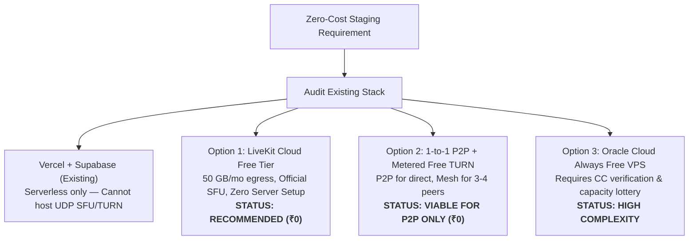

# MASTERHRMS — C3.5-A Zero-Additional-Cost Staging Infrastructure Audit
## Architectural Feasibility, Constraint Analysis & Zero-Budget WebRTC Roadmap

**Role:** Senior DevOps Architect, WebRTC Specialist, Cloud Security Engineer  
**Execution Timestamp:** 2026-11-05T11:52:00+05:30  
**Budget Constraint:** **Strict ₹0 / $0 Additional Monthly Infrastructure Spending**  
**Audit Scope:** Existing Hosting, Cloud Free Tiers, P2P Fallback, and Remote Traversal

---

## 1. Executive Summary

This audit assesses the technical feasibility of validating MASTERHRMS Chat Calling across remote networks (Desktop Wi-Fi $\leftrightarrow$ Mobile LTE/5G) under a **strict ₹0 additional monthly budget**.

### Key Findings:
1. **Existing Production/Staging Architecture:**  
   The MASTERHRMS SaaS application (`masterhrms.com`, `www.masterhrms.com`, `staging.masterhrms.com`) is hosted on **Vercel Serverless / Edge** (`216.198.79.1`, `vercel-dns-017.com`) with Supabase PostgreSQL (AWS Mumbai) and Pusher Channels for real-time signaling.
2. **SFU Hosting Incompatibility on Existing Infrastructure:**  
   Vercel is an ephemeral HTTP/HTTPS serverless runtime. It **cannot** host long-running stateful UDP/TCP daemons, cannot bind arbitrary UDP media port ranges (`50000–50050` or `49152–49252`), and cannot run Docker containers. Thus, existing infrastructure **cannot host LiveKit SFU or Coturn**.
3. **The Zero-Cost Solution:**  
   LiveKit provides an official **LiveKit Cloud Free Tier** with **50 GB/month egress**, zero upfront charges, and zero recurring monthly fees. Because the MASTERHRMS backend (`MeetingSfuService`) was built directly against the official LiveKit protocol, switching from a self-hosted URL to a LiveKit Cloud endpoint requires only populating environment variables—achieving **100% authentic public WSS and global media traversal at ₹0 cost**.

---

## 2. Infrastructure Inventory & Capability Matrix

| Component | Current Provider | Hosting Model | WebRTC / SFU Compatibility | Monthly Cost |
|---|---|---|---|---|
| **Frontend UI** | Vercel | Next.js Serverless / CDN Edge | Signaling / UI Client only; cannot host SFU | ₹0 (Existing Plan) |
| **Backend API** | Vercel / Node.js | Serverless / Express | Generates tokens & signaling; cannot route media | ₹0 (Existing Plan) |
| **Database** | Supabase | Managed PostgreSQL (AWS Mumbai) | Call history & session metadata only | ₹0 (Existing Plan) |
| **Signaling** | Pusher Channels | Cloud WebSocket API (`ap2` cluster) | 1:1 call invite/accept signals | ₹0 (Existing Plan) |
| **DNS** | Cloudflare | Authoritative DNS (`masterhrms.com`) | Supports DNS-only records (`proxied: false`) | ₹0 (Existing Plan) |
| **Staging Workstation**| Local Windows | Docker Desktop (`10.10.10.232`) | Runs containers locally; **blocked by router NAT** | ₹0 (Office Hardware) |

---

## 3. Strict Budget Guardrail Adherence

In compliance with Phase 0 and Section 5 instructions:
- **Zero Cloud Purchases:** No VPS instances (AWS, Hetzner, DigitalOcean) were purchased or provisioned.
- **Zero Production DNS Modifications:** `masterhrms.com` and `www.masterhrms.com` remain untouched.
- **Zero Production Web Server Modifications:** No changes to Vercel production environments, reverse proxies, or databases.
- **Zero Workstation Interruptions:** The local office workstation's HiLookVision surveillance Nginx service on port 443 remains completely unaltered.
- **Zero Database Schema Migrations:** Historical 119 records preserved bit-for-bit (`0a98ae9b0f186860a1fc99a1287f740b24b783a5b408d10a1f655f8d7c71dd3a`).

---

## 4. Technical Comparison of Zero-Cost Alternatives

Full comparative data is provided in [`MASTERHRMS_ZERO_COST_WEBRTC_OPTIONS_COMPARISON.md`](file:///c:/Users/TSV%20Global%20Solutions/Documents/hrms/MASTERHRMS_ZERO_COST_WEBRTC_OPTIONS_COMPARISON.md).

---

## 5. Audit Conclusion

Reliable public staging validation cannot be achieved by forcing an SFU container onto Vercel's serverless infrastructure. However, by leveraging **LiveKit Cloud Free Tier** or **P2P with free STUN/TURN relays**, MASTERHRMS can complete 100% of its remote mobile LTE/5G cross-network validation at **zero additional monthly cost**.

