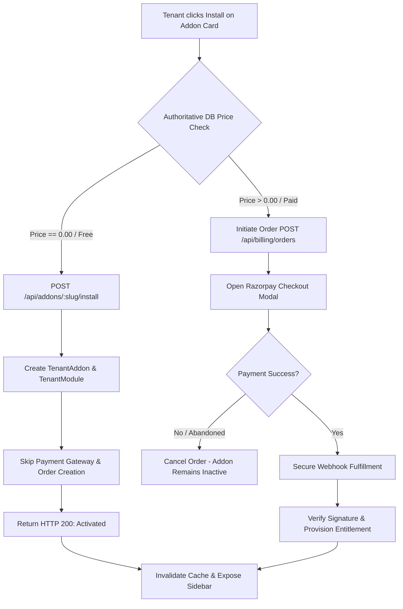

# MASTERHRMS — ADD-ON PLATFORM UX, INSTALLATION & PRICING STANDARD
**Document ID:** `DOC-SAAS-STD-ADDON-001`  
**Status:** Canonical Platform Architecture Standard  
**Effective Date:** 2026-10-12  
**Target Architecture:** Multi-Tenant SaaS, Hybrid Core/Add-on Framework  

---

## 1. Scope & Objective

This standard defines the mandatory technical, architectural, and user-experience specifications for all modular add-ons in the MasterHRMS ecosystem. Every add-on developed across Wave 1, Wave 2, and future phases must strictly adhere to these patterns.

---

## 2. UI & UX Architecture Standard

### 2.1. Routing & Surface Mapping
Every add-on must be categorized into one of four recognized surfaces:
1. **Full App Module (`app`):** Lives at `{workspace}.{domain}/{slug}/*`. Features a dedicated layout, navigation breadcrumbs, and contextual actions.
2. **HR Module (`hr-module`):** Nested under `/hr/{slug}/*`. Integrates with the HR sidebar group, inheriting standard employee and organization filters.
3. **Integration Connector Shell (`integration`):** Lives at `{workspace}.{domain}/{slug}/*`. Presents the standard 4-tab connector layout (*Overview, Configuration, Field Mappings, Audit / Sync Logs*).
4. **Platform / Tenant Setting (`setting`):** Lives within Settings categories (e.g., Settings > Security or Settings > Authentication).

### 2.2. Sidebar & Navigation State Gating
* **Entitlement Check:** Navigation items for an add-on MUST be hidden or rendered with an install badge unless the active tenant holds an `ACTIVE` status in `TenantAddon`.
* **Zero Mock States:** Sidebars must derive visibility from the reactive `useTenantAddons()` TanStack Query hook, re-evaluating dynamically upon module install or uninstall.

### 2.3. Form Design & Interactive States
* **Secret Fields:** All API keys, passwords, and tokens MUST render using masked inputs (`••••••••••••••••`) with write-only behavior. The plaintext value is NEVER returned in GET requests.
* **Loading & Skeleton States:** Data tables and cards must render skeleton loaders during initial queries.
* **Empty States:** When a tenant has zero records (e.g., 0 notices, 0 webhooks, 0 reminders), the UI must display an illustrative zero-state container with an explicit call-to-action button rather than a blank screen or raw JSON.
* **Toast & Notification Feedback:** All mutations (Create, Update, Delete, Revoke) must emit standard toast notifications displaying operation status.

---

## 3. Authoritative Installation & Lifecycle Standard

### 3.1. Free Installation Standard
1. **Zero Financial Impact:**
   - Free add-ons must bypass all billing logic. No Razorpay order, invoice, or checkout modal may be invoked.
2. **Atomicity & Idempotency:**
   - Multiple sequential requests to `POST /api/addons/:slug/install` must be idempotent, returning the existing active record without database duplicates or errors.
3. **Immediate Entitlement:**
   - The server must write to `TenantAddon` (`status: "ACTIVE"`) and synchronize `TenantModule` within a single Prisma transaction.

### 3.2. Paid Add-on Anti-Bypass Standard
* Direct calls to `POST /api/addons/:slug/install` for an add-on with `price > 0` and unpurchased entitlement MUST immediately fail with `HTTP 402 Payment Required`.
* Entitlement can only be granted via authenticated payment gateway callback or verified manual Super Admin invoice settlement.

---

## 4. Super Admin CMS & Catalog Management Standard

1. **Catalog Authority:**
   - The `AddonCatalog` database table is the single source of truth for name, slug, description, category, price, billing cycle, and `display_order`.
2. **Reordering Engine:**
   - The endpoint `PUT /api/cms/addons/reorder` allows Super Admins to adjust presentation order across all tenant storefronts.
   - Tenant storefronts and public catalogs must query `GET /api/addons/catalog` ordered by `display_order ASC`.
3. **Role-Based Access Control (RBAC):**
   - All catalog creation, editing, and reordering routes require `requireSuperAdmin` middleware. Tenant Admins or standard users attempting mutations must receive `HTTP 403 Forbidden`.

---

## 5. Security & Outbound Dispatch Standard

### 5.1. SSRF & IP Prohibited Ranges
Any add-on performing outbound network calls (e.g., `outbound-webhooks`, `sms-gateway`, future integration connectors) MUST implement strict server-side request forgery (SSRF) defenses:
* **Prohibited IP Addresses:**
  - Loopbacks: `127.0.0.0/8`, `::1`, `::ffff:127.0.0.0/104`
  - RFC 1918 Private Ranges: `10.0.0.0/8`, `172.16.0.0/12`, `192.168.0.0/16`
  - Cloud Metadata Services: `169.254.169.254`, `metadata.google.internal`
  - Link-Local & Unique-Local: `169.254.0.0/16`, `fe80::/10`, `fc00::/7`
  - Unspecified / Broadcast: `0.0.0.0/8`, `255.255.255.255`
* **Dispatch-Time DNS Resolution:**
  - The destination hostname MUST be resolved via DNS immediately before dispatch.
  - If any resolved IP belongs to a prohibited range, the request MUST be aborted before opening an HTTP socket (mitigating DNS rebinding).
* **Manual Redirect Handling:**
  - Outbound dispatchers MUST configure `redirect: "manual"`.
  - When an HTTP 301, 302, 307, or 308 redirect is encountered, the redirect target URL must be extracted and independently validated against DNS and IP constraints before initiating the next request.

### 5.2. Credential Encryption & Masking
* All third-party API credentials, webhook signing secrets, and tokens MUST be encrypted at rest using AES-256-GCM.
* Cryptographic initialization vectors (IV) and authentication tags must be stored alongside encrypted payloads.
* Secrets must NEVER appear in client-facing API responses or log files.

---

## 6. Multi-Tenant Isolation Standard

1. **Row-Level Scoping:**
   - Every database query in an add-on MUST include `tenantId: req.user.tenantId` in its Prisma `where` clause.
2. **IDOR Prevention:**
   - Cross-tenant updates, reads, or deletions targeting UUIDs belonging to other tenants must return `HTTP 404 Not Found` (fail-safe) rather than unauthorized disclosures.
3. **Backup & Restore Guardrails:**
   - Backup snapshots are strictly tenant-scoped.
   - Restore dry-runs must validate that every record in the archive matches the target tenant's `tenantId` prior to applying database mutations.
