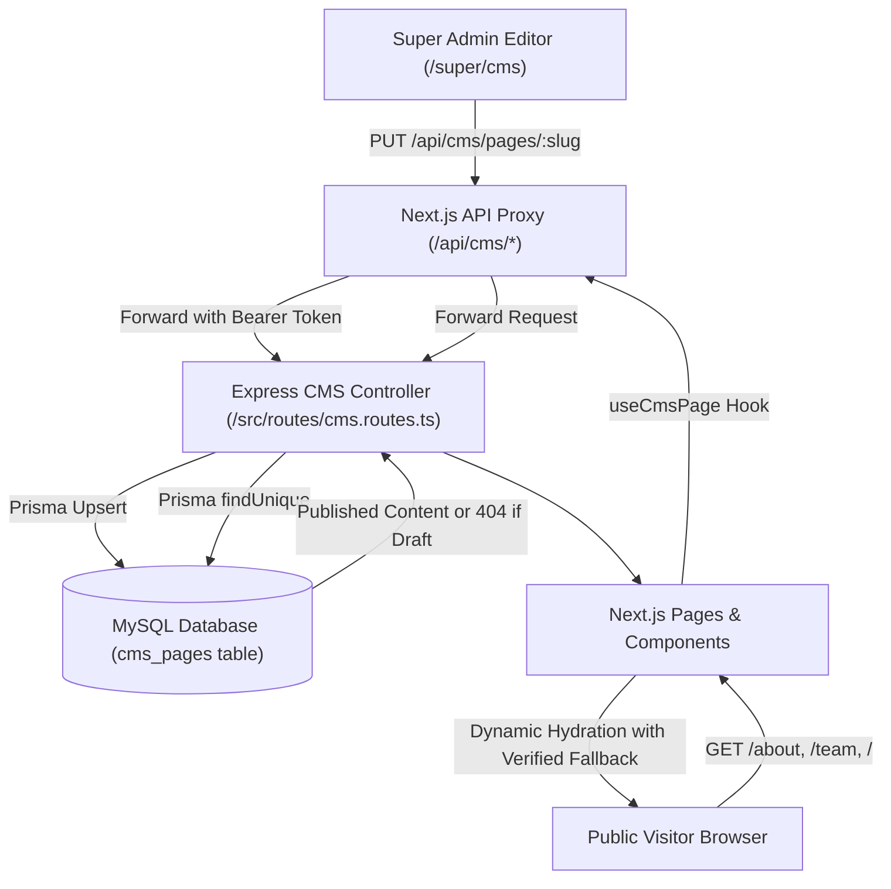

# MASTERHRMS — Complete CMS Content Management & Architecture Report

## Executive Summary

The MASTERHRMS platform has been transitioned into a genuinely CMS-driven architecture powered by the Next.js frontend, an authoritative Express backend, MySQL/Prisma persistence, and the Super Admin Visual CMS Studio (`/super/cms`).

This report provides the full forensic and operational audit of:
1. All canonical CMS-managed pages and registry schemas.
2. The authoritative content service (`useCmsPage` hook and `/api/cms/pages/*` API).
3. The Super Admin Visual CMS Studio capabilities and controls.
4. Persistence models, schema validation, and security boundaries.
5. Content field mappings, draft privacy enforcement, and fallback behavior.

---

## 1. Authoritative CMS Content Architecture

### Authoritative Endpoints
- `GET /api/cms/pages`: Returns list of all eligible CMS pages (filtered for public visitors; complete for super admins).
- `GET /api/cms/pages/:slug`: Returns page record by slug. Unauthenticated requests to draft pages return `HTTP 404`.
- `PUT /api/cms/pages/:slug`: Upserts page content and publication state. Requires `super_admin` role (`HTTP 401/403` on unauthorized calls).
- `POST /api/cms/pages`: Creates custom CMS pages with unique slug validation.
- `DELETE /api/cms/pages/:slug`: Deletes custom CMS page; core system pages (`home`, `footer`, `about`, `team`, `pricing`, `contact`, `legal-*`) are protected from deletion.

---

## 2. Canonical Page & Section Registry

The canonical database registry holds validated records in the MySQL `cms_pages` table:

| Slug | Canonical Title | Category | Route URL | Editable Sections & Fields | Status |
| :--- | :--- | :--- | :--- | :--- | :--- |
| `home` | Home — Next-Gen Automation SaaS | Core | `/` | Hero (eyebrow, title, subtitle, primary/secondary CTAs), CTA banner (badge, title, description, button text & URL), cards | Published |
| `about` | About Us — Story, Culture & Mission | Core | `/about` | Hero (eyebrow, title, subtitle), Mission statement, Statistics, Awards, Team preview | Published |
| `team` | Our Team — Leadership & Engineers | Core | `/team` | Hero Header (eyebrow, title, subtitle), Team Members grid | Published |
| `pricing` | Pricing Plans — Scale As You Grow | Core | `/pricing` | Hero (eyebrow, title, subtitle), Plans array, Feature comparison matrix | Published |
| `contact` | Contact Us — Get in Touch | Core | `/contact` | Hero (title, subtitle), Office address, Contact Form configuration | Published |
| `footer` | Footer Links & Global Theme | Footer | Global | Footer columns (Company, Products, Solutions, Legal), Copyright notice, Social links | Published |
| `legal-terms-of-service` | Terms of Service | Legal | `/legal/terms-of-service` | Document title, version, last updated, markdown body content, sections | Published |
| `legal-privacy-policy` | Privacy Policy | Legal | `/legal/privacy-policy` | Document title, version, last updated, markdown body content, sections | Published |
| `legal-cookie-policy` | Cookie Policy | Legal | `/legal/cookie-policy` | Document title, version, last updated, markdown body content, sections | Published |
| `legal-security` | Security Policy | Legal | `/legal/security` | Document title, version, last updated, markdown body content, sections | Published |
| `legal-dpa` | Data Processing Addendum | Legal | `/legal/dpa` | Document title, version, last updated, markdown body content, sections | Published |

---

## 3. Super Admin Visual CMS Studio (`/super/cms`)

The Visual CMS Studio provides real-time persistent management with zero local-state mocks:

1. **Page Sidebar & Filtering:**
   - Real-time search by title or slug.
   - Categorized pill filters: `All Pages`, `Core Pages`, `Landing & Features`, `Blog Insights`, `Case Studies`, `Resources`, `Legal Docs`, `Footer & Theme`, `Custom Pages`.
   - Live status badges: `Live` (emerald badge) vs `Draft` (outline badge).
   - Direct public link indicator for immediate navigation to the live route.

2. **Visual Section Editor:**
   - **Page Settings & SEO Meta:** Page title, locked/unlocked slug indicator, meta description.
   - **Hero Header Section:** Eyebrow tagline, Hero headline, Subtitle paragraph, Primary CTA button text & URL, Secondary CTA button text & URL.
   - **Blog/Case Study Metadata:** Author, Client name, Impact metric.
   - **Body Section:** Multi-paragraph article body text.
   - **Cards Grid Editor:** Dynamic addition, deletion, and editing of card items (title, description, icon).
   - **Vendor Comparison Editor:** Add/remove vendors, features, and platform comparison notes.
   - **Footer & Theme Editor:** Header logo, footer columns, copyright line, social media URLs.

3. **Multi-Device Live Preview:**
   - Interactive preview frame switchable between **Desktop (100%)**, **Tablet (768px)**, and **Mobile (375px)**.
   - Address bar indicator showing simulated viewport navigation.

4. **Raw JSON Mode:**
   - Direct JSON tree editor with real-time syntax validation.
   - Invalid JSON syntax disables saving and presents specific error tokens to prevent corrupted database payloads.

---

## 4. Frontend Component Hydration (`useCmsPage`)

To guarantee seamless rendering without layout shifts or blank screens, all public marketing components utilize the authoritative `useCmsPage(slug)` hook ([`CMS/src/hooks/use-cms-page.ts`](file:///c:/Users/TSV%20Global%20Solutions/Documents/hrms/CMS/src/hooks/use-cms-page.ts)):

1. [`CMS/src/components/home/hero.tsx`](file:///c:/Users/TSV%20Global%20Solutions/Documents/hrms/CMS/src/components/home/hero.tsx):
   - Hydrates `headline`, `subtitle`, `primaryCtaText`, `primaryCtaUrl`, `secondaryCtaText` from `content.hero`.
   - Fallback: Pre-configured Nexsas marketing copy.
2. [`CMS/src/components/shared/cta.tsx`](file:///c:/Users/TSV%20Global%20Solutions/Documents/hrms/CMS/src/components/shared/cta.tsx):
   - Hydrates `eyebrow`, `title`, `description`, `buttonText`, `buttonUrl` from `content.cta`.
   - Fallback: Standard conversion CTA copy.
3. [`CMS/src/components/about/hero.tsx`](file:///c:/Users/TSV%20Global%20Solutions/Documents/hrms/CMS/src/components/about/hero.tsx):
   - Hydrates `eyebrow`, `title`, `subtitle` from `content.hero`.
   - Fallback: "How Nexsas began" story copy.
4. [`CMS/src/components/team/our-team.tsx`](file:///c:/Users/TSV%20Global%20Solutions/Documents/hrms/CMS/src/components/team/our-team.tsx) & [`CMS/src/components/team/our-team-header.tsx`](file:///c:/Users/TSV%20Global%20Solutions/Documents/hrms/CMS/src/components/team/our-team-header.tsx):
   - Client header hydrates `eyebrow`, `title`, `subtitle` from `content.hero`.
   - Server-side member card generator retains local team markdown roster.
5. [`CMS/src/components/contact/contact-us.tsx`](file:///c:/Users/TSV%20Global%20Solutions/Documents/hrms/CMS/src/components/contact/contact-us.tsx):
   - Hydrates `title` and `subtitle` from `content.hero`.
   - Fallback: "We'd love to hear from you".
6. [`CMS/src/components/shared/layout/footer/footer-bottom.tsx`](file:///c:/Users/TSV%20Global%20Solutions/Documents/hrms/CMS/src/components/shared/layout/footer/footer-bottom.tsx):
   - Hydrates `copyright` from `content.copyright`.
   - Fallback: Standard dynamic copyright year string.

---

## 5. Security & Isolation Boundaries

- **Role-Based Access Control:** All mutations (`POST`, `PUT`, `DELETE`) require an active session with role `super_admin`. Regular users and anonymous visitors cannot publish or alter CMS records.
- **Draft Privacy Rule:** When `published === false`, non-super-admin requests to `/api/cms/pages/:slug` receive `HTTP 404`, ensuring that draft campaigns or unpublished reorganizations do not leak to public scrapers or competitors.
- **Protected Core Slugs:** Slugs `home`, `footer`, `about`, `team`, `pricing`, `contact`, `benefits`, `compare` cannot be renamed or deleted, guarding system integrity.
- **Zero Script Injection:** Presentation inputs are constrained to text strings, validated links, and allowed layout toggles. Arbitrary HTML script tags and external stylesheet injections are not permitted.
