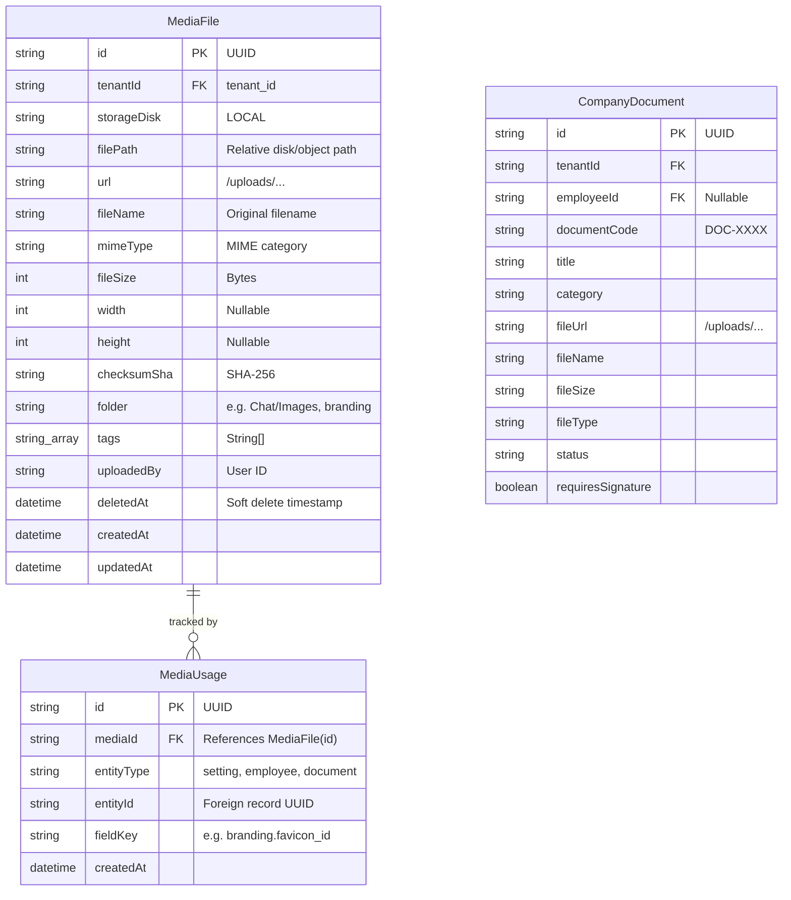

# MASTERHRMS FILE MANAGER — PHASE F0 MANDATORY REPOSITORY AUDIT & UPLOAD INVENTORY

**Audit Date**: October 29, 2026  
**Auditor**: Lead System Engineer  
**Phase**: **F0 — Read-Only Audit & Upload Inventory**  
**Action Status**: **STOPPED FOR APPROVAL (No code or database modified)**  

---

## 1. Repository & Git State

- **Current Branch**: `main`
- **HEAD Commit**: `01178721ba235c7c207b31fdc2320b8b78c420ad` (`feat(chat): simplify group activity labels, add multi-destination forwarding tabs, anchor latest message scroll, split 3-tab navigation, and purge dummy test groups`)
- **Configured Upstream**: `origin/main` (`https://github.com/Webfamily-06/masterhrms.git`)
- **Upstream Synchronization**: Exact match (`Your branch is up to date with 'origin/main'`)
- **Working-Tree State**: Completely clean (`nothing to commit, working tree clean`)

---

## 2. Route & Component Architecture

### A. Existing File Manager Routes
- **List View**: `/apps/file-manager/list-view`
  - CMS file: [CMS/src/app/(workspace)/apps/file-manager/list-view/page.tsx](file:///c:/Users/TSV%20Global%20Solutions/Documents/hrms/CMS/src/app/(workspace)/apps/file-manager/list-view/page.tsx)
  - TanStack route: [src/routes/_authenticated/_app/apps.file-manager.list-view.tsx](file:///c:/Users/TSV%20Global%20Solutions/Documents/hrms/src/routes/_authenticated/_app/apps.file-manager.list-view.tsx)
- **Grid View**: `/apps/file-manager/grid-view`
  - CMS file: [CMS/src/app/(workspace)/apps/file-manager/grid-view/page.tsx](file:///c:/Users/TSV%20Global%20Solutions/Documents/hrms/CMS/src/app/(workspace)/apps/file-manager/grid-view/page.tsx)
  - TanStack route: [src/routes/_authenticated/_app/apps.file-manager.grid-view.tsx](file:///c:/Users/TSV%20Global%20Solutions/Documents/hrms/src/routes/_authenticated/_app/apps.file-manager.grid-view.tsx)
- **Shared Component**: [classic-file-manager-app.tsx](file:///c:/Users/TSV%20Global%20Solutions/Documents/hrms/CMS/src/components/apps/file-manager/classic-file-manager-app.tsx)
  - **Audit Finding**: Currently a **mock-only prototype**. Contains hardcoded `DEFAULT_FILES` (7 mock items) and `DEFAULT_FOLDERS` (3 mock folders). Upload handler (`handleUpload`) merely appends an in-memory object to React `useState` without hitting the backend API. Does not support real rename, move, delete, or permissions.

### B. Existing Media Library Routes
- **HR Media Library**: `/hr/media`
  - CMS file: [CMS/src/app/(workspace)/hr/media/page.tsx](file:///c:/Users/TSV%20Global%20Solutions/Documents/hrms/CMS/src/app/(workspace)/hr/media/page.tsx) -> renders [tenant-media-page.tsx](file:///c:/Users/TSV%20Global%20Solutions/Documents/hrms/CMS/src/components/media/tenant-media-page.tsx)
- **Employee Media Library**: `/me/media`
  - CMS file: [CMS/src/app/(workspace)/me/media/page.tsx](file:///c:/Users/TSV%20Global%20Solutions/Documents/hrms/CMS/src/app/(workspace)/me/media/page.tsx) -> renders `TenantMediaPage`
- **Legacy Redirect**: `/media` -> redirects to `/hr/media`
- **Platform Super Admin**: `/super/media` -> [CMS/src/app/super/media/page.tsx](file:///c:/Users/TSV%20Global%20Solutions/Documents/hrms/CMS/src/app/super/media/page.tsx)
- **Audit Finding**: `TenantMediaPage` is **fully connected and authoritative**. It queries `GET /api/v1/media`, uploads via `POST /api/v1/media/upload`, checks for in-use conflicts via `MediaUsage`, and renders real persisted assets.

### C. Role-Specific File Manager Routes (`/hr/files`, `/me/files`, `/tenant/files`)
- **Status**: **Currently DO NOT exist**.
- Navigation currently points only to `/apps/file-manager/list-view` and `/apps/file-manager/grid-view` in `hr-sidebar.ts`, and to `/me/media` in `employee-sidebar.ts`.
- **Target Implementation**: We will introduce `/hr/files`, `/me/files`, and `/tenant/files` as the canonical role-based entry points, while maintaining backward-compatible aliases/redirects for `/apps/file-manager/*`.

---

## 3. Database & Prisma Schema Inventory

### Exact Database Record Counts (Verified Live)
1. **`MediaFile`**: **149 live records**
   - Folders in use:
     - `workspace/branding`: 61 records
     - `system/branding`: 51 records
     - `Chat/Documents`: 9 records
     - `Chat/Images`: 7 records
     - `Employees/{id}/Profile`: 9 records
     - `branding`: 3 records
     - `documents/employee`: 2 records
     - `documents`: 2 records
     - `platform/branding`: 2 records
     - `Chat/Audio`: 1 record
     - `general/picker`: 1 record
     - `addons/icons`: 1 record
2. **`MediaUsage`**: Actively referenced by tenant settings (`setting` entity type with field keys like `branding.favicon_id`, `branding.logo_light_id`, etc.).
3. **`CompanyDocument`**: **5 live records** (employee contracts and ID proofs). Several `fileUrl` fields directly point to `/uploads/documents/employee/...`, matching existing `MediaFile` records.
4. **`StoredDocument`**: **0 records** (legacy/unused stub).

> [!IMPORTANT]
> **Key Architectural Conclusion**: `MediaFile` is already the true canonical storage table across MASTERHRMS. Chat attachments, branding assets, and employee documents are already stored in `MediaFile`. We MUST extend `MediaFile` rather than creating a competing table.

---

## 4. Storage & Upload Architecture

### A. Deployment Configuration
- **Host**: Vercel configuration (`vercel.json`) defines multi-service architecture:
  - Service `cms`: Next.js App Router in `CMS/`
  - Service `server`: Express Node API in `server/`
  - Rewrites route `/api/(.*)` and `/uploads/(.*)` directly to `server`.
- **Active Provider**: `STORAGE_PROVIDER="local"` in `server/.env`.
- **Database**: PostgreSQL hosted on AWS pooler (`aws-0-ap-south-1.pooler.supabase.com:6543`) via Prisma ORM.
- **File Storage Root**:
  - Local/Server: `<root>/uploads/`
  - Serverless fallback: `os.tmpdir()/uploads` (if `process.env.VERCEL` is present).

### B. Upload Pipeline & Security
- **API Endpoints**:
  - `POST /api/v1/media/upload` (and `/api/media/upload`): Protected by `requireAuth`. Multer 30MB memory limit, magic-byte header validation, dangerous extension blocking (.exe, .sh, .js, .ts, .php, etc.), SHA-256 deduplication, and `MediaFile` record creation.
  - `POST /api/chat/upload`: Multer memory storage, classifies into `Chat/Images`, `Chat/Audio`, `Chat/Documents`, and persists via `MediaService.uploadMedia()`.
- **Static File Security**:
  - `/uploads` route in `server/src/index.ts` is protected by [uploadsSecurityMiddleware](file:///c:/Users/TSV%20Global%20Solutions/Documents/hrms/server/src/middleware/uploads-security.middleware.ts).
  - Enforces path traversal prevention (`..`).
  - Allows public access only for branding/icon directories (`branding/`, `workspace/branding/`, `system/branding/`).
  - Requires JWT token (Bearer, cookie, or `?token=`) for all private assets (`Chat/`, `documents/`, `Employees/`).
  - Enforces strict tenant isolation: verifies `mediaFile.tenantId === userTenantId`. Blocks cross-tenant access with 403 / 404.

---

## 5. Module Upload Entry Points Inventory

| Module | Upload Entry Point | Current Storage Path | Database Model | Status |
|---|---|---|---|---|
| **Media Library** | `POST /api/v1/media/upload` | `/uploads/{folder}/{hash}.ext` | `MediaFile`, `MediaUsage` | Canonical & Production Ready |
| **Chat** | `POST /api/chat/upload` | `/uploads/Chat/{Images\|Documents\|Audio}/...` | `MediaFile`, `ChatMessage` | Fully integrated into `MediaFile` |
| **Employee Profile** | Avatar upload / `PATCH /api/employees/:id` | `/uploads/Employees/{id}/Profile/...` | `MediaFile`, `Employee`, `Profile` | Integrated into `MediaFile` |
| **Documents** | `POST /api/documents` | Accepts `fileUrl` pointing to `/uploads/...` | `CompanyDocument` | Uses `/uploads/documents/employee/...` |
| **Todos & Tasks** | `POST /api/todos` / `PUT /api/todos/:id` | Accepts `attachments: [{ id, name, url }]` | `WorkspaceTodo` JSON metadata | Uses `/uploads/...` URLs |
| **Recruitment** | `POST /api/recruitment/candidates` | Accepts `resumeUrl: string` | `JobCandidate` | Uses URL reference |
| **Expenses** | `POST /api/expenses/claims/upload-receipt` | Uses `StorageFactory` / `LocalEncryptedStorage` | `StoredDocument` (0 live records) | Isolated subsystem |
| **Classic File Manager** | `handleUpload` in `classic-file-manager-app.tsx` | Client `useState` ONLY | None (Mock data) | **Defective prototype** (to be replaced) |

---

## 6. Gap Analysis & Proposed Foundation Plan (F1 Preparation)

### Deficiencies in Current Implementation
1. **Mock Data in File Manager**: `ClassicFileManagerApp` displays fake files (`DEFAULT_FILES`) and folders (`DEFAULT_FOLDERS`), not the 149 real records in PostgreSQL.
2. **Missing Hierarchy & Metadata**:
   - `MediaFile` stores flat folder strings (e.g. `Chat/Images`), without a parent-child folder tree, favorite/star flag, sharing status, or custom user folders.
   - Deletion is soft-delete (`deletedAt`), but there is no Trash / Recycle Bin view or Restore API.
3. **Missing File Manager Routes**:
   - No `/hr/files`, `/me/files`, or `/tenant/files` pages.
4. **No Realtime File Events**:
   - Uploading or moving a file in one browser window does not notify other open File Manager windows via Socket.IO.
5. **Missing Signed URL Engine**:
   - Private assets require cookie or Authorization header; generating time-limited signed URLs (`/api/v1/files/:id/download?signature=...`) is needed for secure one-click external downloads without exposing session cookies.

### Proposed Backward-Compatible Schema Extension (Plan for F1)
Rather than creating an unrelated table, we will add non-destructive optional fields to `MediaFile`:
- `isStarred`: `Boolean @default(false)`
- `parentId`: `String?` (for nested subfolder hierarchies)
- `isFolder`: `Boolean @default(false)`
- `sharing`: `String @default("private")` (`"private"`, `"tenant"`, `"shared"`)
- `sharedWithUserIds`: `String[]` (users with explicit access)
- `category`: `String @default("Documents")` (`"Images"`, `"Videos"`, `"Audio"`, `"Documents"`, `"Folders"`)

All 149 existing `MediaFile` records will be safely preserved, maintaining 100% compatibility with Chat, Branding, and Media Library.

---

## 7. Stop Condition & Approval Request

> [!CAUTION]
> In accordance with Phase F0 instructions, **all work is halted here**. No database migrations, code modifications, or destructive operations have been executed.

**Pending User Approval to proceed to Phase F1 (Foundations & Schema):**
1. Approve extending the canonical `MediaFile` table with non-destructive fields (`isStarred`, `parentId`, `isFolder`, `sharing`, `category`).
2. Approve building the unified File Manager API on `/api/v1/files` backed by `MediaService` and `uploadsSecurityMiddleware`.
3. Approve creating `/hr/files`, `/me/files`, and `/tenant/files` with seamless List/Grid toggling, and redirecting `/apps/file-manager/*` to the canonical engine.
