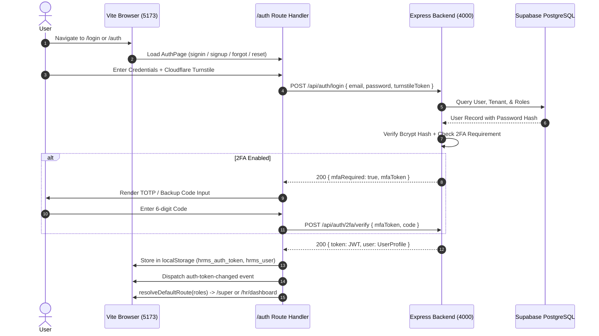
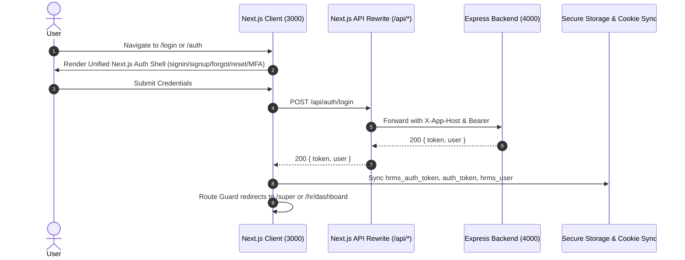

# MASTERHRMS — Vite to Next.js Complete Migration Inventory & Architecture

**Document Date:** October 21, 2026  
**Auditor / Lead Architect:** Antigravity Engineering Agent  
**Goal:** Complete, zero-downtime migration of the MASTERHRMS frontend from Vite 8 + TanStack Start to Next.js 16.1.6 App Router (`CMS/`).  
**Authoritative Backend:** Node.js Express + Prisma ORM on port `4000`.  
**Target Canonical Frontend:** Next.js on port `3000`.

---

## 1. Authentication Architecture (Before & After)

### Current Vite Architecture (`src/routes/auth.tsx`)


### Target Next.js Architecture (`CMS/src/app/(auth)/`)


---

## 2. Complete Vite Route Inventory (508 Route Files Discovered)

The Vite repository contains **508 route files** distributed across 7 primary functional clusters:

### Cluster 1: Public Marketing, Legal & Dynamic CMS (18 Routes)
- `/` (`src/routes/index.tsx`)
- `/about` (`src/routes/about.tsx`)
- `/careers` (`src/routes/careers.tsx`)
- `/contact` (`src/routes/contact.tsx`)
- `/pricing` (`src/routes/pricing.tsx`)
- `/solutions` (`src/routes/solutions.tsx`)
- `/resources` (`src/routes/resources.tsx`)
- `/product` (`src/routes/product.tsx`)
- `/store` (`src/routes/store.tsx`)
- `/developer` (`src/routes/developer.tsx`)
- `/docs` (`src/routes/docs.tsx`)
- `/help-center` (`src/routes/help-center.tsx`)
- `/legal/$slug` (`src/routes/legal.$slug.tsx`)
- `/p/$slug` (`src/routes/p.$slug.tsx`)
- `/cms.index` & `/cms.$` (`src/routes/cms.index.tsx`, `src/routes/cms.$.tsx`)
- `/addons.index` & `/addons_.$slug` (`src/routes/addons.index.tsx`, `src/routes/addons_.$slug.tsx`)

### Cluster 2: Authentication & System States (12 Routes)
- `/auth` (`src/routes/auth.tsx`) — Canonical unified authentication engine
- `/login` (`src/routes/login.tsx`) — Redirects to `/auth`
- `/register` (`src/routes/register.tsx`) — Register alias
- `/super-login` (`src/routes/super-login.tsx`) — Super Admin authentication
- `/super06` (`src/routes/super06.tsx`) — Master Super Admin entry portal
- `/verify-2fa` (`src/routes/verify-2fa.tsx`) — 2FA standalone challenge
- `/lock-screen` (`src/routes/lock-screen.tsx`)
- `/session-expired` (`src/routes/session-expired.tsx`)
- `/maintenance` (`src/routes/maintenance.tsx`)
- `/offline` (`src/routes/offline.tsx`)
- `/403`, `/404`, `/500` (`src/routes/403.tsx`, `src/routes/404.tsx`, `src/routes/500.tsx`)

### Cluster 3: Super Admin Portal (`/_authenticated/super/*` — 42 Routes)
- `/super` (`src/routes/_authenticated/super/index.tsx`) — Executive Analytics & Revenue Control Center
- `/super/tenants` (`src/routes/_authenticated/super/tenants.tsx`) — Multi-Tenant Lifecycle & Provisioning
- `/super/tenant-usage-metrics` (`src/routes/_authenticated/super/tenant-usage-metrics.tsx`)
- `/super/plans` (`src/routes/_authenticated/super/plans.tsx`) — SaaS Tier Configuration & Entitlements
- `/super/coupons` (`src/routes/_authenticated/super/coupons.tsx`)
- `/super/transactions` (`src/routes/_authenticated/super/transactions.tsx`) — Global Revenue Ledger
- `/super/roles` (`src/routes/_authenticated/super/roles.tsx`) — Platform-Wide RBAC Matrix
- `/super/settings` (`src/routes/_authenticated/super/settings.tsx`) — SMTP, Pusher, Cloudflare, Razorpay
- `/super/backup` (`src/routes/_authenticated/super/backup.tsx`) — Database Dump & Disaster Recovery
- `/super/cms` (`src/routes/_authenticated/super/cms.tsx`) — Platform CMS Article & Banner Manager
- `/super/marketplace` (`src/routes/_authenticated/super/marketplace.tsx`) — Add-on Catalog & Licensing
- `/super/compliance` (`src/routes/_authenticated/super/compliance.tsx`)
- `/super/support` & `/super/tenant-support-tickets` (`src/routes/_authenticated/super/support.tsx`)
- `/super/domains` & `/super/domains.documentation` (`src/routes/_authenticated/super/domains.tsx`)
- `/super/media` (`src/routes/_authenticated/super/media.tsx`)
- `/super/email-templates` (`src/routes/_authenticated/super/email-templates.tsx`)
- `/super/sla-policies` & `/super/escalation-rules` (`src/routes/_authenticated/super/sla-policies.tsx`)

### Cluster 4: Core HRM & Operations (`/_authenticated/hr/*` — 115 Routes)
- **Dashboard**: `/hr/dashboard` (`hrm-dashboard.tsx`)
- **Employees**:
  - `/hr/employees` — Comprehensive Employee 360 Directory
  - `/hr/employees/new` — Multi-Step Onboarding Wizard
  - `/hr/employees/$id` — 360 Employee Profile View
  - `/hr/employees/$id/edit` — Employee Profile, Address Intelligence & System ID Editor
  - `/hr/employees/import` — Bulk CSV/Excel Importer
- **Document Vault**:
  - `/hr/documents` — 18 Categorized Standard Document Vault
  - `/hr/documents/categories` — Vault Category Configurator
  - `/hr/documents/templates` — Contract & Offer Letter Builder
  - `/hr/documents/requests` — Employee Document Request Tracker
- **Attendance & Shifts**:
  - `/hr/attendance/records` — Daily Biometric & Manual Punch Grid
  - `/hr/attendance/live` — Real-Time Geo & Device Punch Monitor
  - `/hr/attendance/timesheets` — Weekly/Monthly Timesheet Approvals
  - `/hr/attendance/shifts` — Shift Rostering, Rotations, & Swaps
  - `/hr/attendance/overtime` — Overtime Policy & Calculations
- **Leave Management**:
  - `/hr/leave/applications` — Leave Request Review & Approvals
  - `/hr/leave/balances` — Accrual Engine & Annual Balances
  - `/hr/leave/calendar` — Team Leave Heatmap
  - `/hr/leave/encashment-compoff` — Leave Encashment & Comp-Off Ledger
- **Payroll & Compensation**:
  - `/hr/payroll/runs` — Monthly Payroll Batch Processor
  - `/hr/payroll/payslips` — Automated Payslip Generator & PDF Downloader
  - `/hr/payroll/salaries` — Salary Structure & CTC Breakup Engine
  - `/hr/payroll/components` — Allowances, Deductions, & Statutory Formulae
  - `/hr/payroll/tax` — TDS, Form 16, & Statutory Compliance
- **Performance & OKR**:
  - `/hr/performance/reviews` — 360 Review Cycles & Self-Appraisals
  - `/hr/performance/goals` — OKR Tracking & Key Result Metrics
  - `/hr/performance/pip` — Performance Improvement Plans
- **Recruitment**:
  - `/hr/recruitment/job-postings` — Job Requisitions & Career Site Publisher
  - `/hr/recruitment/pipeline` — Kanban Candidate Tracking Board
  - `/hr/recruitment/interviews` — Interview Scheduling & Scorecards
- **Lifecycle & Offboarding**:
  - `/hr/lifecycle/probation` — Confirmation Reviews
  - `/hr/lifecycle/promotions` — Role & Band Transitions
  - `/hr/lifecycle/transfers` — Branch & Department Transfers
  - `/hr/lifecycle/resignations` & `/hr/lifecycle/terminations` — Exit Clearance Workflow
- **Reports**:
  - `/hr/reports/headcount`, `/hr/reports/attrition`, `/hr/reports/attendance`, `/hr/reports/payroll`, `/hr/reports/statutory`

### Cluster 5: Business, ERP, POS & Finance Modules (`/_authenticated/_app/*` — 119 Modules)
- **CRM & Deals**: `/crm`, `/deals-dashboard`, `/leads-dashboard`, `/contacts`, `/companies`, `/proposals`, `/pipeline`
- **Invoicing & Billing**: `/invoices`, `/invoice/$id`, `/invoice/$id/print`, `/recurring-invoices`, `/purchases`, `/returns`
- **Point of Sale (POS)**: `/pos`, `/pos-dashboard`, `/products`, `/store`, `/customer-display`
- **Projects & Tasks**: `/projects`, `/project/$id`, `/task-board`, `/tasks`, `/timesheets`
- **Inventory & Suppliers**: `/inventory-dashboard`, `/purchases`, `/suppliers`, `/transfers`, `/adjustments`
- **Smart Reports**: `/smart-reports`, `/smart-reports/attendance-summary`, `/smart-reports/payroll-sheet`, `/smart-reports/sales-invoice`, `/smart-reports/product-stock`
- **Add-ons & Integrations**: `/marketplace`, `/google-workspace`, `/shopify`, `/tally-importer`, `/razorpay-gateway`, `/whatsapp-alerts`

### Cluster 6: Personal Self-Service Portal (`/_authenticated/me/*` — 31 Routes)
- `/me/dashboard` — Personal Employee Landing
- `/me/profile` — Personal Details & Emergency Contacts
- `/me/attendance` & `/me/attendance/records` — Personal Punches & Regularization Requests
- `/me/leave` — Personal Leave Balances & Request Form
- `/me/payroll/payslips` — Personal Payslip Archive & Downloads
- `/me/documents` — Personal Document Vault Uploads & Acknowledgements
- `/me/todo` & `/me/calendar` — Personal Task Checklist & Calendar

### Cluster 7: Tenant Administration (`/_authenticated/tenant/*` — 18 Routes)
- `/tenant/dashboard` — Tenant Operational Overview
- `/tenant/users` & `/tenant/roles` — Tenant User Directory & Permissions
- `/tenant/subscription` & `/tenant/billing` — Plan Tier, Invoices, & Payment Gateways
- `/tenant/branding` — Custom Logo, Favicon, & Accent Colors
- `/tenant/domain` — Custom Subdomain & CNAME Resolution
- `/tenant/audit-logs` — Immutable Security & Action Audit Trail

---

## 3. Migration Dependency Map

```
Next.js App Router (CMS/src/app)
├── Providers & Global Context
│   ├── QueryClientProvider (@tanstack/react-query)
│   ├── ThemeProvider (dark / light mode)
│   ├── Sonner Toaster (toast notifications)
│   ├── SocketProvider (real-time events)
│   └── TenantBrandingProvider (dynamic logo, colors)
├── Layout Shells
│   ├── (marketing)/layout.tsx  (Navbar + Footer + SmoothScroll)
│   ├── (auth)/layout.tsx       (Clean Centered Glassmorphic Auth Container)
│   ├── (super)/layout.tsx      (Super Admin Sidebar, Navigation, & Analytics Topbar)
│   └── (app)/layout.tsx        (DreamsSidebar, App Topbar, Notifications, Breadcrumbs)
└── API & Data Layer
    ├── Next.js Proxy Rewrite (/api/* -> http://localhost:4000/api/*)
    ├── Universal API Client (api, getAuthHeaders, setToken, clearToken)
    └── RBAC & Host Guard Middleware (isTenantWorkspaceHost, extractRolesFromToken)
```

---

## 4. Migration Execution Batches

1. **Batch 1: Authentication Core**
   - Implement `/login`, `/auth`, `/register`, `/forgot-password`, `/reset-password`, `/verify-2fa`, `/super06`, `/super-login` in Next.js App Router.
   - Connect directly to Express `/api/auth/*` endpoints with full support for credential login, 2FA challenge, demo autofill, and token persistence.
2. **Batch 2: Shared Layouts & Application Shell**
   - Implement Next.js `(app)` and `(super)` layouts integrating `DreamsSidebar`, `SuperShell`, `RealtimeNotificationDrawer`, `ThemeToggle`, and user profile dropdowns.
3. **Batch 3: Core HRMS & Employee 360 Workflows**
   - Port `/hr/dashboard`, `/hr/employees`, `/hr/employees/new`, `/hr/employees/[id]`, `/hr/employees/[id]/edit`.
   - Port Document Vault (`/hr/documents`), Attendance (`/hr/attendance/records`), Leaves (`/hr/leave`), and Payroll (`/hr/payroll`).
4. **Batch 4: Tenant Admin & Super Admin Portals**
   - Port `/super` dashboard, `/super/tenants`, `/super/plans`, `/super/settings`.
   - Port `/tenant/dashboard`, `/tenant/branding`, `/tenant/subscription`.
5. **Batch 5: Extended Modules & Self-Service**
   - Port `/me/*` self-service, `/pos`, `/invoices`, `/projects`, `/crm`, `/smart-reports`.
6. **Batch 6: Retirement of Vite & Acceptance**
   - Verify all tests, builds, and browser sessions on port `3000`.
   - Update root development scripts so Next.js + Backend is the sole active stack.
