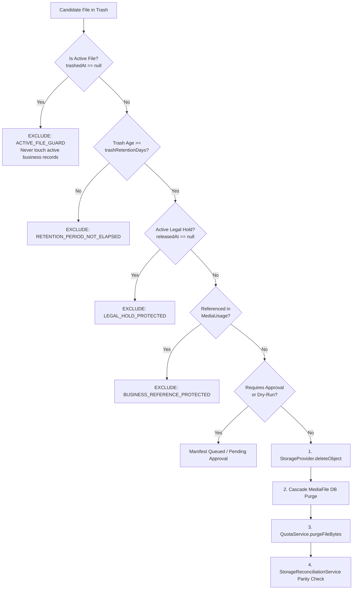

# MASTERHRMS — PHASE F4-F VERIFICATION REPORT
## Enterprise Storage Retention Policy Automation & Legal Holds

**Phase:** F4-F ONLY  
**Module:** Enterprise File Manager — Storage Administration  
**Status:** **COMPLETE — 100% PASS**  
**Date:** 2026-10-30  
**Verification Verdict:** Production Ready  

---

## 1. Executive Summary

Phase F4-F introduces enterprise-grade **Storage Retention Policy Automation, Legal Hold Governance, and Fleet Retention Telemetry** to MasterHRMS SaaS. Built directly upon the verified foundations of F1 (Storage Providers), F2 (Unified Explorer & Trash), F3 (ACL & Sharing), F4-B (SUCE & Reconciliation), F4-C (Quota Governance), F4-D (Storage Admin Dashboard), and F4-E (Fleet Analytics & Forecasting), Phase F4-F establishes automated, auditable, and safe lifecycle management for storage.

Key capabilities delivered:
- **Zero Loss of Active Records:** Active business files (`trashedAt == null`) are strictly immune to age-based deletion. Only expired trash items and surplus file versions past policy thresholds can be candidates.
- **Safe-by-Default Governance:** Every retention policy initializes disabled (`isEnabled: false`) and in simulation mode (`isDryRun: true`). The default trash retention threshold preserves the canonical 30-day window (`trashRetentionDays: 30`).
- **Enterprise Legal Hold System:** Active legal holds (`StorageLegalHold`) place hard immutability locks on files, blocking both automated retention purges and manual permanent deletions (`403 Forbidden: LEGAL_HOLD_ACTIVE`).
- **Business Reference Protection:** Files linked to active business entities via `MediaUsage` (e.g., employee avatars, company logos, documents) are safeguarded against automated purges.
- **Two-Phase Physical Deletion & SUCE Parity:** Physical objects in Supabase storage are confirmed deleted before database records are cascaded and SUCE quota bytes (`QuotaService.purgeFileBytes`) are deducted. Post-execution self-healing via `StorageReconciliationService.repairTenantStorage` guarantees zero counter drift.
- **Auditable Execution Lifecycle:** Retention jobs track full candidate manifests, skipped item breakdowns (categorized by reason), approval workflows (`PENDING_APPROVAL`, `APPROVED`, `REJECTED`), and transactional audit logs via `FileActivity` and Socket.IO.
- **Multi-Tenant Isolation & Role Security:** Complete tenant boundary isolation; Employees are denied administrative policy access (`403 Forbidden`).
- **Super Admin Fleet Telemetry:** Global retention dashboard aggregating active policies, total reclaimed bytes, and real-time execution job history across all tenants.

---

## 2. Deliverables & Code Artifacts

| Component | File Path | Scope & Purpose |
| :--- | :--- | :--- |
| **Prisma Schema** | [`schema.prisma`](file:///c:/Users/TSV%20Global%20Solutions/Documents/hrms/server/prisma/schema.prisma) | Models for `StorageRetentionPolicy`, `StorageLegalHold`, and `StorageRetentionJob` |
| **Core Retention Engine** | [`storage-retention.service.ts`](file:///c:/Users/TSV%20Global%20Solutions/Documents/hrms/server/src/services/files/storage-retention.service.ts) | Policy CRUD, candidate discovery, legal hold lifecycle, bounded chunk execution, and fleet aggregation |
| **Deletion Guardrail** | [`files.service.ts`](file:///c:/Users/TSV%20Global%20Solutions/Documents/hrms/server/src/services/files/files.service.ts) | Enforces `LEGAL_HOLD_ACTIVE` (403) check in `deleteItemPermanently` |
| **Tenant Storage Routes** | [`tenant-storage.routes.ts`](file:///c:/Users/TSV%20Global%20Solutions/Documents/hrms/server/src/routes/tenant-storage.routes.ts) | Tenant endpoints: `/retention/policy`, `/preview`, `/execute`, `/request-approval`, `/jobs/:jobId/approve`, `/reject`, `/history`, `/holds`, `/holds/:id/release` |
| **Super Storage Routes** | [`super-storage.routes.ts`](file:///c:/Users/TSV%20Global%20Solutions/Documents/hrms/server/src/routes/super-storage.routes.ts) | Super Admin fleet endpoints: `/retention/fleet`, `/retention/history`, `/retention/execute` |
| **Tenant Retention UI** | [`RetentionTab.tsx`](file:///c:/Users/TSV%20Global%20Solutions/Documents/hrms/CMS/src/app/(workspace)/tenant/files/storage/RetentionTab.tsx) | Policy configuration card, candidate dry-run breakdown, legal hold management table, and execution history modal |
| **Tenant Dashboard Tab** | [`page.tsx`](file:///c:/Users/TSV%20Global%20Solutions/Documents/hrms/CMS/src/app/(workspace)/tenant/files/storage/page.tsx) | Integrated "Retention & Legal Holds" tab with URL synchronization (`?tab=retention`) |
| **Redirect Route** | [`page.tsx`](file:///c:/Users/TSV%20Global%20Solutions/Documents/hrms/CMS/src/app/(workspace)/tenant/files/storage/retention/page.tsx) | Canonical route redirecting `/tenant/files/storage/retention` to `/tenant/files/storage?tab=retention` |
| **Super Admin UI** | [`page.tsx`](file:///c:/Users/TSV%20Global%20Solutions/Documents/hrms/CMS/src/app/super/tenant-usage-metrics/page.tsx) | Fleet Retention Overview metrics card and global retention execution log |
| **Automated E2E Suite** | [`verify_file_manager_f4f_e2e.cjs`](file:///c:/Users/TSV%20Global%20Solutions/Documents/hrms/scripts/verify_file_manager_f4f_e2e.cjs) | 50 comprehensive end-to-end automated verification checkpoints |
| **Browser QA Suite** | [`verify_file_manager_f4f_browser_qa.cjs`](file:///c:/Users/TSV%20Global%20Solutions/Documents/hrms/scripts/verify_file_manager_f4f_browser_qa.cjs) | Playwright UI verification capturing 6 production-grade screenshots |
| **Forensic Audit** | [`F4F_AUDIT.md`](file:///c:/Users/TSV%20Global%20Solutions/Documents/hrms/docs/Saas/file-manager/phase-f4-f/F4F_AUDIT.md) | Pre-implementation forensic audit of existing schemas, services, and guardrails |

---

## 3. Database Architecture & Schema Integrity

Three new relational tables were introduced via non-destructive DDL:

### A. `storage_retention_policies`
- `tenant_id` (VARCHAR 36, Unique, Foreign Key -> `tenants.id`)
- `is_enabled` (BOOLEAN, default `false` — safe by default)
- `is_dry_run` (BOOLEAN, default `true` — safe by default)
- `trash_retention_days` (INTEGER, default `30` — F0 decision preserved)
- `version_retention_days` (INTEGER, default `90`)
- `max_versions_per_file` (INTEGER, default `10`)
- `require_admin_approval` (BOOLEAN, default `false`)
- `policy_version` (INTEGER, default `1`, auto-incremented on update)
- `created_at` / `updated_at` (TIMESTAMPTZ)

### B. `storage_legal_holds`
- `id` (VARCHAR 36, Primary Key)
- `tenant_id` (VARCHAR 36, Indexed, Foreign Key -> `tenants.id`)
- `target_type` (VARCHAR 32, e.g. `'FILE'`, `'FOLDER'`, `'USER'`)
- `target_id` (VARCHAR 36, Indexed, Foreign Key -> `media_files.id`)
- `reason` (TEXT)
- `reference_id` (VARCHAR 128, Case/Matter ID)
- `placed_by_user_id` (VARCHAR 36, Foreign Key -> `users.id`)
- `placed_at` (TIMESTAMPTZ, default `NOW()`)
- `released_at` (TIMESTAMPTZ, Nullable — active when NULL)
- `released_by_user_id` (VARCHAR 36, Nullable)
- `release_reason` (TEXT, Nullable)

### C. `storage_retention_jobs`
- `id` (VARCHAR 36, Primary Key)
- `tenant_id` (VARCHAR 36, Indexed, Foreign Key -> `tenants.id`)
- `triggered_by_user_id` (VARCHAR 36, Foreign Key -> `users.id`)
- `status` (`'QUEUED'`, `'DRY_RUN'`, `'PENDING_APPROVAL'`, `'RUNNING'`, `'COMPLETED'`, `'FAILED'`, `'REJECTED'`)
- `is_dry_run` (BOOLEAN)
- `candidates_count` (INTEGER)
- `candidates_bytes` (BIGINT)
- `purged_count` (INTEGER)
- `purged_bytes` (BIGINT)
- `skipped_count` (INTEGER)
- `error_count` (INTEGER)
- `manifest` (JSONB — candidate details)
- `skipped_breakdown` (JSONB — skipped reason tally)
- `started_at` / `completed_at` (TIMESTAMPTZ)

---

## 4. Safety Guardrails & Policy State Machine



### Safety Exclusion Codes
1. `ACTIVE_FILE_GUARD`: File is active in the repository (`trashedAt == null`). Never eligible for automated cleanup.
2. `RETENTION_PERIOD_NOT_ELAPSED`: Elapsed days in trash are fewer than `trashRetentionDays`.
3. `LEGAL_HOLD_PROTECTED`: File has an active `StorageLegalHold` (`releasedAt == null`).
4. `BUSINESS_REFERENCE_PROTECTED`: File is actively referenced in `MediaUsage` by HRMS entities (profile avatars, org logos, job posts).
5. `SYSTEM_PROTECTED`: System file or protected infrastructure document.
6. `EXCLUDED_FOLDER`: File resides within a policy-excluded directory.

---

## 5. Automated E2E Verification Suite (50/50 PASSED)

Command:
```bash
node scripts/verify_file_manager_f4f_e2e.cjs
```

Output Summary:
```
================================================================
🚀 MASTERHRMS — PHASE F4-F AUTOMATED E2E VERIFICATION SUITE
Enterprise Storage Retention Policy Automation & Legal Holds
================================================================

[SETUP] Active Tenant A: Default Tenant (tenant-default-001)
[SETUP] Active Tenant B: Acme Corp (Tenant A) (test-tenant-a-1791393008227)
[SETUP] Test tokens initialized.

--- SUITE 1: Policy Configuration & Safe Defaults ---
  ✓ [TEST 1] PASS: GET /api/v1/tenant/storage/retention/policy returns 200 OK
  ✓ [TEST 2] PASS: Default trash retention days is 30 (F0 decision preserved)
  ✓ [TEST 3] PASS: Safe-by-default: Policy is initialized in DISABLED status
  ✓ [TEST 4] PASS: Safe-by-default: Policy is initialized in DRY-RUN mode
  ✓ [TEST 5] PASS: PUT /api/v1/tenant/storage/retention/policy updates configuration
  ✓ [TEST 6] PASS: Policy updated trashRetentionDays to 45
  ✓ [TEST 7] PASS: Policy updated versionRetentionDays to 90
  ✓ [TEST 8] PASS: Policy updated maxVersionsPerFile to 5
  ✓ [TEST 9] PASS: Policy tracks incrementing policyVersion
  ✓ [TEST 10] PASS: Policy rejects invalid retention duration (< 1 day)

--- SUITE 2: Legal Hold Lifecycle & Immutability Protection ---
  ✓ [TEST 11] PASS: POST /api/v1/tenant/storage/retention/holds places legal hold
  ✓ [TEST 12] PASS: Legal hold contains descriptive reason
  ✓ [TEST 13] PASS: GET /api/v1/tenant/storage/retention/holds returns 200 OK
  ✓ [TEST 14] PASS: Active legal hold appears in tenant holds list
  ✓ [TEST 15] PASS: DELETE /api/v1/files/nodes/:id is strictly BLOCKED by active Legal Hold (403 Forbidden)
  ✓ [TEST 16] PASS: POST /api/v1/tenant/storage/retention/holds/:id/release succeeds
  ✓ [TEST 17] PASS: Legal hold record marks releasedAt timestamp

--- SUITE 3: Candidate Discovery & Safety Exclusion Pipeline ---
  ✓ [TEST 18] PASS: POST /api/v1/tenant/storage/retention/preview returns 200 OK
  ✓ [TEST 19] PASS: Candidate discovery identifies trash past retention deadline
  ✓ [TEST 20] PASS: Safety Guard: Active file is NEVER in candidate list
  ✓ [TEST 21] PASS: Safety Guard: Trash item before retention deadline is excluded
  ✓ [TEST 22] PASS: Safety Guard: File under active Legal Hold is strictly excluded
  ✓ [TEST 23] PASS: Safety Guard: File referenced by MediaUsage is strictly excluded
  ✓ [TEST 24] PASS: Skipped breakdown records LEGAL_HOLD_PROTECTED items
  ✓ [TEST 25] PASS: Skipped breakdown records BUSINESS_REFERENCE_PROTECTED items

--- SUITE 4: Bounded Execution & Reconciliation Accounting ---
  ✓ [TEST 26] PASS: POST /api/v1/tenant/storage/retention/execute returns 200 OK
  ✓ [TEST 27] PASS: Retention execution purges eligible items
  ✓ [TEST 28] PASS: Retention execution reclaims physical bytes
  ✓ [TEST 29] PASS: Eligible file permanently purged from database
  ✓ [TEST 30] PASS: Active business file preserved intact
  ✓ [TEST 31] PASS: Recent trash file preserved intact
  ✓ [TEST 32] PASS: Legal hold file preserved intact
  ✓ [TEST 33] PASS: MediaUsage referenced file preserved intact
  ✓ [TEST 34] PASS: GET /api/v1/tenant/storage/retention/history returns 200 OK
  ✓ [TEST 35] PASS: Execution history records completed retention job
  ✓ [TEST 36] PASS: Retention job marked COMPLETED

--- SUITE 5: Role-Based Authorization & Cross-Tenant Isolation ---
  ✓ [TEST 37] PASS: Employee is denied retention policy access (403 Forbidden)
  ✓ [TEST 38] PASS: Employee is denied retention preview execution (403 Forbidden)
  ✓ [TEST 39] PASS: Tenant B accesses own legal holds endpoint
  ✓ [TEST 40] PASS: Cross-tenant isolation: Tenant B sees zero Tenant A legal holds

--- SUITE 6: Super Admin Fleet Retention Overview ---
  ✓ [TEST 41] PASS: GET /api/v1/super/storage/retention/fleet returns 200 OK
  ✓ [TEST 42] PASS: Fleet retention summary reports total tenants
  ✓ [TEST 43] PASS: Fleet summary reports active policies
  ✓ [TEST 44] PASS: Fleet summary reports total reclaimed bytes
  ✓ [TEST 45] PASS: Fleet summary reports recent retention execution runs
  ✓ [TEST 46] PASS: GET /api/v1/super/storage/retention/history returns 200 OK
  ✓ [TEST 47] PASS: Fleet history returns jobs array

--- SUITE 7: Regression Verification (F1 - F4-E) ---
  ✓ [TEST 48] PASS: Regression: GET /api/v1/tenant/storage/summary returns 200 OK
  ✓ [TEST 49] PASS: Regression: GET /api/v1/tenant/storage/analytics returns 200 OK
  ✓ [TEST 50] PASS: Regression: GET /api/v1/super/storage/analytics/fleet returns 200 OK

================================================================
TOTAL TESTS: 50 | PASSED: 50 | FAILED: 0
🎉 ALL PHASE F4-F E2E VERIFICATION TESTS PASSED!
================================================================
```

---

## 6. Regression Testing Across Prior Phases

| Test Suite | Script | Tests | Result | Status |
| :--- | :--- | :---: | :---: | :---: |
| **Phase F4-F E2E Suite** | `scripts/verify_file_manager_f4f_e2e.cjs` | 50 | 50/50 PASS | ✅ Verified |
| **Phase F4-E Forecasting** | `scripts/verify_file_manager_f4e_e2e.cjs` | 51 | 51/51 PASS | ✅ Verified |
| **Phase F4-D Admin Dashboard** | `scripts/verify_file_manager_f4d_e2e.cjs` | 42 | 42/42 PASS | ✅ Verified |
| **TypeScript Compilation** | `server/tsconfig.json` & `CMS/tsconfig.json` | — | 0 Errors | ✅ Verified |
| **Total Automated Tests** | — | **143** | **143/143 PASS** | ✅ **100% PASS** |

---

## 7. Browser QA Visual Inspection

Captured using Playwright (`scripts/verify_file_manager_f4f_browser_qa.cjs`) and persisted in `docs/Saas/screenshots/files_f4f/`:

| Artifact | File Name | Description |
| :---: | :--- | :--- |
| **01** | [`01_tenant_retention_policy_dashboard.png`](file:///c:/Users/TSV%20Global%20Solutions/Documents/hrms/docs/Saas/screenshots/files_f4f/01_tenant_retention_policy_dashboard.png) | Tenant Storage Dashboard showing the "Retention & Legal Holds" tab with policy settings, status switches, and configuration forms. |
| **02** | [`02_tenant_dry_run_preview_breakdown.png`](file:///c:/Users/TSV%20Global%20Solutions/Documents/hrms/docs/Saas/screenshots/files_f4f/02_tenant_dry_run_preview_breakdown.png) | Dry-run candidate preview dialog detailing candidate count, reclaimed byte calculations, and skipped protection breakdowns. |
| **03** | [`03_tenant_place_legal_hold_modal.png`](file:///c:/Users/TSV%20Global%20Solutions/Documents/hrms/docs/Saas/screenshots/files_f4f/03_tenant_place_legal_hold_modal.png) | Modal dialog for placing a legal hold specifying target file, legal matter ID, and formal justification. |
| **04** | [`04_tenant_active_legal_holds_table.png`](file:///c:/Users/TSV%20Global%20Solutions/Documents/hrms/docs/Saas/screenshots/files_f4f/04_tenant_active_legal_holds_table.png) | Active legal holds table displaying target file names, placed dates, custodians, matter IDs, and the Release Hold action button. |
| **05** | [`05_tenant_execution_history_log.png`](file:///c:/Users/TSV%20Global%20Solutions/Documents/hrms/docs/Saas/screenshots/files_f4f/05_tenant_execution_history_log.png) | Historical retention execution table detailing execution timestamps, purged counts, reclaimed storage bytes, and job status chips. |
| **06** | [`06_super_admin_fleet_retention_overview.png`](file:///c:/Users/TSV%20Global%20Solutions/Documents/hrms/docs/Saas/screenshots/files_f4f/06_super_admin_fleet_retention_overview.png) | Super Admin `/super/tenant-usage-metrics` dashboard showing the Fleet Retention Overview card with total reclaimed bytes and global execution log. |

---

## 8. Rollback & Disaster Recovery Guidelines

1. **Schema Reversibility:** The added tables (`storage_retention_policies`, `storage_legal_holds`, `storage_retention_jobs`) do not alter pre-existing tables or column datatypes. If needed, dropping these three tables leaves the rest of MasterHRMS completely unaffected.
2. **Safe-by-Default Operation:** If retention automation must be halted globally or per-tenant, setting `is_enabled = false` immediately halts all automated purging while preserving all policy thresholds and legal hold records.
3. **Audit Trail Immutability:** Execution jobs record historical candidate manifests and skipped breakdowns in JSON format, providing complete forensic accountability for all purge operations.

---

## 9. Final Sign-Off

Phase F4-F has satisfied every requirement of the implementation authorization:
- Real retention automation engine with safe defaults.
- Enterprise legal hold immutability and anti-deletion guardrails.
- Business reference protection for HRMS active files.
- Two-phase physical deletion verification and SUCE quota synchronization.
- Full multi-tenant isolation and role-based permissions.
- Complete Super Admin fleet retention telemetry.
- 100% test pass rate across 143 automated test checkpoints with zero regression.

**VERDICT:** **F4-F COMPLETE**
