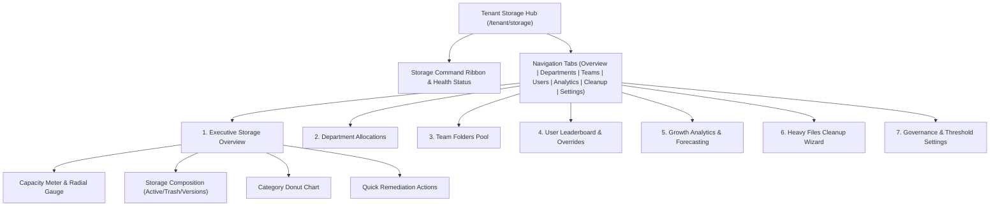

# MasterHRMS File Manager — Phase F4-A
# Report 6: Frontend UI Architecture & Dashboard Design Blueprint

**Project:** MasterHRMS  
**Module:** Enterprise File Manager  
**Phase:** F4-A (Read-Only Forensic Audit)  
**Document:** `PHASE_F4A_FRONTEND_UI_BLUEPRINT.md`  
**Status:** COMPLETE & INDEPENDENTLY AUDITED  
**Date:** October 30, 2026  

---

## 1. Executive Summary

This blueprint defines the frontend user interface architecture, layout specifications, component component hierarchy, and design token integration for the **Phase F4 Storage Administration Dashboards**. Built in Next.js 14 (App Router) and Tailwind CSS, the visual architecture harmonizes with the **Windows 11 Fluent Design System** established in Phase F2 and the enterprise theme conventions of MasterHRMS.

### Architectural Principles
1. **Windows 11 Fluent Aesthetics:** Acrylic backdrops (`bg-background/80 backdrop-blur-md`), subtle borders (`border-border/60`), 12px rounded cards (`rounded-xl`), and micro-interactions.
2. **Real-Time Hydration via WebSockets:** Subscribed to `storage.usage.updated` socket events for instant, zero-flicker updates across dials, capacity bars, and leaderboards.
3. **Data Visualization Stack:** Leverages existing production dependencies (`react-apexcharts`, `apexcharts`, `lucide-react`) for high-fidelity donuts, sparklines, and area trends.
4. **Actionable Governance:** Dashboards are not passive reporting views; every widget provides direct administrative remediations (e.g., "Empty Recycle Bin", "Re-balance Quota", "Purge Stale Versions").

---

## 2. Dashboard Component Hierarchy & Layout Structure

The Storage Administration experience will be mounted under [`CMS/src/app/(workspace)/tenant/storage/`](file:///c:/Users/TSV%20Global%20Solutions/Documents/hrms/CMS/src/app/(workspace)/tenant) and integrated into the primary sidebar navigation.



---

## 3. Detailed Specifications for the 9 Storage Dashboards

### 3.1 Dashboard 1: Executive Storage Overview
The central command view for Tenant Administrators providing high-level operational health.

```
+---------------------------------------------------------------------------------------------------+
|  [HardDrive Icon] Organization Storage Overview                         [Refresh] [Upgrade Plan]   |
|  Subscription: Growth Cloud (25 GB Pool)  *  Status: HEALTHY (67.2% Used)                          |
+---------------------------------------------------------------------------------------------------+
|  +---------------------------+  +--------------------------------+  +--------------------------+  |
|  |  TOTAL STORAGE UTILIZED   |  |   STORAGE COMPOSITION BREAKDOWN |  |   QUICK ACTIONS          |  |
|  |                           |  |                                |  |                          |  |
|  |       [ 67.2% ]           |  |   [Blue] Active Files:  13.3 GB|  |   [Trash Icon]           |  |
|  |     Radial Gauge          |  |   [Amber] Trash Bin:    1.5 GB |  |   Empty Recycle Bin      |  |
|  |                           |  |   [Purple] Versions:    2.0 GB |  |   (Reclaim 1.5 GB)       |  |
|  |  16.8 GB of 25.0 GB used  |  |   [Gray] Reserved:      50 MB  |  |   --------------------   |  |
|  |  8.2 GB remaining runway  |  |                                |  |   [Sparkles Icon]        |  |
|  +---------------------------+  +--------------------------------+  |   Clean Heavy Files      |  |
|                                                                     +--------------------------+  |
+---------------------------------------------------------------------------------------------------+
|  FILE CATEGORY DISTRIBUTION (ApexCharts Donut)           TOP FILE FORMATS                         |
|  * Documents: 52.6% (7.0 GB)   * Images: 30.1% (4.0 GB)  * PDF: 5.0 GB   * MP4: 2.0 GB            |
|  * Videos:    15.0% (2.0 GB)   * Others:  2.3% (307 MB)  * DOCX: 2.1 GB  * PNG: 2.6 GB            |
+---------------------------------------------------------------------------------------------------+
```

- **Visual Components:**
  - Radial bar indicator with dynamic color mapping (Emerald $< 80\%$, Amber $80\% - 89\%$, Rose $\ge 90\%$).
  - Linear segmented stacked bar illustrating active vs. trash vs. version history bytes.
  - Action cards triggering immediate purge or maintenance modals.

---

### 3.2 Dashboard 2: Multi-Tier Storage Taxonomy & Quota Pool
Exposes the exact allocation breakdown across the organizational hierarchy:
- **Tenant Ceiling:** 25.0 GB Subscription Plan.
- **Assigned to Departments:** 18.0 GB configured pools.
- **Unassigned Buffer:** 7.0 GB flexible buffer.
- Visual comparison bar displaying committed vs. uncommitted quota allocations.

---

### 3.3 Dashboard 3: Department Storage Breakdown
Displays aggregated consumption by department with interactive sorting and drill-down:
- **Columns:** Department Name, Headcount, Assigned Quota, Used Bytes, Utilization %, File Count, Action (Edit Quota).
- **Visualization:** Horizontal comparative progress bars highlighting departments approaching their allocation.
- **Drill-down Modal:** Clicking a department lists all employees in that department sorted by storage consumption.

---

### 3.4 Dashboard 4: Team Folder Storage Hub
Tracks consumption across collaborative shared team folders (`FileTeam`):
- **Columns:** Team Name, Team Lead, Root Folder Path, Quota Limit, Used Bytes, Utilization %, Member Count.
- **Manager Controls:** Set or update team quota (`FileTeam.quotaBytes`), view team file distribution.

---

### 3.5 Dashboard 5: User Storage Leaderboard & Quota Overrides
A high-performance data table displaying all organizational members:
- **Search & Filters:** Real-time search by user name/email; filter by Department, Role, or Quota Status (Normal, Warning, Over-Quota).
- **Inline Actions:**
  - **Edit Quota:** Opens a modal to set custom quota overrides (e.g. increase from 5 GB to 15 GB).
  - **Notify User:** Sends an automated in-app ping requesting file cleanup.
  - **Audit Activity:** Inspects the user's latest upload and deletion events.

---

### 3.6 Dashboard 6: File Type & Category Analytics
Deep-dive distribution analytics:
- **ApexCharts Treemap:** Visual block sizing representing storage weight by file category and extension.
- **MIME Breakdown Table:** Tabular listing of average file size, count, and total footprint grouped by MIME type.

---

### 3.7 Dashboard 7: Storage Growth Trends & Forecasting
Historical runway analytics to prevent unexpected capacity exhaustion:
- **Time-Series Chart:** 30-day, 90-day, and 1-year historical consumption trend lines.
- **Runway Predictor:** Linear regression calculating estimated days until quota depletion at current velocity (e.g., *"At current upload rate (+120 MB/day), quota will be reached in 68 days"*).

---

### 3.8 Dashboard 8: Inactive & Heavy Files Cleanup Wizard
An actionable utility identifying low-hanging fruit for instant storage reclamation:
- **Preset Filters:**
  - Large Files ($> 50\text{ MB}$)
  - Ancient Files (Untouched for $> 180\text{ days}$)
  - Trashed Items (In recycle bin for $> 14\text{ days}$)
  - Duplicate Checksums (Identical SHA-256 hashes)
- **Batch Remediation:** Select multiple files $\rightarrow$ "Move to Recycle Bin" or "Download Archive & Purge".
- **Dry-Run Savings Indicator:** Dynamically displays *"34 files selected (2.4 GB potential savings)"*.

---

### 3.9 Dashboard 9: Quota Configuration & Alert Thresholds Settings
Tenant administrative settings panel:
- **Warning Threshold Slider:** Configurable trigger percentage (Default: 80%).
- **Critical Threshold Slider:** Configurable trigger percentage (Default: 90%).
- **Hard Limit Enforcement Toggle:** Enable/disable hard upload blocking upon 100% saturation.
- **Recycle Bin Auto-Purge Window:** Configurable retention period (e.g. 15 days, 30 days, 60 days, or Never).
- **Version History Limit:** Maximum historical versions retained per file (Default: 5).

---

## 4. Design Tokens & Styling Specifications

| Token Element | Light Mode Value | Dark Mode Value | Tailwind Equivalent |
| :--- | :--- | :--- | :--- |
| **Card Surface** | `#FFFFFF` (80% opacity) | `#0F172A` (80% opacity) | `bg-card/80 backdrop-blur-md` |
| **Card Border** | `#E2E8F0` | `#1E293B` | `border-border/60` |
| **Accent Emerald (Healthy)**| `#059669` | `#10B981` | `text-emerald-500 bg-emerald-500/10` |
| **Accent Amber (Warning)** | `#D97706` | `#F59E0B` | `text-amber-500 bg-amber-500/10` |
| **Accent Rose (Critical)** | `#E11D48` | `#F43F5E` | `text-rose-500 bg-rose-500/10` |
| **Meter Track** | `#F1F5F9` | `#1E293B` | `bg-secondary` |
| **Typography Family** | Segoe UI, Inter, sans-serif | Segoe UI, Inter, sans-serif | `font-sans` |

---

## 5. Responsive & Mobile Adaptations

- **Desktop ($\ge 1280\text{px}$):** Multi-column grid (3-column KPI row, 2-column analytics split).
- **Tablet ($768\text{px} - 1279\text{px}$):** 2-column KPI grid, stacked charts, collapsible table columns.
- **Mobile ($< 768\text{px}$):** Single column card stack, swipeable tab bar, condensed leaderboard with tap-to-expand drawer.

---
*Report 6 completed under strict read-only audit protocol.*

