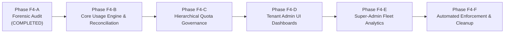

# MasterHRMS File Manager — Phase F4-A
# Report 8: Storage & Quota Infrastructure Implementation Roadmap (Phases F4-B through F4-F)

**Project:** MasterHRMS  
**Module:** Enterprise File Manager  
**Phase:** F4-A (Read-Only Forensic Audit)  
**Document:** `PHASE_F4A_IMPLEMENTATION_ROADMAP.md`  
**Status:** COMPLETE & INDEPENDENTLY AUDITED  
**Date:** October 30, 2026  

---

## 1. Executive Summary

This roadmap establishes the structured, phased implementation sequence for delivering the complete enterprise storage administration and quota governance infrastructure for MasterHRMS. To ensure continuous operational stability and zero regressions in the verified F1–F3 foundation, Phase F4 is decomposed into five focused, sequential sub-phases (**F4-B through F4-F**).

### Roadmap Overview

---

## 2. Granular Sub-Phase Breakdown

### 2.1 Phase F4-B: Core Storage Usage Calculation Engine & Reconciliation Service
**Objective:** Deliver millisecond-accurate multi-dimensional storage accounting and automated database-to-storage reconciliation.

#### Scope of Work:
1. **Schema Refinements & Index Optimization:**
   - Standardize tenant-pool storage records on `userId: null`, eliminating the `"tenant_pool"` string collision.
   - Deploy composite covering index `idx_media_files_storage_calc` on `media_files(tenant_id, status, is_folder, deleted_at)`.
   - Implement `BigInt` handling safety for all file size operations.
2. **Dedicated Storage Usage Engine (`storage-usage.engine.ts`):**
   - High-precision algorithms for Active, Trash, Version History, Reserved, and Physical byte dimensions.
   - Department and Team dynamic rollup queries.
3. **Background Self-Healing Workers:**
   - Hourly reconciliation cron verifying `StorageUsage` counters against live file tallies.
   - 10-minute abandoned upload session reservation reaper.
4. **Backend API Endpoints:**
   - `GET /api/v1/tenant/storage/summary`
   - `GET /api/v1/tenant/storage/breakdown`
   - `POST /api/v1/tenant/storage/maintenance/reconcile`

**Exit Gate Criteria:** Automated end-to-end test suite verifying byte precision, reconciliation self-healing, and sub-50ms API response times.

---

### 2.2 Phase F4-C: Hierarchical Quota Governance & Policy Engine
**Objective:** Implement multi-tier quota management across Tenant, Department, Team, and User scopes with threshold state machines.

#### Scope of Work:
1. **Hierarchical Quota Engine (`quota-policy.service.ts`):**
   - Cascade evaluation: Platform Ceiling $\rightarrow$ Tenant Subscription Plan $\rightarrow$ Department Pool $\rightarrow$ Team Folder $\rightarrow$ Individual User.
   - Atomic conditional reservation locking mitigating concurrent upload race conditions.
2. **Threshold State Machine:**
   - Dynamic classification: Normal ($<80\%$), Warning ($80\%-89\%$), Critical ($90\%-99\%$), Locked ($\ge 100\%$).
3. **Administrative Overrides & Settings:**
   - Custom user quota override endpoints (`PUT /api/v1/tenant/storage/quotas/users/:id`).
   - Configurable policy thresholds and auto-purge retention rules.
4. **Audit Logging & Outbox Integration:**
   - Transactional outbox events for quota modifications (`quota.policy.updated`, `storage.threshold.exceeded`).

**Exit Gate Criteria:** Test suite validating multi-tier inheritance, atomic concurrency limits, and threshold trigger transitions.

---

### 2.3 Phase F4-D: Tenant Admin Storage Dashboards & Visualization UI
**Objective:** Build the 9 interactive storage administration dashboards in Next.js 14 matching the Windows 11 Fluent design system.

#### Scope of Work:
1. **Tenant Storage Hub Shell (`CMS/src/app/(workspace)/tenant/storage/`):**
   - Acrylic command ribbon, health indicator badges, responsive navigation tabs.
2. **Interactive Visualization Widgets:**
   - ApexCharts radial capacity gauge and multi-segment stacked progress bars.
   - Category and MIME type treemaps and donut distribution charts.
   - Historical growth time-series with predictive runway forecasting.
3. **Management & Remediation Data Tables:**
   - Department allocation table with inline quota edit modals.
   - User storage consumption leaderboard with search, role filters, and override actions.
   - Team folder pool monitor with manager reassignment controls.
4. **Live Real-Time Hydration:**
   - TanStack Query hooks bound to canonical storage WebSocket events (`storage:quota_updated`, `storage:tenant:update`, `storage.usage.updated`, `storage:alert`) for consistent zero-refresh dashboard query invalidation.

**Exit Gate Criteria:** Browser E2E QA passing 100% of interactive flows, responsive verification across desktop/tablet/mobile, and zero TypeScript compiler warnings.

---

### 2.4 Phase F4-E: Super-Admin Fleet Storage Analytics & Legacy Metric Consolidation
**Objective:** Provide platform-wide storage visibility and unify legacy metric services into the modern File Manager architecture.

#### Scope of Work:
1. **Super-Admin Fleet Storage Console (`CMS/src/app/super/storage/`):**
   - Global multi-tenant storage capacity vs. actual physical consumption.
   - At-risk tenant radar identifying accounts approaching subscription limits.
   - Storage growth projections across entire platform fleet.
2. **Legacy Consolidation:**
   - Refactor `TenantUsageMetricsService` (lines 69–88) to source file byte tallies directly from `MediaFile` and `StorageUsage` instead of legacy `StoredDocument` and `ExpenseClaim` approximations.
   - Ensure backward compatibility for existing super-admin billing dashboards.

**Exit Gate Criteria:** Verification of cross-tenant fleet metrics accuracy against live database totals; legacy metric regression suite PASS.

---

### 2.5 Phase F4-F: Automated Quota Enforcement, Notifications & Cleanup Tools
**Objective:** Deploy automated system enforcement, real-time user notification banners, and one-click maintenance cleanup tools.

#### Scope of Work:
1. **Enforcement Interceptors:**
   - Middleware blocking uploads, new versions, and trash restorations when tenant pool or user quota is in `LOCKED` state.
   - Permissive bypass allowing file downloads, renames, moves, and permanent purges.
2. **User Notification Banners:**
   - Amber warning banner ($80\%-89\%$) and red persistent alert banner ($\ge 90\%$) in File Explorer ribbon.
   - Critical locked modal with contextual guidance.
3. **Heavy Files & Inactive Cleanup Wizard:**
   - Filterable data table surfacing stale files ($> 180\text{ days}$) and heavy media ($> 50\text{ MB}$).
   - Batch move to trash or download-and-purge with dry-run savings preview.
4. **Recycle Bin Automated Purge Scheduler:**
   - Automated daily cron purging items exceeding the configured retention window (e.g. 30 days).

**Exit Gate Criteria:** Comprehensive E2E test verifying lockout enforcement, cleanup wizard bulk purges, and automated notification deliveries.

---

## 3. Work Breakdown Structure (WBS) & Dependency Matrix

| Phase | Milestone Name | Dependencies | Estimated Effort | Primary Artifact Deliverables |
| :--- | :--- | :--- | :--- | :--- |
| **F4-A** | Storage & Quota Forensic Audit | F1, F2, F3 Complete | **COMPLETE** | 10 Forensic Audit Reports |
| **F4-B** | Core Usage Engine & Reconciliation | F4-A Approval | 2 Working Cycles | `storage-usage.engine.ts`, Cron Jobs, APIs |
| **F4-C** | Hierarchical Quota Governance | F4-B Complete | 2 Working Cycles | `quota-policy.service.ts`, Concurrency Locks |
| **F4-D** | Tenant Admin UI Dashboards | F4-C Complete | 3 Working Cycles | 9 Next.js Dashboards, ApexCharts, Socket.IO |
| **F4-E** | Super-Admin Fleet Analytics | F4-D Complete | 2 Working Cycles | Fleet Storage Hub, Legacy Metric Bridge |
| **F4-F** | Enforcement & Cleanup Wizard | F4-E Complete | 2 Working Cycles | Lockout Middleware, Cleanup Wizard UI, Cron |

---

## 4. Risk Mitigation & Quality Gates

Every sub-phase must pass an independent verification gate before proceeding to the next:
1. **Zero Regression Gate:** Running `verify_file_manager_f1_e2e.cjs`, `verify_file_manager_f2_browser_qa.cjs`, and `verify_file_manager_f3_e2e.cjs` must yield 100% PASS.
2. **TypeScript Compilation:** Zero errors across `server/tsconfig.json` and `CMS/tsconfig.json`.
3. **Dual Workspace Synchronization:** Strict parity maintained between `CMS/` and `src/`.
4. **Rollback Readiness:** Every schema or configuration change must be accompanied by an automated, tested rollback migration.

---
*Report 8 completed under strict read-only audit protocol.*

