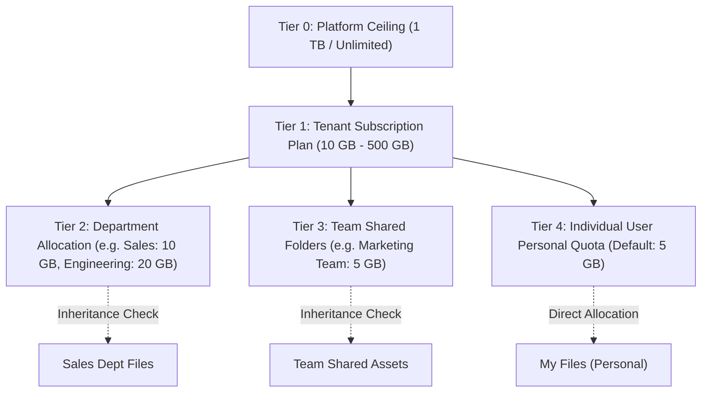
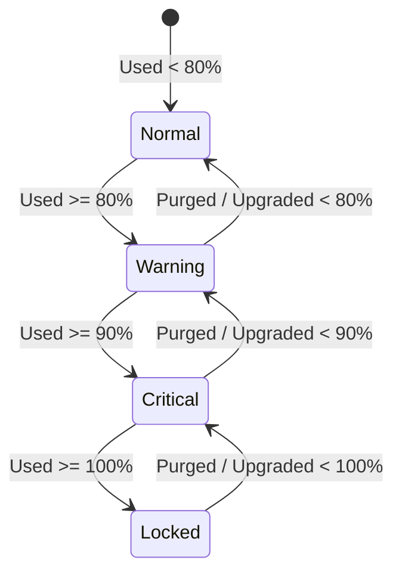
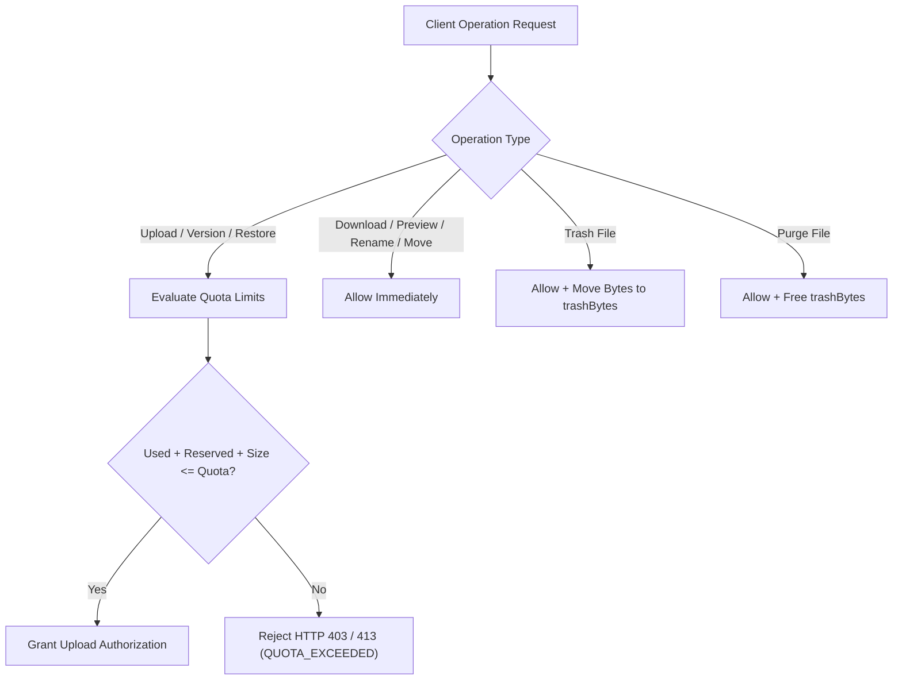

# MasterHRMS File Manager — Phase F4-A
# Report 4: Storage Quota Management & Policy Enforcement Blueprint

**Project:** MasterHRMS  
**Module:** Enterprise File Manager  
**Phase:** F4-A (Read-Only Forensic Audit)  
**Document:** `PHASE_F4A_QUOTA_MANAGEMENT_BLUEPRINT.md`  
**Status:** COMPLETE & INDEPENDENTLY AUDITED  
**Date:** October 30, 2026  

---

## 1. Executive Summary

This blueprint defines the enterprise quota governance framework, hierarchical allocation policies, enforcement state machines, and administrative override protocols for Phase F4 of the MasterHRMS Enterprise File Manager. The architecture balances strict resource governance with a frictionless user experience, preventing unexpected lockouts while protecting infrastructure margins.

### Architectural Pillars
1. **Hierarchical Quota Cascade:** Quota limits cascade down five distinct governance tiers: **Platform Ceiling $\rightarrow$ Tenant Subscription Plan $\rightarrow$ Department Allocation $\rightarrow$ Team Workspace $\rightarrow$ Individual User**.
2. **Multi-Threshold State Machine:** Storage pools transition dynamically through four lifecycle states: **Normal ($< 80\%$) $\rightarrow$ Warning ($80\% - 89\%$) $\rightarrow$ Critical ($90\% - 99\%$) $\rightarrow$ Locked ($\ge 100\%$)**.
3. **Hard vs. Soft Quota Rules:**
   - **Soft Quota:** In-app non-blocking toast/banner warnings and automated administrative digest emails.
   - **Hard Quota:** Upload blockades and file versioning freezes, while preserving read, download, delete, and move operations.
4. **Self-Service Upgrade & Storage Pack Add-ons:** Direct integration with MasterHRMS Stripe/Razorpay billing for instant storage pool expansions (+10 GB, +50 GB, +200 GB packs).

---

## 2. Hierarchical Quota Architecture

### 2.1 Governance Tiers Definition

| Tier Level | Scope | Default Limit | Enforcement Authority | Override Mechanism |
| :--- | :--- | :--- | :--- | :--- |
| **Tier 0** | **Platform Super-Admin** | 1,000 GB (1 TB) | Hard Infrastructure Cap | Super-Admin Console |
| **Tier 1** | **Tenant Plan Pool** | Starter: 10 GB Growth: 25 GB Sovereign: 100 GB Custom: 500 GB | Hard Contractual Cap | Plan Upgrade / Add-On Storage Pack |
| **Tier 2** | **Department Allocation** | Configurable (Pool Subset) | Soft / Hard (Tenant Admin Choice) | Tenant Admin Panel |
| **Tier 3** | **Team Folder** | Configurable (Default: 5 GB) | Soft / Hard (Team Manager Choice) | Tenant Admin / Team Manager |
| **Tier 4** | **Individual User** | 5 GB (`DEFAULT_USER_QUOTA_BYTES`) | Hard Personal Cap | Tenant Admin User Override |

---

## 3. Quota Lifecycle State Machine & Threshold Policy

The storage engine continuously monitors usage percentages ($P = \frac{\text{Used Bytes} + \text{Reserved Bytes}}{\text{Quota Bytes}} \times 100$). The system transitions across four operational states:

### Detailed State Behavioral Specifications

| Threshold State | Usage Percentage | User Experience / UI Indication | System Enforcement Action | Notifications Dispatched |
| :--- | :--- | :--- | :--- | :--- |
| **NORMAL** | $0\% - 79.9\%$ | Default Explorer UI. Blue/Neutral meter bar. | Full operations allowed (Upload, Version, Move, Share). | None. |
| **WARNING** | $80.0\% - 89.9\%$ | Amber storage meter. Non-intrusive banner on File Explorer top bar. | All operations allowed. Zero functionality restriction. | In-app notification to uploader. Weekly digest to Tenant Admin. |
| **CRITICAL** | $90.0\% - 99.9\%$ | Red storage meter. Persistent warning banner with "Manage Storage" CTA. | All operations allowed. Soft warning modal shown on initiating large uploads ($> 50\text{ MB}$). | Urgent in-app alert to Tenant Admin. Email alert to Organization Owner. |
| **LOCKED** | $\ge 100.0\%$ | Critical crimson banner: "Storage Quota Exceeded. Uploads Suspended." | **BLOCKED:** - Direct file uploads - Creating new file versions - Restoring items from Trash  **ALLOWED:** - Download & streaming - Renaming & moving files - Moving files to Trash - Permanently purging files | Immediate high-priority webhook, email, and socket broadcast to all Tenant Admins. |

---

## 4. Operational Enforcement Points

To ensure absolute system stability without data loss, enforcement checks are embedded at specific operational gates:

### 4.1 Detailed Enforcement Matrix

| File Manager Action | Action Status Under Locked Quota ($\ge 100\%$) | Technical Behavior / API Response |
| :--- | :--- | :--- |
| **Single File Upload** | **BLOCKED** | HTTP 403 Forbidden with `{ code: "QUOTA_EXCEEDED", scope: "TENANT" | "USER" }`. |
| **Batch File Upload** | **BLOCKED** | Pre-flight verification fails atomically before any binary is uploaded. |
| **New Version Upload** | **BLOCKED** | Cannot increment version; returns `{ code: "QUOTA_EXCEEDED" }`. |
| **Folder Creation** | **ALLOWED** | Folders consume 0 bytes of object storage; metadata creation is permitted. |
| **Download / View** | **ALLOWED** | Read access is never penalized. |
| **File Rename / Move** | **ALLOWED** | Metadata-only operations consume zero additional storage bytes. |
| **Move to Trash** | **ALLOWED** | Crucial remediation path: transfers bytes from `usedBytes` to `trashBytes`. |
| **Restore from Trash** | **BLOCKED** | Restoring an item would push `usedBytes` over the active limit. |
| **Permanent Purge** | **ALLOWED** | Primary remediation path: permanently deletes physical blob and decrements `trashBytes`. |

---

## 5. Administrative Overrides & Storage Expansion Workflows

Phase F4 introduces three administrative remediation mechanisms:

### 5.1 Temporary Grace Overrides
Tenant Admins can grant temporary quota grace periods (e.g., 48-hour exemption or +5 GB temporary buffer) to resolve mission-critical blocking events during emergency HR cycles:
- **Prisma Representation:** Stored in `StorageQuota.source = "OVERRIDE"` with an explicit `expiresAt` timestamp.
- **Audit Logging:** Every override generates a permanent record in `FileActivity` and `StorageAlertLog`.

### 5.2 Department & User Quota Re-balancing
Tenant Admins can adjust personal user allocations:
- Re-allocate quota from low-consumption users to high-demand roles (e.g. Graphic Designers or Video Editors who need 20 GB).
- Set department-wide quota caps to prevent a single department from exhausting the organization's pooled storage.

### 5.3 Self-Service Add-on Storage Packs
Tenants nearing their plan limits can instantly purchase recurring or one-time storage expansion packs without upgrading their entire subscription tier:
- **Micro Pack:** +10 GB storage
- **Standard Pack:** +50 GB storage
- **Enterprise Pack:** +200 GB storage
- **Billing Hook:** Integrates directly with `TenantSubscription.storageLimitGb` via automated webhook (`customer.subscription.updated`).

---

## 6. Recommendations for Phase F4-C

1. **Implement `QuotaPolicyService`:** Consolidate hierarchical checks (`checkTenantQuota`, `checkDepartmentQuota`, `checkTeamQuota`, `checkUserQuota`) in a unified, testable service.
2. **Expose Self-Service Cleanup Recommendations:** In the locked banner UI, provide one-click cleanup shortcuts (e.g. "Empty Recycle Bin to free 2.4 GB", "Purge old versions to free 850 MB").
3. **Automated Alerting Engine:** Integrate the threshold triggers with MasterHRMS Socket.IO (`broadcastToTenant`) and transactional email templates.

---
*Report 4 completed under strict read-only audit protocol.*

