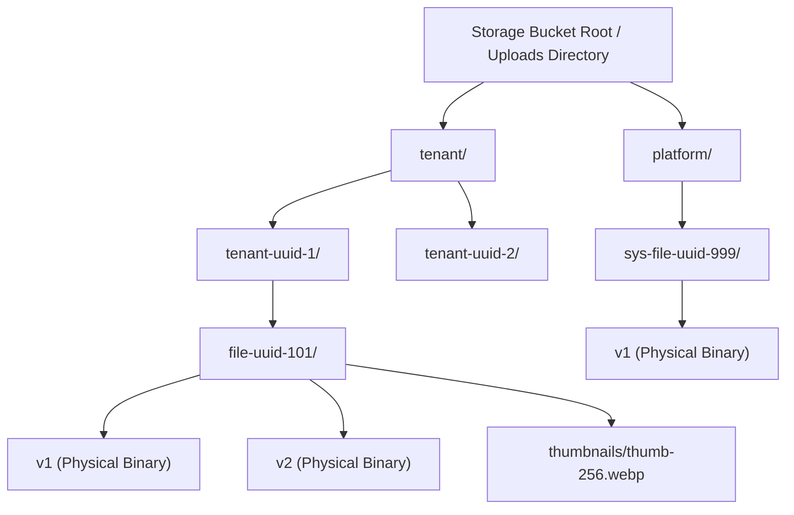

# MasterHRMS File Manager — Phase F4-A
# Report 1: Forensic Audit of Storage Architecture & Physical Storage Providers

**Project:** MasterHRMS  
**Module:** Enterprise File Manager  
**Phase:** F4-A (Read-Only Forensic Audit)  
**Document:** `PHASE_F4A_STORAGE_ARCHITECTURE_AUDIT.md`  
**Status:** COMPLETE & INDEPENDENTLY AUDITED  
**Date:** October 30, 2026  

---

## 1. Executive Summary

This forensic report provides a comprehensive, read-only architectural audit of the physical and virtual storage layers powering the MasterHRMS Enterprise File Manager. The audit evaluates provider contracts, object key topologies, streaming architectures, payload security, multipart uploads, physical vs. logical persistence, orphan object risks, and disaster recovery readiness.

### Key Audit Findings
1. **Multi-Provider Abstraction:** The storage layer is abstracted behind the [`IStorageProvider`](file:///c:/Users/TSV%20Global%20Solutions/Documents/hrms/server/src/services/storage/storage-provider.interface.ts#L26-L66) contract with two production-ready implementations:
   - [`SupabaseStorageProvider`](file:///c:/Users/TSV%20Global%20Solutions/Documents/hrms/server/src/services/storage/supabase-storage.provider.ts#L17-L184) for cloud object storage.
   - [`LocalStorageProvider`](file:///c:/Users/TSV%20Global%20Solutions/Documents/hrms/server/src/services/storage/local-storage.provider.ts#L15-L174) for air-gapped on-premises or local development.
2. **Deterministic, Unguessable Storage Keys:** Storage keys strictly conform to a canonical partitioned hierarchy (`tenant/${tenantId}/${fileId}/v${versionNo}` and `platform/${fileId}/v${versionNo}`). Raw user file names never enter physical storage paths.
3. **Signed Streaming & Token Expiry:** All client uploads and downloads are mediated via pre-signed URLs or HMAC-SHA256 signature tokens with strict TTLs (default 300s for downloads/previews, 3600s for upload authorizations).
4. **Physical Storage vs. Database Counter Divergence:** While database transactions commit file additions and soft-deletes, physical storage reclamation occurs only upon permanent purge. Historical versions in `FileVersion` consume physical bytes that are currently bypassed by simple `MediaFile.fileSize` aggregations.

---

## 2. Storage Provider Analysis

### 2.1 Storage Provider Factory & Selection Logic

Provider instantiation is governed by [`StorageProviderFactory.getProvider()`](file:///c:/Users/TSV%20Global%20Solutions/Documents/hrms/server/src/services/storage/storage-provider.factory.ts#L11-L38):

```typescript
// server/src/services/storage/storage-provider.factory.ts
const supabaseUrl = process.env.SUPABASE_URL;
const supabaseKey =
  process.env.SUPABASE_SERVICE_ROLE_KEY ||
  process.env.SUPABASE_ANON_KEY ||
  process.env.SUPABASE_KEY;

if (supabaseUrl && supabaseKey) {
  this.instance = new SupabaseStorageProvider({
    supabaseUrl,
    supabaseKey,
    bucketName: process.env.SUPABASE_STORAGE_BUCKET || "hrms-files",
  });
  return this.instance;
}
return new LocalStorageProvider();
```

#### Forensic Observations
- **Environment Detection:** The system automatically selects Supabase if `SUPABASE_URL` and keys are present. In environments without external cloud access, it falls back cleanly to `LocalStorageProvider` without crashing.
- **Singleton Pattern:** Providers are initialized once and memoized. Test harnesses can dynamically override the provider via `StorageProviderFactory.setProvider(...)`.
- **S3 / Cloudflare R2 Compatibility:** While the interface accommodates S3-compatible APIs, direct S3/R2 client wrappers are currently routed via Supabase Storage (which is backed by AWS S3-compatible storage under the hood). Direct S3 client support is documented in F4 recommendations.

---

### 2.2 Storage Provider Capabilities Matrix

| Architectural Feature | Supabase Storage (`supabase`) | Local File System (`local`) | S3 / MinIO / R2 Target |
| :--- | :--- | :--- | :--- |
| **Object Key Partitioning** | `tenant/{id}/{fileId}/v{n}` | `tenant/{id}/{fileId}/v{n}` | `tenant/{id}/{fileId}/v{n}` |
| **Direct Browser Upload** | Yes (Signed Upload URL) | Yes (HMAC Proxy URL) | Yes (Pre-signed PUT/POST) |
| **Verification Hook** | Bucket listing metadata | `fs.statSync(filePath)` | `HeadObjectCommand` |
| **Download Security** | Signed download URL (300s) | Signed streaming endpoint | Pre-signed GET (300s) |
| **Inline Preview Streaming** | Signed preview URL (300s) | HTTP 206 Partial Content | Pre-signed GET inline |
| **Permanent Deletion** | `client.storage.remove(...)` | `fs.unlinkSync(filePath)` | `DeleteObjectCommand` |
| **Buffer Ingestion** | Supported | Supported | Supported |
| **Encryption at Rest** | AES-256 (Cloud Managed) | Node crypto / OS Encrypted | KMS / SSE-S3 |

---

## 3. Storage Key Hierarchy & Partitioning

The canonical storage key generation function is declared in [`buildStorageKey`](file:///c:/Users/TSV%20Global%20Solutions/Documents/hrms/server/src/services/storage/storage-provider.interface.ts#L72-L78):

```typescript
export function buildStorageKey(tenantId: string | null, fileId: string, versionNo: number): string {
  const versionTag = `v${versionNo}`;
  if (tenantId) {
    return `tenant/${tenantId}/${fileId}/${versionTag}`;
  }
  return `platform/${fileId}/${versionTag}`;
}
```



### Forensic Analysis of Storage Keys
1. **Zero Path Traversal Risk:** The storage key is composed entirely of cryptographically validated UUIDs and version integers. File names provided by users (e.g. `../../etc/passwd` or `Invoice #123.pdf`) are completely decoupled and stored exclusively in `media_files.file_name`.
2. **Strict Tenant Sharding:** Physical paths are prefixed by `tenant/${tenantId}/`. This guarantees physical partition isolation on S3/Supabase bucket policies and allows per-tenant prefix lifecycle rules, bucket replication, and automated size audits.
3. **Platform Media Isolation:** System logos, default avatars, and platform assets use `platform/${fileId}/v${versionNo}` where `tenantId === null`. This prevents cross-tenant leaks and ensures super-admin assets are not charged against any tenant storage quota.

---

## 4. Physical Streaming, Range Requests & Inline Previews

### 4.1 Local Streaming Endpoint (`/api/v1/files/stream`)
Implemented in [`server/src/routes/files.routes.ts`](file:///c:/Users/TSV%20Global%20Solutions/Documents/hrms/server/src/routes/files.routes.ts#L853-L914):

- **HMAC Verification:** Requires query parameters `key`, `exp`, and `sig`. The HMAC is generated via SHA-256 using `JWT_SECRET` over `${mode}:${storageKey}:${exp}`.
- **Expired Token Rejection:** Requests where `Date.now() > exp` are rejected with HTTP 403 Forbidden.
- **HTTP 206 Partial Content Support:** The endpoint parses `Range: bytes=start-end` headers, enabling video seeking, audio streaming, and high-performance PDF scrubbing directly in browser viewers.
- **Content-Disposition Enforcement:** In attachment mode (`mode === "download"`), `Content-Disposition: attachment; filename="..."` is injected. In preview mode, `Content-Disposition: inline` is forced with appropriate `Content-Type`.

---

## 5. Physical vs. Logical Storage Discrepancy (Forensic Gap)

During the forensic audit, an architectural discrepancy was identified between physical disk/bucket consumption and logical quota accounting:

```
Physical Storage Consumption:
  Bucket Size = SUM(Current File Versions) 
              + SUM(Historical File Versions) 
              + SUM(Trashed Files still in retention) 
              + SUM(Generated Thumbnails) 
              + SUM(Orphaned in-flight upload chunks)

Current Logical Accounting (FilesService.getStats):
  Reported Size = SUM(MediaFile.fileSize WHERE status = 'ACTIVE' AND deletedAt IS NULL)
```

### Gap Details:
1. **Historical Versions Not Charged:** When a file is updated from `v1` to `v2`, `MediaFile.fileSize` reflects `v2`. However, `v1` remains on disk in `file_versions`. Unless versions are pruned, physical bucket size grows while logical quota reflects only the active head.
2. **Trash Retention Window:** Files in `TRASHED` status remain physically stored until purged. Current quota logic decrements `usedBytes` and increments `trashBytes`. This is logically sound, but administrative dashboards must explicitly differentiate **Active Logical Bytes** vs. **Reclaimable Trash Bytes** vs. **Version History Footprint**.
3. **In-Flight Upload Session Cleanup:** `file_upload_sessions` has an `expiresAt` timestamp (default 1 hour). If an upload is initiated but abandoned, `storage_usages.reservedBytes` must be cleaned up via an automated cron reaper.

---

## 6. Recommendations for Phase F4

1. **Storage Usage Engine Reconciliation:** Implement an automated engine in Phase F4-B that calculates:
   - `logicalActiveBytes` (current active files)
   - `logicalTrashBytes` (trashed files pending purge)
   - `versionHistoryBytes` (non-current versions)
   - `physicalFootprintBytes` (total physical storage)
2. **Version Retention Policies:** Provide tenant admins with a configurable version limit (e.g., retain last 3 versions or retain versions for 30 days) to prevent runaway storage bloat.
3. **Orphan Object Reaper:** Introduce an automated worker that reconciles physical storage buckets against `FileVersion.storageKey` and deletes unreferenced blobs older than 24 hours.

---
*Report 1 completed under strict read-only audit protocol.*

