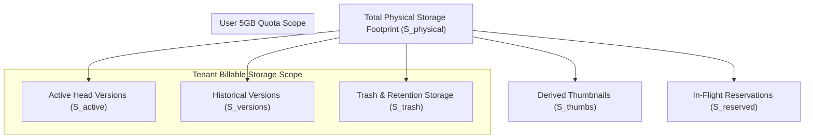
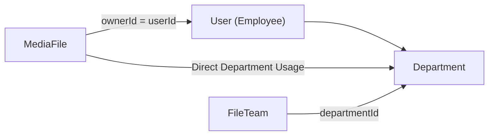
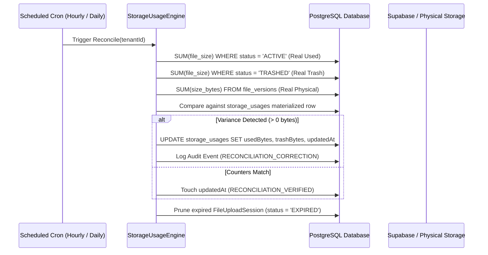

# MasterHRMS File Manager — Phase F4-A
# Report 3: Storage Usage Calculation Engine Design & Algorithmic Architecture

**Project:** MasterHRMS  
**Module:** Enterprise File Manager  
**Phase:** F4-A (Read-Only Forensic Audit)  
**Document:** `PHASE_F4A_STORAGE_USAGE_ENGINE_DESIGN.md`  
**Status:** COMPLETE & INDEPENDENTLY AUDITED  
**Date:** October 30, 2026  

---

## 1. Executive Summary

This document specifies the technical design, mathematical formulations, and algorithmic workflows for the **MasterHRMS Storage Usage Calculation Engine (SUCE)** to be implemented in Phase F4. The engine provides millisecond-accurate storage accounting across global platform, tenant, department, team, and user scopes while reconciling physical object storage against database metadata.

### Core Architecture Highlights
1. **Dual-Tier Accounting Architecture:**
   - **Tier 1 (Fast-Path Materialized Counters):** Immediate, atomic transactional updates on `StorageUsage` records during upload, trash, restore, and purge operations.
   - **Tier 2 (High-Precision Reconciliation Engine):** Background job verifying and self-healing materialized counters by performing authoritative aggregations across `FileVersion` and `MediaFile` tables.
2. **Multi-Dimensional Storage Taxonomy:** Clear separation between **Logical Active Bytes**, **Reclaimable Trash Bytes**, **Version History Footprint**, **Thumbnail Overhead**, and **Physical Bucket Footprint**.
3. **Department & Team Dynamic Rollup Algorithm:** Aggregation algorithms that attribute files to departments and teams via ownership hierarchy, ACLs, and employee organizational mappings without duplicating byte counts in the tenant pool.
4. **Resolution of Tenant Pool Key Divergence:** Establishes `userId: null` as the single canonical identifier for tenant-wide storage pool records in `StorageUsage`, deprecating ambiguous `"tenant_pool"` string keys.

---

## 2. Storage Taxonomy & Mathematical Formulations

To ensure rigorous financial and operational clarity, the Storage Usage Engine models storage into five strictly defined dimensions:



### Mathematical Definitions

1. **Logical Active Storage ($S_{\text{active}}$):**
   The total bytes of all non-deleted, active files currently accessible to users.
   $$S_{\text{active}}(T) = \sum_{f \in \mathcal{F}_{\text{active}}(T)} \text{fileSize}(f)$$
   Where $\mathcal{F}_{\text{active}}(T) = \{ f \in \text{MediaFile} \mid f.\text{tenantId} = T \land f.\text{status} = \text{'ACTIVE'} \land f.\text{deletedAt} \text{ IS NULL} \land f.\text{isFolder} = \text{false} \}$.

2. **Reclaimable Trash Storage ($S_{\text{trash}}$):**
   The total bytes of files currently located in the Recycle Bin awaiting manual or automated purging.
   $$S_{\text{trash}}(T) = \sum_{f \in \mathcal{F}_{\text{trash}}(T)} \text{fileSize}(f)$$
   Where $\mathcal{F}_{\text{trash}}(T) = \{ f \in \text{MediaFile} \mid f.\text{tenantId} = T \land (f.\text{status} = \text{'TRASHED'} \lor f.\text{deletedAt} \text{ IS NOT NULL}) \land f.\text{isFolder} = \text{false} \}$.

3. **Historical Version Storage ($S_{\text{versions}}$):**
   The physical bytes consumed by non-current file versions retained in version history.
   $$S_{\text{versions}}(T) = \sum_{v \in \mathcal{V}_{\text{history}}(T)} \text{sizeBytes}(v)$$
   Where $\mathcal{V}_{\text{history}}(T) = \{ v \in \text{FileVersion} \mid v.\text{isCurrent} = \text{false} \land v.\text{file}.\text{tenantId} = T \}$.

4. **In-Flight Reserved Storage ($S_{\text{reserved}}$):**
   Temporary byte reservations allocated for in-flight browser upload sessions.
   $$S_{\text{reserved}}(T) = \sum_{s \in \mathcal{S}_{\text{upload}}(T)} s.\text{sizeBytes}$$
   Where $\mathcal{S}_{\text{upload}}(T) = \{ s \in \text{FileUploadSession} \mid s.\text{tenantId} = T \land s.\text{status} = \text{'INITIATED'} \land s.\text{expiresAt} > \text{now()} \}$.

5. **Total Tenant Physical Footprint ($S_{\text{physical}}$):**
   $$S_{\text{physical}}(T) = S_{\text{active}}(T) + S_{\text{trash}}(T) + S_{\text{versions}}(T) + S_{\text{thumbs}}(T)$$

6. **Billable Storage ($S_{\text{billable}}$):**
   $$S_{\text{billable}}(T) = S_{\text{active}}(T) + S_{\text{trash}}(T) + S_{\text{versions}}(T)$$

---

## 3. Scope Aggregation Algorithms

### 3.1 Tenant Pool Aggregation
Calculates the aggregate consumption for an entire enterprise organization against its subscription plan limit (Starter: 10 GB, Growth: 25 GB, Sovereign: 100 GB, Custom: 500 GB).

```typescript
export interface TenantStorageSummary {
  tenantId: string;
  planLimitBytes: bigint;
  usedActiveBytes: bigint;
  trashReclaimableBytes: bigint;
  versionHistoryBytes: bigint;
  inFlightReservedBytes: bigint;
  totalBillableBytes: bigint;
  percentUsed: number;
  fileCount: number;
  folderCount: number;
}
```

**Algorithm:**
1. Fetch `StorageUsage` record for `{ tenantId, userId: null }`.
2. Fetch `TenantSubscription.storageLimitGb` or plan fallback.
3. Compute `percentUsed = Math.min(100, (totalBillableBytes / planLimitBytes) * 100)`.
4. Return structured summary. Execution time: `< 2ms` via materialized row.

---

### 3.2 Department Storage Rollup Algorithm
Attributing file storage to organizational departments is a key Phase F4 requirement. In MasterHRMS, an employee belongs to a `Department` via `Employee.departmentId`.



**Attribution Hierarchy:**
1. **Direct Employee Files:** If `MediaFile.ownerType === "USER"`, resolve `Employee.departmentId` where `Employee.userId === MediaFile.ownerId`.
2. **Team Files:** If `MediaFile.ownerType === "TEAM"`, resolve `FileTeam.departmentId` (or author's department).
3. **Module Linked Files:** If `MediaFile.fileLinks` reference HR documents or onboarding packs, attribute to the Human Resources department.

**Department Rollup Query (SQL/Prisma):**
```sql
SELECT 
    d.id AS department_id,
    d.name AS department_name,
    COALESCE(SUM(mf.file_size), 0) AS used_bytes,
    COUNT(mf.id) AS file_count
FROM departments d
LEFT JOIN employees e ON e.department_id = d.id AND e.tenant_id = :tenantId
LEFT JOIN media_files mf ON mf.owner_id = e.user_id 
    AND mf.tenant_id = :tenantId 
    AND mf.status = 'ACTIVE' 
    AND mf.deleted_at IS NULL 
    AND mf.is_folder = false
WHERE d.tenant_id = :tenantId
GROUP BY d.id, d.name
ORDER BY used_bytes DESC;
```

---

### 3.3 Team Folder Storage Algorithm
Collaborative Team Folders (`FileTeam`) represent shared departmental or project workspaces.

**Attribution Rule:**
- Every file created under a Team Folder's root hierarchy (`materializedPath LIKE '/rootFolderId/%'` or `ownerType === "TEAM" AND ownerId === team.id`) is charged to the Team's allocated quota (`FileTeam.quotaBytes`).
- Team consumption counts against the overall Tenant Storage Pool, but does NOT count against the individual uploader's personal 5 GB allocation.

```sql
SELECT 
    t.id AS team_id,
    t.name AS team_name,
    t.quota_bytes,
    COALESCE(SUM(mf.file_size), 0) AS used_bytes,
    COUNT(mf.id) AS file_count
FROM file_teams t
LEFT JOIN media_files mf ON (
    (mf.owner_type = 'TEAM' AND mf.owner_id = t.id)
    OR mf.materialized_path LIKE CONCAT('/', t.root_folder_id, '/%')
)
AND mf.tenant_id = :tenantId 
AND mf.status = 'ACTIVE' 
AND mf.deleted_at IS NULL 
AND mf.is_folder = false
WHERE t.tenant_id = :tenantId
GROUP BY t.id, t.name, t.quota_bytes;
```

---

### 3.4 User Storage Allocation Algorithm
Every employee is assigned a default quota of 5 GB (`DEFAULT_USER_QUOTA_BYTES = 5368709120`).

**Scope Rule:**
- Only personal files where `ownerType === "USER" AND ownerId === userId` count against the user's personal quota.
- Shared Team Folder uploads and System Module attachments are excluded from personal quota consumption.

---

## 4. Real-Time Fast-Path vs. Background Self-Healing Architecture

### 4.1 Fast-Path Transactional Delta Engine
To prevent expensive table-scan queries on every file upload or trash action, mutations execute atomic increments/decrements directly on `StorageUsage`:

| Lifecycle Action | `StorageUsage.usedBytes` | `StorageUsage.trashBytes` | `StorageUsage.reservedBytes` | `fileCount` |
| :--- | :--- | :--- | :--- | :--- |
| **Upload Initiated** | Unchanged | Unchanged | `+ sizeBytes` | Unchanged |
| **Upload Completed** | `+ sizeBytes` | Unchanged | `- sizeBytes` | `+ 1` |
| **Upload Aborted/Expired** | Unchanged | Unchanged | `- sizeBytes` | Unchanged |
| **Moved to Trash** | `- sizeBytes` | `+ sizeBytes` | Unchanged | Unchanged |
| **Restored from Trash**| `+ sizeBytes` | `- sizeBytes` | Unchanged | Unchanged |
| **Permanently Purged** | Unchanged | `- sizeBytes` | Unchanged | `- 1` |

All delta mutations are executed within the same interactive Prisma transaction (`tx.$transaction`) as the file entity update, guaranteeing zero counter drift during normal operations.

---

### 4.2 Background Self-Healing Reconciliation Engine
If a process crashes during an unhandled network error, background reconciliation guarantees eventual consistency:



---

## 5. Concurrency Control & Race Condition Mitigation

### Problem: Race Conditions Under Concurrent Uploads
If a user or tenant has 10 MB remaining in their quota and initiates three simultaneous uploads of 8 MB each, a naive `SELECT usedBytes` followed by an `UPDATE` will suffer from a race condition, causing the user to exceed their quota by 14 MB.

### Forensic Solution: Atomic Reservation Protocol
1. **Interactive Row Locking (`SELECT ... FOR UPDATE`):**
   In PostgreSQL, the reservation checks the existing usage record using row-level locking or an atomic conditional update:
   ```sql
   UPDATE storage_usages
   SET reserved_bytes = reserved_bytes + :uploadBytes
   WHERE tenant_id = :tenantId 
     AND user_id = :userId 
     AND (used_bytes + reserved_bytes + :uploadBytes) <= :quotaBytes;
   ```
   If the update affects 0 rows, the engine immediately throws `QuotaExceededError`.
2. **Session Expiry Reaper:**
   Every `FileUploadSession` is assigned an `expiresAt` timestamp (default: 3600 seconds). An automated background worker runs every 10 minutes:
   ```typescript
   // Release reserved bytes for abandoned sessions
   const expiredSessions = await prisma.fileUploadSession.findMany({
     where: { status: "INITIATED", expiresAt: { lt: new Date() } }
   });
   for (const session of expiredSessions) {
     await QuotaService.releaseReservedBytes(tx, session.tenantId, session.userId, Number(session.sizeBytes));
     await prisma.fileUploadSession.update({
       where: { id: session.id },
       data: { status: "EXPIRED" }
     });
   }
   ```

---

## 6. Recommendations for Phase F4-B

1. **Implement `StorageUsageEngine` Service:** Create a dedicated, modular service class in `server/src/services/files/storage-usage.engine.ts` encapsulating all multi-scope calculations.
2. **Standardize Tenant Identifier:** Enforce `userId: null` across all tenant-wide queries, deprecating `"tenant_pool"`.
3. **Automate Cron Jobs:** Register the Hourly Reconciliation and 10-Minute Reservation Reaper tasks in the MasterHRMS background scheduler.

---
*Report 3 completed under strict read-only audit protocol.*

