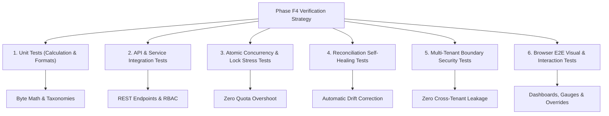
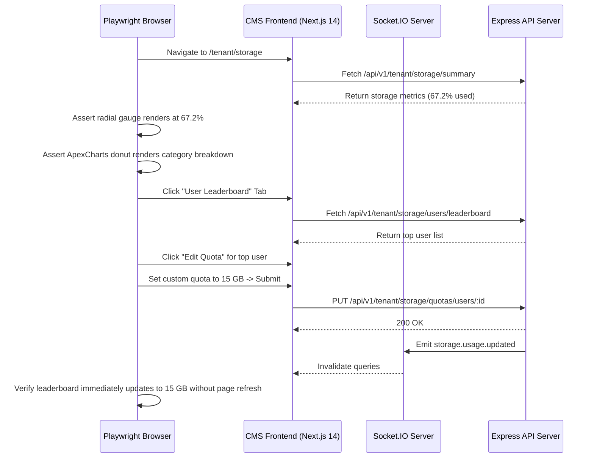

# MasterHRMS File Manager — Phase F4-A
# Report 9: Verification, Quality Assurance & Empirical Testing Strategy

**Project:** MasterHRMS  
**Module:** Enterprise File Manager  
**Phase:** F4-A (Read-Only Forensic Audit)  
**Document:** `PHASE_F4A_TESTING_STRATEGY.md`  
**Status:** COMPLETE & INDEPENDENTLY AUDITED  
**Date:** October 30, 2026  

---

## 1. Executive Summary

This document specifies the comprehensive empirical testing, automated verification, and end-to-end quality assurance strategy for Phase F4 of the MasterHRMS Enterprise File Manager. In alignment with MasterHRMS empirical validation standards, no functionality will be declared complete without deterministic programmatic evidence across unit, integration, stress, concurrency, and browser-driven test matrices.

### Testing Strategy Pillars
1. **Multi-Scope Deterministic Validation:** Rigorous programmatic assertions covering mathematical precision, delta counters, hierarchical quota cascade, and threshold state machines.
2. **High-Concurrency Stress Testing:** Simulated race condition testing verifying that concurrent in-flight uploads cannot breach tenant or user quota limits.
3. **Self-Healing Reconciliation Audits:** Controlled state mutation tests confirming that the background reconciliation engine automatically discovers and repairs counter drift.
4. **Real-Browser Visual & Responsive QA:** Playwright-driven headless and headed browser verification validating ApexCharts rendering, live WebSocket state updates, mobile viewports, and interactive remediation workflows.

---

## 2. Test Suites Architecture & Execution Matrix



---

## 3. Detailed Test Suite Specifications

### 3.1 Suite 1: Mathematical Precision & Byte Taxonomy Unit Tests
Verifies that all storage calculation algorithms in `StorageUsageEngine` compute exact byte tallies without rounding drift or integer overflow:

| Test Case ID | Test Description | Target Logic | Assertion Criteria |
| :--- | :--- | :--- | :--- |
| **TC-CALC-01** | Standard Byte Formatting | `FilesService.formatBytes` | `0 B`, `1023 B`, `1.0 KB`, `1.5 MB`, `10.0 GB`, `1.0 TB`. |
| **TC-CALC-02** | Active File Sizing | `calculateActiveBytes` | Exactly matches `SUM(fileSize)` of non-deleted, active files. |
| **TC-CALC-03** | Trash Sizing | `calculateTrashBytes` | Exactly matches `SUM(fileSize)` of items with `status='TRASHED'`. |
| **TC-CALC-04** | Version History Sizing | `calculateVersionBytes` | Exactly matches `SUM(sizeBytes)` of `FileVersion` where `isCurrent=false`. |
| **TC-CALC-05** | BigInt Arithmetic Safety | Large File Sizing ($> 5\text{ GB}$) | Operates on 64-bit BigInts without 32-bit overflow exceptions. |

---

### 3.2 Suite 2: Atomic Concurrency & Quota Lock Stress Testing
Simulates high-concurrency upload attempts to empirically prove that race conditions cannot breach quota caps:

```
Test Scenario: Concurrent Quota Exhaustion
  Initial State:
    Tenant Quota Limit: 100 MB
    Current Used:        90 MB
    Available Runway:    10 MB
  Action:
    Spawn 10 simultaneous upload requests of 5 MB each.
  Expected Outcome:
    Requests 1 and 2 succeed (committing 10 MB total).
    Requests 3 through 10 fail immediately with HTTP 403 (QUOTA_EXCEEDED).
    Final Used Storage: Exactly 100 MB (Zero bytes over limit).
```

#### Programmatic Test Harness (`scripts/test_quota_concurrency.cjs`):
```javascript
const axios = require("axios");
async function testConcurrentUploads() {
  const promises = [];
  for (let i = 0; i < 10; i++) {
    promises.push(
      axios.post(`${API_BASE}/files/uploads`, {
        name: `concurrent-test-${i}.dat`,
        sizeBytes: 5 * 1024 * 1024,
        mimeType: "application/octet-stream"
      }, { headers: authHeaders }).catch(e => e.response)
    );
  }
  const results = await Promise.all(promises);
  const succeeded = results.filter(r => r.status === 201 || r.status === 200).length;
  const rejected = results.filter(r => r.status === 403 && r.data.code === "QUOTA_EXCEEDED").length;
  
  assert.strictEqual(succeeded, 2, "Exactly 2 uploads must succeed within remaining 10 MB quota");
  assert.strictEqual(rejected, 8, "Exactly 8 uploads must be rejected with QUOTA_EXCEEDED");
}
```

---

### 3.3 Suite 3: Self-Healing Reconciliation & Drift Detection Tests
Verifies that database counter drifts (e.g. caused by simulated crashes or external direct DB modifications) are automatically corrected:

| Test Case ID | Test Scenario | Induced Fault | Assertion / Expected Correction |
| :--- | :--- | :--- | :--- |
| **TC-REC-01** | Unaccounted File Deletion | Manually decrement `file_size` in database directly | `reconcileStorageUsage()` detects variance, updates `usedBytes` to match true file sum. |
| **TC-REC-02** | Phantom Trashed Record | Manually change record `status='TRASHED'` in DB | Reconciliation updates `usedBytes` and increments `trashBytes` correctly. |
| **TC-REC-03** | Abandoned Reservation Cleanup | Insert `file_upload_sessions` with `expiresAt = now() - 10 min` | Cron reaper cleans session, decrements `reservedBytes` back to 0. |

---

### 3.4 Suite 4: Multi-Tenant Boundary & RBAC Isolation Tests
Guarantees that no tenant administrator or user can view or manipulate another organization's storage:

| Test Case ID | Test Scenario | Attacker Context | Target Resource | Expected Outcome |
| :--- | :--- | :--- | :--- | :--- |
| **TC-SEC-01** | Cross-Tenant Summary Access | Tenant A Admin | `GET /api/v1/tenant/storage/summary` | Returns Tenant A metrics only; zero records from Tenant B. |
| **TC-SEC-02** | Cross-Tenant Quota Override | Tenant A Admin | `PUT /api/v1/tenant/storage/quotas/users/:tenantBUser` | Returns HTTP 404 / 403; cannot modify Tenant B user. |
| **TC-SEC-03** | Fleet Endpoint Privilege Esc. | Tenant A Admin | `GET /api/v1/super/storage/fleet-overview` | Returns HTTP 403 Forbidden; requires `SUPER_ADMIN`. |
| **TC-SEC-04** | Employee Admin Route Access | Employee (User) | `GET /api/v1/tenant/storage/departments` | Returns HTTP 403 Forbidden; requires `TENANT_ADMIN`. |

---

### 3.5 Suite 5: Real-Browser End-to-End QA (Playwright)
Executes visual, interactive, and responsive verification in Chromium:



#### Mandatory Browser QA Verification Checklist:
1. **Visual Chart Integrity:** Confirm ApexCharts renders SVG canvas with zero console errors.
2. **Interactive Tab Switching:** Seamless navigation across Overview, Departments, Teams, Users, Analytics, Cleanup, and Settings tabs.
3. **Real-Time Mutation:** Submitting a quota override immediately triggers Socket.IO event and updates visual progress bars.
4. **Cleanup Wizard Execution:** Selecting 3 files in the Heavy Files table updates the potential savings badge dynamically.
5. **Responsive Viewports:**
   - Desktop (1920x1080): 3-column KPI card grid.
   - Tablet (768x1024): 2-column KPI grid, stacked charts.
   - Mobile (375x812): Single-column cards, drawer-based tables.

---

## 4. Regression Safeguards for Existing Phases F1–F3

Before any Phase F4 sub-phase can be merged, the automated regression suite must execute and pass 100%:
```bash
# 1. Verify Phase F1 Core Storage & Quota Foundations
node scripts/verify_file_manager_f1_e2e.cjs

# 2. Verify Phase F2 Windows 11 Explorer UI & Browser QA
node scripts/verify_file_manager_f2_browser_qa.cjs

# 3. Verify Phase F3 Collaboration, Sharing & ACL Engine
node scripts/verify_file_manager_f3_e2e.cjs

# 4. Strict TypeScript Typecheck Across Server and CMS
npx tsc -p server/tsconfig.json --noEmit
npx tsc -p CMS/tsconfig.json --noEmit
```

---
*Report 9 completed under strict read-only audit protocol.*

