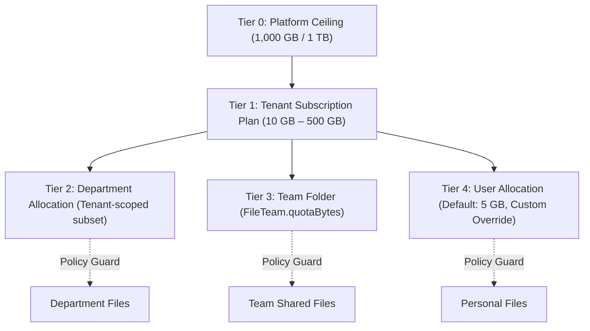

# MasterHRMS File Manager — Phase F4-C
# Implementation Plan: Enterprise Quota Governance, Threshold State Machine & Enforcement

**Project:** MasterHRMS  
**Module:** Enterprise File Manager  
**Phase:** F4-C (Enterprise Quota Governance, Threshold State Machine & Enforcement)  
**Document:** `PHASE_F4C_IMPLEMENTATION_PLAN.md`  
**Status:** READY FOR IMPLEMENTATION  
**Date:** October 30, 2026  

---

## 1. Executive Summary & Scope Definition

Phase F4-C establishes the comprehensive, enterprise-grade quota governance framework for MasterHRMS. Building on the foundation of Phase F4-B (the canonical Storage Usage Calculation Engine [SUCE] and Reconciliation Service), Phase F4-C delivers:

1. **Five-Tier Quota Governance Cascade:** Platform Ceiling $\rightarrow$ Tenant Subscription Plan Pool $\rightarrow$ Department Allocation $\rightarrow$ Team Workspace $\rightarrow$ Individual User Allocation.
2. **Canonical Four-State Quota Lifecycle State Machine:** `NORMAL` ($< 80\%$) $\rightarrow$ `WARNING` ($80\% - 89\%$) $\rightarrow$ `CRITICAL` ($90\% - 99\%$) $\rightarrow$ `LOCKED` ($\ge 100\%$) with automated recovery transitions.
3. **Strict Operational Enforcement Gates:** Transactional pre-flight quota reservation checks, concurrent race condition mitigation, oversubscription protection, and graceful remediation paths (allowing downloads, trashes, and purges while blocking non-essential storage growth when locked).
4. **Administrative Quota Controls:** Tenant-scoped management for department, team, and user quotas, and super-admin tenant overrides with transactional Outbox auditing.
5. **Windows 11 Fluent UI Integration:** State indicator badges, allocation controls, and user feedback in both the File Manager and Tenant Storage Administration pages.

### Explicit Scope Exclusions:
- F4-D Tenant Storage Dashboard expansion (charts & treemaps remain as F4-A/B baseline).
- F4-E Super Admin Fleet Analytics.
- F4-F Automated lifecycle retention rules.
- Billing, Stripe/Razorpay payment webhooks, CompanyProfile, GST, payroll.

---

## 2. Forensic Reconciliation: Existing Model vs. Proposed Policy

### 2.1 Existing Database Models & Capabilities
- `StorageQuota`: Stores tenant pool quota (`userId: null`) and user custom overrides (`userId: UUID`). Contains `quotaBytes BigInt`, `source String ("PLAN" | "DEFAULT" | "OVERRIDE")`.
- `StorageUsage`: Materialized fast-path accounting row (`tenantId, userId`) tracking `usedBytes BigInt`, `trashBytes BigInt`, `reservedBytes BigInt`, and `fileCount Int`.
- `FileTeam`: Stores team folders with `quotaBytes BigInt?` and `rootFolderId String?`.
- `Department`: Organizational unit linked to employees. Department quotas are stored in `Setting` (`group: "storage_quota", key: "dept_" + departmentId`) or `StorageQuota(source: "DEPARTMENT")`.
- `StorageAlertState`: Tracks `currentLevel`, `lastNotifiedLevel`, `lastNotifiedAt`, `resolvedAt` per tenant.

### 2.2 Reconciled Governance Hierarchy Rules



#### Core Invariant: Allocation is Policy, Not Physical Storage
- A child quota (department, team, user) represents an **upper-bound permission policy**, NOT a pre-allocated physical deduction from the tenant pool.
- Actual physical storage is deducted only when files are created or versions added.
- **Zero Double-Charging:** Files uploaded to a Team Folder count against `FileTeam.quotaBytes` and the Tenant Storage Pool, but NEVER against the individual uploader's personal 5 GB quota.

#### Oversubscription Protection Rules:
1. **Department Allocation:** The sum of all active department allocations in a tenant cannot exceed the tenant's total effective quota:
   $$\sum_{d} \text{QuotaBytes}_d \le \text{TenantQuotaBytes}$$
2. **Team Allocation:** The sum of all team folder quotas cannot exceed the tenant's total effective quota:
   $$\sum_{t} \text{QuotaBytes}_t \le \text{TenantQuotaBytes}$$
3. **User Overrides:** An individual user quota override cannot exceed the total tenant quota:
   $$\text{UserQuotaOverrideBytes} \le \text{TenantQuotaBytes}$$

---

## 3. Canonical Quota Lifecycle State Machine

### 3.1 Four Operational States

| Lifecycle State | Utilization Range ($U$) | Color / UI Badge | Permitted File Manager Operations | Dispatched Notifications |
| :--- | :--- | :--- | :--- | :--- |
| **`NORMAL`** | $0\% \le U < 80.0\%$ | Neutral / Blue | Full operations permitted (upload, version, rename, trash, purge, download). | None |
| **`WARNING`** | $80.0\% \le U < 90.0\%$ | Amber / Warning | Full operations permitted. Explorer displays subtle warning banner. | In-app warning toast. |
| **`CRITICAL`** | $90.0\% \le U < 100.0\%$ | Orange / Destructive | Uploads permitted ONLY within remaining capacity. Prominent warning banner. | High-priority in-app alert. |
| **`LOCKED`** | $U \ge 100.0\%$ | Crimson / Locked | **BLOCKED:** Uploads, new versions, restore from trash.<br>**ALLOWED:** Downloads, streaming, moves, trash, permanent purge. | Realtime WebSocket lock alert, Outbox event. |

### 3.2 Authoritative Accounting Dimension
Utilization percentage is evaluated dynamically using fast-path active storage and in-flight reservations against effective quota:
$$U = \min\left(100, \frac{\text{usedBytes} + \text{reservedBytes}}{\text{effectiveQuotaBytes}} \times 100\right)$$
Where:
- $\text{usedBytes} = S_{\text{active}}$ (active non-deleted files).
- $\text{reservedBytes} = S_{\text{reserved}}$ (in-flight browser upload sessions).
- $\text{effectiveQuotaBytes} = \text{TenantQuotaBytes}$ (subscription plan limit or super-admin override).

### 3.3 Recovery Lifecycle
When files are moved to trash or permanently purged:
1. `usedBytes` or `trashBytes` decrements atomically.
2. Utilization drops below $100\%$ ($90\%$, $80\%$).
3. State machine executes a **Recovery Transition**: `LOCKED` $\rightarrow$ `CRITICAL` $\rightarrow$ `WARNING` $\rightarrow$ `NORMAL`.
4. `StorageAlertState.resolvedAt` is stamped, `currentLevel` updated, and `quota.recovered` event dispatched.
5. Upload gates immediately reopen without administrative intervention.

---

## 4. Enforcement Engine Design

### 4.1 Transactional Pre-Flight Gate (`QuotaService.reserveUploadBytes`)
Before issuing a presigned upload URL or receiving a multipart binary:
```typescript
// 1. Validate Single File Max Limit
if (sizeBytes > MAX_FILE_SIZE_BYTES) {
  throw new QuotaExceededError("File exceeds 100 MB limit.", "FILE_SIZE", sizeBytes, MAX_FILE_SIZE_BYTES);
}

// 2. Validate Tenant Lifecycle State & Hard Quota
const tenantQuota = await getTenantQuotaBytes(tenantId);
const tenantUsage = await getOrCreateUsage(tx, tenantId, null);
if (tenantUsage.usedBytes + tenantUsage.reservedBytes + sizeBytes > tenantQuota) {
  throw new QuotaExceededError("Tenant storage quota exceeded.", "TENANT", sizeBytes, available);
}

// 3. Contextual Scope Validation: Team, Department, or User
if (teamId) {
  // Validate FileTeam.quotaBytes
  const team = await tx.fileTeam.findUnique({ where: { id: teamId } });
  if (team?.quotaBytes && (teamUsedBytes + sizeBytes > team.quotaBytes)) {
    throw new QuotaExceededError("Team folder quota exceeded.", "TEAM", sizeBytes, teamAvailable);
  }
} else if (departmentId) {
  // Validate Department Quota
  const deptQuota = await getDepartmentQuotaBytes(tenantId, departmentId);
  if (deptQuota && (deptUsedBytes + sizeBytes > deptQuota)) {
    throw new QuotaExceededError("Department quota exceeded.", "DEPARTMENT", sizeBytes, deptAvailable);
  }
} else {
  // Validate User 5GB Personal Quota
  const userQuota = await getUserQuotaBytes(tenantId, userId);
  const userUsage = await getOrCreateUsage(tx, tenantId, userId);
  if (userUsage.usedBytes + userUsage.reservedBytes + sizeBytes > userQuota) {
    throw new QuotaExceededError("User 5 GB personal quota exceeded.", "USER", sizeBytes, userAvailable);
  }
}

// 4. Atomically increment reservedBytes on Tenant & User/Team
```

### 4.2 Non-Blocking Operations Under LOCKED State
- Downloads & streaming (`/api/v1/files/stream`, `/preview`, `/download`): **ALLOWED**
- Folder creation (`/api/v1/files/folders`): **ALLOWED** (0 bytes consumed)
- File move / rename (`PATCH /api/v1/files/nodes/:id`): **ALLOWED** (0 bytes consumed)
- Moving file to Trash (`POST /api/v1/files/trash`): **ALLOWED** (moves bytes from `usedBytes` to `trashBytes`)
- Empty Trash / Permanent Purge (`POST /api/v1/files/purge`): **ALLOWED** (permanently frees storage)
- Restore from Trash (`POST /api/v1/files/restore`): **BLOCKED** if restored file would exceed quota.

---

## 5. Administrative Quota Management & API Contracts

### 5.1 Endpoints to Implement in Phase F4-C:

#### 1. `GET /api/v1/tenant/storage/quotas`
Returns the complete five-level governance hierarchy and effective quota summary for the authenticated tenant.
- **Access:** `requireTenantAdmin`

#### 2. `PUT /api/v1/tenant/storage/quotas/users/:userId`
Configures a personal quota override for an individual employee with parent ceiling validation.
- **Payload:** `{ "quotaBytes": 10737418240, "reason": "Video Editor allocation" }`
- **Validation:** `quotaBytes <= tenantPlanLimitBytes`

#### 3. `PUT /api/v1/tenant/storage/quotas/teams/:teamId`
Allocates or adjusts quota for a collaborative team folder with oversubscription validation.
- **Payload:** `{ "quotaBytes": 10737418240 }`
- **Validation:** $\sum \text{teamQuotas} \le \text{TenantQuotaBytes}$

#### 4. `PUT /api/v1/tenant/storage/quotas/departments/:departmentId`
Allocates or adjusts quota for an organizational department with oversubscription validation.
- **Payload:** `{ "quotaBytes": 21474836480 }`
- **Validation:** $\sum \text{deptQuotas} \le \text{TenantQuotaBytes}$

#### 5. `PUT /api/v1/super/storage/tenants/:id/quota`
Grants an audited super-admin quota override for an enterprise tenant.
- **Access:** `requireSuperAdmin`
- **Payload:** `{ "quotaBytes": 107374182400, "source": "OVERRIDE", "reason": "Sovereign tier migration" }`

---

## 6. Audit Logging & Realtime Event Matrix

### 6.1 Transactional Outbox Events
All quota updates write to `outbox_events` inside the mutation transaction:
- `quota.override.created`: Super admin or tenant admin override granted.
- `quota.allocation.updated`: Department, team, or user allocation modified.
- `quota.state.transitioned`: Tenant transitioned between `NORMAL`, `WARNING`, `CRITICAL`, `LOCKED`.
- `quota.blocked`: Upload rejected due to quota limit.
- `quota.recovered`: Storage freed, recovering tenant from `LOCKED` back to permitted state.

### 6.2 WebSocket Broadcasts
Targeted tenant-scoped WebSocket events emitted via `broadcastToTenant`:
- `storage:quota_updated`: Sent when quotas or allocations are adjusted.
- `storage:alert`: Sent when lifecycle state transitions occur.

---

## 7. UI Integration Blueprint

### 7.1 Unified File Manager UI (`CMS/src/components/apps/file-manager/unified-file-manager.tsx`)
- Header/Meter Badge: Displays `NORMAL` (Blue), `WARNING` (Amber), `CRITICAL` (Orange), or `LOCKED` (Crimson).
- Quota Warning Banner: Shows when state is `WARNING`, `CRITICAL`, or `LOCKED`.
- Upload Feedback: If upload fails with `QUOTA_EXCEEDED`, renders a clear toast/modal with options to "Manage Storage" or "Empty Recycle Bin".

### 7.2 Tenant Storage Administration UI (`CMS/src/app/(workspace)/tenant/files/storage/page.tsx`)
- Quota Allocation Tab: Manage Department, Team, and User quotas with inline edit dialogs.
- Real-time remaining unallocated capacity indicator to prevent oversubscription.

---

## 8. Test & Verification Plan

1. **Unit & Integration Suite (`scripts/verify_file_manager_f4c_e2e.cjs`):**
   - Check 1: 5-level governance hierarchy resolution.
   - Check 2: Oversubscription prevention (rejecting child allocation $>$ tenant capacity).
   - Check 3: State machine threshold boundaries:
     - $79.9\%$ $\rightarrow$ `NORMAL`
     - $80.0\%$ $\rightarrow$ `WARNING`
     - $89.9\%$ $\rightarrow$ `WARNING`
     - $90.0\%$ $\rightarrow$ `CRITICAL`
     - $99.9\%$ $\rightarrow$ `CRITICAL`
     - $100.0\%$ $\rightarrow$ `LOCKED`
   - Check 4: Upload enforcement (rejection when locked, rejection on 100 MB max limit).
   - Check 5: Non-growth operations permitted when locked (downloads, trash, purge).
   - Check 6: Recovery transition (LOCKED $\rightarrow$ NORMAL on purge).
   - Check 7: Concurrent allocation race condition mitigation.
   - Check 8: Outbox events & socket event dispatching.
   - Check 9: Cross-tenant isolation (attempting to alter another tenant's quotas fails with 403/404).
2. **Browser QA:**
   - Multi-role session testing: Super Admin and Tenant Admin.
   - Verify UI badges, banners, allocation dialogs, and error feedback.
3. **Regression Testing:**
   - F1 E2E Suite (`verify_file_manager_f1_e2e.cjs`)
   - F3 E2E Suite (`verify_file_manager_f3_e2e.cjs`)
   - F4-B E2E Suite (`verify_file_manager_f4b_e2e.cjs`)
   - Full TypeScript build check.

