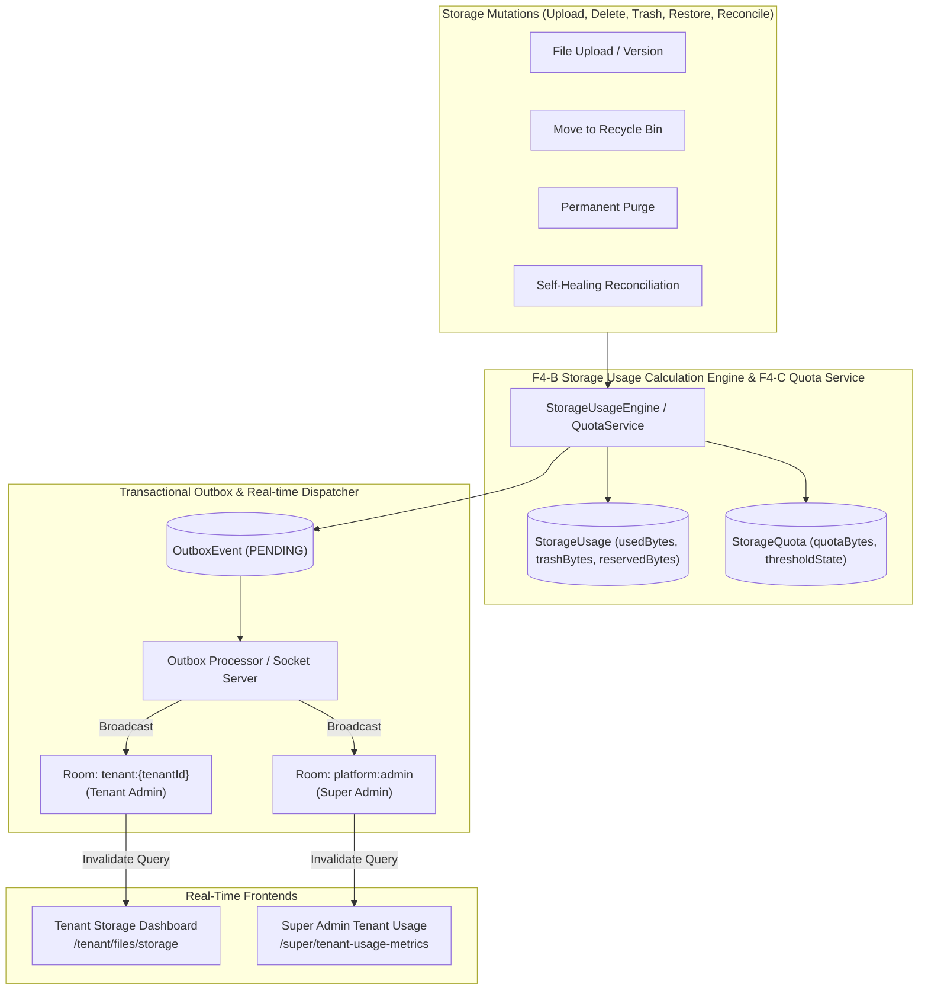

# MASTERHRMS — PHASE F4-D IMPLEMENTATION PLAN
## Tenant Storage Administration Dashboard & Real-Time Super Admin Tenant Usage Metrics

**Document ID:** `PHASE_F4D_IMPLEMENTATION_PLAN.md`  
**Phase:** F4-D  
**Status:** APPROVED & IN EXECUTION  
**Date:** October 30, 2026  
**Module:** Enterprise File Manager (Storage Administration & Fleet Analytics)  

---

## 1. Executive Summary & Audit Findings

### 1.1 Objective
Phase F4-D establishes the production-grade administrative visibility and real-time observability layer for the MASTERHRMS File Manager:
1. **Tenant Storage Administration Dashboard (`/tenant/files/storage`):** A comprehensive, real-time control center for Tenant Admins displaying canonical F4-B multi-dimensional storage usage (Active, Trash, Versions, Reserved, Physical, Billable), F4-C quota governance, department breakdowns, team folders, top users, audit activity, and self-healing reconciliation.
2. **Real-Time Super Admin Tenant Usage Metrics (`/super/tenant-usage-metrics`):** Enhancing the existing `/super/tenant-usage-metrics` page to consume authoritative storage metrics from canonical F4-B and F4-C services, providing platform-wide fleet summary totals, detailed tenant-level usage tables, and rich tenant inspection modals with instant Socket.IO real-time reactivity.

### 1.2 Audit Findings on Legacy Implementation
Prior to Phase F4-D:
- `TenantUsageMetricsService` in `server/src/services/tenant-usage-metrics.service.ts` computed storage by aggregating `StoredDocument` and `ExpenseClaim` rows, completely bypassing the canonical `StorageUsage`, `StorageQuota`, and `StorageAdminService` models established in F4-B and F4-C.
- Multi-dimensional dimensions (reclaimable trash, version history, in-progress upload reservations, physical storage multipliers) were absent from Super Admin reporting.
- Socket.IO events (`storage:alert`, `storage:quota_updated`, `file:created`, `file:deleted`, etc.) were broadcast only to `tenant:{tenantId}`, meaning Super Admin in `platform:admin` had no real-time awareness of tenant storage changes without manually refreshing the browser.
- Real-time connection indicators, automatic reconnection recovery, and targeted query invalidations were missing from both dashboard pages.

---

## 2. Architecture & Data Flow

---

## 3. Specification of Phase F4-D Deliverables

### 3.1 Tenant Storage Administration Dashboard (`/tenant/files/storage`)
- **Route:** `/tenant/files/storage` (Protected by Tenant Admin RBAC).
- **KPI Summary Cards:**
  1. *Total Plan Quota:* Effective quota bytes, formatted string, and source (Plan, Subscription, Override).
  2. *Active Logical Storage:* Current live active files.
  3. *Reclaimable Trash:* Debris in Recycle Bin with potential savings.
  4. *Version History:* Historical version footprint.
  5. *In-Flight Reservations:* Bytes allocated to pending uploads.
  6. *Available Capacity:* Unallocated quota bytes.
  7. *Physical Storage Estimate:* Storage disk occupancy.
  8. *Total Billable Storage:* Sum of active, trash, and versions.
  9. *Quota Lifecycle State:* `NORMAL`, `WARNING`, `CRITICAL`, `LOCKED` with visual alert banner.
- **Visual Composition Chart:** Responsive donut/pie chart breaking down storage by Active, Trash, Versions, and Reserved bytes.
- **Department Storage Table:** Department name, configured allocation, actual used bytes, reserved bytes, remaining capacity, utilization percentage, and threshold state with sorting, search, and pagination.
- **Team Folder Storage Table:** Team name, root folder, quota, used bytes, member count, file count, and allocation modal.
- **User Storage Leaderboard:** User name, department, personal used bytes, file count, and custom quota override modal.
- **Storage Activity Audit:** Real-time chronological audit trail of file operations (`FileActivity`) and reconciliation records.
- **Real-Time Integration:** Socket.IO hook listening to `tenant:{tenantId}` events, connection status badge (`Live` / `Reconnecting`), and last-synced timestamp.

### 3.2 Super Admin Real-Time Tenant Usage Metrics (`/super/tenant-usage-metrics`)
- **Route:** `/super/tenant-usage-metrics` (Preserved canonical route).
- **Fleet Summary KPI Cards:**
  1. Total registered & active tenants.
  2. Total platform allocated storage quota.
  3. Total active logical storage across all tenants.
  4. Total trash storage across all tenants.
  5. Total historical version footprint.
  6. Total in-flight reserved upload bytes.
  7. Total estimated physical storage.
  8. Total billable storage.
  9. Count of tenants approaching quota threshold ($\ge 80\%$).
  10. Count of tenants in `LOCKED` state ($100\%$).
- **Tenant Usage Table:**
  - Columns: Tenant (Name, Avatar, Domain), Subscription Plan, Quota, Active Bytes, Trash Bytes, Version Bytes, Reserved Bytes, Physical Estimate, Utilization %, Quota State (`NORMAL`, `WARNING`, `CRITICAL`, `LOCKED`), Last Usage Update.
  - Controls: Search tenant name, Filter by plan, Filter by quota state, Sort by usage/utilization, Pagination, View mode toggle (List / Grid).
- **Tenant Inspection Drawer/Modal:**
  - Authoritative tenant storage summary.
  - Multi-dimensional byte composition.
  - Department breakdown.
  - Team folder allocation breakdown.
  - Top storage consumers (Users).
  - Recent storage activity and last reconciliation timestamp.
- **Real-Time Integration:**
  - Socket.IO connection in room `platform:admin`.
  - Listen for `storage:platform:update` and storage domain events.
  - Invalidate `["super-tenant-usage-metrics"]` and active inspection query cache without full page reload.

---

## 4. API & Service Architecture

### 4.1 Backend Service Enhancements
1. **`TenantUsageMetricsService` (`server/src/services/tenant-usage-metrics.service.ts`):**
   - Refactor `getTenantUsageMetricsList()` to query canonical `StorageUsage` and `StorageQuota` records.
   - Calculate Fleet Summary metrics via indexed database aggregation.
   - Refactor `getTenantUsageDetail(tenantId)` to integrate canonical `StorageAdminService.getTenantStorageSummary(tenantId)` and `StorageUsageEngine.calculateDepartmentBreakdown(tenantId)`.
2. **`StorageAdminService` (`server/src/services/files/storage-admin.service.ts`):**
   - Add `getStorageActivity(tenantId, limit)` to retrieve recent `FileActivity` records for audit display.
   - Add fleet aggregation helpers for Super Admin metrics.
3. **`OutboxService` & `Socket.IO` (`server/src/services/outbox.service.ts`, `server/src/socket.ts`):**
   - Dispatch all storage events (`storage.usage.updated`, `storage.reconciled`, `quota.state.*`, `file.*`) to `platform:admin` room in addition to `tenant:{tenantId}`.

### 4.2 API Endpoint Inventory
- `GET /api/super/tenant-usage-metrics`: Enhanced with fleet summary and canonical F4 storage data.
- `GET /api/super/tenant-usage-metrics/:id`: Enhanced with canonical multi-dimensional breakdown, departments, teams, and activity.
- `GET /api/v1/tenant/storage/summary`: Canonical multi-dimensional tenant storage summary.
- `GET /api/v1/tenant/storage/departments`: Canonical department breakdown via SUCE.
- `GET /api/v1/tenant/storage/teams`: Team folders breakdown.
- `GET /api/v1/tenant/storage/users`: User consumption leaderboard.
- `GET /api/v1/tenant/storage/activity`: Recent storage audit trail.
- `POST /api/v1/tenant/storage/reconcile`: Self-healing reconciliation (dry-run & repair).

---

## 5. Implementation Roadmap

1. **Phase 1: Backend Service & Route Refactoring**
   - Upgrade `TenantUsageMetricsService` to use canonical `StorageUsage`, `StorageQuota`, and `StorageAdminService`.
   - Implement `getStorageActivity` in `StorageAdminService` and expose `GET /api/v1/tenant/storage/activity`.
   - Update `OutboxService` and `server/src/socket.ts` to broadcast storage events to `platform:admin`.
2. **Phase 2: Tenant Storage Dashboard Upgrade (`/tenant/files/storage`)**
   - Add real-time Socket.IO subscriptions and connection health indicator.
   - Integrate department breakdown, team breakdown, user breakdown, and activity audit tab.
   - Implement responsive storage composition visualization.
3. **Phase 3: Super Admin Tenant Usage Metrics Upgrade (`/super/tenant-usage-metrics`)**
   - Add Fleet Summary cards displaying canonical platform totals.
   - Update tenant usage table to display Active, Trash, Versions, Reserved, Physical, and Quota States.
   - Upgrade tenant inspection drawer with canonical F4 storage details.
   - Add real-time Socket.IO listener for `platform:admin` events.
4. **Phase 4: Automated Testing Suite (`verify_file_manager_f4d_e2e.cjs`)**
   - Verify fleet totals, canonical tenant storage queries, department/team attribution, real-time event dispatch, reconnect recovery, and cross-tenant security.
5. **Phase 5: Playwright Browser QA**
   - Verify Super Admin, Tenant Admin, HR Admin, and Employee roles with real file operations and live updates.
6. **Phase 6: Reporting & Gate Sign-Off**
   - Compile `docs/Saas/file-manager/phase-f4/PHASE_F4D_IMPLEMENTATION_REPORT.md` and STOP.

