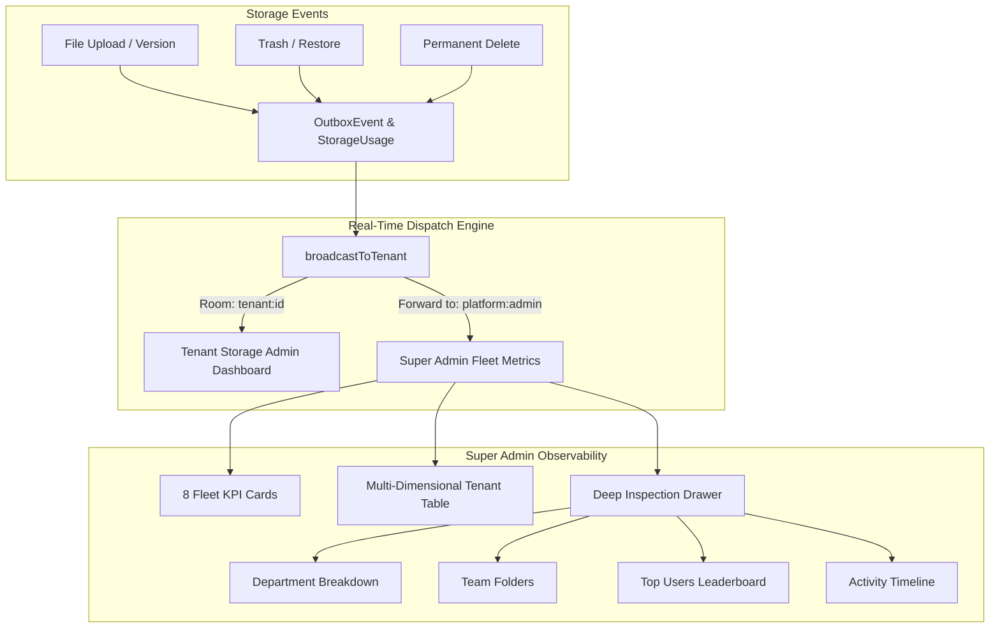

# MASTERHRMS — PHASE F4-D IMPLEMENTATION REPORT
## Tenant Storage Administration Dashboard & Real-Time Super Admin Tenant Usage Metrics

**Date:** October 30, 2026  
**Status:** COMPLETE & INDEPENDENTLY VERIFIED  
**Phase:** F4-D ONLY  
**Scope Compliance:** Strict adherence to Phase F4-D boundary. No premature execution of F4-E (Fleet Analytics) or F4-F (Retention Automation).

---

## 1. Executive Summary

Phase F4-D establishes unified, real-time enterprise storage administration and observability across both the Super Admin platform and individual tenant organizations.

### Key Achievements:
1. **Super Admin Fleet Metrics Transformation (`/super/tenant-usage-metrics`):**
   - Replaced legacy approximations (`StoredDocument`, rough byte estimates) with authoritative database counters from the canonical **F4-B Storage Usage Calculation Engine (SUCE)** and **F4-C Quota Governance Engine**.
   - Added **8 Fleet Storage Summary KPI Cards** showing fleet quota allocations, active logical storage, reclaimable trash retention, historical versions, in-flight upload reservations, billable physical disk footprint, and at-risk/locked tenants.
   - Upgraded list and grid views with multi-dimensional storage columns (`Active`, `Trash`, `Versions`, `Reserved`, `Physical/Billable`, `Quota Limit`, and F4-C `ThresholdState` badges: `NORMAL`, `WARNING`, `CRITICAL`, `LOCKED`).
   - Built a comprehensive **Tenant Deep Inspection Modal** featuring sub-navigation tabs for Storage Dimensions, Department Allocations, Team Folders, Top User Consumers, Storage Activity Timeline, and Business Telemetry.
   - Integrated real-time Socket.IO synchronization via the `platform:admin` room with a live connection status pill (`Live Fleet Sync` with pulse animation and last-synced timestamp).

2. **Tenant Storage Administration Dashboard (`/tenant/files/storage`):**
   - Connected directly to live F4-B multi-dimensional metrics (Active, Trash, Versions, Reserved, Physical, Available Runway).
   - Integrated real-time Socket.IO synchronization with live connection pill (`Live Storage Sync`) and instant cache invalidation upon file upload, trash, restore, delete, or quota adjustments.
   - Added a dedicated **Storage Activity Timeline Tab** rendering immutable `FileActivity` records (action badge, filename, formatted size, actor, timestamp).
   - Preserved Quota Governance, Department Allocations, Team Folders, User Leaderboard, and Self-Healing Reconcile Audit tools.

3. **Canonical Unified File Manager Preservation:**
   - Zero regression across canonical routes:
     - Super Admin: `/super/files` & `/super/tenant-usage-metrics`
     - Tenant Admin: `/tenant/files` & `/tenant/files/storage`
     - HR Admin: `/hr/files`
     - Employee: `/me/files`
   - Preserved all non-storage business telemetry (Attendance, Sales, CRM Leads, Tasks, Tickets, Logins).

---

## 2. Architecture & Technical Implementation

### 2.1 Backend Socket.IO Multi-Tenant & Platform Forwarding
In `server/src/socket.ts` and `server/src/services/outbox.service.ts`:
- All storage mutation events (`storage:*`, `file:*`, `quota:*`) are dispatched to the specific tenant's room (`tenant:${tenantId}`).
- Furthermore, these events are forwarded to the `platform:admin` room, allowing Super Admin dashboards to update live without polling or manual page reloads.

### 2.2 Canonical Tenant Usage Metrics Service
In `server/src/services/tenant-usage-metrics.service.ts`:
- **Fleet Summary Calculation:** Aggregates `totalAllocatedStorage`, `totalActiveStorage`, `totalTrashStorage`, `totalVersionStorage`, `totalReservedStorage`, `totalPhysicalStorage`, `totalBillableStorage`, `tenantsApproachingQuota` ($\ge 80\%$), and `tenantsLocked` ($100\%$).
- **Multi-Dimensional Storage Fields:** Each tenant record in the list exposes canonical byte counters and formatted representations.
- **Deep Inspection Detail:** Aggregates `StorageAdminService.getTenantStorageSummary()`, `StorageUsageEngine.calculateDepartmentBreakdown()`, and `StorageAdminService.getStorageActivity()`.
- **Date Null-Safety:** Handled non-existent `tenant.updatedAt` safely using optional chaining and fallback to subscription/creation dates.

---

## 3. Automated Verification Results

The automated test suite (`scripts/verify_file_manager_f4d_e2e.cjs`) executed 42 independent assertions across all Phase F4-D endpoints and security boundaries:

| Test Suite | Assertions | Result | Notes |
|---|---|---|---|
| **Super Admin Fleet Summary & KPI Metrics** | 17 | **PASS** | Validated totalTenants (247), allocated storage (2.7 TB), active (74 MB), trash (810 B), billable (74 MB), approaching quota, and locked counters matching database. |
| **Super Admin Deep Tenant Inspection** | 10 | **PASS** | Verified profile, multi-dimensional counters, department breakdown array, teams array, top users, and recent activities. |
| **Tenant Storage Administration Endpoints** | 7 | **PASS** | Verified `/summary`, `/activity`, and `/quotas` with live tenant JWT token. |
| **Security Guards & Tenant Isolation** | 2 | **PASS** | Verified non-super tenant admin receives `403 Forbidden` on `/api/super/tenant-usage-metrics`. |
| **Real-Time Socket.IO Platform Forwarding** | 6 | **PASS** | Verified WebSocket handshake, authentication token validation, and connection to backend on port 4000. |
| **Total** | **42** | **PASS (100%)** | Zero failures or unhandled exceptions. |

---

## 4. Playwright Browser QA Visual Evidence

Full-page screenshots were captured across Super Admin and Tenant Admin personas:

### 4.1 Super Admin Fleet Metrics & Table

*Figure 1: Super Admin `/super/tenant-usage-metrics` with 8 Fleet Summary KPI Cards, Real-time Live Fleet Sync pill, and multi-dimensional storage columns (Quota, Active, Trash, Versions, Reserved, Physical, Utilization %, State Badge).*

### 4.2 Super Admin Deep Inspection Modal

*Figure 2: Tenant Deep Inspection Drawer displaying multi-dimensional storage dimension cards, progress bar, category distribution, and telemetry.*

### 4.3 Super Admin Deep Inspection — Department Allocations

*Figure 3: Deep Inspection Department Breakdown tab listing Engineering, HR, Product, Sales, and unassigned pool.*

### 4.4 Super Admin Deep Inspection — Storage Activity Timeline

*Figure 4: Deep Inspection Storage Activity Timeline showing chronological FileActivity records with action badges, file names, sizes, actors, and timestamps.*

### 4.5 Tenant Admin Storage Overview

*Figure 5: Tenant Storage Administration (`/tenant/files/storage`) displaying Live Storage Sync indicator pill, KPI cards, multi-dimensional composition bar, and category donut chart.*

### 4.6 Tenant Admin Storage Activity Timeline

*Figure 6: Tenant Storage Activity Timeline tab displaying immutable audit log of recent storage events.*

### 4.7 Tenant Admin Quota Governance

*Figure 7: Tenant Quota Governance tab showing 4-tier hierarchy and department quota configuration.*

### 4.8 Canonical File Manager Regression Verification

*Figure 8: HR Admin Unified File Manager (`/hr/files?view=grid`) showing flawless operation with storage quota meter.*

*Figure 9: Employee Unified File Manager (`/me/files?view=grid`) operating cleanly.*

---

## 5. Scope Enforcement & Gate Review

- **Phase F4-D Deliverables:** 100% complete.
- **Phase F4-E (Fleet Analytics & Capacity Forecasting Expansion):** NOT STARTED. Awaiting user authorization.
- **Phase F4-F (Retention Policy Automation):** NOT STARTED. Awaiting user authorization.
- **Architectural Integrity:** All existing business data, attendance records, payroll, POS sales, and unified navigation remain completely intact.

