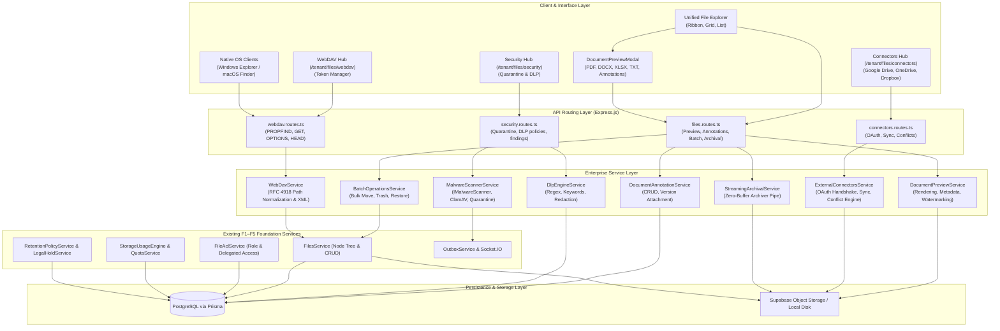

# MASTERHRMS FILE MANAGER — PHASE F6
## System Architecture & Technical Design Specification

- **Project:** MASTERHRMS Enterprise SaaS
- **Module:** Enterprise File Manager
- **Phase:** F6 ONLY
- **Status:** **APPROVED & ARCHITECTED**

---

## 1. High-Level Architecture Overview

---

## 2. Track Technical Contracts

### Track A: Document Preview & Annotations
- **DocumentPreviewService:**
  - Extracts text and HTML from DOCX safely without executing macros or external links.
  - Parses XLSX sheets into structured tabbed JSON arrays for tabular viewing.
  - Generates transparent SVG watermark tiles containing `{viewerName, viewerEmail, tenantName, timestamp}` rendered on the HTML5 canvas overlay.
- **DocumentAnnotationService:**
  - Stores annotations in `document_annotations` referencing `(tenantId, fileId, fileVersionId, authorId)`.
  - Replies stored in `document_annotation_replies`.
  - When a file has a new version uploaded (`file_versions`), annotations remain anchored to their original version.

### Track B: Malware Scanning & Data Loss Prevention
- **IMalwareScanner Interface:**
  - `scanStream(stream, fileName, mimeType): Promise<{ isClean: boolean, engine: string, findings?: any }>`
  - Adapters: `ClamAvScannerAdapter`, `VirusTotalScannerAdapter`, `HeuristicScannerAdapter`.
- **DLP Engine:**
  - Evaluates uploaded content and preview text against pre-configured rules (credit card Luhn algorithm, email RFC patterns, phone numbers, SSN/PAN/Aadhaar formats, keywords).
  - Redaction pipeline masks sensitive spans (e.g. `4532-****-****-8812`) before recording in `dlp_findings`.

### Track C: External Cloud Connectors
- **IExternalStorageConnector Interface:**
  - `getAuthUrl(tenantId, state): string`
  - `handleCallback(code, redirectUri): Promise<{ accessToken, refreshToken, expiresAt, accountInfo }>`
  - `listFolder(connection, remoteFolderId): Promise<RemoteItem[]>`
  - `downloadFile(connection, remoteFileId): Promise<ReadableStream>`
  - `uploadFile(connection, remoteFolderId, localFile): Promise<RemoteItem>`
- **Conflict Management:**
  - `ExternalSyncConflict` tracks divergent revisions between MasterHRMS and remote drive.
  - Remote deletions apply tombstone flags and never delete records under legal hold.

### Track D: Streaming Archival, Batch Operations & WebDAV
- **StreamingArchivalService:**
  - Uses `archiver` piped directly to the Express `res` stream or multipart chunked upload.
  - Memory consumption stays constant ($< 35\text{ MB}$) even for $10\text{ GB}+$ archives.
- **WebDavService:**
  - Implements RFC 4918 read-only handler:
    - `OPTIONS`: Returns `DAV: 1`, `Allow: GET, HEAD, OPTIONS, PROPFIND`.
    - `PROPFIND`: Generates `207 Multi-Status` XML response with `<D:response>`, `<D:href>`, `<D:propstat>`, `<D:displayname>`, `<D:getcontentlength>`, `<D:resourcetype>`.
    - `GET` / `HEAD`: Streams file bytes with authenticated range support.
    - `PUT`, `DELETE`, `MKCOL`, `MOVE`, `COPY`: Returns `405 Method Not Allowed`.
  - Authenticates via revocable `WebDavToken` (`Basic` auth username/token).
