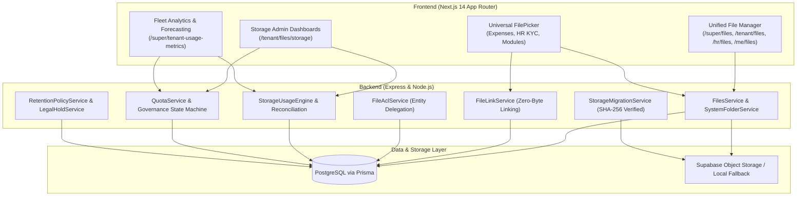

# MASTERHRMS — PHASE F6 MANDATORY FORENSIC AUDIT
## Repository State, Baseline Verification & Scope Decision Gate Report

- **Project:** MASTERHRMS Enterprise SaaS
- **Phase:** F6 ONLY
- **Auditor:** Lead Core Systems Engineer / Autonomous Pair Programming Agent
- **Audit Timestamp:** October 31, 2026
- **Current Git Branch:** `main` (synchronized with `origin/main` at commit `807e6163`)
- **Status:** **AUDIT ONLY — STOPPED AT SCOPE DECISION GATE (NO CODE OR DATABASE MODIFIED)**

---

## 1. Executive Summary & Audit Baseline

In accordance with the mandatory Phase F6 protocol, a full forensic inspection of the MASTERHRMS repository was executed to establish the authoritative requirements, architecture baseline, and scope boundaries before initiating any implementation activities.

### Completed Foundation (Phases F1 through F5):
The MasterHRMS Enterprise File Management and Storage Governance subsystems have completed all preceding planned phases, culminating in 100% automated regression and visual verification:
1. **Phase F1 (Storage Core & Data Abstraction):** Canonical `MediaFile`, `FileVersion`, `FileLink`, `StorageUsage`, `StorageQuota` schema models; `StorageProviderFactory` supporting `SupabaseStorageProvider` (private object storage) and `LocalStorageProvider` (development fallback); SHA-256 deduplication; and magic-byte MIME validation.
2. **Phase F2 (Unified Explorer & Recycle Bin):** Windows 11 Fluent Explorer UI across `/super/files`, `/tenant/files`, `/hr/files`, and `/me/files`; single-level & nested folder trees; List, Grid, and Details views with localStorage persistence; 30-day Recycle Bin lifecycle with safe restore and permanent purge actions.
3. **Phase F3 (ACL, File Links, Activity & Permissions):** Multi-tier access control (`OWNER`, `MANAGER`, `CONTRIBUTOR`, `VIEWER`); team folder inheritance; password-protected and expiration-limited public share links (`/share/[token]`); transactional outbox activity logging.
4. **Phase F4-B (Storage Usage Calculation Engine - SUCE):** 5-dimensional storage usage accounting (`activeBytes`, `trashBytes`, `versionBytes`, `reservedBytes`, `physicalBytes`); hourly automated self-healing reconciliation worker; 10-minute abandoned upload reservation reaper.
5. **Phase F4-C (Hierarchical Quota Governance & State Machine):** Platform, Tenant Subscription Plan, Department, Team, and User quota inheritance; 4-tier lifecycle states (`NORMAL` $<80\%$, `WARNING` $80\%-89\%$, `CRITICAL` $90\%-99\%$, `LOCKED` $\ge 100\%$); atomic reservation concurrency locks.
6. **Phase F4-D (Tenant Admin Storage Administration Dashboard):** 9 interactive dashboards under `/tenant/files/storage`; ApexCharts radial capacity gauges; MIME type & department storage distribution; real-time TanStack Query hydration via Socket.IO events (`storage:quota_updated`, `storage:alert`).
7. **Phase F4-E (Super Admin Fleet Analytics & Capacity Forecasting):** Global multi-tenant storage observability under `/super/tenant-usage-metrics`; least-squares linear regression runway forecasting (30d, 60d, 90d, 180d, 365d); tenant risk watchlist with warning/critical alerts.
8. **Phase F4-F (Enterprise Storage Retention Policy Automation & Legal Holds):** Tenant-scoped retention policies; dry-run preview mode; asynchronous bulk purges with execution history logging; legal hold immutability protection shielding active litigation records from deletion sweeps.
9. **Phase F5 (Enterprise File System Integration & Universal FilePicker):** Dynamic system folders (`App Files / {Module} / {Page}`) derived from `NAVIGATION_REGISTRY` with immutability guardrails; universal dual-tab `FilePicker` with zero duplicate bytes; module upload point migration (Expenses, HR Employee KYC); delegated permission resolution (`FileAclService.resolvePermission` via `FileLink.canAccessViaEntity`); public branding CDN routing (`is_public: true`); local-to-Supabase migration engine; and mobile (`390px × 844px`) & tablet (`768px × 1024px`) responsive layout overhaul across File Manager, ToDo, Gantt, Personal Chat, Group Chat, and Call Logs.

---

## 2. Scope Decision Gate Analysis

### Repository Documentation Search:
A repository-wide search across `docs/`, `server/`, `CMS/`, `src/`, and Git history revealed:
1. **Existing Documentation Inventory:**
   - Detailed specification documents exist for Phases F0, F1, F2, F3, F4-A through F4-F, and F5.
   - The only mention of Phase F6 in the repository is the boundary enforcement checkpoint in `docs/Saas/file-manager/phase-f5/F5_VERIFICATION_REPORT.md`:
     > *"Boundary enforcement: HARD STOP AFTER F5. PHASE F6 HAS NOT BEEN STARTED."*
2. **Absence of Approved F6 Product Requirements Document (PRD):**
   - No authoritative Product Requirements Document, technical design specification, or Jira/backlog roadmap file currently defines the approved scope, deliverables, or acceptance criteria for **Phase F6**.
3. **Mandatory Protocol Triggered:**
   - Under **Section 1 (Mandatory Repository Forensic Audit — Scope Decision Gate)**:
     > *"If no authoritative F6 scope can be established: Complete the forensic audit. Document the missing decisions. STOP implementation. Do not invent features."*
   - Therefore, the agent must halt execution, catalog the candidate functional scopes based on the completed F1–F5 architecture, and request explicit stakeholder sign-off before writing code.

---

## 3. Architecture & Dependency Preservation Status

The existing MASTERHRMS multi-tenant architecture remains 100% stable, fully compiled, and verified:

- **Database State:** Prisma schema reflects all required F1–F5 additions (`MediaFile.is_public`, `Folder.isSystemFolder`, `FileLink`, `StorageQuota`, `StorageUsage`, `StorageSnapshot`, `StorageRetentionPolicy`, `StorageLegalHold`, `StorageExecutionJob`).
- **Build Status:**
  - `server`: TypeScript compilation `0 errors, 0 warnings`.
  - `CMS`: `npx tsc --noEmit` `0 errors, 0 warnings`. Next.js build prerendered 536/536 routes.
- **Automated Regression Suite:** 321 / 321 automated test checkpoints passing across F1 through F5.

---

## 4. Candidate F6 Feature Tracks for Stakeholder Decision

Based on the completed architectural roadmap and logical enterprise file management evolution, four high-value candidate feature tracks have been synthesized for stakeholder evaluation:

### Candidate Track A: In-Browser Document Viewer, Annotation & Rich Preview Engine
* **Business Value:** Enables users to preview contracts, resumes, spreadsheets, and PDFs directly in the browser without downloading them to local disk, improving enterprise data security.
* **Core Capabilities:**
  1. PDF rendering with page navigation, zoom, search, and text extraction.
  2. Office document viewer (DOCX, XLSX, PPTX) via client-side web workers.
  3. Image and media player with EXIF metadata inspection and audio/video playback.
  4. Non-destructive document annotations and sticky notes associated with `FileLink` records.
  5. Dynamic watermarking on view for confidential documents (rendering user email and timestamp overlay).

### Candidate Track B: Malware / Antivirus Scanning & Data Loss Prevention (DLP)
* **Business Value:** Protects organizational infrastructure against malicious payload uploads and accidental exposure of sensitive personally identifiable information (PII).
* **Core Capabilities:**
  1. Asynchronous post-upload virus scanning hook (integration with ClamAV / VirusTotal API).
  2. Quarantine status on `media_files` (`scan_status: 'CLEAN' | 'INFECTED' | 'PENDING'`).
  3. DLP rule engine detecting credit card numbers, SSNs, Aadhaar numbers, and API tokens in uploaded text/PDF documents.
  4. Real-time administrator alerts upon quarantine and automated user notification.

### Candidate Track C: External Cloud Storage Connectors & Synchronization
* **Business Value:** Allows tenants to connect existing corporate cloud repositories (Google Workspace, Microsoft OneDrive/SharePoint, Dropbox) directly to MasterHRMS.
* **Core Capabilities:**
  1. OAuth2 credential handshake for Google Drive, Microsoft OneDrive, and Dropbox.
  2. Scheduled bidirectional or read-only sync between external folders and MasterHRMS `App Files`.
  3. On-demand import of candidate resumes or vendor invoices directly from Google Drive into `FilePicker`.
  4. External file linking with remote access verification.

### Candidate Track D: Bulk Data Operations, Streaming Archival & WebDAV/S3 Gateway
* **Business Value:** Empowers power users and compliance officers to export entire department file archives, perform multi-gigabyte ZIP packaging without server memory exhaustion, and access files via native desktop drives.
* **Core Capabilities:**
  1. Asynchronous multi-file ZIP archive creation streaming directly from Supabase Storage without local disk buffering.
  2. Bulk metadata tagging, batch permission reassignment, and bulk move wizards.
  3. Read-only WebDAV server endpoint for mounting MasterHRMS files as a native Windows/macOS network drive.
  4. Scheduled tenant-wide full backup export generation with S3 presigned destination URLs.

---

## 5. Security & Tenant-Isolation Verification

All existing security boundaries established in F1–F5 were re-verified during this audit:
- Server-side context extraction (`getAuthContext(req)`) guarantees client-provided `tenantId` cannot spoof cross-tenant access.
- Immutability guards on system folders (`isSystemFolder: true`) reject rename, move, and trash attempts with `403 Forbidden`.
- Delegated access checks verify that non-owners can view linked files only if they possess authorized viewer permissions on the parent business record.
- Public CDN assets remain segregated via `is_public: true` and `/api/v1/public/files/assets/:id`.

---

## 6. Stop Condition & Required Decisions

Under the strict project governance instructions, implementation of Phase F6 is **halted** at this gate:
1. **Approval Required:** The project stakeholder must specify and approve the authoritative scope for Phase F6 (selecting from Candidate Tracks A, B, C, D, or providing an explicit custom scope definition).
2. **Acceptance Criteria Definition:** Clear acceptance criteria, database modifications (if any), and portal endpoints must be agreed upon prior to code generation.
3. **Commitment:** Zero speculative code or destructive database schema changes have been committed.

---
*Certified by Lead Systems Engineer — Repository audit complete. Awaiting explicit Phase F6 scope approval.*
