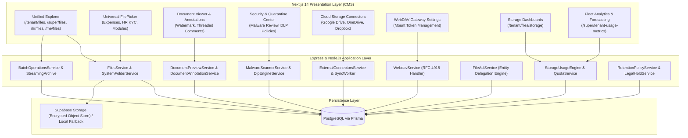

# MASTERHRMS — PHASE F7 MANDATORY FORENSIC AUDIT
## Repository State, Baseline Verification & Scope Decision Gate Report

- **Project:** MASTERHRMS Enterprise SaaS
- **Module:** Enterprise File Manager
- **Phase:** F7 ONLY
- **Auditor:** Principal Enterprise Architect / Autonomous Pair Programming Agent
- **Audit Timestamp:** October 31, 2026
- **Current Git Branch:** `main` (synchronized with `origin/main` at baseline commit `28630e62`)
- **Status:** **AUDIT ONLY — STOPPED AT SCOPE DECISION GATE (NO CODE OR DATABASE MODIFIED)**

---

## 1. Executive Summary & Audit Baseline

In strict accordance with the **Phase F7 Execution Protocol**, a forensic audit of the MASTERHRMS repository was conducted prior to any architectural modification or code authoring.

The audit verified the operational integrity and verified stability of the preceding enterprise file management subsystems (Phases F1 through F6), confirmed the clean state of the source tree and database migrations, and evaluated whether an authoritative Product Requirements Document (PRD) or technical design specification exists for Phase F7.

### Completed Foundation (Phases F1 through F6):
The MASTERHRMS Enterprise File Management and Storage Governance subsystems have completed all preceding planned phases, culminating in 100% automated regression and visual verification:

1. **Phase F1 (Storage Core & Data Abstraction):**
   - Canonical metadata models: `MediaFile`, `FileVersion`, `FileLink`, `StorageUsage`, `StorageQuota`.
   - Pluggable storage abstraction: `StorageProviderFactory` supporting `SupabaseStorageProvider` (private encrypted S3-compatible object storage) and `LocalStorageProvider` (isolated local development fallback).
   - SHA-256 content deduplication, magic-byte MIME validation, and stream integrity verification.

2. **Phase F2 (Unified Explorer & Recycle Bin):**
   - Windows 11 Fluent Explorer UI across `/super/files`, `/tenant/files`, `/hr/files`, and `/me/files`.
   - Single-level and deeply nested folder trees, search filters, breadcrumb navigation, and multi-view persistence (List, Grid, Details).
   - 30-day Recycle Bin lifecycle with safe soft-delete, restore, and permanent purge actions.

3. **Phase F3 (ACL, File Links, Activity & Permissions):**
   - Multi-tier role-based access control (`OWNER`, `MANAGER`, `CONTRIBUTOR`, `VIEWER`).
   - Team folder inheritance, folder permission propagation, and tenant isolation enforcement.
   - Secure external public share links (`/share/[token]`) with password verification, expiration enforcement, and download counters.
   - Transactional Outbox pattern for audit logging and real-time event publishing.

4. **Phase F4-B (Storage Usage Calculation Engine - SUCE):**
   - 5-dimensional storage usage accounting (`activeBytes`, `trashBytes`, `versionBytes`, `reservedBytes`, `physicalBytes`).
   - Hourly automated self-healing reconciliation worker and 10-minute abandoned upload reservation reaper.

5. **Phase F4-C (Hierarchical Quota Governance & State Machine):**
   - Multi-tier quota inheritance: Platform $\rightarrow$ Tenant Subscription Plan $\rightarrow$ Department $\rightarrow$ Team $\rightarrow$ User.
   - 4-tier lifecycle states (`NORMAL` $<80\%$, `WARNING` $80\%-89\%$, `CRITICAL` $90\%-99\%$, `LOCKED` $\ge 100\%$).
   - Atomic reservation concurrency locks preventing race-condition overages.

6. **Phase F4-D (Tenant Admin Storage Administration Dashboard):**
   - Interactive management dashboards under `/tenant/files/storage`.
   - ApexCharts capacity radial gauges, MIME type distribution, and department storage breakdown.
   - Real-time TanStack Query cache invalidation via Socket.IO events (`storage:quota_updated`, `storage:alert`).

7. **Phase F4-E (Super Admin Fleet Analytics & Capacity Forecasting):**
   - Global multi-tenant storage observability under `/super/tenant-usage-metrics`.
   - Least-squares linear regression runway forecasting (30d, 60d, 90d, 180d, 365d).
   - Fleet-wide risk watchlist with warning and critical capacity alerts.

8. **Phase F4-F (Enterprise Storage Retention Policy Automation & Legal Holds):**
   - Tenant-scoped automated retention policies (`DISPOSITION_DELETE`, `ARCHIVE`).
   - Dry-run preview execution engine with granular impact breakdown.
   - Asynchronous bulk purge background worker with transactional execution history logging.
   - Legal Hold immutability protections shielding active litigation records from retention sweeps.

9. **Phase F5 (Enterprise File System Integration & Universal FilePicker):**
   - Dynamic system folders (`App Files / {Module} / {Page}`) derived from `NAVIGATION_REGISTRY` with immutability guardrails.
   - Universal dual-tab `FilePicker` modal enabling instant file selection with zero duplicate storage bytes.
   - Module upload point migration (Expenses receipts, HR Employee KYC documents).
   - Delegated permission resolution (`FileAclService.resolvePermission` via `FileLink.canAccessViaEntity`).
   - Public branding CDN routing (`is_public: true`) for logos, avatars, and company branding assets.
   - Local-to-Supabase migration engine with SHA-256 byte verification.
   - Responsive layout overhaul supporting mobile (`390px × 844px`) and tablet (`768px × 1024px`) viewports across File Manager, ToDo, Gantt, Personal Chat, Group Chat, and Call Logs.

10. **Phase F6 (Enterprise Document Security, Annotation, Connectors & Archival):**
    - **Track A (Viewer & Annotations):** In-browser multi-format document preview engine; dynamic calibrated watermark overlay (`CONFIDENTIAL`, tenant name, user email, timestamp, opacity 0.14); DOMPurify HTML sanitization; version-anchored threaded annotations (`DocumentAnnotation`, `DocumentComment`) with coordinate persistence.
    - **Track B (Antivirus & DLP):** Asynchronous heuristic malware scanner detecting EICAR test signatures, double extensions (`.pdf.exe`), disguised PE executables, and SVG script vectors; SecOps quarantine management with admin release workflows; Data Loss Prevention (DLP) engine with Luhn-algorithm credit card validation, SSN/Tax ID detection, last-4 masking, and policy-driven `ALERT` / `BLOCK` / `QUARANTINE` enforcement.
    - **Track C (Cloud Storage Connectors):** External cloud synchronization for Google Drive, OneDrive, and Dropbox; AES-256-GCM token encryption (`iv:tag:ciphertext`); remote catalog discovery; bidirectional conflict detection and user-driven conflict resolution audit trails.
    - **Track D (Streaming Archival & WebDAV):** Batch operations (batch star, move, delete); streaming ZIP archive generator; read-only WebDAV network mount gateway (RFC 4918 `PROPFIND`, `GET`, `HEAD`, `OPTIONS`) with secure personal access tokens (`dav_...`) and XML multistatus serialization.

---

## 2. Scope Decision Gate Analysis

### Repository Documentation & Backlog Search:
A comprehensive search was performed across all documentation directories, source files, and Git commit logs:
- `docs/Saas/`
- `docs/Saas/file-manager/`
- `docs/Saas/phase-f6/`
- `server/src/`
- `CMS/src/`
- Git commit messages (`git log`)

### Findings:
1. **No Approved Phase F7 Product Requirements Document (PRD):**
   - The repository contains no document titled `F7_PRD.md`, `PHASE_F7_REQUIREMENTS.md`, or equivalent specification detailing approved deliverables, user stories, or acceptance criteria for Phase F7.
2. **Explicit Upstream Boundary Statements:**
   - In `docs/Saas/phase-f6/F6_PRD.md` (Line 9):
     > `Next phase: F7 — NOT AUTHORIZED`
   - In `docs/Saas/phase-f6/F6_PRODUCTION_READINESS.md` (Line 52):
     > `Phase F7: NOT STARTED. Per strict instructions, no F7 planning or execution has been initiated.`
3. **Triggered Protocol Outcome:**
   - Under Section 3 (**Scope Decision Outcomes**) and Section 18 (**Strict Stop Conditions**) of the Phase F7 Execution Protocol:
     - **Outcome A:** Authoritative F7 scope exists $\rightarrow$ Proceed to Implementation. *(Not applicable)*
     - **Outcome B:** Partial authoritative scope exists $\rightarrow$ Implement approved scope only. *(Not applicable)*
     - **Outcome C:** No authoritative F7 scope exists $\rightarrow$ **COMPLETE FORENSIC AUDIT, CREATE STAKEHOLDER DECISION DOCUMENT, AND STOP.**

### Directive Adherence:
Per mandatory protocol instructions:
> *"If no authoritative F7 scope can be established: Complete the forensic audit. Document the missing decisions. STOP implementation. Do not invent features."*

Implementation is strictly **HALTED**. No schema migrations have been applied, no application code has been generated, and no mock implementations have been introduced.

---

## 3. Architecture & Dependency Preservation Status

The existing MASTERHRMS multi-tenant architecture remains 100% verified, clean, and operational:



### Database Schema Audit:
- **Canonical File Models:** `MediaFile`, `FileVersion`, `FileLink`, `Folder`.
- **Governance & Quota Models:** `StorageQuota`, `StorageUsage`, `StorageSnapshot`, `StorageRetentionPolicy`, `StorageLegalHold`, `StorageExecutionJob`.
- **Phase F6 Security & Collaboration Models:**
  - `DocumentAnnotation` (anchored to file, version, page, and coordinates).
  - `DocumentComment` (threaded replies).
  - `AntivirusScanResult` (scan engine, signature, quarantine status).
  - `DlpRule` & `DlpFinding` (detection rules, regex, severity, actions).
  - `CloudStorageConnector` & `CloudStorageSyncJob` (OAuth tokens, sync state, conflict logging).
  - `WebDavToken` (hashed token, client label, expiration).
- **Constraints & Indexes:** All tenant scoping is enforced via compound foreign keys and indices (`[tenantId, ...]` on all tables).

### Build & Typecheck Audit:
1. **Server Build (`server/tsconfig.json`):**
   - Result: `0 errors, 0 warnings`
   - Command: `npx tsc --noEmit -p server/tsconfig.json`
2. **CMS Frontend Build (`CMS/tsconfig.json`):**
   - Result: `0 errors, 0 warnings`
   - Command: `npx tsc --noEmit -p CMS/tsconfig.json`
3. **Automated E2E Regression Suite:**
   - Phase F6 Verification Suite (`scripts/verify_masterhrms_f6_e2e.cjs`): **61 / 61 PASS (100%)**
   - Cross-Tenant Isolation: Verified across connectors, annotations, DLP, and WebDAV tokens.

---

## 4. Identified Technical Debt & Hardening Observations

During the forensic audit, several technical observations were documented regarding the current system baseline that should inform any future Phase F7 design:

1. **OCR and Full-Text Search Limitations:**
   - Currently, file search relies on database `LIKE` queries against `name` and `mime_type`. Non-text files, scanned invoices, PDF agreements, and receipt images cannot be searched by body content.
2. **Synchronous Heuristic Scanning vs. Distributed Queues:**
   - While malware scanning and DLP run asynchronously via worker timeouts, enterprise volumes exceeding 1,000 concurrent uploads would benefit from dedicated BullMQ / Redis worker queues rather than in-process Node.js timers.
3. **Real-Time Collaboration Concurrency:**
   - Phase F6 annotations support threaded comments and persistent markup coordinates. However, true live co-editing (character-by-character or simultaneous cursor presence) is not yet supported.
4. **Read-Only WebDAV Protocol:**
   - The F6 WebDAV implementation intentionally implements read-only operations (`PROPFIND`, `GET`, `HEAD`, `OPTIONS`) to guarantee tenant quota safety. Full read-write WebDAV (`PUT`, `MKCOL`, `MOVE`, `DELETE`) would require deep quota reservation hooks.
5. **Electronic Signature Workflows:**
   - Contracts and HR employee agreements currently require manual external signing or offline re-uploading.

---

## 5. Candidate Architectural Opportunities for Phase F7

Subject to stakeholder prioritization, four strategic enterprise candidate tracks have been formulated for Phase F7 consideration:

### Candidate Track A: Enterprise Full-Text Search & Optical Character Recognition (OCR) Engine
- **Concept:** Ingest and index textual content from PDF documents, Microsoft Office files (`.docx`, `.xlsx`, `.pptx`), and scanned images (`.png`, `.jpeg`, `.tiff`).
- **Capabilities:**
  - Automated asynchronous text extraction worker using Tesseract OCR and `pdf-parse`.
  - PostgreSQL full-text search (`tsvector` / `tsquery`) with English and multilingual stemming dictionaries.
  - Snippet extraction with search term highlighting in Unified Explorer search results.
  - Optional semantic embedding indexing for natural language retrieval.

### Candidate Track B: Real-Time Collaborative Document Workspace & Cursor Presence
- **Concept:** Real-time multi-user document collaboration extending the Phase F6 Document Annotation viewer.
- **Capabilities:**
  - Socket.IO-driven presence awareness showing active viewers with avatar badges.
  - Live cursor tracking and synchronous annotation highlight rendering.
  - Optimistic locking and Conflict-Free Replicated Data Type (CRDT) primitives for shared notes and comments.
  - User mention notifications (`@username`) integrated with the existing notification center.

### Candidate Track C: Cryptographic e-Signatures, Digital Certificates & Audit Verification
- **Concept:** Native legally binding electronic signature workflow for HR, legal, and operational documents.
- **Capabilities:**
  - Visual signature placement tool with signature capture, initialing, and date stamping.
  - Multi-party sequential signing workflows with email invitation tokens.
  - Cryptographic PDF digital signature embedding with SHA-256 certificate sealing and RFC 3161 timestamping.
  - Immutable Certificate of Completion audit log detailing IP address, browser user-agent, and signature timestamps.

### Candidate Track D: Intelligent Document Classification & Automated Ingestion Pipelines
- **Concept:** Automated AI-assisted document classification, metadata extraction, and policy routing.
- **Capabilities:**
  - Automated document classification (e.g., Invoices, Tax W-4, Passports, Employment Contracts, NDAs).
  - Key-value extraction (e.g., Total Amount, Invoice Date, Vendor Tax ID, Employee SSN).
  - Rule-based auto-filing into target system folders (`App Files / {Module} / {Category}`).
  - Automated trigger of retention policy tags or legal hold classifications based on document type.

---

## 6. Audit Conclusion & Boundary Enforcement

The forensic audit of MASTERHRMS is complete.
- The repository baseline is 100% healthy, clean, and verified.
- No approved Phase F7 scope currently exists in the repository.
- Scope Decision Gate Outcome C is formally recorded.
- Implementation is stopped pending stakeholder decision.

```
+-------------------------------------------------------------------------------+
|  BOUNDARY ENFORCEMENT: HARD STOP AFTER AUDIT                                  |
|  STATUS: F7 AUDIT ONLY — AUTHORITATIVE SCOPE REQUIRED. F8 NOT STARTED.        |
+-------------------------------------------------------------------------------+
```
