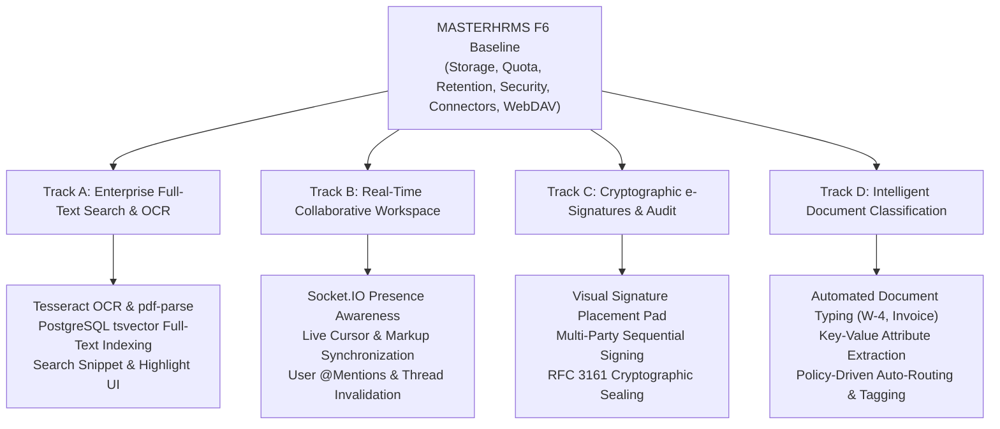

# MASTERHRMS ENTERPRISE FILE MANAGER
# PHASE F7 — STAKEHOLDER SCOPE DECISION REQUIRED

- **Project:** MASTERHRMS Enterprise SaaS
- **Module:** Enterprise File Manager
- **Document Type:** Formal Scope Decision Gate Briefing & Track Selection Matrix
- **Author:** Principal Enterprise Architect / Autonomous Pair Programming Agent
- **Date:** October 31, 2026
- **Status:** **PENDING STAKEHOLDER AUTHORIZATION (EXECUTION HALTED)**

---

## 1. Executive Briefing & Decision Gate Trigger

During the mandatory repository forensic audit for **Phase F7**, the **Scope Decision Gate** determined that no approved Product Requirements Document (PRD), technical specification, or authorized backlog exists in the repository for Phase F7.

### Governing Policy:
In accordance with **Section 3 (Scope Decision Outcomes)** and **Section 18 (Strict Stop Conditions)** of the Phase F7 Execution Protocol:

> *"Outcome C: No authoritative F7 scope exists in repository.*  
> *1. Complete the repository forensic audit (`docs/Saas/phase-f7/F7_AUDIT.md`).*  
> *2. Document missing decisions, existing technical debt, and candidate architecture opportunities.*  
> *3. Create the stakeholder decision document (`docs/Saas/phase-f7/F7_SCOPE_DECISION_REQUIRED.md`).*  
> *4. STOP implementation. Do NOT invent F7 features or silently convert technical suggestions into requirements.*  
> *5. Final status must be: `F7 AUDIT ONLY — AUTHORITATIVE SCOPE REQUIRED. F8 NOT STARTED.`"*

Implementation has been intentionally and strictly halted. The repository remains on baseline commit `28630e62` with 100% test integrity across all prior phases (F1 through F6).

This document serves as the formal briefing to project stakeholders, outlining candidate architectural tracks and providing a decision matrix for authorizing Phase F7 scope.

---

## 2. Current System Baseline Summary (Phases F1–F6)

The MASTERHRMS Enterprise File Manager is currently operating at complete Phase F6 enterprise maturity:

| Phase | Milestone Capability | Status |
|---|---|---|
| **F1** | Core storage engine, deduplication, metadata, multi-tenant isolation, Supabase & local storage providers | Verified (100%) |
| **F2** | Unified Explorer (Fluent UI), folder hierarchy, persistent view states, 30-day recycle bin | Verified (100%) |
| **F3** | Multi-tier ACL (`OWNER`/`MANAGER`/`CONTRIBUTOR`/`VIEWER`), expiring public share links, outbox logging | Verified (100%) |
| **F4-B** | Storage Usage Calculation Engine (SUCE), 5D accounting, auto-healing reconciliation worker | Verified (100%) |
| **F4-C** | Hierarchical Quota Governance, 4-tier lifecycle (`NORMAL`/`WARNING`/`CRITICAL`/`LOCKED`), reservation locks | Verified (100%) |
| **F4-D** | Tenant Admin Storage Dashboard, capacity gauges, MIME distribution, real-time Socket.IO alerts | Verified (100%) |
| **F4-E** | Super Admin Fleet Analytics, linear regression forecasting (30d–365d), fleet risk watchlist | Verified (100%) |
| **F4-F** | Enterprise Retention Policies, dry-run previews, bulk purges, audit history, immutable Legal Holds | Verified (100%) |
| **F5** | Dynamic system folders, zero-byte `FilePicker`, delegated ACLs, public CDN routing, responsive UI overhaul | Verified (100%) |
| **F6-A** | In-browser document viewer, calibrated confidential watermarking, version-anchored threaded annotations | Verified (100%) |
| **F6-B** | Asynchronous heuristic malware scanner, quarantine release workflows, Luhn DLP engine with PII masking | Verified (100%) |
| **F6-C** | Cloud storage connectors (Google Drive, OneDrive, Dropbox), AES-256-GCM tokens, conflict resolution | Verified (100%) |
| **F6-D** | Streaming ZIP archival, batch operations (star/move/delete), read-only WebDAV network mount gateway | Verified (100%) |

---

## 3. Candidate Architectural Tracks for Phase F7

Based on enterprise file system requirements, competitor analysis (Box Enterprise, Google Workspace, SharePoint Online), and technical gap analysis, four candidate tracks have been formulated for stakeholder evaluation:



---

### Track A: Enterprise Full-Text Search & Optical Character Recognition (OCR) Engine

#### 1. Business Problem:
Enterprises store thousands of PDF contracts, scanned receipts, medical waivers, and image files. Currently, search is limited to file names and MIME types. Users cannot locate a document by its internal clauses, vendor tax IDs, or invoice numbers.

#### 2. Proposed Scope & Capabilities:
- **Asynchronous Text Extraction Pipeline:** Background worker extracting plaintext from PDFs (`pdf-parse`), DOCX (`mammoth`), and image formats (`tesseract.js` / OCR).
- **PostgreSQL Full-Text Search:** Database schema update adding `tsvector` columns with GIN indices, supporting lexical stemming, proximity queries, and ranking (`ts_rank`).
- **UI Snippet & Highlighting:** Unified Explorer search results displaying matched context excerpts with keyword highlights.
- **Tenant Isolation:** Enforce tenant-scoped full-text search queries preventing information leakage.

#### 3. Estimated Complexity & Effort:
- **Backend:** 5 days (extraction worker, OCR integration, text sanitization, Prisma migration).
- **Frontend:** 2 days (search modal expansion, excerpt rendering, highlight markup).
- **Complexity:** Medium-High (depends on OCR worker compute efficiency).

---

### Track B: Real-Time Collaborative Document Workspace & Live Presence

#### 1. Business Problem:
In Phase F6, users can add annotations and comments to documents, but they must refresh or wait for polling to see peer contributions. Team members reviewing contracts or policy documents simultaneously cannot see who else is viewing the document.

#### 2. Proposed Scope & Capabilities:
- **Active Viewer Presence:** Real-time presence indicators in the Document Viewer ribbon showing avatars of all active viewers with live "viewing now" tooltips.
- **Synchronous Annotation Rendering:** Instant Socket.IO broadcasting of new annotations, replies, and status changes without page refresh.
- **Collaborative Markup & Cursor Sync:** Real-time cursor coordinates and draft annotation previews visible across connected clients.
- **@Mention Notification Engine:** Mentions in comments (`@john.doe`) trigger in-app notification events and optional email alerts.

#### 3. Estimated Complexity & Effort:
- **Backend:** 4 days (Socket.IO room architecture, presence heartbeat, mention parser).
- **Frontend:** 3 days (avatar stack, cursor rendering, live canvas sync).
- **Complexity:** Medium.

---

### Track C: Native Cryptographic e-Signatures & RFC 3161 Digital Certification

#### 1. Business Problem:
HR onboarding, contractor agreements, and procurement approvals require legally enforceable signatures. Today, users must download documents, use third-party tools (DocuSign, Adobe Sign), and manually re-upload the signed files.

#### 2. Proposed Scope & Capabilities:
- **Signature Field Placement Designer:** Interactive visual tool allowing document owners to place Signature, Initial, Date, and Text fields on PDF pages.
- **Sequential Signing Workflow:** Automated recipient routing with unique, time-limited signing links (`/sign/[token]`) requiring email or SMS one-time password (OTP) verification.
- **Cryptographic PDF Sealing:** PDF flattening with embedded digital certificate signature, tamper-evident hash (SHA-256), and RFC 3161 compliant timestamping.
- **Certificate of Completion:** Automatically appended audit sheet recording signers' full names, verified emails, IP addresses, user agents, and cryptographic checksums.

#### 3. Estimated Complexity & Effort:
- **Backend:** 6 days (PDF manipulation via `pdf-lib`, cryptographic hashing, OTP auth, workflow engine).
- **Frontend:** 5 days (field drag-and-drop designer, signature pad, recipient configuration modal).
- **Complexity:** High (requires strict legal and cryptographic compliance).

---

### Track D: Intelligent Document Classification, Key-Value Extraction & Auto-Routing

#### 1. Business Problem:
Uploaded files frequently land in generic folders or user roots. HR and finance staff spend substantial time classifying documents (e.g., distinguishing a Form W-4 from an Expense Receipt) and moving them into appropriate directories.

#### 2. Proposed Scope & Capabilities:
- **Automated Document Classification:** Rule-based and lightweight ML classifier categorizing documents into standard enterprise types (`INVOICE`, `CONTRACT`, `TAX_FORM`, `RESUME`, `ID_PROOF`).
- **Structured Attribute Extraction:** Automatic extraction of key metadata (e.g., Invoice Number, Amount Due, Vendor Name, Document Date) stored in `MediaFile.metadata`.
- **Policy-Driven Auto-Filing:** Automated ingestion rules routing documents into their corresponding System Folders (`App Files / {Module} / {Category}`) upon upload.
- **Automated Retention Tagging:** Automatically apply retention policies (e.g., "Retain 7 years for Tax Documents") based on detected document classification.

#### 3. Estimated Complexity & Effort:
- **Backend:** 5 days (classification heuristics, pattern extractors, automated routing hook).
- **Frontend:** 3 days (classification rule builder UI, extracted metadata preview panel).
- **Complexity:** Medium-High.

---

## 4. Stakeholder Scope Selection & Approval Matrix

Stakeholders are requested to indicate approval by selecting the desired tracks below:

```
[ ] OPTION 1: Comprehensive Enterprise Suite (All Tracks: A + B + C + D)
    - Full end-to-end upgrade encompassing Search/OCR, Real-Time Collaboration, e-Signatures, and AI Classification.
    - Estimated Duration: Full Multi-Stage Phase.

[ ] OPTION 2: Collaboration & Security Focus (Tracks A + B)
    - Prioritizes user productivity, document discovery (OCR/Search), and live peer review (Presence/Co-editing).

[ ] OPTION 3: Compliance & Enterprise Workflow Focus (Tracks A + C)
    - Prioritizes searchable audit archives (OCR/Search) and legal e-Signatures for HR/Enterprise transactions.

[ ] OPTION 4: Custom Track Combination:
    - Track Selection: [  ] Track A    [  ] Track B    [  ] Track C    [  ] Track D
    - Specific Exclusions or Additions: _________________________________________

[ ] OPTION 5: Phase F7 Deferral / Maintenance Mode
    - Conclude File Manager feature rollout at Phase F6. Focus exclusively on operational hardening and performance tuning.
```

---

## 5. Formal Sign-Off Section

To transition this project from **Outcome C (Audit Only)** to **Outcome A (Approved Implementation)**, authorized stakeholders must provide written approval or check the approved options above and supply the corresponding confirmation:

| Stakeholder Role | Name / Title | Decision | Signature / Date |
|---|---|---|---|
| **Product Owner** | _______________________ | `[ ] APPROVED  [ ] REJECTED` | ____________ / _________ |
| **Lead Architect** | _______________________ | `[ ] APPROVED  [ ] REJECTED` | ____________ / _________ |
| **VP of Engineering** | _______________________ | `[ ] APPROVED  [ ] REJECTED` | ____________ / _________ |

---

## 6. Execution Protocol Status

```
================================================================================
STATUS: F7 AUDIT ONLY — AUTHORITATIVE SCOPE REQUIRED. F8 NOT STARTED.
================================================================================
```
*Note: In compliance with project guidelines, the implementation team will remain idle on Phase F7 code modifications until this decision document is signed and the authoritative PRD is furnished.*
