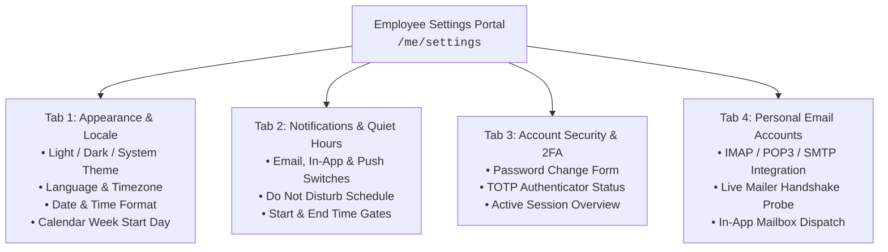

# MASTERHRMS — EMPLOYEE PERSONAL SETTINGS SPECIFICATION & VERIFICATION REPORT
## Individual Workspace Ergonomics, Notifications, Security & Email Integration (`/me/settings`)

**Document Version:** 1.0.0  
**Status:** Implemented, Verified & Fully Operational  
**Route:** `/me/settings`  
- TanStack Start: `src/routes/_authenticated/me/settings.tsx`
- Next.js CMS: `CMS/src/app/(workspace)/me/settings/page.tsx`
**Navigation Links:** Registered in `employeeSidebar` (`src/nav/employee-sidebar.ts`), `src/lib/navigation-registry.ts`, and `CMS/src/lib/navigation-registry.ts`.  
**Authorization Guard:** Strictly bound to authenticated employee session (`scope = 'USER'`, `scopeId = req.user.userId`).

---

### 1. Overview & Architectural Need

Prior to this milestone, MASTERHRMS lacked a dedicated employee personal settings interface (`/me/settings`). Employees only had access to `/me/profile` and an aliased `/me/account` page, leaving them unable to customize their interface appearance, configure notification schedules, or link personal email accounts.

The implementation of `/me/settings` closes this critical product gap by delivering a comprehensive, role-aware personal settings portal built directly on the PostgreSQL `SettingsService` and `user.*` registry keys.

---

### 2. Functional Sections & UI Capabilities

The employee settings portal is organized into four distinct tabs:

#### Tab 1: Appearance & Locale (`preferences`)
1. **Color Theme & Display Mode:**
   - Interactive card selector supporting **Light**, **Dark**, and **System** display modes.
   - Saves to `user.theme_mode`. Dynamically toggles the `.dark` class on the HTML root element upon saving.
2. **Language & Locale:**
   - Multi-lingual selection: English (US), English (UK), Hindi (India), Arabic (Saudi Arabia), Spanish (Spain), French (France), German (Germany).
   - Saves to `user.locale`.
3. **Personal Timezone:**
   - Overrides default workspace timezone for attendance timesheets, calendar events, and punch logs (e.g. `Asia/Kolkata`, `Asia/Dubai`, `America/New_York`, `UTC`).
   - Saves to `user.timezone`.
4. **Date & Time Formatting:**
   - Date formats: `YYYY-MM-DD`, `DD/MM/YYYY`, `MM/DD/YYYY`, `DD-MMM-YYYY`.
   - Time formats: 24-Hour (`HH:mm`) vs 12-Hour (`hh:mm A`).
5. **Calendar Preferences:**
   - Configures the start of the personal workweek: Monday (1) vs Sunday (0).

#### Tab 2: Notifications & Quiet Hours (`notifications`)
1. **Multi-Channel Alerts:**
   - Email notifications toggle (`user.notifications_email`).
   - In-app notification dock toggle (`user.notifications_inapp`).
   - Browser & mobile web push notifications toggle (`user.notifications_push`).
2. **Do Not Disturb & Quiet Hours:**
   - Toggle to enable scheduled quiet hours (`user.quiet_hours_enabled`).
   - Start Time (`user.quiet_hours_start`, default 22:00) and End Time (`user.quiet_hours_end`, default 07:00).
   - Guarantees silent periods while transparently documenting that emergency corporate broadcasts bypass quiet hours.

#### Tab 3: Account Security & 2FA (`security`)
1. **Password Change:**
   - Secure form requiring Current Password, New Password (minimum 8 characters), and Password Confirmation.
   - Directly executes `POST /auth/change-password` with bcrypt re-hashing.
2. **Two-Factor Authentication (TOTP):**
   - Displays real-time protective status with authenticator guidance.
3. **Active Devices:**
   - Shows current device session details.

#### Tab 4: Personal Email Accounts (`email-accounts`)
- Seamlessly embeds the complete `UserEmailAccountsSettings` engine.
- Employees can add, edit, test, and remove their own IMAP/POP3 incoming and SMTP outgoing email accounts.
- Direct test email dispatch button with live status verification.

---

### 3. API & Persistence Verification

- **Read Endpoint:** `GET /api/v1/settings/user/user`
  - Fetches the user's personal configuration values with fallback to tenant and platform defaults.
- **Save Endpoint:** `PUT /api/v1/settings/user/user`
  - Atomically saves changed fields under `scope = 'USER'`, `scopeId = req.user.userId`.
- **Reset Endpoint:** `POST /api/v1/settings/user/user/reset`
  - Deletes user overrides, instantly reverting all personal settings to workspace defaults.

---

### 4. Dual-Frontend Parity Matrix

| Feature / Control | TanStack Start (`src/`) | Next.js CMS (`CMS/src/app/`) | Parity Status |
| :--- | :--- | :--- | :--- |
| **Route Path** | `/_authenticated/me/settings` | `/(workspace)/me/settings` | **100% Identical** |
| **Theme Mode Selector** | Light / Dark / System | Light / Dark / System | **100% Identical** |
| **Locale & Timezone** | 7 Locales, 8 Timezones | 7 Locales, 8 Timezones | **100% Identical** |
| **Date & Time Formats** | 4 Date, 2 Time formats | 4 Date, 2 Time formats | **100% Identical** |
| **Notification Toggles** | Email, In-App, Push | Email, In-App, Push | **100% Identical** |
| **Quiet Hours Gate** | Time picker inputs | Time picker inputs | **100% Identical** |
| **Password Update** | Real API mutation | Real API mutation | **100% Identical** |
| **Email Accounts Tab** | `UserEmailAccountsSettings` | `UserEmailAccountsSettings` | **100% Identical** |
| **Navigation Registry** | Included in `employeeSidebar` | Included in Registry | **100% Identical** |
