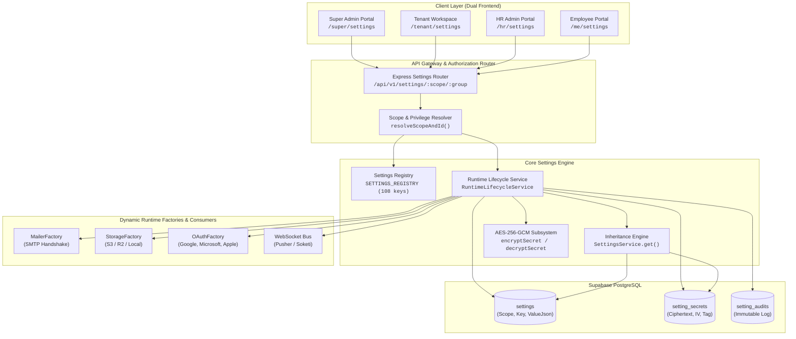
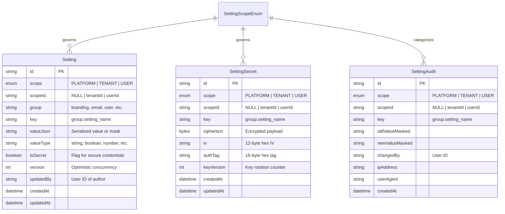

# MASTERHRMS — SETTINGS PLATFORM ARCHITECTURE SPECIFICATION
## Comprehensive Multi-Tier, Role-Aware Configuration Architecture

**Document Version:** 1.0.0  
**Status:** Approved & Implemented  
**Scope:** Super Admin (`/super/settings`), Tenant Admin (`/tenant/settings`), HR Admin (`/hr/settings`), Employee (`/me/settings`)  
**Target Repository:** `Webfamily-06/masterhrms`  
**Primary Branch:** `main`  

---

### 1. Architectural Philosophy & Core Tenets

The MASTERHRMS Settings Platform is engineered upon five foundational architectural tenets:

1. **Unified Persistence with Multi-Scope Partitioning:** Configuration does not reside in disparate, fragmented tables or hardcoded environment variables. All application settings persist in normalized, relational tables (`settings`, `setting_secrets`, and `setting_audits`) governed by strict scoping (`PLATFORM`, `TENANT`, `USER`).
2. **Deterministic Inheritance Hierarchy:** When an application module requests a configuration value, the inheritance resolver applies a strict four-stage fallback cascade:
   $$\text{USER Scope} \longrightarrow \text{TENANT Scope} \longrightarrow \text{PLATFORM Scope} \longrightarrow \text{Registry Schema Default}$$
3. **Defense-in-Depth Cryptographic Isolation:** Plaintext secrets never reside in public configuration storage or API responses. High-entropy credentials (passwords, private keys, API secrets) are encrypted using authenticated AES-256-GCM with unique 96-bit Initialization Vectors (IV) and 128-bit authentication tags.
4. **Reactive Runtime Lifecycle Synchronization:** Updates trigger immediate in-memory cache invalidation, dynamic factory re-instantiation (`MailerFactory`, `StorageFactory`, `OAuthFactory`, `SmsFactory`), and real-time WebSocket notifications across active tenant browser sessions.
5. **Dual-Frontend Feature Parity:** Identical configuration interfaces, real-time feedback loops, and validation contracts are implemented across both the TanStack Start (`src/`) and Next.js CMS (`CMS/`) application layers.

---

### 2. High-Altitude Architecture Diagram

---

### 3. Database Schema & Storage Model

#### 3.1 Entity Relationship Model

#### 3.2 Indexing & Multi-Tenant Partitioning
- **Composite Unique Constraint:** `@@unique([scope, scopeId, key])` guarantees strict atomic uniqueness. Overrides cannot collide between tenants or users.
- **Group Index:** `@@index([scope, scopeId, group])` enables instant sub-millisecond retrieval of all configuration keys within an active category.

---

### 4. Settings Registry (`SETTINGS_REGISTRY`)

The registry in `server/src/services/settings/settings-registry.ts` defines all valid system keys, data types, permissible scopes, default fallback values, and real-time broadcast topics:

| Group | Key Count | Allowed Scopes | Description |
| :--- | :---: | :--- | :--- |
| **`branding`** | 7 | `PLATFORM`, `TENANT` | App name, support email, brand accent color, light/dark logos, favicon |
| **`locale`** | 5 | `PLATFORM`, `TENANT`, `USER` | Timezone, date format, time format, default currency, default language |
| **`user`** | 12 | `USER` | Personal theme mode, locale, timezone, date/time formats, notification switches, quiet hours, week start |
| **`appearance`** | 3 | `PLATFORM`, `TENANT` | Default tenant theme, sidebar layout, display density |
| **`seo`** | 4 | `PLATFORM` | Meta title, description, canonical domain, robots index directive |
| **`invoicing`** | 3 | `PLATFORM`, `TENANT` | Default billing cycle interval, auto-posting rules, standard terms |
| **`ai`** | 4 | `PLATFORM`, `TENANT` | Provider, model identifier, API secret, tenant token allocation |
| **`email`** | 10 | `PLATFORM`, `TENANT` | SMTP host, port, authentication, encryption, sender identity |
| **`oauth`** | 10 | `PLATFORM` | Social logins (Google, Microsoft, Apple, GitHub) Client IDs & Secrets |
| **`storage`** | 8 | `PLATFORM`, `TENANT` | Local storage, AWS S3, Cloudflare R2 bucket configurations |
| **`security`** | 9 | `PLATFORM`, `TENANT` | Password strength, session lifetimes, MFA enforcement, IP filters |
| **`payments`** | 13 | `PLATFORM`, `TENANT` | Razorpay, Stripe, PayPal API keys, webhook signing secrets |
| **`system`** | 3 | `PLATFORM` | Emergency maintenance mode, system banners, diagnostics |
| **`hr`** | 6 | `PLATFORM`, `TENANT` | Employee ID prefix rules, sequence counters, formatting delimiters |
| **Total** | **108** | — | **Exhaustive coverage of enterprise configuration** |

---

### 5. Role-Aware Scopes & Access Boundaries

#### 5.1 Super Admin (`/super/settings`)
- **Authority:** Full global jurisdiction over `PLATFORM` and tenant fallback defaults.
- **Exclusive Capabilities:** OAuth provider configuration, platform payment gateway keys, global SEO and maintenance mode activation, tenant quota limits.
- **RBAC Guard:** `requireAuth` + `req.user.roles.includes("super_admin")`.

#### 5.2 Tenant Admin (`/tenant/settings`)
- **Authority:** Workspace-level overrides for company identity, custom domain mailers, tenant storage buckets, and payment accounts.
- **Inheritance Visuals:** UI clearly identifies whether a value is inherited from Platform defaults or actively overridden by the tenant, with one-click "Revert to Default" capability.
- **RBAC Guard:** Restricted to `admin`, `tenant_admin`, `owner`, or users with `settings.manage`. Regular employees receive `403 Forbidden` on mutation attempts.

#### 5.3 HR Admin (`/hr/settings`)
- **Authority:** Operational and human capital configuration: employee ID generation patterns, shift timing and grace periods, statutory payroll formulas, leave quotas, approval workflows, custom fields.
- **Privilege Separation:** HR Admins cannot modify platform-level OAuth, billing subscriptions, or root infrastructure keys.

#### 5.4 Employee / Individual (`/me/settings`)
- **Authority:** Personal workspace ergonomics: UI theme (light/dark/system), individual timezone and calendar week start, notification channels, quiet hours scheduling, personal credential updates, and IMAP/SMTP personal email connections (`UserEmailAccount`).
- **Security Boundary:** Bound strictly to `req.user.userId`. Users can never access or mutate other users' preferences.

---

### 6. Cryptography & Security Subsystem

- **Cipher Algorithm:** `AES-256-GCM` (Galois/Counter Mode) authenticated encryption.
- **Master Encryption Key:** Sourced from `SETTINGS_ENCRYPTION_KEY` environment secret (32-byte cryptographic key).
- **IV Generation:** Cryptographically random 12-byte (96-bit) IV generated per write operation via `crypto.randomBytes(12)`.
- **Integrity Tag:** 16-byte (128-bit) authentication tag verified on every decryption attempt to prevent ciphertext tampering.
- **Masking Protocol:** Read endpoints automatically mask secret fields (`{ set: true, masked: "••••••••" }`). Plaintext secrets are never serialized into client responses.

---

### 7. Realtime Synchronization & Cache Architecture

- **In-Memory TTL Cache:** L1 read cache maintained with 60-second TTL to minimize database roundtrips during high-concurrency requests.
- **Instant Mutation Invalidation:** When a setting is saved, the in-memory cache for `[scope, scopeId, group]` is instantly evicted.
- **WebSocket Broadcast:** `broadcastToTenant(tenantId, "settings-updated", { scope, group })` broadcasts updates across all active client tabs.
- **Hot-Reload in Browser:** The frontend listens to `settings-updated` custom events, automatically refreshing query caches without requiring a page reload.
