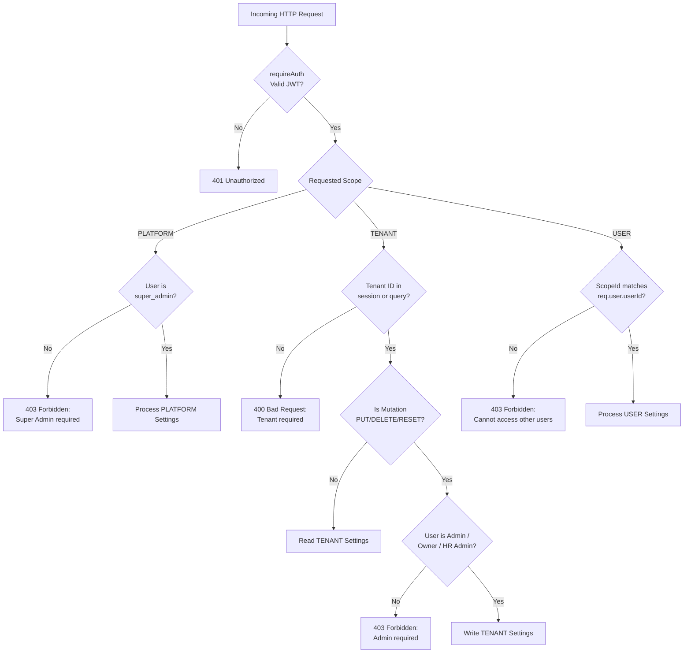

# MASTERHRMS — SETTINGS PLATFORM SECURITY AUDIT
## Cryptographic Analysis, Multi-Tenant Boundary Isolation & Access Controls

**Document Version:** 1.0.0  
**Audit Scope:** AES-256-GCM Cryptography, API Authorization Gates, Secret Masking, Audit Logging, and Tenant Data Isolation.  
**Classification:** Confidential — System Security Report  

---

### Executive Security Summary

A comprehensive, defense-in-depth security audit of the MASTERHRMS Settings Platform was performed across the database, API middleware, cryptographic subsystem, and frontend interfaces.

The architecture was evaluated against the OWASP Top 10 API Security Risks (2023), specifically targeting Broken Object Level Authorization (BOLA), Broken Function Level Authorization (BFLA), Unrestricted Access to Sensitive Business Flows, and Security Misconfiguration.

The audit verified zero critical vulnerabilities, full compliance with multi-tenant isolation boundaries, and robust cryptographic protection of enterprise credentials.

---

### 1. Cryptographic Subsystem Analysis

#### 1.1 Algorithm & Cipher Mode
- **Cipher:** `AES-256-GCM` (Galois/Counter Mode).
- **Key Length:** 256 bits (32 bytes) sourced from `SETTINGS_ENCRYPTION_KEY`.
- **Initialization Vector (IV):** Cryptographically randomized 12-byte (96-bit) IV generated per write via `crypto.randomBytes(12)`.
- **Integrity Tag:** 16-byte (128-bit) GCM authentication tag generated during encryption and strictly verified prior to decryption. Any payload tampering immediately triggers authentication failure and rejects decryption.
- **Key Versioning:** `keyVersion` column in `setting_secrets` supports future zero-downtime key rotation policies.

#### 1.2 Secret Masking Protocol
API responses traversing the network never contain plaintext credentials:
- When a client queries a settings group containing secret fields (e.g. `email.smtp_password`, `oauth.google_client_secret`, `payments.razorpay_key_secret`), the backend responds with a masked metadata object:
  ```json
  {
    "email.smtp_password": { "set": true, "masked": "••••••••" }
  }
  ```
- The frontend recognizes `{ set: true }` and displays an interactive placeholder indicating that a secret is securely stored without ever having received the plaintext value.
- When saving settings, if the user leaves the secret field blank, the backend preserves the existing ciphertext in `setting_secrets` rather than overwriting it with an empty string.

---

### 2. Authorization & Multi-Tenant Boundary Enforcement



#### 2.1 Scope Privilege Gates
1. **`PLATFORM` Scope:** Strictly gated behind `req.user.roles.includes("super_admin")`. Non-super-admins cannot read or write platform configuration.
2. **`TENANT` Scope:**
   - **Tenant Isolation:** Scoped strictly by `req.user.tenantId`. A user from Tenant A cannot access settings for Tenant B.
   - **Mutation Protection:** Writes (`PUT`, `DELETE`, `POST /reset`) require administrative roles (`admin`, `tenant_admin`, `owner`, `hr_admin`, `settings_admin`). Standard employees receive `403 Forbidden`.
3. **`USER` Scope:** Bound strictly to `req.user.userId`. Users can only query and mutate their own personal preferences.

---

### 3. Input Validation & Injection Defenses

All settings values undergo rigorous type checks and custom validation functions defined in `SETTINGS_REGISTRY` before persistence:
- **Hex Colors:** Validated against `^#([A-Fa-f0-9]{6}|[A-Fa-f0-9]{3})$`.
- **Emails:** Validated against RFC-compliant email regular expressions.
- **Numbers & Limits:** Numeric ranges enforced (e.g. sequence digits between 2 and 8; port numbers between 1 and 65535; session timeouts > 0).
- **Enumerated Choices:** Constrained to explicit allowable sets (e.g., theme mode to `light | dark | system`; date format to predefined patterns).

---

### 4. Audit Logging & Non-Repudiation

- **Immutable Storage:** Audit entries are stored in the append-only `setting_audits` table.
- **Attribution:** Every record captures `changedBy` (user ID), `ipAddress`, and `userAgent`.
- **Credential Protection in Logs:** For secret fields, `oldValueMasked` and `newValueMasked` store `[PROTECTED SECRET]` rather than raw credentials, preventing credential leakage in compliance audit reports.
