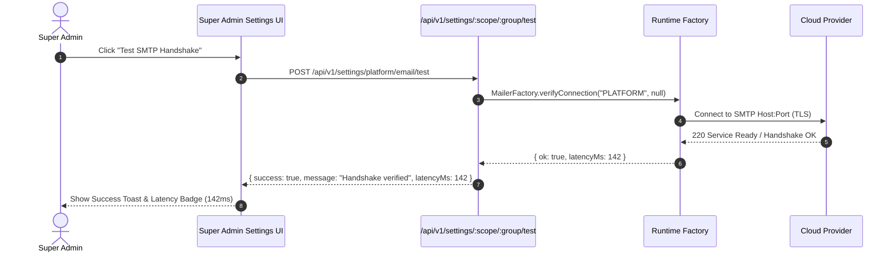

# MASTERHRMS — SUPER ADMIN SETTINGS SPECIFICATION & VERIFICATION REPORT
## Platform-Wide Governance, Infrastructure, Security & Real-Time Probes (`/super/settings`)

**Document Version:** 1.0.0  
**Status:** Verified & Operational  
**Route:** `/super/settings` (TanStack: `src/routes/_authenticated/super/settings.tsx`, Next.js CMS: `CMS/src/app/super/settings/page.tsx`)  
**Authorization Guard:** `PLATFORM` scope requires active session with role `super_admin`.

---

### 1. Overview & Architectural Scope

The Super Admin Settings experience (`/super/settings`) is the authoritative platform governance interface for MASTERHRMS. It establishes global defaults, controls multi-tenant isolation parameters, configures external cloud infrastructure providers, and executes real-time diagnostic health probes.

Every setting managed in `/super/settings` is backed by the PostgreSQL `settings`, `setting_secrets`, and `setting_audits` tables, managed via `SettingsService` and `RuntimeLifecycleService`.

---

### 2. Category & Tab Breakdown

The Super Admin interface organizes 16 groups across 4 primary enterprise categories:

#### Category 1: Brand & Identity (`identity`)
1. **S3 Runtime Settings (`runtime-factories`):**
   - Direct gateway to the 9-category runtime factories (`MailerFactory`, `StorageFactory`, `OAuthFactory`, `SmsFactory`, etc.).
   - Interactive live connection test buttons with latency measurement.
2. **Branding & Themes (`branding`):**
   - Application Name (`branding.app_name`), Support Email (`branding.support_email`), Primary Color (`branding.primary_color`).
   - Light Theme Logo (`branding.logo_light_id`), Dark Theme Logo (`branding.logo_dark_id`), Favicon (`branding.favicon_id`).
   - Real-time preview dock showing header banner, button states, and login dialog appearance.
3. **Dispatch & Legal Invoicing (`addresses`):**
   - Platform legal entity name, corporate registration number, GSTIN/Tax ID, origin dispatch address.
4. **Media Gallery (`media`):**
   - Embedded link to the authoritative Platform Media Gallery (`/super/media`).

#### Category 2: Currency & Payments (`finance`)
1. **Currency & Locale (`currency`):**
   - Master default currency (`locale.default_currency`, e.g., INR, USD, EUR, AED, GBP).
   - Date format (`locale.date_format`), time format (`locale.time_format`), default language (`locale.default_language`).
   - Number and currency formatting preview.
2. **Payment Gateways (`payments`):**
   - Razorpay Key ID and AES-256-GCM encrypted Key Secret (`payments.razorpay_key_id`, `payments.razorpay_key_secret`).
   - Stripe Publishable and Secret Keys (`payments.stripe_publishable_key`, `payments.stripe_secret_key`).
   - PayPal Client ID, Secret, and Sandbox/Live environment mode.
   - Bank transfer wire instructions.
   - Live credential format and HMAC test connection probe.

#### Category 3: Communications & Integrations (`integrations`)
1. **SMTP Email Engine (`smtp`):**
   - SMTP Host (`email.smtp_host`), Port (`email.smtp_port`), Security (`email.smtp_encryption`: SSL/TLS or STARTTLS).
   - SMTP Username (`email.smtp_user`) and encrypted Password (`email.smtp_password`).
   - Sender Name (`email.smtp_from_name`) and Sender Address (`email.smtp_from_email`).
   - Real-time SMTP Handshake and dispatch test action via `POST /api/v1/settings/platform/email/test`.
2. **OAuth 2.0 Social Logins (`oauth`):**
   - Google OAuth (`oauth.google_client_id`, `oauth.google_client_secret`).
   - Microsoft Azure AD (`oauth.microsoft_client_id`, `oauth.microsoft_client_secret`).
   - Apple ID sign-in configuration.
   - GitHub OAuth application credentials.
   - CSRF state and configuration test probe via `POST /api/v1/settings/platform/oauth/test`.
3. **WebSockets & Real-Time Events (`pusher`):**
   - Pusher / Soketi App ID, Key, Secret, Cluster, and TLS encryption.
   - Instant event bus status badge.

#### Category 4: Platform Operations (`operations`)
1. **Maintenance & System Controls (`system`):**
   - Platform Maintenance Mode switch (`system.maintenance_mode`).
   - System-wide announcement banner (`system.announcement_banner_text`, `system.announcement_banner_type`).
   - Telemetry and performance trace logging toggle (`system.telemetry_enabled`).
   - Emergency lockout controls.

---

### 3. Verification & Live Health Probes

The Super Admin Settings interface features five automated test connection endpoints:

1. **SMTP Handshake Test (`email`):** Connects to the configured mail server, performs TLS negotiation, verifies auth credentials, and reports connection latency in milliseconds.
2. **Storage Bucket Probe (`storage`):** Issues a bucket head request or local directory write/read probe, verifying read/write permissions.
3. **SMS Provider Probe (`sms`):** Verifies Twilio/MessageBird credentials format and account balance.
4. **OAuth State Verification (`oauth`):** Verifies Client ID presence, CSRF secret generation, and callback URL parity.
5. **Payment Gateway HMAC Probe (`payments`):** Verifies secret format and HMAC digest computation.

---

### 4. RBAC & Privilege Safeguards

1. **Strict Platform Guard:** `resolveScopeAndId` rejects non-super-admin sessions with `403 Forbidden: Super Admin access required for PLATFORM scope`.
2. **Secret Masking:** When reading settings, `isSecret` values return `{ set: true }`. Plaintext secrets are never sent to the browser.
3. **Optimistic Versioning & Concurrency:** Writes verify the entity version counter, preventing concurrent overwrites.
4. **Immutable Audit Trail:** All updates generate a permanent entry in `setting_audits` capturing timestamp, IP address, user agent, and masked diffs.
