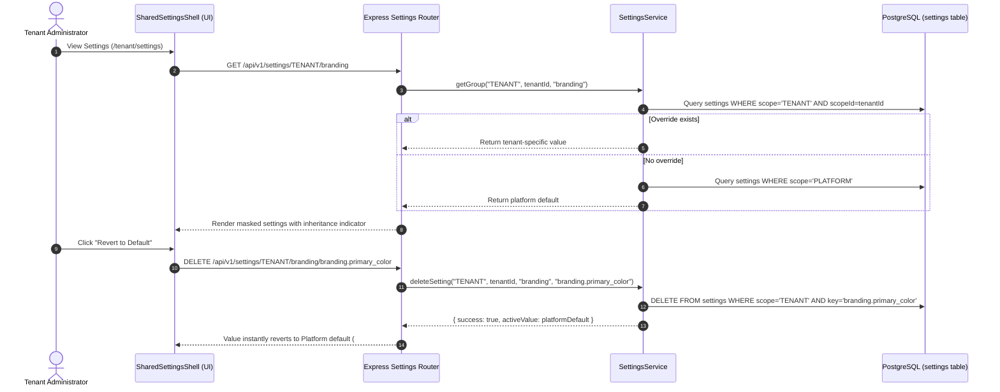

# MASTERHRMS — TENANT SETTINGS SPECIFICATION & VERIFICATION REPORT
## Company Workspace Isolation, White-Label Branding & Inheritance Resolver (`/tenant/settings`)

**Document Version:** 1.0.0  
**Status:** Verified & Operational  
**Route:** `/tenant/settings` (TanStack: `src/routes/_authenticated/tenant/settings.tsx`, Next.js CMS: `CMS/src/app/(workspace)/tenant/settings/page.tsx`)  
**Shared Component:** `SharedSettingsShell` (`src/components/settings/shared-settings-shell.tsx`, `CMS/src/components/settings/shared-settings-shell.tsx`)  
**Authorization Guard:** `TENANT` scope requires active tenant membership with administrative roles (`admin`, `tenant_admin`, `hr_admin`, `owner`, `settings_admin`).

---

### 1. Overview & Architectural Scope

The Tenant Workspace Settings experience (`/tenant/settings`) provides tenant-scoped configuration for companies operating within MASTERHRMS. Tenants can white-label the workspace, configure custom corporate mailers, choose storage backends, set security rules, and connect their own payment gateways.

Crucially, the tenant settings architecture implements deterministic inheritance from the Platform baseline:
- If a tenant has not configured a setting, the application inherits the Platform default.
- If a tenant saves a value, it creates an isolated record in `settings` with `scope = 'TENANT'` and `scopeId = tenantId`.
- If a tenant removes or resets an override, the system seamlessly reverts to the inherited Platform default.

---

### 2. Category & Configuration Matrix

`SharedSettingsShell` provides a unified, reactive interface structured into 7 core groups:

| Category | Settings Group | Configurable Parameters | Inheritance & Overrides |
| :--- | :--- | :--- | :--- |
| **General & Branding** | `branding`, `locale` | Company App Name, Support Email, Brand Accent Color, Light/Dark Logos, Favicon, Default Timezone, Date Format, Currency | Inherits Platform branding unless overridden by Tenant |
| **Email & Delivery** | `email` | Custom SMTP Host, Port, Encryption, Username, Password, Sender Name, Sender Email | Falls back to Platform default SMTP mailer |
| **OAuth & SSO** | `oauth` | Workspace-specific OAuth integrations & social login toggles | Inherits Platform-level OAuth providers |
| **Cloud Storage** | `storage` | Storage Provider (Local, S3, Cloudflare R2), S3 Bucket Name, Region, Endpoint, Access Keys | Inherits Platform global storage bucket |
| **Workspace Security** | `security` | Minimum password length, session idle timeouts, 2FA requirement, IP whitelist rules | Inherits Platform security baseline |
| **Payment Gateways** | `payments` | Razorpay Key ID/Secret, Stripe Publishable/Secret Keys, PayPal Client ID | Optional tenant billing isolation |
| **System Controls** | `system` | Workspace maintenance mode, tenant announcement banner, telemetry | Tenant-scoped announcements |

---

### 3. Inheritance & Override Lifecycle

---

### 4. Dual-Frontend Parity Verification

The Tenant Settings experience is implemented with 100% parity across both frontend frameworks:
- **TanStack Start:** `src/routes/_authenticated/tenant/settings.tsx` renders `SharedSettingsShell` with `scope="TENANT"`, utilizing TanStack Router search params and React Query state synchronization.
- **Next.js CMS:** `CMS/src/app/(workspace)/tenant/settings/page.tsx` renders `SharedSettingsShell` with `scope="TENANT"`, utilizing Next.js navigation hooks and server-rendered layout boundaries.

---

### 5. Multi-Tenant Security & Privilege Enforcement

1. **Tenant Isolation:** `resolveScopeAndId` guarantees that a tenant administrator can only query and mutate settings for their own `tenantId`. Cross-tenant writes are strictly blocked at the API layer.
2. **Role-Based Mutation Guard:** Write operations (`PUT`, `DELETE`, `POST /reset`) verify that `req.user` possesses an administrative role (`admin`, `tenant_admin`, `hr_admin`, `owner`, or `settings_admin`). Non-admin employees attempting to modify workspace settings are rejected with `403 Forbidden`.
3. **Secret Masking:** High-value tenant secrets (custom SMTP passwords, payment gateway secrets) are AES-256-GCM encrypted and masked in API payloads.
4. **Audit Logging:** Every tenant setting update records the modifying administrator's user ID, IP address, and old/new masked values in `setting_audits`.
