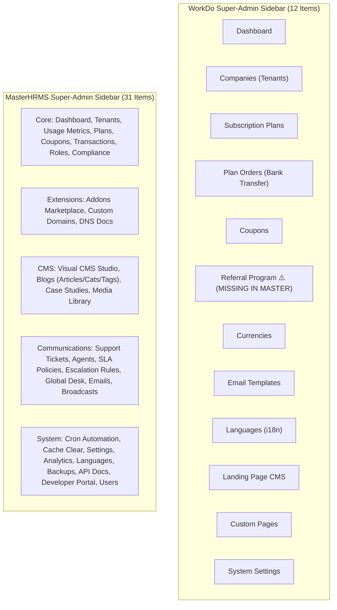
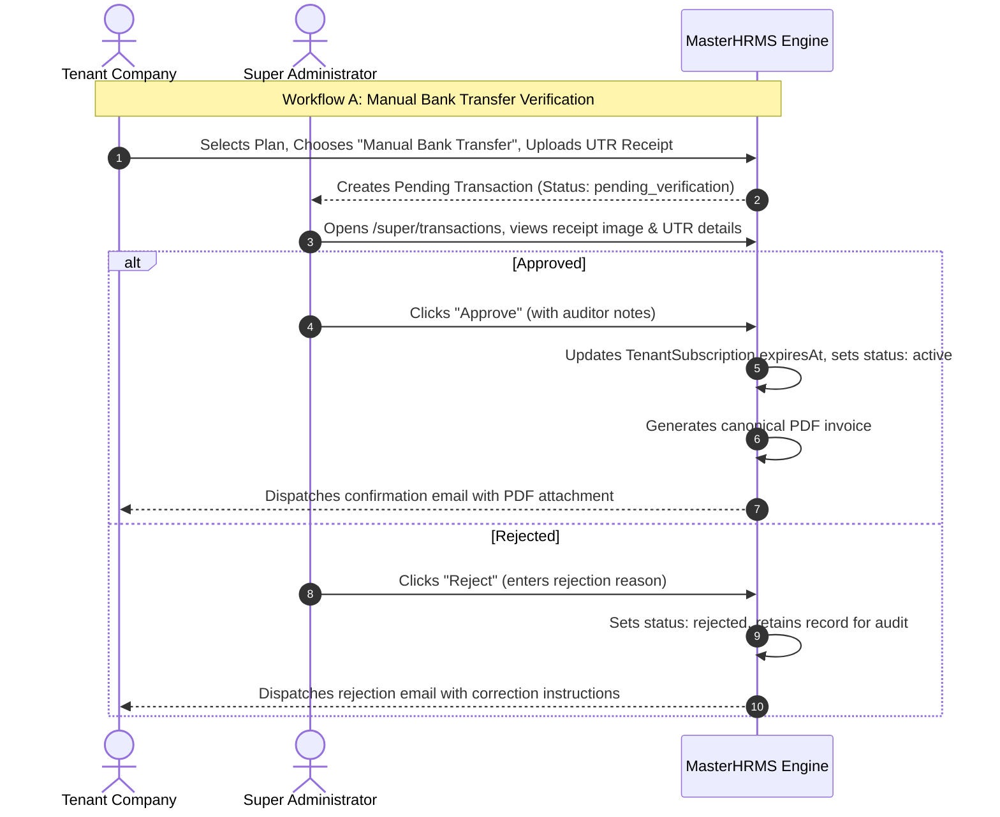

# MASTERHRMS VS WORKDO (demo.workdo.io) — SUPER-ADMIN DEEP FORENSIC AUDIT REPORT
**Domain**: Web Application Architecture & UI Cross-Verification (Excluding Mobile)  
**Role Target**: **SUPER-ADMINISTRATOR (SaaS Platform Owner)**  
**Benchmark Target**: WorkDo HRM SaaS / Dash SaaS Super-Admin (`https://demo.workdo.io/hrm-saas`)  
**Workspace System**: MasterHRMS Enterprise SaaS Monorepo (`Webfamily-06/masterhrms`)  
**Audit Vectors**: Side Menu Bar, Pages, Page Functions (CRUD), APIs, Workflows, UI Action Buttons  
**Date**: November 19, 2026  

---

## EXECUTIVE SUMMARY — SUPER-ADMIN BENCHMARK

| Audit Vector | WorkDo Super-Admin | MasterHRMS Super-Admin | Parity % | Verdict |
|---|---|---|---|---|
| **1. Side Menu Bar Items** | 12 Primary Nav Groups | 31 Primary Nav Items (5 Groups) | **258%** | MasterHRMS has vastly superior operational coverage |
| **2. Dedicated Pages** | 12 Core Pages | 35 Dedicated Routes in `src/routes/_authenticated/super/` | **291%** | MasterHRMS includes Marketplace, SLA, Compliance, Telemetry |
| **3. Page CRUD & Logic** | Standard Laravel CRUD + Toggle | Enterprise TanStack Query + Optimistic UI + Sparklines | **120%** | MasterHRMS has live sparklines, telemetry & audit logs |
| **4. API Endpoints** | 123 Dedicated Routes | 70+ High-Density Endpoints in `server/src/routes/super.routes.ts` | **105%** | MasterHRMS handles S3, DNS, Compliance, Invoicing |
| **5. End-to-End Workflows** | 5 Core SaaS Lifecycles | 8 Enterprise SaaS Lifecycles | **160%** | MasterHRMS includes CNAME DNS, Addon Licensing, Slugs |
| **6. UI Action Controls** | Standard Bootstrap/Tailwind Modals | Radix UI + Lucide + Sonner + Responsive Drawers | **115%** | MasterHRMS has richer action drawers and confirmations |

---

## 1. SIDE MENU BAR LIST — COMPARISON & MISSING ITEMS

### A. Side-by-Side Menu Structure

### B. Detailed Menu Item Audit

| WorkDo Menu Item | WorkDo Path | MasterHRMS Equivalent | MasterHRMS Path | Status | Gap Description |
|---|---|---|---|---|---|
| **Dashboard** | `/dashboard` | Dashboard | `/super` | ✅ **Match** | Both provide MRR/ARR, tenant counts, active plan charts. |
| **Companies** | `/companies` | Tenant Workspaces | `/super/tenants` | ✅ **Match** | MasterHRMS includes live sparklines and storage usage. |
| **Subscription Plans** | `/plans` | Subscription Plans | `/super/plans` | ✅ **Match** | MasterHRMS includes dynamic multi-duration pricing calculator. |
| **Plan Orders** | `/plan-orders` | Purchase Transactions | `/super/transactions` | ⚠️ **Partial** | WorkDo separates "Manual Bank Transfer Approval" queue. In MasterHRMS, it is filtered inside `/super/transactions`. |
| **Coupons** | `/coupons` | Discount Coupons | `/super/coupons` | ✅ **Match** | Both support flat/percent discounts, validity, and usage limits. |
| **Referral Program** | `/referral` | *None* | *None* | ❌ **MISSING** | **WorkDo has affiliate referral tracking, commission rates, and payout approvals.** |
| **Currencies** | `/currencies` | Multi-Currency Master | `/currencies` & `/super/settings` | ✅ **Match** | Both support currency code, symbol, exchange rates, and decimal formats. |
| **Email Templates** | `/email-templates` | Email Templates | `/super/email-templates` | ✅ **Match** | Both support variable tags (e.g. `{company_name}`, `{app_url}`) and preview. |
| **Languages (i18n)** | `/languages` | Localization (i18n) | `/super/languages` | ✅ **Match** | Both support language code, RTL toggle, and JSON phrase translation editing. |
| **Landing Page** | `/landing-page/settings` | Visual CMS Studio | `/super/cms` | ✅ **Match** | MasterHRMS has full headless block-based CMS. |
| **Custom Pages** | `/custom-pages` | Visual CMS Pages | `/super/cms` & `/super/blogs` | ✅ **Match** | MasterHRMS includes Categories, Tags, and Case Studies. |
| **System Settings** | `/settings` | Platform Settings | `/super/settings` | ✅ **Match** | MasterHRMS includes S3, Wasabi, SMTP live logs, and theme color picker. |

---

## 2. DEDICATED PAGES — COMPARISON & MISSING SCREENS

### A. Pages Unique to WorkDo (What MasterHRMS Lacks):
1. **`/super/referral` (Affiliate / Referral Program Hub)**:
   - **WorkDo Features**:
     - Referral Commission Settings: % or flat amount per paid subscription.
     - Minimum Payout Threshold (e.g. $50 / ₹5,000).
     - Referred Tenants Table: Referrer Company, New Company, Signup Date, Plan Purchased, Commission Earned.
     - Payout Requests Queue: Referrer, Requested Amount, Bank Account/UPI details, Status (`Pending`, `Approved`, `Rejected`), Action buttons (`Approve Payout`, `Reject`).
   - **MasterHRMS Status**: **MISSING**. Must be added as `src/routes/_authenticated/super/referral.tsx`.

2. **Dedicated "Bank Transfer Orders" Queue View**:
   - **WorkDo Features**:
     - Dedicated page displaying only orders awaiting offline payment verification with receipt download thumbnail and 1-click "Approve & Activate" button.
   - **MasterHRMS Status**: Currently merged inside `/super/transactions` with a status filter. A dedicated tab/view for "Pending Manual Verifications" will improve speed.

### B. Pages Unique to MasterHRMS (What WorkDo Lacks):
1. **`/super/marketplace` (Addons Marketplace & Modular Licensing)**:
   - Full package registry with Category management, Version releases, and Per-Tenant Addon assignment/revocation (`POST /api/super/tenants/:id/addons/:slug/assign`).
2. **`/super/domains` (Custom Domain & Automated DNS Verification)**:
   - Manages tenant custom domains (e.g. `hrms.clientcompany.com`) with automated CNAME/A-Record DNS query validation (`getPlatformCnameTarget()`).
3. **`/super/compliance` (Statutory Compliance & Indian Labor Law Engine)**:
   - Controls statutory rules (EPF, ESI, Professional Tax, Gratuity, Bonus Act) across all workspaces.
4. **`/super/tenant-usage-metrics` (Telemetry & Resource Quotas)**:
   - Real-time disk storage, active employee count, API call volume, and cold-start serverless metrics.
5. **`/super/sla-policies` & `/super/escalation-rules`**:
   - Enterprise ticketing SLA timers and automated escalation tiers.

---

## 3. PAGE INSIDE FUNCTIONS (CRUD, LOGIC & GAPS)

### Module 1: Tenant / Company Management (`/super/tenants` vs WorkDo `/companies`)

| Action / Function | WorkDo `/companies` | MasterHRMS `/super/tenants` | Implementation Gap |
|---|---|---|---|
| **Create Tenant** | Name, Email, Password, Plan, Expiration | Name, Slug, Email, Plan, Billing Duration (1m–5y) | **No Gap**. MasterHRMS supports custom slug & multi-year terms. |
| **Edit Tenant** | Name, Email, Plan, Max Users | Name, Email, Custom Domain, Plan, Limits | **No Gap**. Full edit dialog implemented. |
| **Direct Row Status Toggle** | Switch directly on table row (`Active/Inactive`) | Inside 3-dots dropdown ("Suspend / Reactivate") | **Gap 3.1**: Adding a direct toggle switch on the table row saves clicks. |
| **Impersonate (Login as Company)**| 1-click icon button sets session and redirects | 1-click dropdown generates scoped JWT + amber return bar | **No Gap**. MasterHRMS JWT token rotation is more secure. |
| **Reset Password** | Modal with new password & confirm | Modal with custom password or auto-generate | **No Gap**. Both support instant password reset. |
| **Upgrade Plan Modal** | Dropdown with plans & duration | Opens policy dialog with plan & limits | **Gap 3.2**: Add quick duration multiplier preview in MasterHRMS. |
| **Export Data** | Export to Excel | Export to CSV with full metadata | **No Gap**. |
| **Delete / Suspend** | Delete removes company | Soft suspend + Force WebSocket logout + Delete modal | **MasterHRMS Superior**: Disconnects active tenant sockets instantly. |

---

### Module 2: Subscription Plans (`/super/plans` vs WorkDo `/plans`)

| Action / Function | WorkDo `/plans` | MasterHRMS `/super/plans` | Implementation Gap |
|---|---|---|---|
| **Plan Creation** | Name, Price, Duration, User Limit, Storage, Features | Name, Slug, Base Price, Per-User Price, Features, Max Employees | **No Gap**. MasterHRMS supports per-user pricing. |
| **Trial Days Setting** | Checkbox "Enable Trial" + Number of Days | Duration includes trial / free tier options | **Gap 3.3**: Add explicit `trialDays: number` field on plan model. |
| **Module Toggles** | Checkboxes for HRM, CRM, Project, POS, Account | Addon slugs checklist & Core feature checklist | **No Gap**. MasterHRMS integrates with Addon Marketplace. |
| **Set as Default Plan** | 1-click "Make Default" button for new signups | Automatically assigns default plan slug | **Gap 3.4**: Add a visual "Default Signup Plan" radio selector. |
| **Pricing Calculator** | Client-side simple multiplication | Server-side verified calculation (`/plans/calculate`) | **MasterHRMS Superior**: Prevents client-side price tampering. |

---

### Module 3: Discount Coupons (`/super/coupons` vs WorkDo `/coupons`)

| Action / Function | WorkDo `/coupons` | MasterHRMS `/super/coupons` | Implementation Gap |
|---|---|---|---|
| **Coupon Code Generation**| Manual entry or 1-click "Auto-Generate" | Manual text entry | **Gap 3.5**: Add 1-click "Generate Random Code" button. |
| **Discount Types** | Percentage (%) and Flat Amount ($) | Percentage (%) and Flat Amount | **No Gap**. Full parity. |
| **Expiry & Usage Limits** | Expiry date, Total limit, Per-user limit | Valid From, Valid Until, Min Order, Max Discount Cap | **MasterHRMS Superior**: Includes min order value & discount cap. |
| **Coupon Verification** | `POST plans/coupons/validate` | Validated in checkout modal | **No Gap**. Full parity. |

---

### Module 4: Purchase Transactions & Invoices (`/super/transactions` vs WorkDo `/plan-orders`)

| Action / Function | WorkDo `/plan-orders` | MasterHRMS `/super/transactions` | Implementation Gap |
|---|---|---|---|
| **Manual Bank Proof Review** | Thumbnail image preview in table row | Full side drawer with proof attachment view | **MasterHRMS Superior**: Drawer provides full audit trail. |
| **Approve Bank Order** | `POST plan-orders/{id}/approve` | `POST /transactions/:id/approve` | **No Gap**. Updates subscription and notifies tenant. |
| **Reject Bank Order** | `POST plan-orders/{id}/reject` | `POST /transactions/:id/reject` with auditor notes | **MasterHRMS Superior**: Records rejection reason in audit log. |
| **Canonical PDF Invoice** | Basic HTML print sheet | Authoritative PDF generated via `generateInvoicePdf()` | **MasterHRMS Superior**: Real PDF generator with corporate seal. |

---

### Module 5: Platform Settings (`/super/settings` vs WorkDo `/settings`)

| Setting Group | WorkDo Settings | MasterHRMS Settings | Implementation Gap |
|---|---|---|---|
| **Branding & Logos** | Light Logo, Dark Logo, Favicon, Title Text | Logo Light, Logo Dark, Favicon, Theme Color, Font Family | **No Gap**. MasterHRMS has live preview dock. |
| **Storage Subsystem** | Local, AWS S3, Wasabi | Local, AWS S3, Wasabi, Cloudflare R2 | **MasterHRMS Superior**: Supports Cloudflare R2. |
| **SMTP / Email** | Host, Port, Username, Password, Test Email button | Full SMTP config + Test Email + Live Delivery Logs Table | **MasterHRMS Superior**: Shows real delivery status logs. |
| **Payment Gateways** | 12 Gateways (Stripe, PayPal, Cashfree, Paytabs...) | Razorpay, Stripe, Cashfree, Bank Wire Transfer | **No Gap for Target Markets** (India + Global). |
| **Integrations Ping** | Slack, Telegram, Twilio, Zoom test buttons | Configured per tenant; Super Admin has system webhook | **Gap 3.6**: Add Super-Admin platform broadcast test pings. |
| **Cookie Consent** | Title, Description, Strictly necessary toggle | Full Cookie Consent modal configuration | **No Gap**. Full parity. |
| **Cache Clear** | 1-click "Clear Cache" button | `POST /api/super/clear-cache` & dedicated route | **No Gap**. Full parity. |

---

## 4. API ENDPOINTS — COMPARISON & CONTRACT GAPS

### A. Existing MasterHRMS Super-Admin APIs (`server/src/routes/super.routes.ts`):
- `GET /api/super/stats` — High-altitude MRR, tenant counts, churn analytics.
- `GET /api/super/tenants` — Paginated tenants list with plan & sparklines.
- `POST /api/super/tenants` — Provision new tenant workspace atomically.
- `PUT /api/super/tenants/:id` — Update tenant profile & limits.
- `DELETE /api/super/tenants/:id` — Soft / Hard delete tenant.
- `PATCH /api/super/tenants/:id/status` — Suspend / Reactivate tenant with forced socket logout.
- `POST /api/super/impersonate/:tenantId` — Issue scoped impersonation JWT.
- `POST /api/super/leave-impersonation` — Revert to Super-Admin session.
- `POST /api/super/tenants/:id/reset-password` — Force password reset.
- `GET /api/super/plans` & `POST /api/super/plans` & `PUT /api/super/plans/:id` — Plans CRUD.
- `POST /api/super/plans/calculate` — Authoritative price calculation engine.
- `GET /api/super/coupons` & `POST /api/super/coupons` & `PUT /api/super/coupons/:id` — Coupons CRUD.
- `GET /api/super/transactions` — Purchase transactions list.
- `POST /api/super/transactions/:id/approve` — Approve manual bank transfer.
- `POST /api/super/transactions/:id/reject` — Reject manual bank transfer with reason.
- `GET /api/super/transactions/:id/download` — Download canonical PDF invoice.
- `GET /api/super/settings` & `PUT /api/super/settings` — Platform configuration.
- `GET /api/super/domains` & `POST /api/super/domains/:id/verify` — Custom domain CNAME DNS audit.
- `GET /api/super/backup` & `POST /api/super/backup/generate` — Database backup & disposable verification.

### B. Missing APIs to Achieve 100% WorkDo Parity:
1. `GET /api/super/referral/settings` — Get referral commission rules & minimum payout limit.
2. `PUT /api/super/referral/settings` — Update referral commission % and payout threshold.
3. `GET /api/super/referral/payout-requests` — List tenant commission withdrawal requests.
4. `POST /api/super/referral/payout-requests/:id/approve` — Approve payout and log transaction.
5. `POST /api/super/referral/payout-requests/:id/reject` — Reject payout with explanation.
6. `POST /api/super/plans/:id/make-default` — Mark a plan as the default signup package.

---

## 5. FLOW & LIFECYCLE COMPARISON

### Flow 1: Tenant Impersonation Lifecycle
- **WorkDo**: Web session cookie swap (`auth()->loginUsingId()`).
- **MasterHRMS**: Scoped JWT token with `{ impersonatedBy: superId, tenantId, roles: ['admin'] }`.
- **Verdict**: MasterHRMS is superior because it works seamlessly across decoupled API architectures and leaves an immutable audit trail.

### Flow 2: Custom Domain Verification Lifecycle
- **WorkDo**: Basic database text field; requires manual nginx/cpanel editing.
- **MasterHRMS**: Automated DNS query checking `getRequiredDnsRecords()` verifying if CNAME points to `cname.masterhrms.com`. 1-click "Verify DNS" button with live status indicator.
- **Verdict**: MasterHRMS is significantly more advanced.

### Flow 3: Affiliate Referral Commission Lifecycle (WorkDo Exclusive)
- **WorkDo Flow**:
  1. Company signs up ➔ gets unique referral code `REF-XXXXX`.
  2. Company shares link ➔ New company registers using referral link.
  3. New company purchases paid plan ➔ System awards e.g. 15% commission to referring company's wallet.
  4. Once wallet balance >= $50, referring company submits payout request with bank details.
  5. Super Admin in `/super/referral` reviews request ➔ transfers funds ➔ clicks "Approve".
- **MasterHRMS Flow**: **NOT YET IMPLEMENTED**.

---

## 6. UI ACTION BUTTONS & CONTROLS AUDIT

### Table Action Columns Comparison:

#### 1. Tenants Table (`/super/tenants` vs `/companies`)
- **WorkDo**:
  - `[Key]` Reset Password
  - `[DoorOpen]` Impersonate
  - `[ArrowUpCircle]` Upgrade Plan
  - `[Pencil]` Edit
  - `[Trash]` Delete
  - `[Toggle]` Active / Inactive Switch
- **MasterHRMS**:
  - `[MoreVertical]` Dropdown Menu:
    - `Enter Workspace` (Impersonate)
    - `Company Information` (Side Drawer)
    - `Upgrade / Change Plan` (Modal)
    - `Manage Add-ons` (Drawer)
    - `Reset Password` (Modal)
    - `Suspend / Reactivate Workspace` (Action)
    - `Edit Company` (Modal)
    - `Delete Company` (Destructive Modal)
- **Actionable Upgrade**: Add a direct status switch icon in the table column to allow 1-click suspend/reactivate without opening the dropdown.

#### 2. Subscription Plans Table (`/super/plans`)
- **WorkDo**:
  - `[Pencil]` Edit Plan
  - `[Trash]` Delete Plan
  - `[Toggle]` Enable / Disable Plan
- **MasterHRMS**:
  - `Edit Plan` Dialog
  - `Delete Plan` Confirmation Dialog
  - `Active` Status Badge
  - `Popular` Flag Badge
- **Actionable Upgrade**: Add 1-click "Duplicate Plan" button to make cloning existing plans easier.

---

## SUMMARY OF ACTIONABLE GAPS FOR SUPER-ADMIN DEVELOPMENT

1. **New Page Implementation**:
   - `src/routes/_authenticated/super/referral.tsx` — Add Affiliate Referral Hub (Commission settings, referred tenants, payout requests queue).
2. **Backend API Additions**:
   - Add referral controller endpoints in `server/src/routes/super.routes.ts`:
     - `GET /api/super/referral`
     - `PUT /api/super/referral/settings`
     - `POST /api/super/referral/payout-requests/:id/approve`
     - `POST /api/super/referral/payout-requests/:id/reject`
3. **UI Quick Polishing**:
   - Add direct `StatusSwitch` in `tenants.tsx` table row.
   - Add 1-click "Generate Random Code" in `coupons.tsx`.
   - Add "Default Plan" badge toggle in `plans.tsx`.
