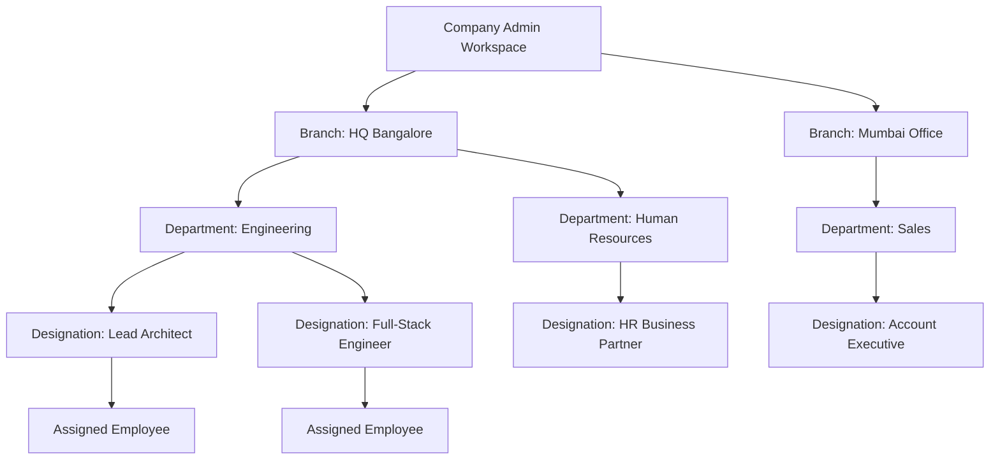

# 03. Organisation Structure Implementation Report

This document details the audit and verification of Organisation Structure management for the Company Admin role, covering Branches, Departments, and Designations.

---

## 1. Hierarchy & Relationship Architecture



---

## 2. Functional Capabilities

### 2.1 Branch Management
- **Frontend Route**: `/hr/organization/branches`
- **Backend API**: `/api/organization/branches`, `/api/v1/organization/branches`
- **Controller Logic**: `server/src/routes/organization.routes.ts`
- **Features Verified**:
  - Name, Code, Address, Phone, Email, Status (`active` / `inactive`).
  - Search by Name, Code, Phone, or Email.
  - Active/Inactive status toggle.
  - Export to Excel and PDF via `GlobalListActionToolbar`.
  - **Dependency Protection**: The server enforces a pre-deletion check:
    ```typescript
    dependencyCheck: async (db, id, tenantId) => {
      const [empCount, deptCount] = await Promise.all([
        db.employee.count({ where: { branchId: id, tenantId } }),
        db.department.count({ where: { branchId: id, tenantId } }),
      ]);
      if (empCount > 0 || deptCount > 0) {
        return {
          canDelete: false,
          message: `Cannot delete Branch because ${empCount} employee(s) and ${deptCount} department(s) are assigned to it. Please deactivate/archive it instead.`,
        };
      }
      return { canDelete: true };
    }
    ```

---

### 2.2 Department Management
- **Frontend Route**: `/hr/organization/departments`
- **Backend API**: `/api/organization/departments`, `/api/v1/organization/departments`
- **Features Verified**:
  - Name, Description, Branch assignment dropdown.
  - Filter table by Branch and by Status.
  - **Dependency Protection**: Prevents deletion if employees (`db.employee.count`) or designations (`db.designation.count`) are currently assigned.

---

### 2.3 Designation Management
- **Frontend Route**: `/hr/organization/designations`
- **Backend API**: `/api/organization/designations`, `/api/v1/organization/designations`
- **Features Verified**:
  - Name, Description, Department assignment dropdown.
  - Filter table by Department and by Status.
  - **Dependency Protection**: Prevents deletion if any active employees hold this designation.

---

## 3. Sidebar Navigation Integration

To achieve 100% WorkDo parity, direct links to Branches, Departments, and Designations have been integrated into `TENANT_NAVIGATION_REGISTRY` in `src/nav/registry.ts`, allowing Company Admins to manage their organization without navigating away from the workspace context.
